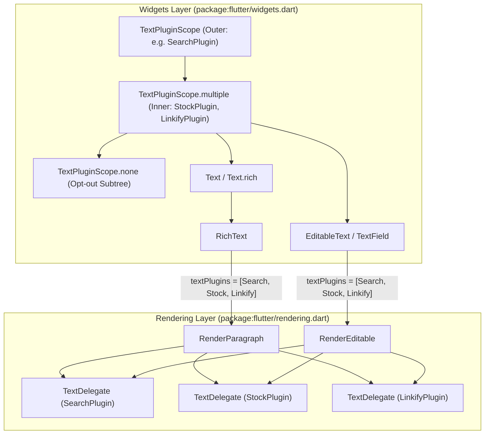
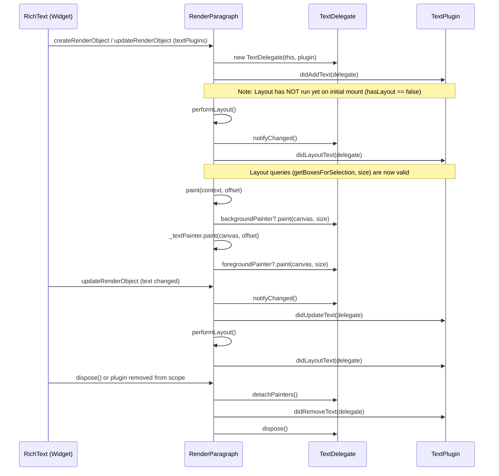
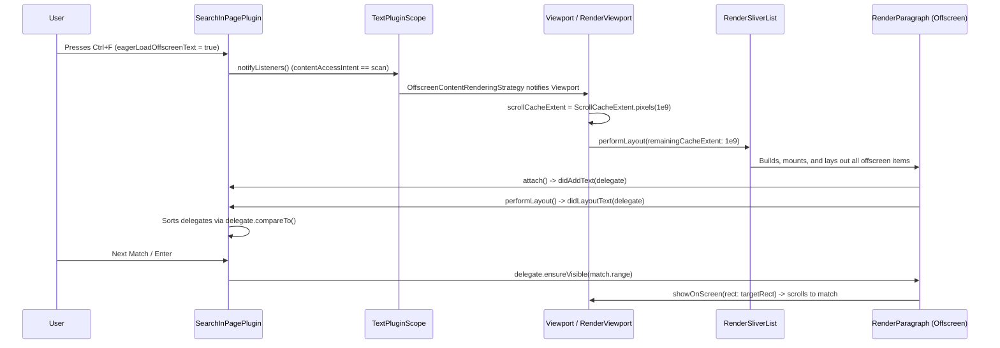

# RFC 170.0000: Composable Text Plugins in Flutter

## Overview

This RFC proposes a composable text plugin system in `package:flutter/rendering.dart` and `package:flutter/widgets.dart` centered on `TextPluginScope`, `TextPlugin`, and `TextDelegate`.

By attaching plugins through an `InheritedWidget` (`TextPluginScope`) directly to `RenderParagraph` and `RenderEditable`, applications and third-party packages can inspect rendered text, paint background and foreground decorations, handle pointer gestures, scroll character ranges into view, and request offscreen sliver rendering (`OffscreenContentRenderingStrategy`) across standard `Text`, `RichText`, and `EditableText` (`TextField`) subtrees without modifying existing widget code.

## Table of contents

- [Overview](#overview)
- [1. Problem statement and motivation](#1-problem-statement-and-motivation)
  - [1.1 Why custom `Text` subclasses fail](#11-why-custom-text-subclasses-fail)
  - [1.2 Historical context, prior art, and acknowledgments](#12-historical-context-prior-art-and-acknowledgments)
- [2. Design goals and package boundaries](#2-design-goals-and-package-boundaries)
  - [2.1 Goals and non-goals](#21-goals-and-non-goals)
  - [2.2 Built-in framework plugins versus community packages](#22-built-in-framework-plugins-versus-community-packages)
- [3. Architecture and component design](#3-architecture-and-component-design)
  - [3.1 Layering and file organization](#31-layering-and-file-organization)
  - [3.2 `TextPlugin` lifecycle contract](#32-textplugin-lifecycle-contract)
  - [3.3 `TextDelegate` proxy for text render objects](#33-textdelegate-proxy-for-text-render-objects)
  - [3.4 `TextPluginScope` and hierarchical merging](#34-textpluginscope-and-hierarchical-merging)
  - [3.5 `RenderParagraph` and `RenderEditable` painting and Z-order pipeline](#35-renderparagraph-and-rendereditable-painting-and-z-order-pipeline)
  - [3.6 First-party `SearchInPagePlugin` implementation](#36-first-party-searchinpageplugin-implementation)
- [4. Community package use cases](#4-community-package-use-cases)
  - [4.1 Use cases implemented in the demo app](#41-use-cases-implemented-in-the-demo-app)
  - [4.2 Additional community package ideas](#42-additional-community-package-ideas)
- [5. Feature deep dives](#5-feature-deep-dives)
  - [5.1 Scrolling, document ordering, and offscreen content rendering](#51-scrolling-document-ordering-and-offscreen-content-rendering)
  - [5.2 Should selection highlighting be a `TextPlugin`?](#52-should-selection-highlighting-be-a-textplugin)
- [6. Future directions and forward compatibility](#6-future-directions-and-forward-compatibility)
  - [6.1 Non-text widgets with searchable labels](#61-non-text-widgets-with-searchable-labels)
  - [6.2 Native text fields and platform views](#62-native-text-fields-and-platform-views)
- [7. Corner cases and architectural analysis](#7-corner-cases-and-architectural-analysis)
  - [7.1 `ChangeNotifier` and `setState` re-entrancy during build, layout, and dispose](#71-changenotifier-and-setstate-re-entrancy-during-build-layout-and-dispose)
  - [7.2 Calling layout queries in `didAddText` or `didUpdateText`](#72-calling-layout-queries-in-didaddtext-or-didupdatetext)
  - [7.3 Embedded `WidgetSpan`s and UTF-16 offset alignment](#73-embedded-widgetspans-and-utf-16-offset-alignment)
  - [7.4 Text truncation and overflow clipping](#74-text-truncation-and-overflow-clipping)
  - [7.5 Multi-line wrapping, bidirectional text, and surrogate pairs](#75-multi-line-wrapping-bidirectional-text-and-surrogate-pairs)
  - [7.6 Plugin list reconciliation and stateful delegate preservation](#76-plugin-list-reconciliation-and-stateful-delegate-preservation)
  - [7.7 Duplicate plugin instances across nested scopes](#77-duplicate-plugin-instances-across-nested-scopes)
  - [7.8 Pointer event routing and scroll gesture slop](#78-pointer-event-routing-and-scroll-gesture-slop)
  - [7.9 `SelectionArea` and `SelectableRegion` coexistence](#79-selectionarea-and-selectableregion-coexistence)
  - [7.10 Unintended capture of UI chrome and `TextPluginScope.none`](#710-unintended-capture-of-ui-chrome-and-textpluginscopenone)
  - [7.11 Lazy slivers and offscreen viewport recycling](#711-lazy-slivers-and-offscreen-viewport-recycling)
  - [7.12 Canvas state corruption in plugin painters](#712-canvas-state-corruption-in-plugin-painters)

---

## 1. Problem statement and motivation

Flutter applications often need cross-cutting text features that inspect, decorate, or attach interactions to text across a page or widget subtree.

1. Find-in-page search locates all matches across separate [Text](https://github.com/flutter/flutter/blob/master/packages/flutter/lib/src/widgets/text.dart) and [RichText](https://github.com/flutter/flutter/blob/master/packages/flutter/lib/src/widgets/basic.dart) widgets. It also paints active and passive highlights and scrolls the active match into view.

2. Entity and pattern decoration highlights stock tickers (`GOOG`, `AAPL`), hashtags, mentions, or citations without mutating the source string. Callers do not need to pre-tokenize `TextSpan` trees.

3. Automatic linkification detects URLs (`https://...`, `www....`) in plain `Text` widgets, paints link underlines, and handles tap gestures.

4. Live content and SEO extraction indexes visible text across a subtree to generate Schema.org JSON-LD metadata, reading-time analytics, or crawler snapshots.

### 1.1 Why custom `Text` subclasses fail

Historically, package authors solved these problems by creating custom replacement widgets such as `LinkifyText`, `SearchableText`, and `ParsedText`. That approach fails in production apps for three reasons.

First, custom widgets do not compose. A developer cannot combine `LinkifyText` from one package with `StockTickerText` from another package on the same paragraph.

Second, replacing widgets requires invasive refactoring. Developers must replace every `Text` widget in the app, including those inside third-party packages or Material and Cupertino components (`ListTile`, `Card`, `DataTable`).

Third, individual text widgets lack document-level coordination unless paired with custom ancestor state management.

> [!IMPORTANT]
> Cross-cutting text features belong in an ambient, composable plugin pipeline attached via `InheritedWidget` (`TextPluginScope`). [RenderParagraph](https://github.com/flutter/flutter/blob/master/packages/flutter/lib/src/rendering/paragraph.dart) and [RenderEditable](https://github.com/flutter/flutter/blob/master/packages/flutter/lib/src/rendering/editable.dart) execute this pipeline directly, leaving standard `Text`, `RichText`, and `EditableText` widgets unchanged.

### 1.2 Historical context, prior art, and acknowledgments

This design builds on years of prototyping and architectural discussions across the Flutter team. We want to thank **Michael Goderbauer (`@goderbauer`)**, **Renzo Olivares (`@Renzo-Olivares`)**, and **Kevin Moore (`@kevmoo`)** for their work in this area.

#### 1. Michael Goderbauer's original Text Plugins proposal (November 2023)

In late 2023, **Michael Goderbauer** authored the original [Text Plugins One-Pager](https://docs.google.com/document/d/1doToFSPGJO29_FJ-VE7mD6XiNgF-s2xVaIi-UC495m8/edit?tab=t.0) after building an early [Find-in-Page web demo](https://goderbauer.github.io/demos/find-in-page/) with a custom `SearchableText` widget.

Goderbauer recognized that `SearchableText` could not compose with SEO text extraction, auto-linkification, or stock ticker highlighting. It also could not reach `Text` widgets inside third-party packages. He proposed the three core abstractions used in this design: `TextPluginScope`, `TextPlugin` (`didAddText`, `didUpdateText`, `didRemoveText`), and `TextDelegate` (`text`, `foregroundPainter`, `backgroundPainter`, `getBoxesForSelection`, `handleEvent`).

#### 2. Renzo Olivares's `Ctrl+F` and `TextPluginScope` prototype

**Renzo Olivares** turned the one-pager into a working framework prototype on his [text-plugins-alt](https://github.com/Renzo-Olivares/flutter/tree/text-plugins-alt) branch. His branch demonstrated end-to-end `Ctrl+F` (`SearchInPagePlugin`) alongside selection highlighting (`_SelectionHighlightTextPlugin`).

Renzo's prototype solved several rendering-layer problems that we carry forward here. He made `TextDelegate` implement `Listenable` (notifying plugins after `RenderParagraph.performLayout`) and `Comparable<TextDelegate>` (sorting delegates in visual document order via a Lowest Common Ancestor walk of the `RenderObject` tree).

He also exposed `placeholderRanges` (`includePlaceholders: false`) so regex and substring queries do not match across `WidgetSpan` `0xFFFC` boundaries, and added `ensureVisible()` to scroll active matches into view. Finally, he prototyped `_SelectionHighlightTextPlugin` inside `SelectableRegion` to test whether selection highlighting could use the `TextPlugin` paint pipeline.

#### 3. Kevin Moore's Find-in-Page experiment

**Kevin Moore** built an end-to-end `Ctrl+F` and `Cmd+F` prototype ([PR #193186](https://github.com/flutter/flutter/pull/193186), [RFC #25](https://github.com/flutter/rfc/pull/25)) that implemented Find-in-Page on top of `SelectableRegion`, `SelectionRegistrar`, and `RenderParagraph`'s internal `_SelectableFragment`.

This experiment validated developer demand and surfaced key edge cases, including offscreen lazy sliver discovery and `Semantics` label search. It also showed why `SelectableRegion` could not be the underlying foundation.

Adding search-specific properties (`searchHighlightColor`, `setSearchHighlights`) directly onto `Text`, `RenderParagraph`, and `Selectable` solved `Ctrl+F` in isolation. However, it could not generalize to linkification, spellcheck, or custom highlights, and could not support `EditableText` (`TextField`), which does not register with an ancestor `SelectableRegion`.

In addition, `_SelectableFragment` requires a `SelectionRegistrar`. Searching non-selectable pages required wrapping the subtree in a hidden "find-only" `SelectableRegion` (`_enableSelection: false`). That wrapper still added extra `SelectionContainer` elements per `Text` widget and required special logic to suppress selection cursors, focus changes, and gesture recognizers. These findings motivated unifying our work around `TextPluginScope`.

---

## 2. Design goals and package boundaries

### 2.1 Goals and non-goals

#### Goals

- Existing `Text('...')`, `Text.rich(...)`, and `EditableText` (`TextField`) widgets automatically participate when placed inside a `TextPluginScope`.

- Static text (`RenderParagraph`) and editable text (`RenderEditable`) both support plugins and update decorations live during text editing.

- Multiple plugins can inspect, paint behind or in front of, and handle pointer events on the same `RenderParagraph` or `RenderEditable` in root-to-leaf installation order.

- Plugins interact with a capability-scoped `TextDelegate` wrapping `RenderParagraph` or `RenderEditable`, rather than mutating RenderObject internals directly.

- Subtrees such as toolbars, search inputs, or decorative chrome can opt out of ancestor plugins via `TextPluginScope.none`.

- Rendering primitives live in `package:flutter/rendering.dart` (`packages/flutter/lib/src/rendering/text_plugin.dart`), and widget scoping lives in `package:flutter/widgets.dart` (`packages/flutter/lib/src/widgets/text_plugin.dart`). Neither layer depends on Material or Cupertino.

- While the initial implementation targets `RenderParagraph` and `RenderEditable`, `TextDelegate` and `TextPluginScope` are shaped so non-text widgets and native platform-view text fields can be integrated later without breaking existing plugins (see [Section 6](#6-future-directions-and-forward-compatibility)).

#### Non-goals (current scope)

- We do not aim to build every plugin in the framework. We define the extensible architecture and provide core plugins (`SearchInPagePlugin` and `_SelectionHighlightTextPlugin`), while community packages provide domain-specific plugins.

- Non-text widgets (`Image`, `Icon`, custom `RenderBox` subclasses) are out of the initial scope. Section [6.1](#61-non-text-widgets-with-searchable-labels) describes how whole-box delegation can support them in the future.

- Text rendered by native OS or browser DOM views inside a Platform View (`HtmlElementView`, `UITextView`, `EditText`) is out of the initial scope. Section [6.2](#62-native-text-fields-and-platform-views) shows how `TextDelegate` can connect to the W3C `Range` and CSS Custom Highlight APIs (`CSS.highlights`) in a future phase.

- `TextPlugin` is not a security or PII redaction mechanism. Drawing an opaque bar in `foregroundPainter` only hides glyphs on screen, while the plain text remains accessible to `Ctrl+F`, `SelectionArea` copy-paste, the `Semantics` tree, and DevTools. Apps must scrub sensitive strings at the data layer before passing them to `Text` widgets.

- Plugins do not mutate the input `InlineSpan` tree or alter text layout metrics. They decorate and observe laid-out text via [CustomPainter](https://github.com/flutter/flutter/blob/master/packages/flutter/lib/src/rendering/custom_paint.dart) hooks (`backgroundPainter` and `foregroundPainter`).

---

### 2.2 Built-in framework plugins versus community packages

We separate what belongs in the core Flutter framework (`package:flutter`) from what belongs in community packages on `pub.dev`.

#### 2.2.1 Framework-builtin plugins (`package:flutter`)

Only plugins that implement platform-standard features with zero external dependencies belong inside `package:flutter`:

1. `SearchInPagePlugin` provides desktop and web `Ctrl+F` search highlighting, sequential match navigation, and viewport offscreen rendering management.

2. `_SelectionHighlightTextPlugin` is a candidate internal plugin for migrating `SelectionArea` and `SelectableRegion` selection highlighting onto the `TextPlugin` pipeline (evaluated in [Section 5.2](#52-should-selection-highlighting-be-a-textplugin)).

#### 2.2.2 Community package plugins (`pub.dev`)

Domain-specific or third-party-dependent features belong in standalone community packages:

1. `SpellCheckPlugin` (`package:flutter_spellcheck`) renders IME spellcheck squiggly underlines and grammar suggestions.

2. `LinkifyPlugin` (`package:flutter_linkify_plugin`) parses URLs with regular expressions, applies custom link styles, and launches URLs via `url_launcher`.

3. `StockTickerPlugin` decorates financial symbols (`GOOG`, `AAPL`), detects crypto addresses, and formats currency conversions.

4. `SpoilerMaskPlugin` (`package:flutter_spoiler_mask`) renders interactive tap-to-reveal spoiler bars (`||...||`) and flashcard cloze-deletion study masks (`{{...}}`).

5. `ReadAloudPlugin` (`package:flutter_read_aloud`) synchronizes word-by-word TTS karaoke highlights with `flutter_tts` or cloud speech APIs.

6. `SeoExtractorPlugin` (`package:flutter_seo_text`) extracts plain text for Schema.org JSON-LD web crawlers.

7. `AiGroundingPlugin` renders LLM citation grounding popups and interactive source attribution spans.

#### 2.2.3 Principles for a general-purpose API

The `TextPlugin` API follows four design rules so it can support both core selection and community packages:

1. `TextDelegate` exposes low-level geometry and painting primitives (`getBoxesForSelection`, `getPositionForOffset`, `getWordBoundary`, `getLineBoundary`, `getOffsetForCaret`, `backgroundPainter`, and `foregroundPainter`) rather than feature-specific methods.

2. `TextPluginScope` stacks arbitrary numbers of plugins. `TextPluginScope.exclude(types: {...})` lets app developers filter out specific plugins on UI chrome without disabling core plugins like `_SelectionHighlightTextPlugin`.

3. `ContentAccessIntent` (`highlight` versus `scan`) on `TextPlugin` and the standalone `OffscreenContentRenderingStrategy` widget (`OffscreenRenderingPolicy.lazy` versus `OffscreenRenderingPolicy.eager`) let document-wide plugins request eager offscreen sliver rendering in `ListView.builder` viewports. This keeps `Viewport` decoupled from `TextPluginScope`.

4. `TextDelegate` provides a path to register `TextPluginSemanticAnnotation`s so visually decorated text (links, tickers, spoiler masks) maps to focusable `SemanticsNode`s for screen readers.

---

## 3. Architecture and component design

At the widget level, developers wrap any subtree in `TextPluginScope`:

```dart
TextPluginScope.multiple(
  plugins: [
    SearchInPagePlugin(query: 'Flutter'),
    SpoilerMaskPlugin(), // e.g., tap-to-reveal ||spoiler|| & {{cloze}} masks
  ],
  child: Column(
    children: [
      // Standard widgets automatically participate in the plugin pipeline!
      Text('Welcome to Flutter! ||Plot twist||'), // Automatically highlighted & masked
      TextField(),                                // Text input also automatically inspected

      // Developers can easily firewall UI chrome from being affected:
      TextPluginScope.none(
        child: Text('Search query: Flutter'), // Safely isolated from plugins
      ),
    ],
  ),
)
```



### 3.1 Layering and file organization

| Layer | File | Public Symbols | Responsibility |
| :--- | :--- | :--- | :--- |
| **Rendering** | `packages/flutter/lib/src/rendering/text_plugin.dart` | `ContentAccessIntent`, `TextPlugin`, `TextDelegate` | Defines the plugin lifecycle interface, `ContentAccessIntent`, and the delegate handle wrapping `RenderParagraph` or `RenderEditable`. |
| **Rendering** | [packages/flutter/lib/src/rendering/paragraph.dart](https://github.com/flutter/flutter/blob/master/packages/flutter/lib/src/rendering/paragraph.dart) | `RenderParagraph.textPlugins` | Reconciles delegates, dispatches lifecycle and pointer events, and executes painters for static text. |
| **Rendering** | [packages/flutter/lib/src/rendering/editable.dart](https://github.com/flutter/flutter/blob/master/packages/flutter/lib/src/rendering/editable.dart) | `RenderEditable.textPlugins` | Reconciles delegates, dispatches typing, layout, and pointer events, and executes painters for editable text fields. |
| **Widgets** | `packages/flutter/lib/src/widgets/text_plugin.dart` | `TextPluginScope` | Scopes and merges `TextPlugin` lists down the widget tree and configures `OffscreenContentRenderingStrategy` when any active plugin requests `ContentAccessIntent.scan`. |
| **Widgets** | [packages/flutter/lib/src/widgets/viewport.dart](https://github.com/flutter/flutter/blob/master/packages/flutter/lib/src/widgets/viewport.dart) | `OffscreenRenderingPolicy`, `OffscreenContentRenderingStrategy` | Inherited strategy controlling whether descendant `Viewport` and `ShrinkWrappingViewport` widgets render offscreen sliver content lazily or eagerly. |
| **Widgets** | [packages/flutter/lib/src/widgets/basic.dart](https://github.com/flutter/flutter/blob/master/packages/flutter/lib/src/widgets/basic.dart) | `RichText.textPlugins` | Resolves `textPlugins ?? TextPluginScope.maybeOf(context)` and forwards to `RenderParagraph`. |
| **Widgets** | [packages/flutter/lib/src/widgets/editable_text.dart](https://github.com/flutter/flutter/blob/master/packages/flutter/lib/src/widgets/editable_text.dart) | `EditableText.textPlugins` | Resolves `textPlugins ?? TextPluginScope.maybeOf(context)` and forwards to `_Editable` and `RenderEditable`. |

### 3.2 `TextPlugin` lifecycle contract

Defined in `packages/flutter/lib/src/rendering/text_plugin.dart`, `TextPlugin` exposes a declarative `contentAccessIntent` property and five lifecycle hooks:

```dart
enum ContentAccessIntent { highlight, scan }

abstract class TextPlugin {
  const TextPlugin();

  ContentAccessIntent get contentAccessIntent => ContentAccessIntent.highlight;

  void didAddText(TextDelegate delegate) {}
  void didUpdateText(TextDelegate delegate) {}
  void didLayoutText(TextDelegate delegate) {}
  void didRemoveText(TextDelegate delegate) {}
  void handlePointerEvent(TextDelegate delegate, PointerEvent event) {}
}
```



### 3.3 `TextDelegate` proxy for text render objects

Passing `RenderParagraph` directly to plugins would allow plugins to corrupt layout state, mutate constraints, or overwrite each other's painters. Instead, each `(RenderParagraph, TextPlugin)` pair gets its own `TextDelegate` instance.

Each `TextDelegate` owns isolated `backgroundPainter` and `foregroundPainter` slots. Setting or replacing a painter checks `shouldRepaint`, attaches or detaches the painter's `Listenable` (`addListener(_paragraph.markNeedsPaint)`), and calls `markNeedsPaint()` only when needed.

For content inspection, `delegate.text` returns `_paragraph.text.toPlainText(includeSemanticsLabels: false)`. Plugins see the exact UTF-16 character stream laid out by `TextPainter` without `semanticsLabel` overrides shifting character offsets. `delegate.textSpan` exposes the raw `InlineSpan` tree for plugins that inspect styles or span structure.

For layout and coordinate queries, `TextDelegate` exposes `hasLayout` (`_paragraph.hasSize && !_paragraph.debugNeedsLayout`), `hasSize`, and `size`. It also provides `getBoxesForSelection`, `getPositionForOffset`, `getWordBoundary`, `getOffsetForCaret`, and `getFullHeightForCaret`.

Finally, `TextDelegate` provides coordinate conversion and scrolling helpers: `localToGlobal`, `globalToLocal`, `getTransformTo`, `showOnScreen`, and `ensureVisible`. These helpers allow find-in-page plugins to scroll the active match into the viewport.

### 3.4 `TextPluginScope` and hierarchical merging

`TextPluginScope` uses an internal `InheritedWidget` (`_InheritedTextPluginScope`) that computes the merged, deduplicated list of plugins from root to leaf during `build`.

1. `TextPluginScope(plugin: p, child: ...)` and `TextPluginScope.multiple(plugins: [p1, p2], child: ...)` look up `TextPluginScope.of(context)` and append their plugins after any ancestor plugins.

2. If a plugin instance is already present in an ancestor scope, it retains its outer position so each `(RenderParagraph, TextPlugin)` pair is 1-to-1.

3. `TextPluginScope.exclude(types: {...})` filters out ancestor plugins whose `runtimeType` matches `types`, while `TextPluginScope.none` installs an `_InheritedTextPluginScope` with `plugins: const <TextPlugin>[]`, shadowing all ancestor scopes for its `child` subtree.

### 3.5 `RenderParagraph` and `RenderEditable` painting and Z-order pipeline

Within `RenderParagraph.paint` and `RenderEditable._paintContents`, painting runs in three core stages from back to front:

1. Plugin `backgroundPainter`s run in root-to-leaf `TextPluginScope` installation order, clipped to `offset & size` when `_needsClipping` is true.

2. Paragraph glyphs and inline children (`_textPainter.paint` and `paintInlineChildren`) paint with any applicable overflow shader or clipping.

3. Plugin `foregroundPainter`s run in root-to-leaf `TextPluginScope` installation order, clipped when `_needsClipping` is true.

In our current prototype, existing `SelectionArea` and `EditableText` selection layers remain in place around stage 2 (`_SelectableFragment.paintSelection` before `_textPainter.paint` and `_SelectableFragment.paintHandles` after `foregroundPainter`s in `RenderParagraph`; `_backgroundRenderObject` and `_foregroundRenderObject` in `RenderEditable`). If selection highlighting is migrated to `_SelectionHighlightTextPlugin` (see [Section 5.2](#52-should-selection-highlighting-be-a-textplugin)), selection highlight rectangles are no longer a separate stage in `RenderParagraph.paint`. They simply paint as a standard `backgroundPainter` in stage 1, with their Z-order relative to other plugins determined by widget-tree nesting.

### 3.6 First-party `SearchInPagePlugin` implementation

`SearchInPagePlugin` is the primary first-party `TextPlugin` motivating this proposal, providing drop-in `Ctrl+F` / `Cmd+F` Find-in-Page across any subtree of `Text`, `RichText`, and `EditableText` widgets.

#### 3.6.1 Public API and `ChangeNotifier` integration

`SearchInPagePlugin` extends `TextPlugin` and mixes in `ChangeNotifier` for two reasons. First, search bar UIs can wrap `ListenableBuilder(listenable: searchPlugin, ...)` to display `"${activeMatchIndex + 1} of ${matches.length}"` and enable or disable next/previous buttons. Second, `TextPluginScope` detects `plugin is Listenable` and subscribes to `contentAccessIntent` transitions automatically when `eagerLoadOffscreenText` is toggled.

```dart
@immutable
class SearchMatch {
  const SearchMatch({required this.delegate, required this.range});

  final TextDelegate delegate;
  final TextRange range;

  List<ui.TextBox> getBoxes() {
    if (!delegate.hasLayout) {
      return const <ui.TextBox>[];
    }
    return delegate.getBoxesForSelection(
      TextSelection(baseOffset: range.start, extentOffset: range.end),
      includePlaceholders: false,
    );
  }
}

class SearchInPagePlugin extends TextPlugin with ChangeNotifier {
  SearchInPagePlugin({
    this.matchHighlightColor = const Color(0x66FFEB3B),
    this.activeMatchBackgroundColor = const Color(0xCCFF9800),
    this.activeMatchBorderColor = const Color(0xFFE65100),
    bool caseSensitive = false,
    bool eagerLoadOffscreenText = true,
  });

  String get query => _query;
  set query(String value);

  bool get caseSensitive => _caseSensitive;
  set caseSensitive(bool value);

  bool get eagerLoadOffscreenText => _eagerLoadOffscreenText;
  set eagerLoadOffscreenText(bool value);

  @override
  ContentAccessIntent get contentAccessIntent => _eagerLoadOffscreenText
      ? ContentAccessIntent.scan
      : ContentAccessIntent.highlight;

  List<SearchMatch> get matches => List<SearchMatch>.unmodifiable(_matches);
  int get activeMatchIndex => _activeMatchIndex;
  SearchMatch? get activeMatch;

  void nextMatch();
  void previousMatch();
  void scrollToActiveMatch();
}
```

#### 3.6.2 Document-ordered match indexing and active match preservation

`SearchInPagePlugin` maintains the set of mounted text delegates in `final Set<TextDelegate> _delegates`. Whenever a delegate mounts (`didAddText`), changes text (`didUpdateText`), unmounts (`didRemoveText`), or the user updates `query` or `caseSensitive`, `_rebuildMatches()` runs:

1. Before clearing `_matches`, it records `final SearchMatch? previousActive = activeMatch`.

2. It sorts the mounted delegates in top-to-bottom document reading order via `final sortedDelegates = _delegates.toList()..sort()`, which delegates to `TextDelegate.compareTo` (lowest common ancestor pre-order traversal in the render tree).

3. For each `delegate` in `sortedDelegates`, it scans `delegate.text` (lowercased when `!caseSensitive`) for non-overlapping occurrences of `query` and appends `SearchMatch(delegate: delegate, range: TextRange(start: index, end: index + searchTarget.length))`.

4. If `previousActive != null`, it looks up `_matches.indexOf(previousActive)` (using `SearchMatch` value equality on `(delegate, range)`). When found, `_activeMatchIndex` updates to that new index instead of resetting to `0`. This keeps the user's active match stable even when new list items mount above the current viewport during scrolling.

#### 3.6.3 Two-layer custom painting (`backgroundPainter` and `foregroundPainter`)

After indexing matches, `_updatePainters()` groups matches by `TextDelegate` and configures each delegate's painters:

1. If a delegate has no matches, both `delegate.backgroundPainter` and `delegate.foregroundPainter` are set to `null`.

2. Every delegate with one or more matches receives a `_SearchBackgroundPainter` on `delegate.backgroundPainter`. During stage 1 of `RenderParagraph.paint` (behind the text glyphs), it queries `delegate.getBoxesForSelection(..., includePlaceholders: false)` and fills rounded rectangles (`Radius.circular(3.0)`) using `matchHighlightColor` for passive matches and `activeMatchBackgroundColor` for the active match.

3. Only the delegate containing `activeMatch` receives a `_SearchForegroundPainter` on `delegate.foregroundPainter`. During stage 3 of `RenderParagraph.paint` (in front of the text glyphs), it strokes a `1.75px` rounded border (`activeMatchBorderColor`, inflated by `0.5px`) around the active match boxes so the focused match stands out clearly against dense text.

#### 3.6.4 Deferred scroll-on-layout and safe notification coalescing

Because `didAddText` and `didUpdateText` can fire during `BuildScope.buildScope` or `PipelineOwner.flushLayout` (for example, when `SliverMultiBoxAdaptorElement` builds offscreen items during a scroll or when `eagerLoadOffscreenText` triggers `_forceBuildAll`), `SearchInPagePlugin` guards both scrolling and listener notifications:

1. When `nextMatch()`, `previousMatch()`, or `query` changes call `scrollToActiveMatch()`, the target `current.delegate.hasLayout` may still be `false` if the match belongs to a newly built paragraph whose layout pass has not completed yet. In that case, `scrollToActiveMatch()` sets `_pendingScrollToActiveMatch = true`. Once `didLayoutText(delegate)` fires for `activeMatch?.delegate`, the plugin clears `_pendingScrollToActiveMatch` and schedules `delegate.ensureVisible(activeMatch!.range, alignment: 0.3, duration: Duration(milliseconds: 250))` in a post-frame callback.

2. As detailed in [Section 7.1](#71-changenotifier-and-setstate-re-entrancy-during-build-layout-and-dispose), `_notifyListenersSafely()` checks `SchedulerBinding.instance.schedulerPhase == SchedulerPhase.persistentCallbacks`. If the framework is mid-build or mid-layout, it sets `_notificationScheduled = true` and coalesces all delegate mutations in that frame into a single `addPostFrameCallback` call to `notifyListeners()`.

---

## 4. Community package use cases

`TextPlugin` combines text inspection (`plainText`, `placeholderRanges`), sub-span geometry (`getBoxesForSelection`, `getPositionForOffset`, `getWordBoundary`), custom painting (`backgroundPainter`, `foregroundPainter`), pointer routing (`handlePointerEvent`), and viewport control (`ensureVisible`, `compareTo`, `contentAccessIntent`). Together, these primitives support drop-in packages across any `Text`, `RichText`, or `EditableText` subtree.

### 4.1 Use cases implemented in the demo app

Alongside `SearchInPagePlugin` (covered in [Section 3.6](#36-first-party-searchinpageplugin-implementation) and [Section 5.1](#51-scrolling-document-ordering-and-offscreen-content-rendering)), our demo app (`examples/text_plugins`) implements six community-style plugins to validate the API across real interactions:

#### 1. TTS read-aloud karaoke synchronizer (`ReadAloudPlugin`)

`ReadAloudPlugin` sorts mounted `TextDelegate`s in visual reading order via `delegates.sort()` (`TextDelegate.compareTo`) and tokenizes words while skipping `0xFFFC` `WidgetSpan` placeholders. It tints the active paragraph in `backgroundPainter`, paints a pill highlight over the spoken word in `foregroundPainter`, and calls `delegate.ensureVisible(wordRange)` when narration crosses a paragraph boundary. Updating word highlights via `CustomPainter` and `TextDelegate.markNeedsPaint()` avoids rebuilding or re-laying out `RenderParagraph` on every word boundary.

#### 2. Interactive spoiler and study-cloze masking (`SpoilerMaskPlugin`)

`SpoilerMaskPlugin` scans `delegate.text` for spoiler tags (`||...||`, `[spoiler]...[/spoiler]`) or flashcard cloze-deletion markers (`{{...}}`). In `foregroundPainter` (which runs after `_textPainter.paint()`), it draws an opaque rounded cover over the hidden glyphs. In `handlePointerEvent`, tapping a masked box toggles revealing or re-masking that span and calls `markNeedsPaint()`.

#### 3. Read-only spellcheck and style-guide linter (`SpellcheckLinterPlugin`)

`SpellcheckLinterPlugin` inspects rendered text for common misspellings (`recieve`, `seperate`, `occured`, `teh`) and terminology rules. In `foregroundPainter`, it draws wavy red or amber underlines along `box.toRect().bottom` using `Path`, and shows replacement suggestions when tapped.

#### 4. Interactive financial ticker badges (`StockTickerPlugin`)

`StockTickerPlugin` matches financial ticker symbols (`GOOG`, `AAPL`, `MSFT`, `NVDA`) in `delegate.text`, paints green or red pill backgrounds in `backgroundPainter`, and draws underline accents in `foregroundPainter`. In `handlePointerEvent`, it tracks pointer-down and pointer-up movement against `kTouchSlop` so tapping a ticker opens a live quote card without interfering with scroll drags.

#### 5. Automatic URL linkification (`LinkifyPlugin`)

`LinkifyPlugin` detects URLs (`https://...`, `www....`) inside plain `Text` and `EditableText` widgets. It draws link underlines in `foregroundPainter` and triggers a URL launch callback when tapped in `handlePointerEvent`, without requiring callers to manually split strings into `TextSpan`s with `TapGestureRecognizer`s.

#### 6. Live content and SEO metadata extraction (`SeoExtractorPlugin`)

`SeoExtractorPlugin` is a headless inspection plugin that attaches no painters. As `TextDelegate`s mount, update, and unmount, it indexes visible text in document order (`compareTo`) to compute live word counts, reading-time estimates, and structured Schema.org JSON-LD metadata.

### 4.2 Additional community package ideas

Beyond the plugins implemented in the demo app, the same `TextPlugin` primitives can support other community packages:

- Inline dictionary, translation, and furigana popovers triggered by hover or long-press via `getPositionForOffset` and `getWordBoundary`, or focus reading rulers that dim surrounding lines in `foregroundPainter`.
- Staging-build QA detectors that highlight untranslated l10n keys (`auth.login.button_title`), broken interpolation placeholders (`{userName}`), or typography widows and orphans.
- Collaborative document annotations, persistent user highlights, and multiplayer presence carets positioned via `getOffsetForCaret`.
- AI source-attribution citations, 120fps shader shimmer effects driven by an `AnimationController` on `foregroundPainter` without text relayout, and smart entity links for log viewers (UUIDs, Git SHAs, `file.dart:123:45` stack traces, and timestamps).

---

## 5. Feature deep dives

### 5.1 Scrolling, document ordering, and offscreen content rendering

Supporting browser-style Find-in-Page (`Ctrl+F`) across scrollable Flutter views requires solving three problems at the rendering and widget layers:

1. Scrolling to a matched character range (`TextDelegate.ensureVisible`).

2. Sorting matches in visual document order regardless of lazy mount order (`TextDelegate.compareTo`).

3. Eagerly rendering offscreen content in `ListView.builder`, `SliverList.builder`, and `CustomScrollView` when `Ctrl+F` is active so offscreen items are built, laid out, and searchable (`TextPlugin.contentAccessIntent` and `OffscreenContentRenderingStrategy`).



---

#### 5.1.1 Scrolling to a specific character range (`TextDelegate.ensureVisible`)

Scrolling to an entire `RenderParagraph` (`showOnScreen(rect: null)`) is not enough when a paragraph spans multiple screens or when a nested scroll view clips part of a line.

`TextDelegate.ensureVisible` computes the glyph bounding rectangle for any `TextRange` and reveals it across all enclosing viewports:

```dart
void ensureVisible(
  ui.TextRange range, {
  Duration duration = Duration.zero,
  Curve curve = Curves.ease,
}) {
  assert(hasLayout);
  final List<ui.TextBox> boxes = getBoxesForSelection(
    TextSelection(baseOffset: range.start, extentOffset: range.end),
    boxHeightStyle: ui.BoxHeightStyle.max,
    includePlaceholders: false,
  );
  if (boxes.isNotEmpty) {
    var targetRect = boxes.first.toRect();
    for (var i = 1; i < boxes.length; i += 1) {
      targetRect = targetRect.expandToInclude(boxes[i].toRect());
    }
    showOnScreen(rect: targetRect, duration: duration, curve: curve);
    return;
  }
  final position = ui.TextPosition(offset: range.start);
  final Offset caretOffset = getOffsetForCaret(position, Rect.zero);
  final double caretHeight = getFullHeightForCaret(position);
  showOnScreen(
    rect: Rect.fromLTWH(caretOffset.dx, caretOffset.dy, 1.0, caretHeight),
    duration: duration,
    curve: curve,
  );
}
```

When `showOnScreen` runs, `_paragraph.showOnScreen(descendant: _paragraph, rect: targetRect, duration: duration, curve: curve)` walks up the `RenderObject.parent` chain.

Each enclosing [RenderViewportBase](https://github.com/flutter/flutter/blob/master/packages/flutter/lib/src/rendering/viewport.dart) invokes `RenderViewportBase.showInViewport`. It queries `viewport.getOffsetToReveal(descendant, 0.0, rect: rect)` for the leading edge and `viewport.getOffsetToReveal(descendant, 1.0, rect: rect)` for the trailing edge.

If `targetRect` is already visible between the leading and trailing edges of the viewport, `RevealedOffset.clampOffset` returns `null` and no scroll occurs. Otherwise, `offset.moveTo(targetOffset.offset, duration: duration, curve: curve)` scrolls the minimal distance needed to bring `targetRect` onscreen, then continues walking up `super.showOnScreen` so nested scroll views scroll both axes into view.

If `SearchInPagePlugin.scrollToActiveMatch` is called while a newly mounted delegate has not completed layout (`!delegate.hasLayout`), the plugin sets `_pendingScrollToActiveMatch = true`. It then calls `ensureVisible` inside `didLayoutText(delegate)` once layout finishes.

---

#### 5.1.2 Document-order sorting (`TextDelegate implements Comparable<TextDelegate>`)

When a user starts in the middle of a `ListView.builder` (such as `Item 10`) and scrolls upward, `RenderSliverList` mounts `Item 9`, then `Item 8`, then `Item 7`. As a result, `didAddText` fires in the order `[Item 10, Item 9, Item 8, Item 7]`. If `SearchInPagePlugin` iterates over `_delegates` in registration order, pressing "Next Match" jumps backward up the document.

Comparing global screen coordinates (`localToGlobal(Offset.zero).dy`) also fails for general layouts. Two side-by-side columns or wrapped flex items can have overlapping vertical coordinates even though they have a well-defined reading order in the widget tree.

We solve this with Lowest Common Ancestor (LCA) render-tree traversal:

1. `RenderParagraph` registers its `TextDelegate`s in `attach(PipelineOwner)` (when `RenderParagraph.parent` and the ancestor chain up to the root are linked) and unregisters them in `detach()`.

2. `TextDelegate.compareTo` walks up `RenderObject.parent` from both `this._paragraph` and `other._paragraph` to find their lowest common ancestor (`commonParent`) and the two diverging child branches (`thisBranch` and `otherBranch`).

3. It calls `commonParent.visitChildren(...)` to check which branch comes first. Because `ContainerRenderObjectMixin.visitChildren` (used by `RenderFlex`, `RenderWrap`, `RenderViewport`, and `RenderSliverList`) visits children from `firstChild` to `lastChild` in ascending logical index order, `delegates.sort()` produces top-to-bottom document order even when children are prepended during upward scrolling.

---

#### 5.1.3 Declarative offscreen content rendering (`ContentAccessIntent` and `OffscreenContentRenderingStrategy`)

In Flutter's sliver protocol ([RenderViewport._attemptLayout](https://github.com/flutter/flutter/blob/master/packages/flutter/lib/src/rendering/viewport.dart) and [RenderSliverList.performLayout](https://github.com/flutter/flutter/blob/master/packages/flutter/lib/src/rendering/sliver_list.dart)), `RenderViewport` computes `_calculatedCacheExtent` from `scrollCacheExtent` (defaulting to `250.0` logical pixels before and after the visible viewport).

`RenderSliverList` only builds and lays out children whose layout offsets fall within `[scrollOffset + cacheOrigin, scrollOffset + cacheOrigin + remainingCacheExtent]`. It calls `collectGarbage(leadingGarbage, trailingGarbage)` to destroy children outside that window. In a `ListView.builder` with 50 items, items #10 through #50 do not exist in the Element or RenderObject trees until scrolled near the viewport.

Rather than coupling `Viewport` to `TextPluginScope` or exposing a boolean flag on `TextPlugin`, we split the design into two abstractions: `ContentAccessIntent` on `TextPlugin` and `OffscreenContentRenderingStrategy` on `Viewport`.

```dart
enum ContentAccessIntent {
  /// The plugin only decorates or interacts with visible onscreen content
  /// (e.g., StockTickerPlugin, LinkifyPlugin, SpoilerMaskPlugin).
  highlight,

  /// The plugin scans content across the UI and requires offscreen children
  /// in scrollable viewports to be rendered (e.g., active Ctrl+F SearchInPagePlugin).
  scan,
}
```

Each plugin declares what content it needs to access rather than how a `Viewport` renders. When multiple plugins are composed in a `TextPluginScope`, their intents combine using an upper bound (`scan` if any active plugin requests `ContentAccessIntent.scan`, otherwise `highlight`).

`ContentAccessIntent` can also grow intermediate values later, such as `lookahead` for `ReadAloudPlugin` pre-rendering the next 1 to 2 screens, without breaking API compatibility. In `SearchInPagePlugin`, pressing `Ctrl+F` or `Cmd+F` sets `eagerLoadOffscreenText = true` (`contentAccessIntent => ContentAccessIntent.scan`) and calls `notifyListeners()`.

At the widget layer, `OffscreenContentRenderingStrategy` is a standalone `InheritedWidget` in `package:flutter/widgets.dart`:

```dart
enum OffscreenRenderingPolicy { lazy, eager }

class OffscreenContentRenderingStrategy extends InheritedWidget {
  const OffscreenContentRenderingStrategy({
    super.key,
    required this.policy,
    required super.child,
  });

  final OffscreenRenderingPolicy policy;
  static OffscreenRenderingPolicy of(BuildContext context) { ... }
}
```

`Viewport` and `ShrinkWrappingViewport` in [packages/flutter/lib/src/widgets/viewport.dart](https://github.com/flutter/flutter/blob/master/packages/flutter/lib/src/widgets/viewport.dart) do not import `text_plugin.dart`; they only query `OffscreenContentRenderingStrategy.of(context)`.

`TextPluginScope` separates `_InheritedTextPluginScope` (which provides `List<TextPlugin>` to `RichText` and `EditableText`) from `OffscreenContentRenderingStrategy` (which provides `OffscreenRenderingPolicy` to `Viewport`). When a plugin's `contentAccessIntent` flips between `highlight` and `scan`, only `Viewport` and `ShrinkWrappingViewport` rebuild; existing onscreen `RichText` widgets do not rebuild.

Because `OffscreenContentRenderingStrategy` is a standalone widget, developers can also place it directly in the widget tree. For example, they can wrap an unbounded feed in `OffscreenContentRenderingStrategy(policy: OffscreenRenderingPolicy.lazy, child: ...)` so it stays lazy even inside a `Ctrl+F` scope.

When `OffscreenContentRenderingStrategy.of(context) == OffscreenRenderingPolicy.eager`, `Viewport` and `ShrinkWrappingViewport` apply `const ScrollCacheExtent.pixels(1e9)`.

We use `1e9` (`1,000,000,000.0` logical pixels) instead of `double.maxFinite` or `double.infinity`. In `RenderViewport._attemptLayout`, `fullCacheExtent = mainAxisExtent + 2 * _calculatedCacheExtent` and `centerCacheOffset = centerOffset + _calculatedCacheExtent`. Using `double.maxFinite` (`1.79e308`) overflows `2 * _calculatedCacheExtent` to `double.infinity` (producing `NaN` in `fullCacheExtent - centerCacheOffset`) and loses floating-point mantissa precision when adding `centerOffset`.

By contrast, `1e9` pixels (~1,600,000 screens of scroll) stays well within IEEE-754 float64 exact precision (`9e15`). It preserves sub-pixel layout accuracy while forcing finite `SliverList`, `SliverGrid`, and `ListView.builder` delegates to build and lay out all children from index `0` to `itemCount - 1`.

When the user closes `Ctrl+F` (`eagerLoadOffscreenText = false`), `OffscreenContentRenderingStrategy` switches back to `OffscreenRenderingPolicy.lazy` and restores the normal `250.0` pixel `cacheExtent`. On the next layout pass, `RenderSliverList.collectGarbage` unmounts offscreen items and triggers `didRemoveText` for each one.

> [!WARNING]
> Only use `OffscreenRenderingPolicy.eager` (`ContentAccessIntent.scan`) on finite lists (`itemCount != null`). If a `SliverChildBuilderDelegate` has `childCount == null` (an infinite generator that never returns `null`), wrap that scroll view in `OffscreenContentRenderingStrategy(policy: OffscreenRenderingPolicy.lazy, child: ...)` so it does not build unbounded items.

---

### 5.2 Should selection highlighting be a `TextPlugin`?

When a user drags to select text inside a [SelectionArea](https://github.com/flutter/flutter/blob/master/packages/flutter/lib/src/material/selection_area.dart) or [SelectableRegion](https://github.com/flutter/flutter/blob/master/packages/flutter/lib/src/widgets/selectable_region.dart), Flutter draws a colored rectangle behind the selected characters. A natural architectural question is what parts of text selection can be implemented as a `TextPlugin`, and what parts cannot.

#### 5.2.1 What `TextPlugin` can do: painting selection highlights

In `RenderParagraph` today, selection highlight painting (`_SelectableFragment.paintSelection`) queries `getBoxesForSelection` and draws rectangles on the canvas before the text glyphs paint:

```dart
for (final TextBox textBox in paragraph.getBoxesForSelection(selection)) {
  context.canvas.drawRect(textBox.toRect().shift(offset), selectionPaint);
}
```

Because this is the same operation performed by a plugin `backgroundPainter`, `SelectableRegion` can install a `_SelectionHighlightTextPlugin` via `TextPluginScope` that reads the paragraph's active selection from `TextDelegate` and paints the highlight boxes.

Moving selection highlight painting into a `TextPlugin` simplifies `RenderParagraph.paint` and allows apps to customize how selection highlights look (such as rounded selection corners or collaborative cursors) using the standard plugin pipeline.

---

#### 5.2.2 Trade-offs and what `TextPlugin` cannot do alone

Evaluating selection as a `TextPlugin` highlights four architectural trade-offs and boundaries:

##### 1. Paint order between `SelectionArea` and inner feature plugins

`SelectionArea` is typically mounted near the root of an app or page, while feature plugins (such as `StockTickerPlugin`, which paints an opaque green pill behind `"GOOG"`) are mounted deeper inside the page body:

```dart
SelectionArea( // Outer scope: selection highlight
  child: Scaffold(
    body: TextPluginScope(
      plugin: stockTickerPlugin, // Inner scope: opaque green pill
      child: const Text('Buy GOOG today'),
    ),
  ),
)
```

When outer scopes paint behind inner scopes, the inner opaque `"GOOG"` pill paints over the outer selection highlight, making `"GOOG"` look unselected. Flipping the pipeline so outer scopes paint on top fixes `SelectionArea`, but breaks normal plugin composition where a more specific inner `TextPluginScope` is expected to paint over an outer `TextPluginScope`.

##### 2. Per-widget `Text(selectionColor: ...)` and inline `WidgetSpan`s

A single `_SelectionHighlightTextPlugin` installed at the root `SelectableRegion` only knows the default selection color from `DefaultSelectionStyle`. If a descendant `Text('Warning', selectionColor: Colors.red)` overrides its selection color, or if a `Text.rich` contains inline `WidgetSpan`s that split the paragraph into multiple selectable ranges, the plugin cannot render accurately unless `TextDelegate` exposes per-paragraph `selectionColor` and `selections` (with `includePlaceholders: false` so inline widgets are not highlighted).

##### 3. Plugin opt-out (`TextPluginScope.none` versus `TextPluginScope.exclude`)

If a developer wraps a sidebar in `TextPluginScope.none` so `SeoExtractorPlugin` ignores the sidebar text, `TextPluginScope.none` removes all ancestor plugins, including `_SelectionHighlightTextPlugin`. Users could still copy the sidebar text, but the visual selection highlight would disappear. Using `TextPluginScope.exclude(types: {SeoExtractorPlugin})` lets developers disable specific feature plugins without stripping selection highlighting.

##### 4. Mobile drag handles and cross-widget selection

While `CustomPainter` can draw selection rectangles on a `Canvas`, it cannot replace the rest of `_SelectableFragment` inside `RenderParagraph`:

1. Mobile selection drag handles (the teardrop handles on Android and iOS) require pushing composited `LeaderLayer`s (`context.pushLayer(LeaderLayer(...))`) into the `PaintingContext` during `RenderParagraph.paint`. A `CustomPainter` only receives a `Canvas` and cannot push composited layers.

2. `SelectionArea` coordinates selection gestures across both text (`RenderParagraph`) and non-text widgets (such as selectable images), so `RenderParagraph` must still register its selectable fragments with `SelectionRegistrar`.

---

#### 5.2.3 Summary: what can and cannot move to `TextPlugin`

| Selection Responsibility | Can be a `TextPlugin`? | Architectural Reason |
| :--- | :--- | :--- |
| **Drawing selection highlight boxes** | **Yes** | Maps directly to `TextDelegate.backgroundPainter` + `getBoxesForSelection(..., includePlaceholders: false)`, provided `TextDelegate` exposes `selections` and `selectionColor`. |
| **Custom selection styles (rounded rects, animations)** | **Yes** | Custom `TextPlugin` painters can draw any `Canvas` decoration behind or in front of selected glyphs. |
| **Mobile drag handle positioning (`LeaderLayer`)** | **No (not via `CustomPainter`)** | Requires `PaintingContext.pushLayer(LeaderLayer(...))` and `alwaysNeedsCompositing` on `RenderParagraph`. |
| **Gesture dispatch and cross-widget selection** | **No** | Handled by `SelectableRegion` and `SelectionRegistrar` across both text and non-text `Selectable` render objects. |

#### 5.2.4 Follow-up roadmap: what it would take to migrate `SelectionArea` to `TextPlugin`

Moving all of `SelectionArea`'s text responsibilities into a `TextPlugin` involves a core trade-off: it removes roughly 2,100 lines of `_SelectableFragment` code from `RenderParagraph`, but it requires expanding `TextDelegate` beyond canvas painting into composited layer management and `SelectionRegistrar` plumbing.

Because of that trade-off, this initial proposal keeps Flutter's built-in selection rendering unchanged while landing the core `TextPlugin` pipeline first. If we choose to migrate `SelectionArea` to `TextPlugin` in a follow-up, it would require four steps:

1. Expose per-paragraph `selections` (`List<TextSelection>`) and `selectionColor` (`Color?`) on `TextDelegate`, and have `SelectionContainer` and `SelectableRegion` install `_SelectionHighlightTextPlugin` to draw selection boxes via `delegate.backgroundPainter`.

2. Add an explicit paint-priority or layer slot for selection highlights so outer `SelectionArea` highlights are not hidden behind opaque background badges from inner feature plugins.

3. Extend `TextDelegate` with `delegate.registerHandleLayers(startLink, endLink)` so a selection plugin can push composited `LeaderLayer`s for mobile drag handles during `RenderParagraph.paint` and `RenderEditable._paintContents`.

4. Use `TextPluginScope.exclude(types: {...})` on UI chrome so disabling feature plugins never strips `_SelectionHighlightTextPlugin`, and then remove the legacy selection highlight painting code from `RenderParagraph` and `RenderEditable`.

---

## 6. Future directions and forward compatibility

Although the initial scope targets `RenderParagraph` and `RenderEditable`, we shaped `TextDelegate`, `TextPlugin`, and `TextPluginScope` so the architecture can expand to non-text widgets and native platform-view text fields without breaking existing plugins.

---

### 6.1 Non-text widgets with searchable labels

Users searching a page (`Ctrl+F` via `SearchInPagePlugin`) or listening to an article (`ReadAloudPlugin`) often expect labeled non-text widgets (`Image(semanticLabel: '...')`, `Icon(semanticLabel: '...')`, or custom charts like `BarChart` and `Sparkline`) to be discoverable, highlighted, scrolled into view, and narrated in document order alongside paragraphs.

#### 1. Simple non-text widgets: whole-widget bounding box mapping

`TextDelegate.renderObject` is typed as `RenderBox` rather than `RenderParagraph`. Document-order sorting (`compareTo`), viewport reveal (`showOnScreen`, `ensureVisible`), coordinate conversion (`localToGlobal`, `globalToLocal`), and painter attachment (`backgroundPainter`, `foregroundPainter`) already work on any `RenderBox`.

Unlike a paragraph where substrings map to individual glyph boxes, a simple non-text `RenderBox` (such as `Image` or `Icon`) exposing a searchable `label` maps any non-empty `TextSelection` within `0..label.length` to the widget's full bounding box:

```dart
[ui.TextBox.fromLTRBD(0, 0, size.width, size.height, textDirection)]
```

While whole-widget highlighting works well for Search, TTS, and SEO, character-level typographic plugins like `SpellCheckPlugin` (which draws wavy underlines under words) should not underline an entire `Image`. Exposing `bool get hasCharacterBoxes` on `TextDelegate` lets character-specific plugins skip non-text delegates. Because an `Image` paints opaque pixels across its bounds, non-text delegates can render highlight borders or tints in `foregroundPainter`.

#### 2. Complex non-text widgets (`BarChart`, `Sparkline`): widget-owned highlight rendering

A complex widget such as a `BarChart` or `Sparkline` may want to control how matched content is highlighted. A rectangular `CustomPainter` overlay does not know how to highlight a specific bar, pie slice, or sparkline vertex.

In `Ctrl+F` (`SearchInPagePlugin`) or TTS (`ReadAloudPlugin`), the plugin owns the document-wide coordinator state (the active search query, the `"3 of 12"` match count, and Next/Previous navigation). Meanwhile, the `BarChart` widget owns the domain-specific rendering of its data series.

We can separate match discovery (owned by the plugin) from highlight rendering (owned by the widget or host) by passing structured highlight ranges to `TextDelegate`, with the plugin's `CustomPainter` acting as the default fallback when a widget does not override highlight rendering:

```dart
class TextPluginHighlight {
  const TextPluginHighlight({
    required this.range,
    required this.role, // e.g., searchMatch, activeSearchMatch, spokenWord
    this.fallbackStyle, // Default color/decoration if host uses default painter
  });

  final ui.TextRange range;
  final Object role;
  final TextHighlightStyle? fallbackStyle;
}
```

First, a `BarChart` exposes its data labels to `TextDelegate` (for example, `"Q1: $10M\nQ2: $15M\nQ3: $22M\nQ4: $18M"`).

Second, when `SearchInPagePlugin` queries `delegate.getBoxesForSelection(rangeForQ3)` for `ensureVisible`, the `BarChart` returns the bounding `Rect` of the Q3 bar so `Ctrl+F` scrolls directly to that bar.

Third, instead of painting a flat yellow rectangle over the chart, the `BarChart` receives the active `List<TextPluginHighlight>`, maps range `18..26` (`"Q3: $22M"`) back to `barIndex = 2`, and highlights that bar or sparkline vertex using its own graphics.

#### Summary across target widgets

| Target Widget | How `TextDelegate.text` Is Provided | How `getBoxesForSelection(range)` Works | Who Renders the Highlight? |
| :--- | :--- | :--- | :--- |
| **Standard `Text` / `EditableText`** | `InlineSpan.toPlainText()` | `TextPainter` glyph boxes | **Plugin's default painter** (`CustomPainter` on `RenderParagraph`) |
| **Simple `Image` / `Icon`** | `semanticLabel` | Whole widget bounding box (`0..w, 0..h`) | **Plugin's default painter** (or foreground border/tint) |
| **Complex Graphic (`BarChart`, `Sparkline`)** | Concatenated series / datum labels | Bounding box of the matched bar / datum | **The Chart Widget itself** (glows bar, pulses sparkline point, elevates slice) |
| **Native Platform View (`HtmlElementView`, `UITextView`)** | DOM `textContent` / native text | W3C `Range.getClientRects()` / `UITextInput` | **The Platform View itself** (via W3C `CSS.highlights` / `::highlight()` or `NSLayoutManager`) |

---

### 6.2 Native text fields and platform views

On Web and mobile platforms, apps may embed platform-rendered text fields or HTML views via Platform Views (`HtmlElementView`, `UiKitView`, `AndroidView`), where text shaping and painting happen inside the browser DOM or native OS toolkit rather than Flutter's `TextPainter`.

On Web (`HtmlElementView`), the W3C `Range` API and W3C CSS Custom Highlight API (`CSS.highlights` and `::highlight()`) use the same non-destructive decoration model as `TextPlugin`:

| `TextDelegate` Capability | Flutter (`RenderParagraph` / `RenderEditable`) | Web Platform View (W3C DOM APIs) | iOS / Android Native Text Views |
| :--- | :--- | :--- | :--- |
| **`text`** | `InlineSpan.toPlainText()` | `element.textContent` | `UITextView.text` / `EditText.getText()` |
| **`getBoxesForSelection(range)`** | `ui.Paragraph.getBoxesForRange` | `Range.getClientRects()` (mapped to local `RenderBox` coordinates) | `UITextInput.selectionRects(for:)` / `Layout.getSelectionPath` |
| **`getPositionForOffset(point)`** | `TextPainter.getPositionForOffset` | `document.caretPositionFromPoint(x, y)` | `UITextInput.closestPosition(to:)` / `Layout.getOffsetForHorizontal` |
| **`ensureVisible(range)`** | `RenderObject.showOnScreen(rect)` | `Range.getBoundingClientRect()` + `scrollIntoView` / `showOnScreen` | `UITextView.scrollRangeToVisible` |
| **Range Decoration** | `CustomPainter` (`backgroundPainter` / `foregroundPainter`) | **`CSS.highlights.set(id, new Highlight(range))`** + `::highlight(id)` | `NSLayoutManager` temporary attributes / `Spannable` `CharacterStyle` |

To support platform views without breaking existing plugins:

1. `TextDelegate` can delegate text, geometry, and painting hooks to a `TextDelegateHost` interface that Platform View render objects can also implement.

2. A Flutter `CustomPainter` cannot paint between a native platform view's background and its text glyphs, and a canvas overlay cannot stay frame-synchronized with internal DOM compositor scrolling. Adding a declarative highlight method on `TextDelegate` (`setHighlights(Object pluginKey, List<TextHighlight> highlights)`) alongside `CustomPainter` lets `RenderParagraph` and `RenderEditable` paint ranges with an internal `CustomPainter`, while Web Platform Views translate those ranges into W3C `Range` instances registered in `CSS.highlights` (`::highlight()`).

3. In browsers, W3C `Range` and `CSS.highlights` operate on DOM `Text` nodes. Because HTML `<input>` and `<textarea>` store their text inside a closed User-Agent shadow root (`.value`), native web text fields using `CSS.highlights` should use `<div contenteditable="plaintext-only">` (or a synchronized mirror DOM node) so character offsets map to DOM `Text` nodes.

---

## 7. Corner cases and architectural analysis

Below are 12 corner cases identified during design and prototyping, along with how the architecture handles each one.

### 7.1 `ChangeNotifier` and `setState` re-entrancy during build, layout, and dispose

Suppose a search bar widget at the top of the screen listens to `SearchInPagePlugin` (`ChangeNotifier`) via `ListenableBuilder` to display a match counter such as `"1 of 5 matches"`.

When the user scrolls a `ListView` and a new `Text` item mounts on screen, `RenderParagraph` invokes `searchPlugin.didAddText(delegate)` while Flutter is in the middle of building and laying out the frame (`SchedulerPhase.persistentCallbacks`). Inside `didAddText`, `SearchInPagePlugin` scans the new paragraph and finds a sixth match (`"1 of 6 matches"`).

If `SearchInPagePlugin` calls `notifyListeners()` synchronously inside `didAddText` (or inside `didUpdateText`, `didLayoutText`, or `didRemoveText`), the search bar widget will call `setState()` while Flutter is still building or laying out the widget tree. Flutter then throws a `setState() or markNeedsBuild() called during build` assertion error.

To avoid this crash, plugins separate canvas repaints from external widget notifications:

- Updating `delegate.backgroundPainter = ...` inside `didAddText` or `didUpdateText` only calls `RenderParagraph.markNeedsPaint()`, which is always safe during build and layout because painting happens later in the same frame.
- When notifying external UI widgets (such as the `"1 of 6 matches"` counter in `SearchInPagePlugin._notifyListenersSafely`), if `SchedulerBinding.instance.schedulerPhase == SchedulerPhase.persistentCallbacks`, the plugin defers `notifyListeners()` to the end of the frame via `SchedulerBinding.instance.addPostFrameCallback`. When the user types in the search box between frames (`SchedulerPhase.idle`), `notifyListeners()` runs immediately.

---

### 7.2 Calling layout queries in `didAddText` or `didUpdateText`

When `didAddText(delegate)` runs during `RichText.createRenderObject`, `RenderParagraph.performLayout()` has not run yet (`!_paragraph.hasSize`). Similarly, when `RichText.updateRenderObject` updates `RenderParagraph.text`, `markNeedsLayout()` is called before `didUpdateText(delegate)`, so `_paragraph.debugNeedsLayout` is `true`. Calling `delegate.getBoxesForSelection(...)` or `delegate.size` inside `didAddText` or `didUpdateText` fails with a `!debugNeedsLayout` assertion.

To prevent this:

1. `TextDelegate.hasLayout` exposes `_paragraph.hasSize && !_paragraph.debugNeedsLayout`.

2. `TextPlugin.didLayoutText` runs at the end of `RenderParagraph.performLayout()` (and immediately in `_updateTextPlugins` when a new plugin attaches to an already-laid-out `RenderParagraph`).

3. Plugin `CustomPainter`s query `delegate.getBoxesForSelection(...)` inside `CustomPainter.paint(Canvas canvas, Size size)` (guarded by `if (!delegate.hasLayout) return;`), where layout is guaranteed to be complete.

---

### 7.3 Embedded `WidgetSpan`s and UTF-16 offset alignment

A `Text.rich` widget can contain inline `WidgetSpan` children:

```dart
Text.rich(
  TextSpan(
    children: [
      TextSpan(text: 'Buy '),
      WidgetSpan(child: Icon(Icons.trending_up)),
      TextSpan(text: ' GOOG today'),
    ],
  ),
)
```

Inside `TextPainter` and `ui.Paragraph`, every `PlaceholderSpan` occupies 1 UTF-16 code unit represented by the Unicode Object Replacement Character `\uFFFC` (`0xFFFC`).

If `delegate.text` omitted placeholders (`includePlaceholders: false`), `' GOOG today'` would start at index `4` in `delegate.text`, but at offset `5` in `TextPainter`. Passing `TextSelection(baseOffset: 4, extentOffset: 8)` to `getBoxesForSelection` would highlight `'GOO'` instead of `'GOOG'`. Conversely, if `delegate.text` used `includeSemanticsLabels: true` (the default of `InlineSpan.toPlainText()`), a `TextSpan(text: 'GOOG', semanticsLabel: 'Alphabet Inc.')` would return `'Alphabet Inc.'` in `delegate.text`, desynchronizing string indices from `TextPainter` glyph offsets.

`TextDelegate.text` calls `_paragraph.text.toPlainText(includeSemanticsLabels: false)`, which keeps `includePlaceholders: true` (emitting `\uFFFC` for each `PlaceholderSpan`) and sets `includeSemanticsLabels: false`. This preserves a 1-to-1 UTF-16 offset match between `delegate.text` indices and `TextSelection` offsets in `TextPainter`.

> [!TIP]
> Because `\uFFFC` is not a word character (`\w`) or whitespace (`\s`), regex patterns like `\bGOOG\b` treat adjacent `WidgetSpan`s as word boundaries without shifting character indices. Also pass `includePlaceholders: false` to `getBoxesForSelection` (or inspect `delegate.placeholderRanges`) so multi-word matches do not highlight across an inline widget.

---

### 7.4 Text truncation and overflow clipping

Suppose a `Text` widget has `maxLines: 1, overflow: TextOverflow.ellipsis` and a 500-character string where `'GOOG'` appears at character 400 (truncated behind `'...'`).

`delegate.text` returns the full 500-character string from `InlineSpan.toPlainText`, so a regex in `SearchInPagePlugin` or `StockTickerPlugin` still matches `'GOOG'` at offset `400..404`. For characters past the ellipsis cutoff, `ui.Paragraph.getBoxesForRange` returns an empty list `[]` or a collapsed zero-width box at the ellipsis end. For a match that straddles the ellipsis cutoff (`'https://flut...'`), `getBoxesForSelection` returns the box for the visible prefix (`'https://flut'`).

In `RenderParagraph.paint`, when `_needsClipping` is `true` (`TextOverflow.clip`, `TextOverflow.ellipsis`, `TextOverflow.fade`), both `backgroundPainter` and `foregroundPainter` passes are clipped to `offset & size` via `context.canvas.clipRect(offset & size)` so badges cannot bleed outside the paragraph bounds. In the future, exposing `bool didExceedMaxLines` or `TextRange getVisibleTextRange()` on `TextDelegate` can let search plugins filter out truncated matches when desired.

---

### 7.5 Multi-line wrapping, bidirectional text, and surrogate pairs

A single logical substring (such as a long URL wrapping across two lines, or an English phrase inside an Arabic or Hebrew RTL paragraph) does not map to a single `Rect`. `getBoxesForSelection` returns multiple `ui.TextBox` instances, one per line fragment and bidirectional run.

In addition, Dart `String` indices and `TextSelection` offsets are UTF-16 code units. Characters outside the Basic Multilingual Plane (such as emoji characters like U+1F680 or regional indicator flag pairs) occupy 2 or more UTF-16 code units.

Plugins should iterate over every `ui.TextBox` returned by `delegate.getBoxesForSelection(...)` for both painting and pointer hit-testing (`boxes.any((box) => box.toRect().contains(localPosition))`). When scrolling a multi-line match into view (`SearchInPagePlugin._scrollToActiveMatch`), `TextDelegate.ensureVisible` computes the bounding union of all boxes (`boxes.map((b) => b.toRect()).reduce((a, b) => a.expandToInclude(b))`) and passes it to `showOnScreen(rect: bounds)`.

---

### 7.6 Plugin list reconciliation and stateful delegate preservation

Suppose a user toggles a single plugin on or off in `TextPluginScope.multiple(plugins: _activePlugins, ...)`, changing the active plugin list from `[stockPlugin, linkifyPlugin, searchPlugin]` to `[stockPlugin, linkifyPlugin]`.

If `RenderParagraph` disposed all delegates and recreated them whenever `textPlugins` changed, `stockPlugin` and `linkifyPlugin` would receive unnecessary `didRemoveText` and `didAddText` calls on every toggle, losing any per-delegate state cached by `stockPlugin`.

In `RenderParagraph._updateTextPlugins`, we diff the existing `_textPluginDelegates` keys against `newPlugins`:

1. Only plugins removed from `newPlugins` have their `TextDelegate` detached, notified via `plugin.didRemoveText(delegate)`, and disposed.

2. Plugins present in both the old and new lists keep their existing `TextDelegate` instance and attached painters, re-indexed to match the new installation order.

3. Only newly added plugins receive a new `TextDelegate`, `didAddText(delegate)`, and (if already laid out) `didLayoutText(delegate)`.

---

### 7.7 Duplicate plugin instances across nested scopes

A widget tree might mount the same `TextPlugin` instance twice, either in `TextPluginScope.multiple(plugins: [pluginA, pluginA])` or in both an outer `TextPluginScope(plugin: pluginA)` and an inner `TextPluginScope(plugin: pluginA)`.

If `RenderParagraph` created two `TextDelegate`s for `pluginA`, `pluginA.didAddText` would run twice for the same paragraph, its painter would paint twice (doubling alpha opacity on semi-transparent highlights), and `pluginA.handlePointerEvent` would fire twice per tap.

We deduplicate at both layers: `TextPluginScope.build` deduplicates `combined` using a `Set<TextPlugin>` while preserving first-seen (outermost) order, and `RenderParagraph._updateTextPlugins` checks `if (orderedDelegates.containsKey(plugin)) continue;` in case duplicate plugins are passed directly to `RichText(textPlugins: [...])`.

---

### 7.8 Pointer event routing and scroll gesture slop

`RenderParagraph.handleEvent` forwards `PointerEvent`s to all active plugins in installation order. Inside a `SingleChildScrollView` or `ListView`, a user might press down on a highlighted link (`https://flutter.dev`) or stock ticker (`GOOG`) and drag to scroll. If a plugin triggered on `PointerDownEvent` or unconditionally on `PointerUpEvent`, scrolling the page would open links or modals.

Interactive plugins (`StockTickerPlugin.handlePointerEvent`, `LinkifyPlugin.handlePointerEvent`) record `event.localPosition` on `PointerDownEvent`, clear it on `PointerCancelEvent`, and on `PointerUpEvent` check `(event.localPosition - downPos).distance <= kTouchSlop` before firing their tap callback.

To coexist with built-in `TextSpan.recognizer` targets, in `RenderParagraph.hitTestChildren`, if a `TextSpan` implements `HitTestTarget` (has a `GestureRecognizer`), it is added to the `HitTestResult` before `RenderParagraph` itself, and `RenderParagraph.hitTestSelf` returns `true` so both the span's recognizer and `RenderParagraph.handleEvent` receive the pointer event.

---

### 7.9 `SelectionArea` and `SelectableRegion` coexistence

When a `Text` widget is inside both a `SelectionArea` and a `TextPluginScope`, both `RenderParagraph`'s `_SelectableFragment`s and `TextDelegate` painters are active on the same `RenderParagraph`.

If a plugin's `backgroundPainter` painted on top of the user's text selection highlight, an opaque plugin badge would hide the user's selection rectangle. If a plugin's `foregroundPainter` painted on top of selection drag handles, the handles could be covered.

In `RenderParagraph.paint`, plugin `backgroundPainter`s paint behind `_SelectableFragment.paintSelection` so user text selection remains visible over plugin background tints. Plugin `foregroundPainter`s paint in front of glyphs (for underlines and overlays) but behind `_SelectableFragment.paintHandles`.

---

### 7.10 Unintended capture of UI chrome and `TextPluginScope.none`

In Flutter, many UI controls use `Text` and `RichText` internally, including `AppBar` titles, `FilledButton` labels, `FilterChip` labels, `Tooltip` popups, `SnackBar` messages, and `TextField` hint or counter text.

If a developer wraps their entire `MaterialApp` or `Scaffold` in a `TextPluginScope(plugin: searchPlugin, ...)`, searching for `'Add'` highlights the `'Add Text'` button label. Worse, if the search bar itself is inside the `TextPluginScope` and displays `'1 / 4'`, typing `'1'` matches the search bar's own match counter.

`TextPluginScope.none` strips all ancestor `TextPlugin`s for its `child` subtree. Developers should either place `TextPluginScope` around the content body rather than the outer `Scaffold` chrome, or wrap embedded toolbars and search bars in `TextPluginScope.none`.

---

### 7.11 Lazy slivers and offscreen viewport recycling

In a `ListView.builder` or `CustomScrollView` with 1,000 paragraphs, Flutter by default only builds and mounts `RenderParagraph` instances for items inside the viewport plus `cacheExtent` (`250.0` logical pixels).

As the user scrolls down, top paragraphs are deactivated (`detach()` fires `didRemoveText`) and bottom paragraphs are mounted (`attach()` fires `didAddText` and `didLayoutText`). Visual decoration plugins (`StockTickerPlugin`, `LinkifyPlugin`) work with $O(\text{visible items})$ memory overhead.

Document-wide plugins (`SearchInPagePlugin`, `SeoExtractorPlugin`) handle upward scroll mount order via `TextDelegate.compareTo`, character-range scrolling via `TextDelegate.ensureVisible`, and offscreen item discovery via `TextPlugin.contentAccessIntent` and `OffscreenContentRenderingStrategy` (see [Section 5.1](#51-scrolling-document-ordering-and-offscreen-content-rendering)).

---

### 7.12 Canvas state corruption in plugin painters

All plugin `backgroundPainter`s and `foregroundPainter`s share `PaintingContext.canvas` with `RenderParagraph`. A buggy plugin painter that calls `canvas.save()` without `canvas.restore()`, or mutates the canvas transform without restoring, could corrupt the rendering of subsequent plugins, the paragraph text itself, or sibling widgets in the same repaint boundary.

`RenderParagraph._paintWithCustomPainter` wraps each individual plugin painter call in its own `canvas.save()`, `canvas.translate(offset.dx, offset.dy)`, and `canvas.restore()` pair. In debug mode, it records `canvas.getSaveCount()` before and after `painter.paint(canvas, size)` and throws a `FlutterError` naming the offending `CustomPainter` if its `save()` and `restore()` calls are unbalanced.
