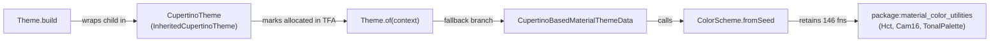

# RFC 310.0000: Size-Aware Design Systems and Tree-Shakable Theme Defaults

## Overview

Every Flutter app using `MaterialApp` pays a fixed binary-size tax for design-system subsystems and component themes it never uses. Because `Theme.build`, `Theme.of`, and `ThemeData` eagerly instantiate and cross-reference `CupertinoThemeData`, `ColorScheme.fromSeed`, and all 47 component theme classes (`DatePickerThemeData`, `DataTableThemeData`, `TimePickerThemeData`, etc.), Dart's whole-program tree-shakers cannot prune unused design-system code across native AOT, WebAssembly, or JavaScript builds.

This RFC proposes:

1. **Tree-shakable design-system boundaries**: Break the `Theme.of` -> `ColorScheme.fromSeed` retention cycle and migrate `ThemeData`'s 47 component themes to Type Flow Analysis (TFA)-foldable lazy backing fields with zero breaking changes.
2. **Follow-on framework and engine patterns**: Eliminate five additional categories of tree-shaking retention anti-patterns uncovered by basic-block coverage profiling.
3. **Size-aware testing and CI guardrails**: Add deterministic presubmit symbol-retention tests in `flutter/packages` and `flutter/flutter` alongside postsubmit Wasm size tracking.

### Empirical impact of initial prototype changes

Measured on [kevmoo/slide_puzzle](https://github.com/kevmoo/slide_puzzle) (a 15-puzzle app using `MaterialApp`, `ElevatedButton`, `IconButton`, `Checkbox`, and `TabBar` across 3 animated themes) with prototype PRs [flutter/packages#13515](https://github.com/flutter/packages/pull/13515) and [flutter/packages#13516](https://github.com/flutter/packages/pull/13516):

| Target Platform & Compiler | Stock `material_ui` | + `Theme.of` Cycle Fix | + Lazy `ThemeData` Sub-Themes | Net Reduction |
| :--- | ---: | ---: | ---: | ---: |
| **Native Linux x64 AOT (`libapp.so`, `gen_snapshot`)** | `3,113,944 B` | `3,015,640 B` (`-98,304 B`) | `2,933,720 B` | **`-180,224 B` (`-5.79%`)** |
| **WebAssembly (`main.dart.wasm`, `dart2wasm`)** | `2,497,700 B` | `2,453,498 B` (`-44,202 B`) | `2,416,445 B` | **`-81,255 B` (`-3.25%`)** |
| **WebAssembly Code Section (`main.dart.wasm`)** | `1,003,395 B` (`8,801` fns) | `984,868 B` (`-18,527 B`) | `957,529 B` (`8,517` fns) | **`-45,866 B` (`-4.57%`, `-284` fns)** |
| **Web JavaScript (`main.dart.js`, `dart2js -O4`)** | `2,112,157 B` | `2,091,412 B` (`-20,745 B`) | `2,077,939 B` | **`-34,218 B` (`-1.62%`)** |

## Goals

* Eliminate unreferenced `package:material_color_utilities` and unused component `*ThemeData` classes from compiled binaries.
* Preserve 100% of public API signatures, non-nullable `ThemeData` getters, `ThemeData.lerp` behavior, and `ThemeData() == ThemeData(fooTheme: const FooThemeData())` equality invariants.
* Establish reusable coding patterns for `flutter/packages` and `flutter/flutter` that cooperate with Dart VM TFA (`pkg/vm/lib/transformations/type_flow/`) and `dart2js` closed-world analysis.
* Introduce deterministic presubmit symbol-retention tests that fail when an unreferenced subsystem is rooted by `MaterialApp` or `ThemeData`.

### Non-goals

* Changing public `ThemeData` property types from non-nullable (`CardThemeData`) to nullable (`CardThemeData?`).
* Requiring users to opt into tree-shaking via new flags or alternative `ThemeData` constructors.
* Enforcing hard byte-count thresholds on PR presubmits.

## Background

### Shared AOT and Wasm tree-shaking pipeline

Both the native Dart VM AOT compiler (`gen_snapshot` in `pkg/vm/lib/kernel_front_end.dart`, targeting Android, iOS, macOS, Linux, and Windows) and `dart2wasm` (`pkg/dart2wasm/lib/compile.dart`) run the same whole-program Kernel TFA pass (`package:vm/transformations/type_flow/transformer.dart`), while `dart2js` runs closed-world type inference (`pkg/compiler/lib/src/universe/`) from the same reachability roots. Because 64-bit native machine code (`x86_64` and `arm64`) carries wider instruction encodings, object pool entries, stack maps, and pre-serialized `const` heap snapshots than stack-machine Wasm bytecode, pruning a reachable class graph in Kernel TFA yields an even larger byte reduction in native `libapp.so` / `App.framework` than in `.wasm`.

### Coverage-guided discovery

Basic-block coverage profiling (`wasm_walk`) of release `.wasm` builds across [kevmoo/slide_puzzle](https://github.com/kevmoo/slide_puzzle), [kevmoo/flutter-wasm-compare](https://github.com/kevmoo/flutter-wasm-compare), and [flutter_gallery](https://github.com/flutter-team-archive/gallery) showed that `51.0%` to `62.9%` of compiled code bytes remain unexecuted across all interactive states, with `72.0%` to `82.9%` of unhit bytes residing in `0%-hit` functions rooted by `Theme.of`, `ThemeData`, and five framework and engine initialization patterns.

## Technical details

### Breaking the Theme.of to ColorScheme.fromSeed cycle

In stock `material_ui`, a cycle between `Theme.build` and `Theme.of` retains `package:material_color_utilities` (`146` functions) in every `MaterialApp`, even when the app supplies a `const ColorScheme` and never calls `ColorScheme.fromSeed`:



Three changes in [flutter/packages#13515](https://github.com/flutter/packages/pull/13515) break this cycle:

* **Lazy `InheritedCupertinoTheme` lookup in `Theme.of`**: Call `context.dependOnInheritedWidgetOfExactType<InheritedCupertinoTheme>()` only when `inheritedTheme == null`, avoiding both the unconditional TFA reachability root and a redundant `InheritedElement` registration on every `Theme.of(context)` call.
* **Preserve `NoDefaultCupertinoThemeData` in `MaterialBasedCupertinoThemeData`**: Replace `(materialTheme.cupertinoOverrideTheme ?? const CupertinoThemeData()).noDefault()` with `materialTheme.cupertinoOverrideTheme?.noDefault() ?? const NoDefaultCupertinoThemeData()` so `Theme.build` never allocates a base `CupertinoThemeData`.
* **Short-circuit `MaterialBasedCupertinoThemeData` in `CupertinoBasedMaterialThemeData`**: Pattern-match `MaterialBasedCupertinoThemeData() => themeData._materialTheme` in `CupertinoBasedMaterialThemeData` so TFA proves `themeData` is exclusively `MaterialBasedCupertinoThemeData` in Material-only apps and prunes `ColorScheme.fromSeed` (`-99.86%` of `material_color_utilities` in Wasm).

### Lazy ThemeData component theme backing fields

During the null-safety migration ([flutter/flutter#66858](https://github.com/flutter/flutter/pull/66858)), `ThemeData`'s 47 component theme getters were kept non-nullable (`final CardThemeData cardTheme;`) so widgets can read `Theme.of(context).cardTheme.color` without `?.`, forcing `factory ThemeData` to eagerly evaluate `cardTheme ??= const CardThemeData()` for all 47 sub-themes ([flutter/flutter#72643](https://github.com/flutter/flutter/issues/72643)). To let TFA prune unused `*ThemeData` classes without changing public getter types ([flutter/packages#13516](https://github.com/flutter/packages/pull/13516)), `ThemeData` stores each component theme in a private nullable field (`_fooTheme`) that defaults to `null`:

```dart
class ThemeData with Diagnosticable {
  const ThemeData.raw({required FooThemeData? fooTheme}) : _fooTheme = fooTheme;

  final FooThemeData? _fooTheme;
  FooThemeData get fooTheme => _fooTheme ?? const FooThemeData();

  static ThemeData lerp(ThemeData a, ThemeData b, double t) => ThemeData.raw(
    fooTheme: a._fooTheme == null && b._fooTheme == null
        ? null
        : FooThemeData.lerp(a.fooTheme, b.fooTheme, t),
  );

  @override
  bool operator ==(Object other) =>
      other is ThemeData &&
      ((other._fooTheme == null && _fooTheme == null) || other.fooTheme == fooTheme);

  @override
  int get hashCode => Object.hashAll(<Object?>[
    if (_fooTheme != null && _fooTheme != const FooThemeData()) _fooTheme,
  ]);
}
```

* **Factory construction (`factory ThemeData`)**: Passes `fooTheme: fooTheme` to `ThemeData.raw` without `??= const FooThemeData()`, so TFA infers static type `Null` for `_fooTheme` when omitted.
* **Interpolation (`ThemeData.lerp`)**: When `_fooTheme` is `Null`, TFA folds `a._fooTheme == null && b._fooTheme == null` to `true` and strips `FooThemeData.lerp` (shrinking `ThemeDataTween.lerp` in `AnimatedTheme` by `-78.3%`, from `9,559 B` to `2,070 B` in Wasm); when customized on one side, passing `a.fooTheme` and `b.fooTheme` interpolates against `const FooThemeData()`, preserving non-null defaults on `InputDecorationThemeData` and `ScrollbarThemeData`.
* **Equality (`ThemeData.operator ==`)**: TFA folds `other._fooTheme == null && _fooTheme == null` to `true` when unused (stripping `83` `*ThemeData.==` and `hashCode` methods), while `other.fooTheme == fooTheme` preserves `ThemeData() == ThemeData(fooTheme: const FooThemeData())`.
* **Hashing (`ThemeData.hashCode`)**: TFA folds `_fooTheme != null` to `false` when unused, and `_fooTheme != const FooThemeData()` hashes an explicit default instance identically to `null`.

### Follow-on framework and engine patterns

Auditing the remaining `547.8 KB` of unhit Wasm code in [kevmoo/slide_puzzle](https://github.com/kevmoo/slide_puzzle) identified five follow-on categories (`~89 KB` Wasm / `~190+ KB` native AOT):

| Category | Pattern & Retention Root | Unhit Wasm ([kevmoo/slide_puzzle](https://github.com/kevmoo/slide_puzzle)) | Concrete Fix |
| :--- | :--- | ---: | :--- |
| **1. Non-folded `!kIsWeb` guards** | `theme_data.dart` writes `platform == TargetPlatform.android && !kIsWeb`, preventing CFE constant-folding and retaining `InkSparkle` + `SkwasmFragmentShader`. | `-3.0 KB` (`16` fns) | Put compile-time constants first (`!kIsWeb && platform == TargetPlatform.android`) so CFE folds `false && E1` before TFA. |
| **2. Private `enum` switch bleed** | `Checkbox` (`_CheckboxType`), `Slider` (`_SliderType`), and `IconButton` (`_IconButtonVariant`) switch on a private enum in `build`; TFA widens `Enum.index` to `int`, retaining `CupertinoCheckbox`, `CupertinoSlider`, and unused M3 variants. | `-6.7 KB` to `-9.3 KB` (`40–68` fns) | Redirect `.adaptive` and variant constructors to private subclasses (`= _AdaptiveCheckbox`, matching `AlertDialog.adaptive = _AdaptiveAlertDialog`). |
| **3. Cross-platform route & channel bleed** | `WidgetsBinding.initInstances` registers mobile `SystemChannels`; `PageTransitionsTheme._defaultBuilders` instantiates all platform builders; `Theme.build` calls `MaterialBasedCupertinoThemeData.resolveFrom`. | `-17.4 KB` (`126` fns; drops 100% of `cupertino_ui` in Material apps) | Guard mobile channels with `if (!kIsWeb)`, resolve default `PageTransitionsBuilder` lazily for the active platform, and defer `CupertinoThemeData.resolveFrom` until `CupertinoTheme.of(context)`. |
| **4. Eager binding & service init** | `ServicesBinding.initInstances` eagerly initializes `RestorationManager`, `TextInput.ensureInitialized()`, and `@Deprecated` `RawKeyboard`; `MaterialApp` mounts `HeroController` when no `Hero` widgets exist. | `-32.1 KB` (`212` fns) | Make `ServicesBinding._restorationManager` `late final`, defer `TextInput` initialization until `TextInput.attach`, and gate `HeroController` on `_HeroState` allocation. |
| **5. Dynamic selector tables** | `Tween<T>.lerp` runs `(begin as dynamic) + ((end as dynamic) - (begin as dynamic)) * t`, retaining `+`, `-`, and `*` on `Matrix4`, `Quaternion`, and `Vector4`; `_JsonStringifier` calls `(object as dynamic).toJson()`, retaining `SemanticsNode.toJson`. | `-19.5 KB` (`86` fns) | Specialize `Tween<double>.lerp` (or intersect `DynamicDispatchTable.build` with TFA receiver type cones), and rename debug-only `SemanticsNode.toJson` to `toDiagnosticsJson`. |

## Testing

### Presubmit symbol-retention tests

Today, `flutter/packages` (`web_build_all_packages.yaml`) only checks exit code `0` on an `all_packages` bundle, and `flutter/flutter` (`_runWebTreeshakeTest` in `dev/bots/suite_runners/run_web_tests.dart`) only checks 5 `timeline.dart` classes under `dart2js --profile`:

* **In `flutter/packages` (`packages/material_ui/test/tree_shaking_test.dart`)**: Compile a minimal `MaterialApp(home: Scaffold(body: Text('hello')))` fixture (`--wasm --no-strip-wasm` or `--analyze-size`) and assert that emitted symbol tables omit `package:material_color_utilities` (`Hct`, `Cam16`, `TonalPalette`), unused component themes (`DatePickerThemeData`, `TimePickerThemeData`, `DataTableThemeData`, `SliderThemeData`, `BottomSheetThemeData`) and their `.lerp()` methods, `CupertinoCheckbox` / `CupertinoAlertDialog`, and `InkSparkle` on Web.
* **In `flutter/flutter` (`dev/bots/suite_runners/run_web_tests.dart`)**: Extend `_runWebTreeshakeTest()` on `treeshaking_main.dart` to verify both `dart2js` and `dart2wasm` outputs against the same symbol non-retention list.

### Postsubmit Wasm and native size tracking

Today, `Linux web_size__compile_test` (`dev/devicelab/lib/tasks/perf_tests.dart`) builds without `--wasm`, recording `main.dart.js` and `canvaskit.wasm` but never `main.dart.wasm`:

* **Add `--wasm` to `WebCompileTest` (`dev/devicelab/lib/tasks/perf_tests.dart`)**: Extend `Linux web_size__compile_test` on `hello_world`, `basic_material_app`, and `flutter_gallery` to build with `--wasm` and report `main.dart.wasm` (uncompressed and gzipped) and `skwasm.wasm` metrics to Cocoon / Skia Perf.
* **Track `basic_material_app` across native and Web**: Ensure `basic_material_app_*__compile` benchmarks track both `libapp.so` and `main.dart.wasm` as `packages/material_ui` and `packages/cupertino_ui` decouple into `flutter/packages`.

## Rollout

1. **Phase 1 (In review)**: Land [flutter/packages#13515](https://github.com/flutter/packages/pull/13515) (`Theme.of` cycle fix) and [flutter/packages#13516](https://github.com/flutter/packages/pull/13516) (lazy `ThemeData` component theme backing fields) in `flutter/packages`, and mirror both to `packages/flutter/lib/src/material/` in `flutter/flutter`.
2. **Phase 2 (CI guardrails)**: Land `packages/material_ui/test/tree_shaking_test.dart` in `flutter/packages` and extend `_runWebTreeshakeTest` and `WebCompileTest` (`--wasm`) in `flutter/flutter`.
3. **Phase 3 (Follow-on framework and engine PRs)**: Land the five follow-on categories as independent PRs, adding each newly tree-shaken symbol to the presubmit non-retention list.

## Alternatives considered

### Make ThemeData component theme getters nullable

Making all 47 component theme getters on `ThemeData` return nullable types (`CardThemeData? get cardTheme`) was discussed in [flutter/flutter#72643](https://github.com/flutter/flutter/issues/72643). That approach was rejected because it breaks every widget and app reading `Theme.of(context).cardTheme.color` without `?.`, whereas private nullable backing fields (`_fooTheme`) achieve the same TFA dead-code elimination with zero API breakage.

### Pass nullable backing fields directly to FooThemeData.lerp

Passing `FooThemeData.lerp(a._fooTheme, b._fooTheme, t)` directly when one side is `null` was rejected because component themes like `InputDecorationThemeData` and `ScrollbarThemeData` define non-null field defaults in `const FooThemeData()` that are lost when interpolating from `null`. Guarding with `a._fooTheme == null && b._fooTheme == null ? null : FooThemeData.lerp(a.fooTheme, b.fooTheme, t)` folds the branch away when `_fooTheme` is unused while still interpolating against `const FooThemeData()` whenever either theme is customized.

### Enforce hard byte-size thresholds in presubmit CI

Failing PR presubmits when `main.dart.wasm` or `libapp.so` exceeds a fixed byte count was rejected because raw byte totals shift across Dart SDK rolls, compiler inlining heuristic changes, and unrelated corelib edits. Asserting symbol non-retention on presubmit verifies the tree-shaking invariant deterministically, while continuous byte-size tracking runs in postsubmit Skia Perf benchmarks.
