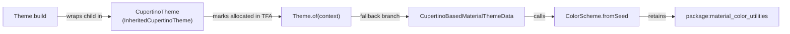

# RFC 310.0000: Size-Aware Design Systems and Tree-Shakable Theme Defaults

## Overview

In `package:material_ui`, `Theme.build`, `Theme.of`, and `ThemeData` eagerly instantiate and cross-reference `CupertinoThemeData`, `ColorScheme.fromSeed`, and all 47 component theme classes. Because of those reachability roots, Dart's whole-program tree-shakers cannot prune unused design-system code even when an application only mounts a few Material widgets.

This RFC proposes decoupling the `Theme.of` -> `ColorScheme.fromSeed` fallback cycle ([flutter/packages#13515](https://github.com/flutter/packages/pull/13515)), migrating `ThemeData`'s 47 component themes to Type Flow Analysis (TFA)-foldable lazy backing fields ([flutter/packages#13516](https://github.com/flutter/packages/pull/13516)), and adding deterministic presubmit symbol-retention tests in `flutter/packages`.

**Who benefits and key trade-offs:** These changes primarily shrink small, focused, or embedded applications (such as mini-apps, landing pages, add-to-app modules, and games) that mount a narrow subset of Material widgets without `TextField` or `ColorScheme.fromSeed` (`-180 KB` / `-5.8%` on Linux x64 AOT and `-81 KB` / `-3.3%` on WebAssembly in [kevmoo/slide_puzzle](https://github.com/kevmoo/slide_puzzle)). Widget-dense applications that mount most of the Material catalog (such as [flutter/devtools](https://github.com/flutter/devtools)) see smaller WebAssembly savings (`-22 KB` / `-0.4%`) and currently incur a minor `dart2js` size increase (`+8 KB` / `+0.1%`).

## Goals

* Prune unreferenced `package:material_color_utilities` and unused component `*ThemeData` classes from native AOT (`gen_snapshot`) and WebAssembly (`dart2wasm`) binaries in `package:material_ui` when those widgets and color solvers are unused.
* Preserve 100% of public API signatures, non-nullable `ThemeData` getters, `ThemeData.lerp` behavior, and `ThemeData() == ThemeData(fooTheme: const FooThemeData())` equality invariants.
* Introduce deterministic presubmit symbol-retention tests in `flutter/packages` so tree-shaking boundaries cannot silently regress.

### Non-goals

* Backporting these changes to `packages/flutter/lib/src/material/` in the Flutter SDK, which is slated for deprecation in favor of `package:material_ui` ([flutter/flutter#101479](https://github.com/flutter/flutter/issues/101479)).
* Changing public `ThemeData` property types from non-nullable (`CardThemeData`) to nullable (`CardThemeData?`), or requiring opt-in flags or new `ThemeData` constructors.
* Enforcing hard byte-count thresholds on PR presubmits.
* Follow-up tree-shaking opportunities identified during profiling (tracked for separate investigation rather than proposed in this RFC):
  * **Decoupling `TextField` and `CupertinoBasedMaterialThemeData` from `ColorScheme.fromSeed`**: Avoiding the perceptual CAM16/HCT solver in `CupertinoBasedMaterialThemeData` (or gating `TextField`'s iOS/macOS `CupertinoTheme.of` lookup) so `TextField`-using apps can also drop `package:material_color_utilities`.
  * **Eliminating the `dart2js` overhead on inspector-enabled apps**: Guarding `_fooTheme == null` inside `ThemeData.debugFillProperties` (and avoiding eager `ThemeData.fallback()` instantiation) so `dart2js` can prune unused `*ThemeData` classes alongside `dart2wasm`.
  * **Other `material_ui` and `cupertino_ui` retention roots**: Placing `!kIsWeb` before runtime `TargetPlatform` checks so the Dart front-end constant-folds `InkSparkle` on Web, replacing private `enum` switches in `.adaptive` / M3 variants (`Checkbox`, `Slider`, `IconButton`) with private subclasses, and lazily resolving `PageTransitionsTheme` builders.
  * **Core `flutter/flutter`, `web_ui`, and `dart2wasm` candidates**: Deferring eager `ServicesBinding` (`RestorationManager`, `TextInput`) and `HeroController` initialization, gating mobile-only `SystemChannels` on Web, and specializing `Tween<double>.lerp` to avoid dynamic `+`/`-`/`*` dispatch tables.

## Background

### Shared AOT and Wasm tree-shaking pipeline

Both the native Dart VM AOT compiler (`gen_snapshot`, targeting Android, iOS, macOS, Linux, and Windows) and `dart2wasm` run the same whole-program Kernel Type Flow Analysis (TFA) pass prior to code generation, while `dart2js` runs closed-world AST resolution followed by global type inference. Because 64-bit native machine code carries wider instruction encodings, object pool entries, stack maps, and pre-serialized `const` heap snapshots than stack-machine Wasm bytecode, pruning a reachable class graph in Kernel TFA yields an even larger byte reduction in native `libapp.so` / `App.framework` than in `.wasm`.

### Coverage-guided discovery

Basic-block coverage profiling of release WebAssembly builds across [kevmoo/slide_puzzle](https://github.com/kevmoo/slide_puzzle), [kevmoo/flutter-wasm-compare](https://github.com/kevmoo/flutter-wasm-compare), and [flutter_gallery](https://github.com/flutter-team-archive/gallery) showed that over half of compiled code bytes in minimal apps belong to functions that are never entered during interactive sessions. Within the design-system layer, tracing why those unexecuted functions survived compilation exposed two primary retention hubs in `package:material_ui`: `Theme.of` and `ThemeData`.

## Technical details

### Breaking the Theme.of to ColorScheme.fromSeed cycle

In stock `material_ui`, a cycle between `Theme.build` and `Theme.of` retains `package:material_color_utilities` in every `MaterialApp`, even when the app uses `ThemeData.light()` / `ThemeData.dark()` (`_defaultM3ColorScheme`) or a custom `const ColorScheme` and never calls `ColorScheme.fromSeed`:



Three changes in [flutter/packages#13515](https://github.com/flutter/packages/pull/13515) break this cycle when `CupertinoThemeData` is not independently instantiated:

* **Lazy `InheritedCupertinoTheme` lookup in `Theme.of`**: Call `context.dependOnInheritedWidgetOfExactType<InheritedCupertinoTheme>()` only when `inheritedTheme == null`, avoiding both the unconditional TFA reachability root and a redundant `InheritedElement` registration on every `Theme.of(context)` call.
* **Preserve `NoDefaultCupertinoThemeData` in `MaterialBasedCupertinoThemeData`**: Replace `(materialTheme.cupertinoOverrideTheme ?? const CupertinoThemeData()).noDefault()` with `materialTheme.cupertinoOverrideTheme?.noDefault() ?? const NoDefaultCupertinoThemeData()` so `Theme.build` never allocates a base `CupertinoThemeData`.
* **Short-circuit `MaterialBasedCupertinoThemeData` in `CupertinoBasedMaterialThemeData`**: Pattern-match `MaterialBasedCupertinoThemeData() => themeData._materialTheme` in `CupertinoBasedMaterialThemeData` so TFA proves `themeData` is exclusively `MaterialBasedCupertinoThemeData` when no standalone `CupertinoThemeData` is allocated and prunes `ColorScheme.fromSeed`.

### Lazy ThemeData component theme backing fields

During the null-safety migration ([flutter/flutter#66858](https://github.com/flutter/flutter/pull/66858)) and subsequent component theme normalization ([flutter/flutter#91772](https://github.com/flutter/flutter/issues/91772)), `ThemeData`'s 47 component theme getters were kept non-nullable (`final CardThemeData cardTheme;`) so widgets can read `Theme.of(context).cardTheme.color` without `?.`, forcing `factory ThemeData` to eagerly evaluate `cardTheme ??= const CardThemeData()` for all 47 sub-themes. To let TFA prune unused `*ThemeData` classes without changing public getter types ([flutter/packages#13516](https://github.com/flutter/packages/pull/13516)), `ThemeData` stores each component theme in a private nullable field (`_fooTheme`) that defaults to `null`:

```dart
class ThemeData with Diagnosticable {
  const ThemeData.raw({required this._fooTheme});

  final FooThemeData? _fooTheme;
  FooThemeData get fooTheme => _fooTheme ?? const FooThemeData();

  static ThemeData lerp(ThemeData a, ThemeData b, double t) => ThemeData.raw(
    fooTheme: a._fooTheme == null && b._fooTheme == null
        ? null
        : FooThemeData.lerp(a.fooTheme, b.fooTheme, t),
  );

  @override
  bool operator ==(Object other) =>
      identical(this, other) ||
      (other is ThemeData &&
          ((other._fooTheme == null && _fooTheme == null) ||
              other.fooTheme == fooTheme));

  @override
  int get hashCode => Object.hashAll(<Object?>[
    if (_fooTheme != null && _fooTheme != const FooThemeData()) _fooTheme,
  ]);
}
```

When an application leaves a component theme unconfigured, `factory ThemeData` passes `null` through to `ThemeData.raw`, allowing TFA to infer static type `Null` for `_fooTheme`. Across `ThemeData.lerp` (or step-interpolation for themes like `InputDecorationThemeData` that lack `.lerp`), `operator ==`, and `hashCode`, TFA constant-folds the `_fooTheme == null` guards and strips the dead `FooThemeData` methods, while `dart2wasm` and `gen_snapshot` inline uncustomized getter reads directly to `const FooThemeData()`. When customized on either side, `lerp` and `operator ==` fall back through the public getter to `const FooThemeData()`, preserving default-equivalence (`ThemeData() == ThemeData(fooTheme: const FooThemeData())`) and non-null sub-theme defaults.

### Measured impact, trade-offs, and limitations

1. **Small widget-subset app ([kevmoo/slide_puzzle](https://github.com/kevmoo/slide_puzzle))** — uses a custom `const ColorScheme` and 4 Material widgets (`ElevatedButton`, `IconButton`, `Checkbox`, `TabBar`) across 3 animated themes:

   | Target Platform & Compiler | Stock `material_ui` | + `#13515` (`Theme.of`) | + `#13515` & `#13516` | Net Delta |
   | :--- | ---: | ---: | ---: | ---: |
   | **Native Linux x64 AOT (`libapp.so`, `gen_snapshot`)** | `3.11 MB` | `3.02 MB` (`-98 KB`) | `2.93 MB` | **`-180 KB` (`-5.8%`)** |
   | **WebAssembly (`main.dart.wasm`, `dart2wasm`)** | `2.50 MB` | `2.45 MB` (`-44 KB`) | `2.42 MB` | **`-81 KB` (`-3.3%`)** |
   | **Web JavaScript (`main.dart.js`, `dart2js -O4`)** | `2.11 MB` | `2.09 MB` (`-21 KB`) | `2.08 MB` | **`-34 KB` (`-1.6%`)** |

2. **Large widget-dense app ([flutter/devtools](https://github.com/flutter/devtools) `packages/devtools_app`)** — multi-screen web app mounting `TextField` and 31 of the 47 Material component themes:

   | Target Platform & Compiler | Stock `material_ui` | + `#13515` (`Theme.of`) | + `#13515` & `#13516` | Net Delta |
   | :--- | ---: | ---: | ---: | ---: |
   | **WebAssembly (`main.dart.wasm`, `dart2wasm`)** | `5.75 MB` | `5.75 MB` (`-1 KB`) | `5.72 MB` | **`-22 KB` (`-0.4%`)** |
   | **Web JavaScript (`main.dart.js`, `dart2js -O4`)** | `6.19 MB` | `6.19 MB` (`-3 KB`) | `6.20 MB` | **`+8 KB` (`+0.1%`)** |

Comparing `slide_puzzle` and `DevTools` defines three clear boundaries of this design:

* **Savings scale inversely with widget catalog coverage**: Any widget an app mounts (`Card.build` -> `Theme.of(context).cardTheme`) evaluates `_cardTheme ?? const CardThemeData()`, keeping `CardThemeData` allocated (though uncustomized `.lerp`, `==`, and `hashCode` methods still drop in TFA). Whole `*ThemeData` libraries only drop for unmounted widgets (`~41` unused sub-themes in `slide_puzzle` vs. `16` unused sub-themes in `DevTools`).
* **Mounting `TextField` currently re-retains `ColorScheme.fromSeed`**: Even though `DevTools` uses `ThemeData.dark()` / `ThemeData.light()` (`_defaultM3ColorScheme`) rather than `ColorScheme.fromSeed`, `TextField` calls `CupertinoTheme.of(context)` inside its `switch (theme.platform)` iOS/macOS branches (which remain live on Web because `theme.platform` is a runtime property). Because `CupertinoTheme.of` falls back to `const CupertinoThemeData()`, TFA marks `CupertinoThemeData` allocated and retains `CupertinoBasedMaterialThemeData` -> `ColorScheme.fromSeed` (`~44 KB` saved on `slide_puzzle` vs. `~1 KB` on `DevTools`).
* **Why `dart2js` increases by `+8 KB` (`+0.1%`) on `DevTools`**: Unlike `dart2wasm` and `gen_snapshot` (which prune `16` unused `*_theme.dart` libraries on `DevTools` via interprocedural TFA), `dart2js` resolves AST references inside reachable methods *before* global type inference runs. Because `DevTools`'s widget inspector keeps `Diagnosticable.debugFillProperties` polymorphically live—and `ThemeData.debugFillProperties` currently calls `ThemeData.fallback()` and reads all 47 public getters unconditionally—`dart2js` retains all 47 `*ThemeData` classes while adding `+8 KB` (`+2 KB` gzipped) for the nullable backing getters and `lerp`/`==`/`hashCode` null guards.

## Testing

### Presubmit symbol-retention tests in `flutter/packages`

Today, `.ci/targets/web_build_all_packages.yaml` in `flutter/packages` only checks exit code `0` on a combined `all_packages` bundle, so re-introducing a retention cycle in `package:material_ui` passes CI undetected:

* **Add `packages/material_ui/test/tree_shaking_test.dart`**: Compile a minimal `MaterialApp(home: Scaffold(body: Text('hello')))` fixture (`--wasm --no-strip-wasm` or `--analyze-size`) and assert that emitted symbol tables omit `package:material_color_utilities` when `ColorScheme.fromSeed` and `TextField` are unused, as well as unreferenced component `*ThemeData` classes and their `.lerp()` methods.

### Postsubmit Wasm and native size tracking

Today, `Linux web_size__compile_test` (`dev/devicelab/lib/tasks/perf_tests.dart` in `flutter/flutter`) builds without `--wasm`, recording `main.dart.js` and `canvaskit.wasm` but never `main.dart.wasm`:

* **Track `material_ui` canary benchmarks across Wasm, JS, and native AOT**: As benchmark apps (`basic_material_app`) migrate from `package:flutter/material.dart` to `package:material_ui`, extend `WebCompileTest` to build with `--wasm` and report `main.dart.wasm` alongside `main.dart.js` and native `libapp.so` to Cocoon / Skia Perf so both Wasm wins and `dart2js` deltas are continuously tracked.

## Rollout

1. **Phase 1 (In review)**: Land [flutter/packages#13515](https://github.com/flutter/packages/pull/13515) (`Theme.of` cycle fix) and [flutter/packages#13516](https://github.com/flutter/packages/pull/13516) (lazy `ThemeData` component theme backing fields) in `packages/material_ui` (`flutter/packages` only; apps on `package:flutter/material.dart` gain these savings when migrating to `package:material_ui`).
2. **Phase 2 (CI guardrails)**: Land `packages/material_ui/test/tree_shaking_test.dart` in `flutter/packages` and add `--wasm` size tracking for `material_ui` benchmark apps.

## Alternatives Considered

### Make ThemeData component theme getters nullable

Making all 47 component theme getters on `ThemeData` return nullable types (`CardThemeData? get cardTheme`) was rejected because it breaks every widget and app reading `Theme.of(context).cardTheme.color` without `?.`, whereas private nullable backing fields (`_fooTheme`) achieve the same TFA dead-code elimination with zero API breakage.

### Pass nullable backing fields directly to FooThemeData.lerp

Passing `FooThemeData.lerp(a._fooTheme, b._fooTheme, t)` directly when one side is `null` was rejected because component themes like `ScrollbarThemeData` and `ChipThemeData` define non-null field defaults in `const FooThemeData()` that are lost when interpolating from `null`. Guarding with `a._fooTheme == null && b._fooTheme == null ? null : FooThemeData.lerp(a.fooTheme, b.fooTheme, t)` folds the branch away when `_fooTheme` is unused while still interpolating against `const FooThemeData()` whenever either theme is customized.

### Enforce hard byte-size thresholds in presubmit CI

Failing PR presubmits when `main.dart.wasm` or `libapp.so` exceeds a fixed byte count was rejected because raw byte totals shift across Dart SDK rolls, compiler inlining heuristic changes, and unrelated corelib edits. Asserting symbol non-retention on presubmit verifies the tree-shaking invariant deterministically, while continuous byte-size tracking runs in postsubmit Skia Perf benchmarks.
