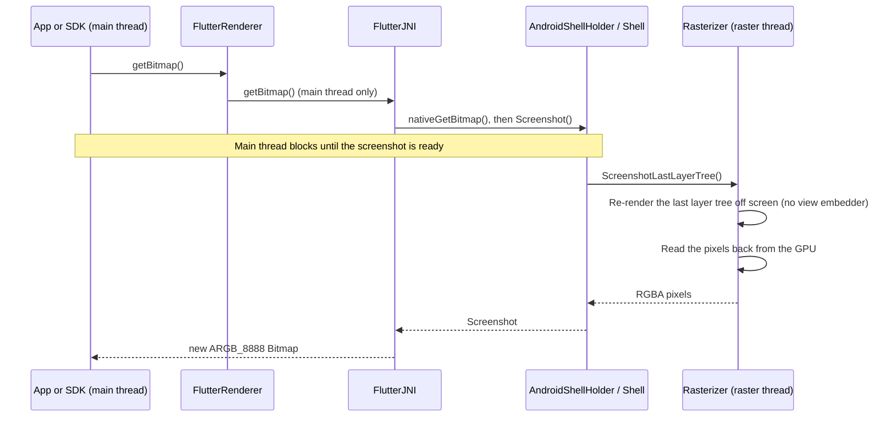

# RFC 410.0000: Deprecate Android FlutterRenderer.getBitmap

## Overview

This RFC proposes deprecating the two Android embedding APIs that return the current Flutter frame as an `android.graphics.Bitmap`:

- [`FlutterRenderer.getBitmap()`](https://github.com/flutter/flutter/blob/9d80afcdecf4f9641a9bed1e03d3a17ca44b4e1f/engine/src/flutter/shell/platform/android/io/flutter/embedding/engine/renderer/FlutterRenderer.java#L1342-L1344)
- [`FlutterJNI.getBitmap()`](https://github.com/flutter/flutter/blob/9d80afcdecf4f9641a9bed1e03d3a17ca44b4e1f/engine/src/flutter/shell/platform/android/io/flutter/embedding/engine/FlutterJNI.java#L1701-L1708)

Callers should use [`OffsetLayer.toImage()`](https://api.flutter.dev/flutter/rendering/OffsetLayer/toImage.html) on the `RenderView`'s layer or [`RenderRepaintBoundary.toImage()`](https://api.flutter.dev/flutter/rendering/RenderRepaintBoundary/toImage.html) from Dart instead.

Why:

- Nothing in `flutter/flutter` or `flutter/packages` calls `getBitmap()`, and it has had no test coverage since 2024.
- The engine implementation blocks the Android main thread for 200–470 ms per call.
- It cannot be reimplemented in the embedder alone. See [Alternatives Considered](#alternatives-considered).
- Removing it deletes a JNI entry point and the embedder's dependency on `Shell::Screenshot`, which the embedder C-API does not expose.

### Goals

- Give callers a documented migration path to `OffsetLayer.toImage()` and `RenderRepaintBoundary.toImage()`.
- Platform view support is unchanged. See [Platform view support](#platform-view-support).
- Deprecate both APIs with no behavior change.
- Then remove the Java APIs, the `nativeGetBitmap` JNI entry point, and `AndroidShellHolder::Screenshot`.

### Non-Goals

- Changing `Shell::Screenshot` or `Rasterizer::ScreenshotLastLayerTree`.
- Changing `flutter screenshot` (which uses `adb shell screencap -p`), `integration_test`'s `binding.takeScreenshot()`, or the VM service `_flutter.screenshot` RPC (`Shell::OnServiceProtocolScreenshot`). None of these call `FlutterRenderer.getBitmap()`.
- Adding a new native screenshot API.

## Background

### Current implementation



Source:

- [`GetBitmap`](https://github.com/flutter/flutter/blob/9d80afcdecf4f9641a9bed1e03d3a17ca44b4e1f/engine/src/flutter/shell/platform/android/platform_view_android_jni_impl.cc#L449-L480)
- [`AndroidShellHolder::Screenshot`](https://github.com/flutter/flutter/blob/9d80afcdecf4f9641a9bed1e03d3a17ca44b4e1f/engine/src/flutter/shell/platform/android/android_shell_holder.cc#L307-L314)
- [`Shell::Screenshot`](https://github.com/flutter/flutter/blob/9d80afcdecf4f9641a9bed1e03d3a17ca44b4e1f/engine/src/flutter/shell/common/shell.cc#L2395)
- [`Rasterizer::ScreenshotLastLayerTree`](https://github.com/flutter/flutter/blob/9d80afcdecf4f9641a9bed1e03d3a17ca44b4e1f/engine/src/flutter/shell/common/rasterizer.cc#L1089-L1152)

### Platform view support

| Platform view mode | How it is drawn | Current `getBitmap()` | `toImage()` (proposed) | Alternative `PixelCopy` ([#195526](https://github.com/flutter/flutter/pull/195526)) |
| :--- | :--- | :--- | :--- | :--- |
| Texture Layer Hybrid Composition (TLHC) | The native view draws into an external texture that Flutter composites | Works | Works | Works; returns `null` on API 29–33 when `EnableHcpp=true` |
| Virtual Display (VD) | The native view renders to a virtual display that Flutter uses as an external texture | Works | Works | Works; returns `null` on API 29–33 when `EnableHcpp=true` |
| Hybrid Composition (HC) | The native view is a real Android `View`; Flutter draws in surfaces below and above it | Flutter UI captured; native view missing | Flutter UI captured; native view missing | Native view missing, and Flutter UI drawn over it is dropped |
| Hybrid Composition++ (HCPP) | The native view is composited by the system with `SurfaceControl` | Flutter UI captured; native view missing | Flutter UI captured; native view missing | Returns `null` - even if no platform view is present |

> [!IMPORTANT]
> Platform view support is the same for the proposed method (`toImage()`) and the current method (`getBitmap()`) in every mode. Migrating from `getBitmap()` to `toImage()` does not change which platform views appear in the capture.

### Known usage

Public GitHub code search finds these callers. Metrics are as of 2026-10-30; private usage is unknown.

| Project | Use | pub.dev likes / downloads (30 days) | GitHub stars / forks | Latest release |
| :--- | :--- | :--- | :--- | :--- |
| [Gleap Flutter SDK](https://github.com/GleapSDK/Flutter-SDK) (`gleap_sdk`) | Bug-report screenshots | 14 / 14,327 | 4 / 3 | 19.3.1 (2026-10-19) |
| [Appcues Flutter plugin](https://github.com/appcues/appcues-flutter-plugin) (`appcues_flutter`) | Screenshots for element targeting | 2 / 12,205 | 6 / 0 | 5.0.6 (2026-10-16) |
| [GrowingIO autotracker plugin](https://github.com/growingio/flutter-growingio-sdk-autotracker-plugin) | Analytics screenshots | Not on pub.dev | 3 / 0 | Last commit 2022-12-13 |
| [flutter_native_boost](https://github.com/bozaigao/flutter_native_boost) (`flutter_native_boost`) | Snapshot shown during native page transitions | 0 / 29 | 1 / 1 | 1.0.3 (2021-01-13) |

Gleap and Appcues are actively maintained and account for nearly all downloads, so they are the main migration targets.

## Proposal

### Phase 1: Deprecate

1. Annotate both methods with `@Deprecated(since = "Flutter X.Y", forRemoval = true)`, plus a Javadoc `@deprecated` tag that points to `OffsetLayer.toImage()`, `RenderRepaintBoundary.toImage()`, and the migration guide. Behavior does not change.
2. Publish a migration guide under [docs.flutter.dev breaking changes](https://docs.flutter.dev/release/breaking-changes).
3. Announce the deprecation on flutter-announce, and apply the `c: API break` label.
4. Notify the Gleap and Appcues maintainers.

```java
/**
 * @deprecated Use {@code OffsetLayer.toImage()} on the {@code RenderView}'s layer or {@code
 *     RenderRepaintBoundary.toImage()} from Dart instead. They capture the same content without
 *     blocking the platform thread.
 *     See https://docs.flutter.dev/release/breaking-changes/<TODO-guide>.
 *     This feature was deprecated after v<TODO-beta-version>.
 */
@Deprecated(since = "Flutter X.Y", forRemoval = true)
@Nullable
public Bitmap getBitmap() {
  return flutterJNI.getBitmap();
}
```

### Phase 2: Remove

After the deprecation has shipped for at least 4 stable releases or 1 year (whichever is longer), remove:

- `FlutterRenderer.getBitmap()` and `FlutterJNI.getBitmap()`;
- `nativeGetBitmap` and its JNI registration and `Bitmap` class lookups;
- `AndroidShellHolder::Screenshot`.

## Proposed Migration Guide

To capture the whole Flutter view without adding a `RepaintBoundary` widget to the tree, call `toImage()` on the `RenderView`'s root layer (`RenderView` is already a repaint boundary and its root `TransformLayer` already scales by `devicePixelRatio`, so pass `view.paintBounds`):

```dart
Future<ui.Image> captureFlutterUi() async {
  await WidgetsBinding.instance.endOfFrame;
  final RenderView view = RendererBinding.instance.renderViews.first;
  // ignore: invalid_use_of_protected_member
  final OffsetLayer layer = view.layer! as OffsetLayer;
  return layer.toImage(view.paintBounds);
}
```

(`RenderObject.layer` is currently annotated `@protected`, which is why [`flutter_driver` suppresses `invalid_use_of_protected_member`](https://github.com/flutter/flutter/blob/9d80afcdecf4f9641a9bed1e03d3a17ca44b4e1f/packages/flutter_driver/lib/src/common/handler_factory.dart#L381-L391). We can also expose `RenderView.layer` or add a public `RenderView.toImage()` helper so callers do not need the ignore comment.)

To capture a specific subtree instead, wrap it in a `RepaintBoundary` and call `RenderRepaintBoundary.toImage()`:

```dart
final GlobalKey captureKey = GlobalKey();

// In build(): RepaintBoundary(key: captureKey, child: const MyApp())

Future<ui.Image> captureSubtree(BuildContext context) async {
  await WidgetsBinding.instance.endOfFrame;
  final RenderRepaintBoundary boundary =
      captureKey.currentContext!.findRenderObject()! as RenderRepaintBoundary;
  return boundary.toImage(pixelRatio: View.of(context).devicePixelRatio);
}
```

Native SDKs that need an `android.graphics.Bitmap` can ask Dart for the capture over a platform channel. The Dart side returns `image.toByteData(format: ui.ImageByteFormat.rawRgba)` (premultiplied RGBA) and the image size. The native side copies the bytes into a bitmap:

```kotlin
val bitmap = Bitmap.createBitmap(width, height, Bitmap.Config.ARGB_8888)
bitmap.copyPixelsFromBuffer(ByteBuffer.wrap(rgbaBytes))
```

Measured on a Pixel 8 (API 34, profile build, full-screen 1080×2337 capture, median of 24):

| | Current `getBitmap()` | Pigeon → `toImage()` → `Bitmap` |
| :--- | :--- | :--- |
| Time until the `Bitmap` is ready | 217 ms | 112 ms |
| Main thread | Blocked for 217 ms | Longest task 50 ms (Dart encodes the 10 MB reply) |
| Missed frames at 60 Hz | 13 | 5 |

Returning PNG instead of `rawRgba` shrinks the message to 15 KB, but takes 269 ms because of the encode and decode.

> [!WARNING]
> From native code, the capture arrives asynchronously in a callback; calls from native code into Dart (Pigeon or platform channels) are always asynchronous. Do not block the main thread waiting for the result. Dart runs on the main thread, so the capture can never complete and the app deadlocks. If an existing API must return a `Bitmap` synchronously, request the capture from a background thread and wait on that thread, or capture from Dart ahead of time.

How `toImage()` differs from `getBitmap()`:

- It is called from Dart, is asynchronous, and does not block the Android main thread.
- It requires the Dart UI isolate to be running. Unlike `getBitmap()`, which hops directly to the raster thread, `toImage()` does not complete while the Dart isolate is paused (for example, at a debugger breakpoint). Developer tools (`flutter screenshot` and the VM service `_flutter.screenshot` RPC) still work while the isolate is paused.
- It captures the `RenderView` or `RepaintBoundary` subtree at the requested `pixelRatio`.

## Alternatives Considered

### Reimplement `getBitmap()` with `PixelCopy`

[flutter/flutter#195526](https://github.com/flutter/flutter/pull/195526) removed the engine path and reimplemented `FlutterRenderer.getBitmap()` in Java. It calls `PixelCopy.request()` on the `Surface` that Flutter renders into.

When that `Surface` holds the whole frame, the result is pixel-exact and about 7–10× faster than the engine path. But `PixelCopy` only sees buffers queued to that one `Surface`, which fails in two cases:

- **HCPP enabled (the default on master and beta):** Impeller presents through a `SurfaceControl` child layer on API 29+. Nothing reaches the `Surface`, so `getBitmap()` returns `null`, even with no platform views on screen.
- **Hybrid Composition:** Flutter UI drawn over a platform view lives in separate overlay surfaces, so it is dropped.

Android has no public API to read back those layers:

- Through Android 16 (API 36), `PixelCopy` only accepts a `Surface`, `SurfaceView`, `Window`, or `View`. `PixelCopy` on a `Window` reads only the window's `ViewRootImpl` `ThreadedRenderer` surface and does not composite `SurfaceView` or `SurfaceControl` layers. (`integration_test`'s [`FlutterDeviceScreenshot`](https://github.com/flutter/flutter/blob/9d80afcdecf4f9641a9bed1e03d3a17ca44b4e1f/packages/integration_test/android/src/main/java/dev/flutter/plugins/integration_test/FlutterDeviceScreenshot.java#L101-L271) works around this by calling `flutterView.convertToImageView()`, scheduling a new Dart frame, and waiting two `Choreographer` frames on the main thread before calling `PixelCopy.request(window, ...)`, which cannot be done inside a synchronous main-thread `getBitmap()` call without deadlocking.)
- In AOSP, compositing and reading back a `SurfaceControl` subtree (`android.window.ScreenCapture.captureLayers`) is `@hide` / `@TestApi` and requires the signature `READ_FRAME_BUFFER` permission because child `SurfaceControl` layers can host cross-process `SurfaceControlViewHost` or `FLAG_SECURE` content.
- Even if a future Android version added a public `ASurfaceControl` readback API, `PixelCopy` would still fail on Android 10–16 (API 29–36), where HCPP is active.

### Add a screenshot API to the embedder C-API

Exposing `Shell::Screenshot` in `embedder.h` would keep `FlutterRenderer.getBitmap()` working, but keeps a flawed API:

- `FlutterRenderer.getBitmap()` is synchronous on the Android main thread. `Shell::Screenshot` blocks the main thread on a latch while the raster thread re-renders the layer tree off screen and reads the pixels back from the GPU, stalling the UI thread for 200–470 ms (13–28 frames at 60 Hz).
- None of the C-API embedders (macOS, Windows, Linux) expose a public `Shell::Screenshot` API, and on iOS `-[FlutterEngine screenshot:base64Encode:]` is internal (`FlutterEngine_Internal.h`).
- Only two active external packages (`gleap_sdk` and `appcues_flutter`) call `getBitmap()`. Both are Flutter plugins with a Dart layer and can capture the `RenderView` asynchronously with `toImage()` without modifying the app's widget tree or blocking the main thread.
