# RFC 410.0000: Flutter Android Embedder C-API Migration

## Executive Summary and Overview

> [!IMPORTANT]
> This RFC proposes a phased, in-place migration of the Flutter Android embedder ([`engine/src/flutter/shell/platform/android/`](https://github.com/flutter/flutter/tree/4762dec4fc9072cd9269814ef36364f35a9a66dc/engine/src/flutter/shell/platform/android)) to the public Flutter Embedder C-API ([`embedder.h`](https://github.com/flutter/flutter/blob/4762dec4fc9072cd9269814ef36364f35a9a66dc/engine/src/flutter/shell/platform/embedder/embedder.h)), reducing direct internal engine `#include`s in `shell/platform/android/` from **98 to 0** while keeping `libflutter.so` as a single shared library and preserving the public Java/Kotlin API.

Today, the Android embedder interacts directly with engine internals: it allocates task runners, instantiates [`flutter::Shell`](https://github.com/flutter/flutter/blob/4762dec4fc9072cd9269814ef36364f35a9a66dc/engine/src/flutter/shell/common/shell.h#L113), inspects internal graphics contexts, and manages platform view compositing via private `flow` headers. This coupling causes several problems:

- Internal engine refactors in Impeller, Flow, or the Dart runtime break the Android embedder.
- Compiling `libflutter.so` requires pulling internal engine translation units into the Android target.
- Third-party desktop and embedded platforms use [`embedder.h`](https://github.com/flutter/flutter/blob/4762dec4fc9072cd9269814ef36364f35a9a66dc/engine/src/flutter/shell/platform/embedder/embedder.h), while Flutter's primary mobile embedders do not. Because the Android embedder bypasses the public C-API, missing features in [`embedder.h`](https://github.com/flutter/flutter/blob/4762dec4fc9072cd9269814ef36364f35a9a66dc/engine/src/flutter/shell/platform/embedder/embedder.h) (such as dynamic thread merging, platform view mutators, and hardware buffer external textures) are not exercised by first-party code.

This document establishes the plan to decouple the Android embedder from engine internals.

### Strict Dependency Management

The dependency graph of [`shell/platform/android/`](https://github.com/flutter/flutter/tree/4762dec4fc9072cd9269814ef36364f35a9a66dc/engine/src/flutter/shell/platform/android) in [`BUILD.gn`](https://github.com/flutter/flutter/blob/4762dec4fc9072cd9269814ef36364f35a9a66dc/engine/src/flutter/shell/platform/android/BUILD.gn) will be reduced strictly to:

|Allowed Dependencies||
|---|---|
|[`//flutter/shell/platform/embedder:embedder_headers`](https://github.com/flutter/flutter/blob/4762dec4fc9072cd9269814ef36364f35a9a66dc/engine/src/flutter/shell/platform/embedder/BUILD.gn#L210)||
|[`//flutter/shell/platform/embedder:embedder_as_internal_library`](https://github.com/flutter/flutter/blob/4762dec4fc9072cd9269814ef36364f35a9a66dc/engine/src/flutter/shell/platform/embedder/BUILD.gn#L206)|Enforce dynamic `FlutterEngineProcTable` resolution with`defines = [ "FLUTTER_ENGINE_NO_PROTOTYPES" ]`|
|[`//flutter/fml`](https://github.com/flutter/flutter/tree/4762dec4fc9072cd9269814ef36364f35a9a66dc/engine/src/flutter/fml)|Optional|
|[`//flutter/common`](https://github.com/flutter/flutter/tree/4762dec4fc9072cd9269814ef36364f35a9a66dc/engine/src/flutter/common)|Optional|
|[`//flutter/assets`](https://github.com/flutter/flutter/tree/4762dec4fc9072cd9269814ef36364f35a9a66dc/engine/src/flutter/assets)|Optional|

All direct dependencies on internal engine subsystems ([`//flutter/shell/common`](https://github.com/flutter/flutter/tree/4762dec4fc9072cd9269814ef36364f35a9a66dc/engine/src/flutter/shell/common), [`//flutter/runtime`](https://github.com/flutter/flutter/tree/4762dec4fc9072cd9269814ef36364f35a9a66dc/engine/src/flutter/runtime), [`//flutter/flow`](https://github.com/flutter/flutter/tree/4762dec4fc9072cd9269814ef36364f35a9a66dc/engine/src/flutter/flow), [`//flutter/skia`](https://github.com/flutter/flutter/tree/4762dec4fc9072cd9269814ef36364f35a9a66dc/engine/src/flutter/skia), [`//flutter/impeller`](https://github.com/flutter/flutter/tree/4762dec4fc9072cd9269814ef36364f35a9a66dc/engine/src/flutter/impeller), [`//flutter/lib/ui`](https://github.com/flutter/flutter/tree/4762dec4fc9072cd9269814ef36364f35a9a66dc/engine/src/flutter/lib/ui), and [`//flutter/txt`](https://github.com/flutter/flutter/tree/4762dec4fc9072cd9269814ef36364f35a9a66dc/engine/src/flutter/txt)) will be eliminated.

### Goals

- Establish an enforced architectural boundary between Android embedder and the engine core.
- Reduce direct internal engine header inclusions in [`shell/platform/android/`](https://github.com/flutter/flutter/tree/4762dec4fc9072cd9269814ef36364f35a9a66dc/engine/src/flutter/shell/platform/android) from 98 to 0.
- Enable independent compilation and stable ABI boundaries for Android embeddings.
- Maintain complete behavioral correctness, performance parity, and accessibility support across all supported Android API levels and rendering backends (Impeller Vulkan, Impeller OpenGL, and legacy Skia).
- Ensure the embedder API exposes the features needed to create an out-of-tree embedder that is as feature-complete as Flutter Android.

### Non-Goals

- Modifying the public Java/Kotlin Flutter Android API ([`io.flutter.embedding.android.*`](https://github.com/flutter/flutter/tree/4762dec4fc9072cd9269814ef36364f35a9a66dc/engine/src/flutter/shell/platform/android/io/flutter/embedding/android)).
- Repackaging or splitting `libflutter.so` into separate shared libraries (such as `libflutter_engine.so` and `libflutter_embedder.so`). Compilation remains unified within `libflutter.so` to avoid symbol export inflation, increased APK binary size, and runtime dynamic linker overhead on Android.

## Background and Problem Statement

The Android embedder in [`engine/src/flutter/shell/platform/android/`](https://github.com/flutter/flutter/tree/4762dec4fc9072cd9269814ef36364f35a9a66dc/engine/src/flutter/shell/platform/android) bypasses [`embedder.h`](https://github.com/flutter/flutter/blob/4762dec4fc9072cd9269814ef36364f35a9a66dc/engine/src/flutter/shell/platform/embedder/embedder.h). [`FlutterJNI`](https://github.com/flutter/flutter/blob/4762dec4fc9072cd9269814ef36364f35a9a66dc/engine/src/flutter/shell/platform/android/io/flutter/embedding/engine/FlutterJNI.java#L108) instantiates [`AndroidShellHolder`](https://github.com/flutter/flutter/blob/4762dec4fc9072cd9269814ef36364f35a9a66dc/engine/src/flutter/shell/platform/android/android_shell_holder.h#L38), which creates [`flutter::ThreadHost`](https://github.com/flutter/flutter/blob/4762dec4fc9072cd9269814ef36364f35a9a66dc/engine/src/flutter/shell/common/thread_host.h#L21) and [`flutter::Shell`](https://github.com/flutter/flutter/blob/4762dec4fc9072cd9269814ef36364f35a9a66dc/engine/src/flutter/shell/common/shell.h#L113) directly, while [`PlatformViewAndroid`](https://github.com/flutter/flutter/blob/4762dec4fc9072cd9269814ef36364f35a9a66dc/engine/src/flutter/shell/platform/android/platform_view_android.h#L43) subclasses internal [`flutter::PlatformView`](https://github.com/flutter/flutter/blob/4762dec4fc9072cd9269814ef36364f35a9a66dc/engine/src/flutter/shell/common/platform_view.h#L51):

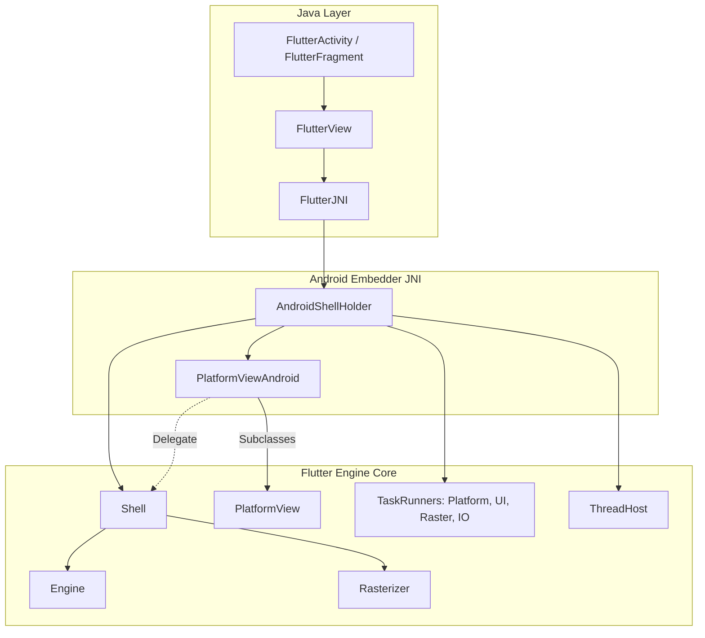

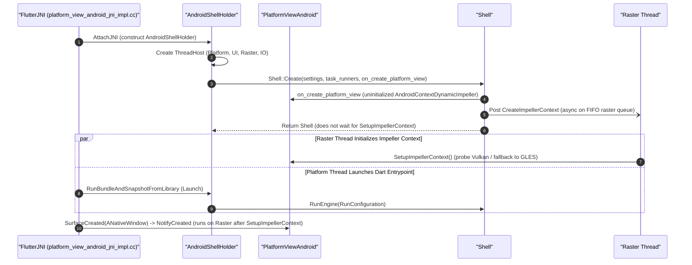

### Dependency Entanglement in [`BUILD.gn`](https://github.com/flutter/flutter/blob/4762dec4fc9072cd9269814ef36364f35a9a66dc/engine/src/flutter/shell/platform/android/BUILD.gn)

[`shell/platform/android/`](https://github.com/flutter/flutter/tree/4762dec4fc9072cd9269814ef36364f35a9a66dc/engine/src/flutter/shell/platform/android) includes 98 internal engine headers across 9 subsystems:

<details>

| Subsystem & Headers | Direct GN Dependencies | Key Internal Headers | Functional Purpose in Embedder |
| :--- | :--- | :--- | :--- |
| **Impeller & Graphics Context Setup**<br/>(29 headers) | [`//flutter/impeller`](https://github.com/flutter/flutter/tree/4762dec4fc9072cd9269814ef36364f35a9a66dc/engine/src/flutter/impeller)<br/>[`//flutter/impeller/toolkit/android`](https://github.com/flutter/flutter/tree/4762dec4fc9072cd9269814ef36364f35a9a66dc/engine/src/flutter/impeller/toolkit/android)<br/>[`//flutter/impeller/toolkit/egl`](https://github.com/flutter/flutter/tree/4762dec4fc9072cd9269814ef36364f35a9a66dc/engine/src/flutter/impeller/toolkit/egl)<br/>[`//flutter/impeller/toolkit/gles`](https://github.com/flutter/flutter/tree/4762dec4fc9072cd9269814ef36364f35a9a66dc/engine/src/flutter/impeller/toolkit/gles)<br/>[`//flutter/impeller/toolkit/glvk`](https://github.com/flutter/flutter/tree/4762dec4fc9072cd9269814ef36364f35a9a66dc/engine/src/flutter/impeller/toolkit/glvk) | [`renderer/backend/vulkan/context_vk.h`](https://github.com/flutter/flutter/blob/4762dec4fc9072cd9269814ef36364f35a9a66dc/engine/src/flutter/impeller/renderer/backend/vulkan/context_vk.h)<br/>[`surface_context_vk.h`](https://github.com/flutter/flutter/blob/4762dec4fc9072cd9269814ef36364f35a9a66dc/engine/src/flutter/impeller/renderer/backend/vulkan/surface_context_vk.h)<br/>[`renderer/backend/gles/context_gles.h`](https://github.com/flutter/flutter/blob/4762dec4fc9072cd9269814ef36364f35a9a66dc/engine/src/flutter/impeller/renderer/backend/gles/context_gles.h)<br/>[`toolkit/android/hardware_buffer.h`](https://github.com/flutter/flutter/blob/4762dec4fc9072cd9269814ef36364f35a9a66dc/engine/src/flutter/impeller/toolkit/android/hardware_buffer.h)<br/>[`renderer/backend/vulkan/android/ahb_texture_source_vk.h`](https://github.com/flutter/flutter/blob/4762dec4fc9072cd9269814ef36364f35a9a66dc/engine/src/flutter/impeller/renderer/backend/vulkan/android/ahb_texture_source_vk.h) | Initializing rendering contexts on the raster thread ([`SetupImpellerContext`](https://github.com/flutter/flutter/blob/4762dec4fc9072cd9269814ef36364f35a9a66dc/engine/src/flutter/shell/platform/android/platform_view_android.h#L128)), creating Vulkan and EGL swapchains, and managing zero-copy [`AHardwareBuffer`](https://developer.android.com/ndk/reference/group/a-hardware-buffer) imports. |
| **Platform Views & Layer Compositing**<br/>(2 headers) | [`//flutter/flow`](https://github.com/flutter/flutter/tree/4762dec4fc9072cd9269814ef36364f35a9a66dc/engine/src/flutter/flow) | [`flow/embedded_views.h`](https://github.com/flutter/flutter/blob/4762dec4fc9072cd9269814ef36364f35a9a66dc/engine/src/flutter/flow/embedded_views.h)<br/>[`flow/surface.h`](https://github.com/flutter/flutter/blob/4762dec4fc9072cd9269814ef36364f35a9a66dc/engine/src/flutter/flow/surface.h) | Platform view compositing across Hybrid Composition++ (HCPP via [`SurfaceControl`](https://developer.android.com/reference/android/view/SurfaceControl)), Hybrid Composition (HC), Texture Layer Hybrid Composition (TLHC), and Virtual Displays (VD); managing geometric clipping and transforms via [`flutter::MutatorsStack`](https://github.com/flutter/flutter/blob/4762dec4fc9072cd9269814ef36364f35a9a66dc/engine/src/flutter/flow/embedded_views.h#L211), view slicing, surface pooling ([`surface_pool.h`](https://github.com/flutter/flutter/blob/4762dec4fc9072cd9269814ef36364f35a9a66dc/engine/src/flutter/shell/platform/android/external_view_embedder/surface_pool.h)), and multi-surface composition frame results ([`external_view_embedder_2.h`](https://github.com/flutter/flutter/blob/4762dec4fc9072cd9269814ef36364f35a9a66dc/engine/src/flutter/shell/platform/android/external_view_embedder/external_view_embedder_2.h)). |
| **External Textures & Surface Control**<br/>(5 headers) | [`//flutter/common/graphics`](https://github.com/flutter/flutter/tree/4762dec4fc9072cd9269814ef36364f35a9a66dc/engine/src/flutter/common/graphics)<br/>[`//flutter/display_list`](https://github.com/flutter/flutter/tree/4762dec4fc9072cd9269814ef36364f35a9a66dc/engine/src/flutter/display_list) | [`common/graphics/texture.h`](https://github.com/flutter/flutter/blob/4762dec4fc9072cd9269814ef36364f35a9a66dc/engine/src/flutter/common/graphics/texture.h)<br/>[`common/graphics/gl_context_switch.h`](https://github.com/flutter/flutter/blob/4762dec4fc9072cd9269814ef36364f35a9a66dc/engine/src/flutter/common/graphics/gl_context_switch.h)<br/>[`display_list/image/dl_image_skia.h`](https://github.com/flutter/flutter/blob/4762dec4fc9072cd9269814ef36364f35a9a66dc/engine/src/flutter/display_list/image/dl_image_skia.h)<br/>[`display_list/geometry/dl_geometry_types.h`](https://github.com/flutter/flutter/blob/4762dec4fc9072cd9269814ef36364f35a9a66dc/engine/src/flutter/display_list/geometry/dl_geometry_types.h) | Texture lifecycle and frame updates for Android [`SurfaceTexture`](https://developer.android.com/reference/android/graphics/SurfaceTexture) (OpenGL ES) and [`SurfaceProducer`](https://github.com/flutter/flutter/blob/4762dec4fc9072cd9269814ef36364f35a9a66dc/engine/src/flutter/shell/platform/android/io/flutter/view/TextureRegistry.java#L21) (Vulkan); feeding decoded video and camera frames into the [`DisplayList`](https://github.com/flutter/flutter/blob/4762dec4fc9072cd9269814ef36364f35a9a66dc/engine/src/flutter/display_list/display_list.h) compositor. |
| **Engine Core, Lifecycle & Threading**<br/>(11 headers) | [`//flutter/shell/common`](https://github.com/flutter/flutter/tree/4762dec4fc9072cd9269814ef36364f35a9a66dc/engine/src/flutter/shell/common) | [`shell/common/shell.h`](https://github.com/flutter/flutter/blob/4762dec4fc9072cd9269814ef36364f35a9a66dc/engine/src/flutter/shell/common/shell.h)<br/>[`thread_host.h`](https://github.com/flutter/flutter/blob/4762dec4fc9072cd9269814ef36364f35a9a66dc/engine/src/flutter/shell/common/thread_host.h)<br/>[`platform_view.h`](https://github.com/flutter/flutter/blob/4762dec4fc9072cd9269814ef36364f35a9a66dc/engine/src/flutter/shell/common/platform_view.h)<br/>[`rasterizer.h`](https://github.com/flutter/flutter/blob/4762dec4fc9072cd9269814ef36364f35a9a66dc/engine/src/flutter/shell/common/rasterizer.h)<br/>[`run_configuration.h`](https://github.com/flutter/flutter/blob/4762dec4fc9072cd9269814ef36364f35a9a66dc/engine/src/flutter/shell/common/run_configuration.h)<br/>[`vsync_waiter.h`](https://github.com/flutter/flutter/blob/4762dec4fc9072cd9269814ef36364f35a9a66dc/engine/src/flutter/shell/common/vsync_waiter.h)<br/>[`snapshot_surface_producer.h`](https://github.com/flutter/flutter/blob/4762dec4fc9072cd9269814ef36364f35a9a66dc/engine/src/flutter/shell/common/snapshot_surface_producer.h) | Direct instantiation of [`flutter::Shell::Create(...)`](https://github.com/flutter/flutter/blob/4762dec4fc9072cd9269814ef36364f35a9a66dc/engine/src/flutter/shell/common/shell.h#L170-L176), thread host allocation (Platform, UI, Raster, IO), vsync scheduling, snapshot generation, and rasterizer coordination. |
| **UI Layer & Message Dispatch**<br/>(5 headers) | [`//flutter/lib/ui`](https://github.com/flutter/flutter/tree/4762dec4fc9072cd9269814ef36364f35a9a66dc/engine/src/flutter/lib/ui) | [`lib/ui/window/platform_message.h`](https://github.com/flutter/flutter/blob/4762dec4fc9072cd9269814ef36364f35a9a66dc/engine/src/flutter/lib/ui/window/platform_message.h)<br/>[`platform_message_response.h`](https://github.com/flutter/flutter/blob/4762dec4fc9072cd9269814ef36364f35a9a66dc/engine/src/flutter/lib/ui/window/platform_message_response.h)<br/>[`lib/ui/plugins/callback_cache.h`](https://github.com/flutter/flutter/blob/4762dec4fc9072cd9269814ef36364f35a9a66dc/engine/src/flutter/lib/ui/plugins/callback_cache.h)<br/>[`lib/ui/painting/image_generator.h`](https://github.com/flutter/flutter/blob/4762dec4fc9072cd9269814ef36364f35a9a66dc/engine/src/flutter/lib/ui/painting/image_generator.h) | Binary message encoding and decoding for platform channels, background Dart entrypoint lookup ([`PluginUtilities.getCallbackHandle`](https://github.com/flutter/flutter/blob/4762dec4fc9072cd9269814ef36364f35a9a66dc/engine/src/flutter/lib/ui/plugins.dart#L54) via [`callback_cache.h`](https://github.com/flutter/flutter/blob/4762dec4fc9072cd9269814ef36364f35a9a66dc/engine/src/flutter/lib/ui/plugins/callback_cache.h)), and native platform image decoding. |
| **Dart VM, Runtime & Service Isolate**<br/>(2 headers) | [`//flutter/runtime`](https://github.com/flutter/flutter/tree/4762dec4fc9072cd9269814ef36364f35a9a66dc/engine/src/flutter/runtime)<br/>[`//flutter/runtime:libdart`](https://github.com/flutter/flutter/blob/4762dec4fc9072cd9269814ef36364f35a9a66dc/engine/src/flutter/runtime/BUILD.gn) | [`runtime/dart_vm.h`](https://github.com/flutter/flutter/blob/4762dec4fc9072cd9269814ef36364f35a9a66dc/engine/src/flutter/runtime/dart_vm.h)<br/>[`runtime/dart_service_isolate.h`](https://github.com/flutter/flutter/blob/4762dec4fc9072cd9269814ef36364f35a9a66dc/engine/src/flutter/runtime/dart_service_isolate.h) | Managing the Dart VM lifecycle, configuring concurrent message loops, isolate creation, and Dart service isolate initialization. |
| **Asset Management & Packaging**<br/>(1 header) | [`//flutter/assets`](https://github.com/flutter/flutter/tree/4762dec4fc9072cd9269814ef36364f35a9a66dc/engine/src/flutter/assets) | [`assets/asset_resolver.h`](https://github.com/flutter/flutter/blob/4762dec4fc9072cd9269814ef36364f35a9a66dc/engine/src/flutter/assets/asset_resolver.h) | Resolving assets and kernel blobs packaged within the Android APK via [`APKAssetProvider`](https://github.com/flutter/flutter/blob/4762dec4fc9072cd9269814ef36364f35a9a66dc/engine/src/flutter/shell/platform/android/apk_asset_provider.h#L17). |
| **GPU Backends & Surface Delegates**<br/>(5 headers) | [`//flutter/shell/gpu`](https://github.com/flutter/flutter/tree/4762dec4fc9072cd9269814ef36364f35a9a66dc/engine/src/flutter/shell/gpu)<br/>[`//flutter/vulkan`](https://github.com/flutter/flutter/tree/4762dec4fc9072cd9269814ef36364f35a9a66dc/engine/src/flutter/vulkan) | [`shell/gpu/gpu_surface_gl_impeller.h`](https://github.com/flutter/flutter/blob/4762dec4fc9072cd9269814ef36364f35a9a66dc/engine/src/flutter/shell/gpu/gpu_surface_gl_impeller.h)<br/>[`gpu_surface_vulkan_impeller.h`](https://github.com/flutter/flutter/blob/4762dec4fc9072cd9269814ef36364f35a9a66dc/engine/src/flutter/shell/gpu/gpu_surface_vulkan_impeller.h)<br/>[`vulkan/vulkan_native_surface_android.h`](https://github.com/flutter/flutter/blob/4762dec4fc9072cd9269814ef36364f35a9a66dc/engine/src/flutter/vulkan/vulkan_native_surface_android.h) | Implementing platform window surface delegates for OpenGL and Vulkan render pipelines. |
| **Foundational Utilities & Concurrency**<br/>(24 headers) | [`//flutter/fml`](https://github.com/flutter/flutter/tree/4762dec4fc9072cd9269814ef36364f35a9a66dc/engine/src/flutter/fml) | [`fml/raster_thread_merger.h`](https://github.com/flutter/flutter/blob/4762dec4fc9072cd9269814ef36364f35a9a66dc/engine/src/flutter/fml/raster_thread_merger.h)<br/>[`fml/task_runner.h`](https://github.com/flutter/flutter/blob/4762dec4fc9072cd9269814ef36364f35a9a66dc/engine/src/flutter/fml/task_runner.h)<br/>[`fml/message_loop.h`](https://github.com/flutter/flutter/blob/4762dec4fc9072cd9269814ef36364f35a9a66dc/engine/src/flutter/fml/message_loop.h)<br/>[`fml/concurrent_message_loop.h`](https://github.com/flutter/flutter/blob/4762dec4fc9072cd9269814ef36364f35a9a66dc/engine/src/flutter/fml/concurrent_message_loop.h)<br/>[`fml/platform/android/jni_util.h`](https://github.com/flutter/flutter/blob/4762dec4fc9072cd9269814ef36364f35a9a66dc/engine/src/flutter/fml/platform/android/jni_util.h)<br/>[`fml/platform/android/scoped_java_ref.h`](https://github.com/flutter/flutter/blob/4762dec4fc9072cd9269814ef36364f35a9a66dc/engine/src/flutter/fml/platform/android/scoped_java_ref.h) | Message loops, JNI handle wrappers, task scheduling, and raster thread leasing. |
</details>

## Detailed Design

The following sections specify the [`embedder.h`](https://github.com/flutter/flutter/blob/4762dec4fc9072cd9269814ef36364f35a9a66dc/engine/src/flutter/shell/platform/embedder/embedder.h) additions and behavioral changes required to decouple the Android embedder from internal engine headers.

### Initialization

> [!IMPORTANT]
> - **Embedder API additions (`embedder.h`)**: Adds `kDeferred` (`FlutterDeferredRendererConfig`), `FlutterRendererConfigResolveCallback`, `FlutterRendererResolveInfo`, and `FlutterRendererRejectReason` to [`FlutterRendererConfig`](https://github.com/flutter/flutter/blob/4762dec4fc9072cd9269814ef36364f35a9a66dc/engine/src/flutter/shell/platform/embedder/embedder.h#L1055).
> - **Behavioral changes**:
>   - [`PlatformViewEmbedder`](https://github.com/flutter/flutter/blob/4762dec4fc9072cd9269814ef36364f35a9a66dc/engine/src/flutter/shell/platform/embedder/platform_view_embedder.h#L36), [`EmbedderSurfaceVulkanImpeller`](https://github.com/flutter/flutter/blob/4762dec4fc9072cd9269814ef36364f35a9a66dc/engine/src/flutter/shell/platform/embedder/embedder_surface_vulkan_impeller.h), and [`EmbedderSurfaceGLImpeller`](https://github.com/flutter/flutter/blob/4762dec4fc9072cd9269814ef36364f35a9a66dc/engine/src/flutter/shell/platform/embedder/embedder_surface_gl_impeller.h) move [`impeller::Context`](https://github.com/flutter/flutter/blob/4762dec4fc9072cd9269814ef36364f35a9a66dc/engine/src/flutter/impeller/renderer/context.h#L70) creation from their UI-thread constructors into `PlatformViewEmbedder::SetupImpellerContext()` on the raster thread, and `PlatformViewEmbedder::NotifyCreated()` queues surface creation on the FIFO raster task runner instead of blocking the UI thread on a latch.
>   - If the engine rejects a `kVulkan` configuration returned by `resolve_callback` (because context creation fails or the driver matches [`DriverInfoVK::IsKnownBadDriver()`](https://github.com/flutter/flutter/blob/4762dec4fc9072cd9269814ef36364f35a9a66dc/engine/src/flutter/impeller/renderer/backend/vulkan/driver_info_vk.cc#L377)), it re-invokes `resolve_callback` with the rejection reason so the embedder can destroy its `VkDevice` and return `kOpenGL`.

<details>
<summary>Why <code>shell/platform/embedder/</code> must change to preserve non-blocking startup</summary>

[`PlatformView::SetupImpellerContext()`](https://github.com/flutter/flutter/blob/4762dec4fc9072cd9269814ef36364f35a9a66dc/engine/src/flutter/shell/common/platform_view.h#L1040) was added in [#167765](https://github.com/flutter/flutter/pull/167765) because Vulkan driver and context initialization can take 100+ ms on Android devices, but [#167765](https://github.com/flutter/flutter/pull/167765) only wired it up in `PlatformViewAndroid`:

- [`EmbedderSurfaceVulkanImpeller`](https://github.com/flutter/flutter/blob/4762dec4fc9072cd9269814ef36364f35a9a66dc/engine/src/flutter/shell/platform/embedder/embedder_surface_vulkan_impeller.cc#L76-L95) and [`EmbedderSurfaceGLImpeller`](https://github.com/flutter/flutter/blob/4762dec4fc9072cd9269814ef36364f35a9a66dc/engine/src/flutter/shell/platform/embedder/embedder_surface_gl_impeller.cc#L98-L125) currently construct `impeller::ContextVK` and `impeller::ContextGLES` synchronously in their constructors on the UI thread during `FlutterEngineRunInitialized`.
- [`PlatformView::NotifyCreated()`](https://github.com/flutter/flutter/blob/4762dec4fc9072cd9269814ef36364f35a9a66dc/engine/src/flutter/shell/common/platform_view.cc#L64-L85) (called by `FlutterEngineRunInitialized` right after `LaunchShell()`) posts `CreateRenderingSurface()` to the FIFO raster task runner behind `CreateImpellerContext` and blocks the UI thread on `latch.Wait()`.

Moving context creation into `PlatformViewEmbedder::SetupImpellerContext()` and making `PlatformViewEmbedder::NotifyCreated()` queue [`Shell::OnPlatformViewCreated`](https://github.com/flutter/flutter/blob/4762dec4fc9072cd9269814ef36364f35a9a66dc/engine/src/flutter/shell/common/shell.cc#L973-L1062) on the raster task runner without a latch keeps both backend probing (`resolve_callback`) and `impeller::Context` creation off the UI thread.
</details>

```c
// FlutterRendererConfig gains a struct tag so that the callback below can
// refer to it. Adding a tag to a typedef'd struct is source and ABI compatible.
typedef struct FlutterRendererConfig FlutterRendererConfig;

typedef enum {
  // ... existing values ...
  /// The embedder chooses the renderer on the raster thread while the engine
  /// launches. See |FlutterDeferredRendererConfig|.
  kDeferred,
} FlutterRendererType;

typedef enum {
  kFlutterRendererRejectReasonNone = 0,
  /// The configuration failed validation (missing callbacks, a type this build
  /// or these settings do not support, or `kDeferred` itself).
  kFlutterRendererRejectReasonInvalidConfig,
  /// The engine could not create a rendering context from the configuration,
  /// for example because the Vulkan device lacks a required extension.
  kFlutterRendererRejectReasonContextCreationFailed,
  /// The Vulkan driver is on the engine's list of known-bad drivers.
  kFlutterRendererRejectReasonKnownBadDriver,
} FlutterRendererRejectReason;

typedef struct {
  /// The size of this struct. Must be sizeof(FlutterRendererResolveInfo).
  size_t struct_size;
  /// 0 on the first call; incremented after each rejected configuration.
  size_t attempt;
  /// The type of the previously returned configuration. Unset on attempt 0.
  FlutterRendererType rejected_type;
  /// Why the previous configuration was rejected. None on attempt 0.
  FlutterRendererRejectReason reject_reason;
} FlutterRendererResolveInfo;

/// @param[in]  user_data   The `user_data` passed to `FlutterEngineInitialize`
///                         or `FlutterEngineRun`.
/// @param[in]  info        Which attempt this is and, after a rejection, why.
/// @param[out] config_out  Zero-initialized, engine-owned. Set `type` to
///                         `kOpenGL`, `kSoftware`, `kMetal` or `kVulkan` and
///                         fill in that union member. Memory it references must
///                         stay valid until `FlutterEngineDeinitialize` returns
///                         for this engine and every engine spawned from it.
/// @return     `false` if no renderer can be created.
typedef bool (*FlutterRendererConfigResolveCallback)(
    void* /* user_data */,
    const FlutterRendererResolveInfo* /* info */,
    FlutterRendererConfig* /* config_out */);

typedef struct {
  /// The size of this struct. Must be sizeof(FlutterDeferredRendererConfig).
  size_t struct_size;
  /// Required. Called on the raster task runner before the engine creates its
  /// rendering context, while the engine launches. If the engine rejects the
  /// returned configuration, it releases every object it created from it
  /// (embedder-provided handles are never destroyed by the engine) and calls
  /// this again with the reason; return `false` to stop. The engine creates
  /// its rendering surface after this returns, so only
  /// `FlutterEngineDeinitialize` and `FlutterEngineShutdown` wait for it. The
  /// callback may block, but it must not wait on the platform thread.
  /// Engines created with `FlutterEngineSpawn` reuse the resolved
  /// configuration and rendering context; the callback is not called for
  /// them.
  FlutterRendererConfigResolveCallback resolve_callback;
} FlutterDeferredRendererConfig;

struct FlutterRendererConfig {
  FlutterRendererType type;
  union {
    FlutterOpenGLRendererConfig open_gl;
    FlutterSoftwareRendererConfig software;
    FlutterMetalRendererConfig metal;
    FlutterVulkanRendererConfig vulkan;
    FlutterDeferredRendererConfig deferred;
  };
};
```

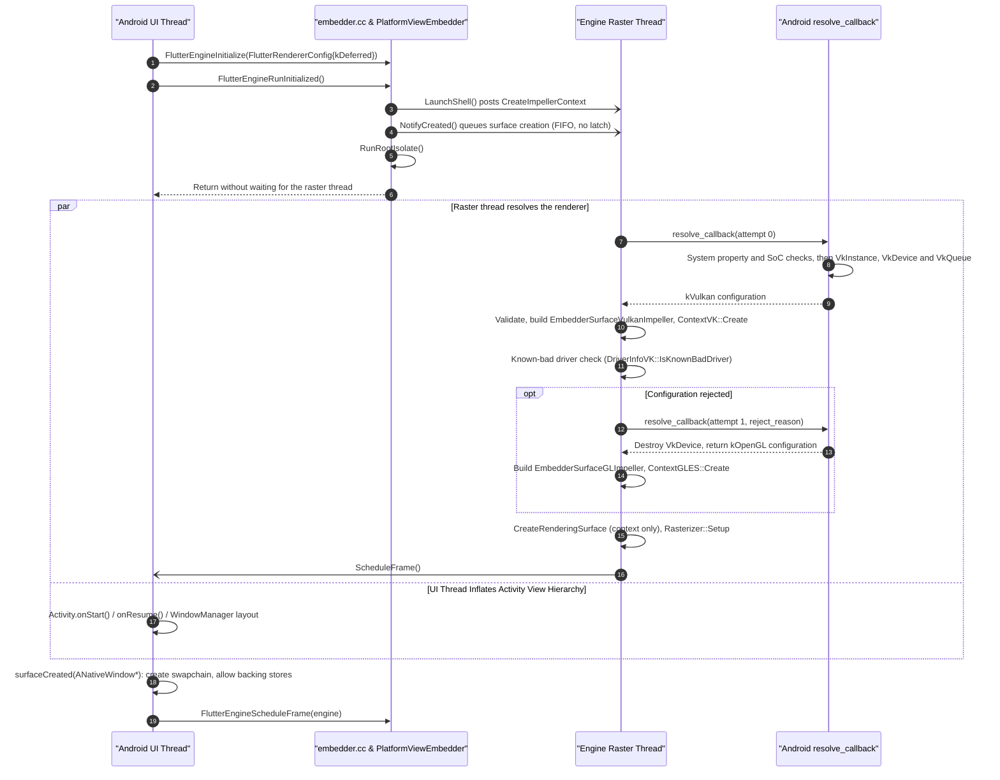

### Platform Views

> [!IMPORTANT]
> - **Embedder API additions (`embedder.h`)**: Adds `FlutterBackingStoreConfig.is_root_layer` (`bool`) and `FlutterCompositor.merge_raster_thread_on_platform_views` (`bool`).
> - **Behavioral changes**:
>   - Replaces [`AndroidExternalViewEmbedder`](https://github.com/flutter/flutter/blob/4762dec4fc9072cd9269814ef36364f35a9a66dc/engine/src/flutter/shell/platform/android/external_view_embedder/external_view_embedder.h#L29) and [`AndroidExternalViewEmbedder2`](https://github.com/flutter/flutter/blob/4762dec4fc9072cd9269814ef36364f35a9a66dc/engine/src/flutter/shell/platform/android/external_view_embedder/external_view_embedder_2.h#L34) with [`FlutterCompositor`](https://github.com/flutter/flutter/blob/4762dec4fc9072cd9269814ef36364f35a9a66dc/engine/src/flutter/shell/platform/embedder/embedder.h#L2264-L2322), using `is_root_layer` to distinguish the bottom-most background layer from full-screen overlay layers above a platform view.
>   - [`EmbedderExternalViewEmbedder`](https://github.com/flutter/flutter/blob/4762dec4fc9072cd9269814ef36364f35a9a66dc/engine/src/flutter/shell/platform/embedder/embedder_external_view_embedder.h#L30) implements `SupportsDynamicThreadMerging()` and `PostPrerollAction()` when `merge_raster_thread_on_platform_views` is `true`, dynamically merging the raster task runner onto the platform thread during Hybrid Composition (HC) frames.

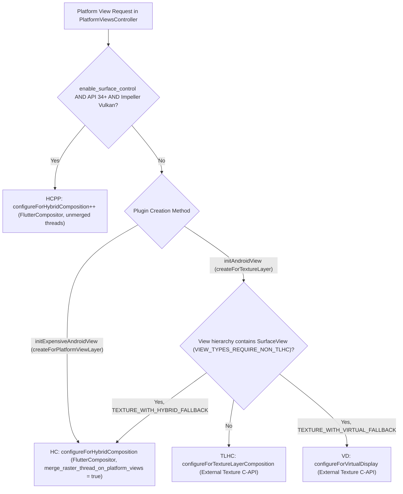

```c
typedef struct {
  /// The size of this struct. Must be sizeof(FlutterBackingStoreConfig).
  size_t struct_size;
  /// The size of the render target the engine expects to render into.
  FlutterSize size;
  /// The identifier for the view that the engine will use this backing store to
  /// render into.
  FlutterViewId view_id;
  /// True if this backing store is for the bottom-most layer of the frame for
  /// `view_id`, with no platform view composited beneath it. The engine
  /// requests at most one such backing store per view per frame, and none when
  /// all Flutter contents are composited above platform views. False for all
  /// other layers. Read this field only if `struct_size` covers it, and treat
  /// it as false otherwise.
  ///
  /// An embedder may return the view's on-screen render target (for example,
  /// the next swapchain image or default framebuffer) when this is true. The
  /// engine's backing store cache ignores this field, so such an embedder must
  /// set `FlutterCompositor.avoid_backing_store_cache` to true.
  bool is_root_layer;
} FlutterBackingStoreConfig;
```

#### Opt-In Dynamic Raster Thread Merging for Hybrid Composition

The Android embedder sets `merge_raster_thread_on_platform_views = true` when HCPP (`enable_surface_control`) is not active, and `false` when HCPP is active:

```c
typedef struct {
  // ... existing fields ...
  /// When true, the engine dynamically merges the raster task runner onto the
  /// platform task runner for frames that composite one or more
  /// `kFlutterLayerContentTypePlatformView` layers, holding a short frame
  /// lease before unmerging once platform views leave the scene.
  ///
  /// While the threads are merged, `create_backing_store_callback`,
  /// `collect_backing_store_callback`, and `present_view_callback` (or
  /// `present_layers_callback`) execute on the platform thread.
  ///
  /// Requires engine-managed message loop task queues for the platform and
  /// render threads (`FlutterCustomTaskRunners.platform_task_runner` and
  /// `render_task_runner` must be NULL so the engine binds `fml::MessageLoop`
  /// to the calling platform thread and creates the raster thread).
  bool merge_raster_thread_on_platform_views;
} FlutterCompositor;
```

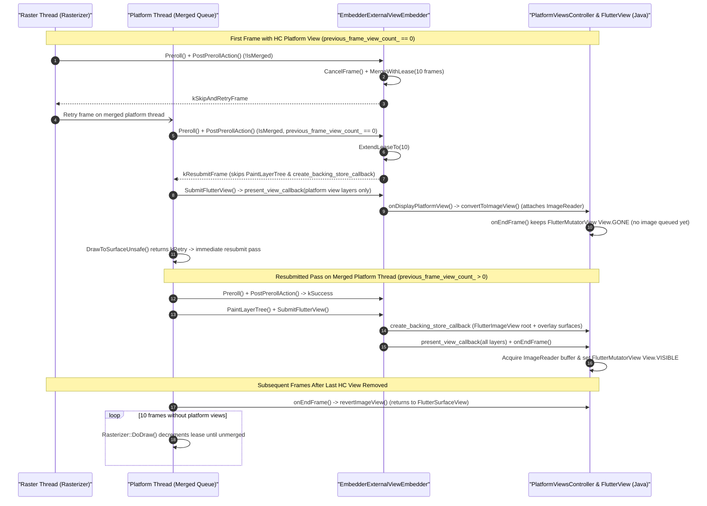

When HCPP (`enable_surface_control` on API 34+ with Impeller Vulkan) is active, `merge_raster_thread_on_platform_views` is `false` and `AndroidSurfaceControl` exports an acquire fence on its `VkQueue` inside `present_view_callback`:

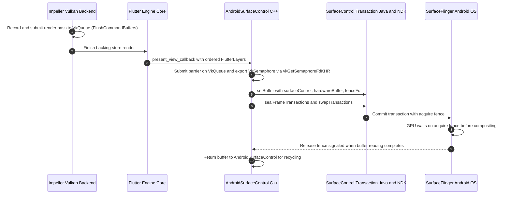

### Platform View Mutator Stack Serialization

> [!IMPORTANT]
> - **Embedder API additions (`embedder.h`)**: Adds `FlutterPath` (`FlutterPathFillType`, `FlutterPathVerb`), `kFlutterPlatformViewMutationTypeClipPath`, and `FlutterCompositor.platform_view_mutation_capabilities` (`FlutterPlatformViewMutationCapability`).
> - **Behavioral changes**:
>   - Arbitrary path clips serialize into an ABI-stable structure-of-arrays `FlutterPath` layout instead of exposing `SkPath` or `//flutter/flow` headers.
>   - On Android API 34+ (`android.graphics.Path.conicTo`), the Android compositor sets `kFlutterPlatformViewMutationCapabilityPathConics` to receive exact conic path verbs (`kFlutterPathVerbConic`), and `AndroidMutatorsMapper` translates `FlutterPlatformView.mutations` into Java [`FlutterMutatorView`](https://github.com/flutter/flutter/blob/4762dec4fc9072cd9269814ef36364f35a9a66dc/engine/src/flutter/shell/platform/android/io/flutter/embedding/engine/mutatorsstack/FlutterMutatorView.java#L32) and [`SurfaceControl.Transaction`](https://developer.android.com/reference/android/view/SurfaceControl.Transaction) transforms.

```c
typedef enum {
  kFlutterPlatformViewMutationTypeOpacity,
  kFlutterPlatformViewMutationTypeClipRect,
  kFlutterPlatformViewMutationTypeClipRoundedRect,
  kFlutterPlatformViewMutationTypeTransformation,
  kFlutterPlatformViewMutationTypeClipPath,
} FlutterPlatformViewMutationType;

typedef struct {
  FlutterPlatformViewMutationType type;
  union {
    double opacity;
    FlutterRect clip_rect;
    FlutterRoundedRect clip_rounded_rect;
    FlutterTransformation transformation;
    const FlutterPath* clip_path;
  };
} FlutterPlatformViewMutation;

typedef enum {
  kFlutterPathFillTypeNonZero,
  kFlutterPathFillTypeEvenOdd,
} FlutterPathFillType;

typedef enum {
  kFlutterPathVerbMove,
  kFlutterPathVerbLine,
  kFlutterPathVerbQuad,
  kFlutterPathVerbConic,
  kFlutterPathVerbCubic,
  kFlutterPathVerbClose,
} FlutterPathVerb;

typedef struct {
  /// The size of this struct. Must be sizeof(FlutterPath).
  size_t struct_size;
  /// The fill rule for this path.
  FlutterPathFillType fill_type;
  /// The number of entries in `verbs`.
  size_t verbs_count;
  /// The path verbs, in drawing order. Every contour begins with
  /// `kFlutterPathVerbMove`. Valid only for the duration of the frame
  /// presentation callback.
  const FlutterPathVerb* verbs;
  /// The number of entries in `points`. Equals the sum of the points used by
  /// each verb: move 1, line 1, quad 2, conic 2, cubic 3, close 0.
  size_t points_count;
  /// The points, consumed in verb order. Valid only for the duration of the
  /// frame presentation callback.
  const FlutterPoint* points;
  /// The number of entries in `conic_weights`. Equals the number of
  /// `kFlutterPathVerbConic` verbs.
  size_t conic_weights_count;
  /// The conic weights, consumed in verb order. Valid only for the duration of
  /// the frame presentation callback.
  const double* conic_weights;
  /// Conservative control-point bounds containing all points of the path, in
  /// the same coordinate space. An embedder that cannot clip to a path clips
  /// to this rectangle.
  FlutterRect bounds;
} FlutterPath;

/// Optional platform view mutation features that a compositor can consume.
///
/// The engine only emits a mutation type or path verb that is gated by one of
/// these bits when the compositor sets that bit in
/// `FlutterCompositor.platform_view_mutation_capabilities`.
typedef enum {
  /// Only the default mutation types and path verbs are emitted.
  kFlutterPlatformViewMutationCapabilityDefault = 0,
  /// Clip paths may contain `kFlutterPathVerbConic` verbs. Without this bit,
  /// the engine converts conics to quadratic Bezier curves before handing
  /// paths to the embedder.
  kFlutterPlatformViewMutationCapabilityPathConics = 1 << 0,
} FlutterPlatformViewMutationCapability;

typedef struct {
  size_t struct_size;
  FlutterPlatformViewIdentifier identifier;
  size_t mutations_count;
  /// Applied in order. The first entry is a transformation mutation when a
  /// device pixel ratio or root surface transformation is in effect, so that
  /// subsequent mutations are already in the correct coordinate space.
  const FlutterPlatformViewMutation** mutations;
} FlutterPlatformView;
```

### External Textures

> [!IMPORTANT]
> To replace the internal `flutter::Texture` subclasses ([`ImageExternalTexture`](https://github.com/flutter/flutter/blob/4762dec4fc9072cd9269814ef36364f35a9a66dc/engine/src/flutter/shell/platform/android/image_external_texture.h#L36) and [`SurfaceTextureExternalTexture`](https://github.com/flutter/flutter/blob/4762dec4fc9072cd9269814ef36364f35a9a66dc/engine/src/flutter/shell/platform/android/surface_texture_external_texture.h#L33)) across both [`SurfaceProducer`](https://github.com/flutter/flutter/blob/4762dec4fc9072cd9269814ef36364f35a9a66dc/engine/src/flutter/shell/platform/android/io/flutter/view/TextureRegistry.java#L21) (`AHardwareBuffer`) and [`SurfaceTexture`](https://developer.android.com/reference/android/graphics/SurfaceTexture) (`GL_TEXTURE_EXTERNAL_OES`) pipelines:
>
> - **Embedder API additions (`embedder.h`)**: Adds `FlutterVulkanYcbcrConversionInfo` (`FlutterVulkanComponentMapping`, `FlutterVulkanComponentSwizzle`) and `FlutterVulkanExternalTexture.ycbcr_conversion_info` (extending [`FlutterVulkanExternalTexture` from #188855](https://github.com/flutter/flutter/pull/188855)); adds `FlutterOpenGLExternalTexture` (with `FlutterTransformation uv_transform`) and `FlutterOpenGLRendererConfig.external_texture_frame_callback` (`FlutterOpenGLTextureFrameCallback`, deprecating `gl_external_texture_frame_callback`).
> - **Behavioral changes**: The Vulkan renderer samples multi-planar and vendor-specific external YCbCr camera and video frames (`VkSamplerYcbcrConversion`) without exposing Android `AHardwareBuffer` types in `embedder.h`, and the OpenGL ES renderer applies `SurfaceTexture.getTransformMatrix()` UV transforms while keeping [`FlutterOpenGLTexture`](https://github.com/flutter/flutter/blob/4762dec4fc9072cd9269814ef36364f35a9a66dc/engine/src/flutter/shell/platform/embedder/embedder.h#L519-L540) unchanged for backing store render targets.

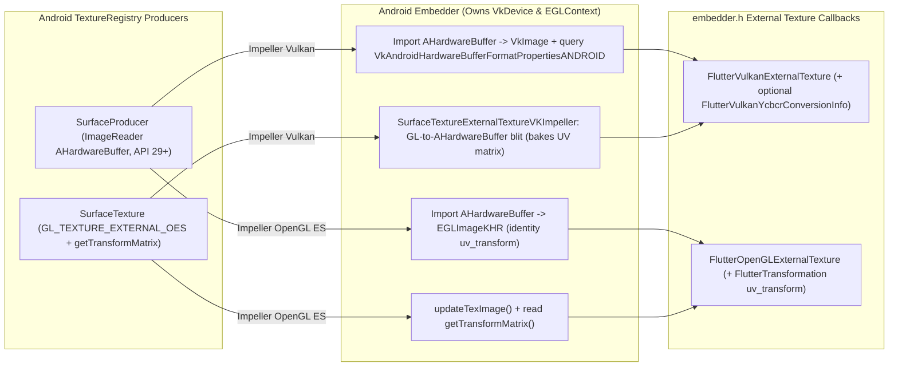

```c
/// VkComponentSwizzle values for FlutterVulkanComponentMapping.
typedef enum {
  kFlutterVulkanComponentSwizzleIdentity = 0,
  kFlutterVulkanComponentSwizzleZero = 1,
  kFlutterVulkanComponentSwizzleOne = 2,
  kFlutterVulkanComponentSwizzleR = 3,
  kFlutterVulkanComponentSwizzleG = 4,
  kFlutterVulkanComponentSwizzleB = 5,
  kFlutterVulkanComponentSwizzleA = 6,
} FlutterVulkanComponentSwizzle;

/// Equivalent to VkComponentMapping for YCbCr conversion.
typedef struct {
  FlutterVulkanComponentSwizzle r;
  FlutterVulkanComponentSwizzle g;
  FlutterVulkanComponentSwizzle b;
  FlutterVulkanComponentSwizzle a;
} FlutterVulkanComponentMapping;

/// Parameters for creating a VkSamplerYcbcrConversion when sampling an
/// external-format or YCbCr-encoded VkImage (mirrors
/// VkSamplerYcbcrConversionCreateInfo and VkExternalFormatANDROID).
typedef struct {
  /// The size of this struct. Must be sizeof(FlutterVulkanYcbcrConversionInfo).
  size_t struct_size;
  /// The VkFormat of the image, or VK_FORMAT_UNDEFINED (0) when using
  /// `external_format`.
  uint32_t format;
  /// VkSamplerYcbcrModelConversion value.
  uint32_t ycbcr_model;
  /// VkSamplerYcbcrRange value.
  uint32_t ycbcr_range;
  /// Component swizzle mapping.
  FlutterVulkanComponentMapping components;
  /// VkChromaLocation for X chroma samples.
  uint32_t x_chroma_offset;
  /// VkChromaLocation for Y chroma samples.
  uint32_t y_chroma_offset;
  /// VkFilter for chroma reconstruction.
  uint32_t chroma_filter;
  /// Whether explicit chroma reconstruction is forced (VkBool32).
  bool force_explicit_reconstruction;
  /// VkFormatFeatureFlags for the external format.
  uint32_t format_features;
  /// Platform-defined external format identifier (for example from
  /// VkAndroidHardwareBufferFormatPropertiesANDROID.externalFormat), or 0
  /// if `format` is a known Vulkan format.
  uint64_t external_format;
} FlutterVulkanYcbcrConversionInfo;

typedef struct {
  // ... existing members from flutter/flutter#188855 (struct_size, image,
  // format, user_data, destruction_callback, width, height) ...

  /// Optional YCbCr sampler conversion info for multi-planar or
  /// external-format images. NULL for standard RGBA sampling.
  const FlutterVulkanYcbcrConversionInfo* ycbcr_conversion_info;
} FlutterVulkanExternalTexture;

typedef struct {
  /// The size of this struct. Must be sizeof(FlutterOpenGLExternalTexture).
  size_t struct_size;
  /// Target texture of the active texture unit (for example GL_TEXTURE_2D or
  /// GL_TEXTURE_EXTERNAL_OES).
  uint32_t target;
  /// The name of the texture.
  uint32_t name;
  /// The texture format (for example GL_RGBA8). Use GL_RGBA8 when `target`
  /// is GL_TEXTURE_EXTERNAL_OES.
  uint32_t format;
  /// User data to be returned on the invocation of the destruction callback.
  void* user_data;
  /// Callback invoked (on an engine-managed thread) that asks the embedder
  /// to collect the texture.
  VoidCallback destruction_callback;
  /// Width of the texture in pixels.
  size_t width;
  /// Height of the texture in pixels.
  size_t height;
  /// Transformation applied to normalized texture coordinates before
  /// sampling, for example from SurfaceTexture.getTransformMatrix(). An
  /// all-zero or identity matrix draws the texture untransformed.
  FlutterTransformation uv_transform;
} FlutterOpenGLExternalTexture;

typedef bool (*FlutterOpenGLTextureFrameCallback)(
    void* /* user data */,
    int64_t /* texture identifier */,
    size_t /* width */,
    size_t /* height */,
    FlutterOpenGLExternalTexture* /* texture out */);

// Appended to FlutterOpenGLRendererConfig:
FlutterOpenGLTextureFrameCallback external_texture_frame_callback;
```

### Accessibility and Semantics Parity

> [!IMPORTANT]
> To deliver the complete semantics tree to Java [`AccessibilityBridge`](https://github.com/flutter/flutter/blob/4762dec4fc9072cd9269814ef36364f35a9a66dc/engine/src/flutter/shell/platform/android/io/flutter/view/AccessibilityBridge.java#L80) without including internal [`lib/ui/semantics/semantics_node.h`](https://github.com/flutter/flutter/blob/4762dec4fc9072cd9269814ef36364f35a9a66dc/engine/src/flutter/lib/ui/semantics/semantics_node.h) headers:
>
> - **Embedder API additions (`embedder.h`)**: Adds `FlutterSemanticsRole` and appends nine node fields (`max_value_length`, `current_value_length`, `link_url`, `locale`, `min_value`, `max_value`, `hit_test_transform`, `role`, and `hit_test_child_count`) in place to [`FlutterSemanticsNode2`](https://github.com/flutter/flutter/blob/4762dec4fc9072cd9269814ef36364f35a9a66dc/engine/src/flutter/shell/platform/embedder/embedder.h#L1677-L1783).
> - **Behavioral changes**: `hit_test_child_count` separates the length of `children_in_hit_test_order` from `child_count` (`children_in_traversal_order`, which can differ when the framework grafts nodes such as `OverlayPortal`). `AndroidSemanticsMapper` consumes `FlutterSemanticsUpdate2` via `FlutterProjectArgs.update_semantics_callback2` to pack the direct `ByteBuffer` and string pool arrays expected by `AccessibilityBridge`, while accessibility actions route back through `FlutterEngineSendSemanticsAction`.

```c
typedef enum {
  kFlutterSemanticsRoleNone = 0,
  kFlutterSemanticsRoleTab = 1,
  kFlutterSemanticsRoleTabBar = 2,
  kFlutterSemanticsRoleTabPanel = 3,
  kFlutterSemanticsRoleDialog = 4,
  kFlutterSemanticsRoleAlertDialog = 5,
  kFlutterSemanticsRoleTable = 6,
  kFlutterSemanticsRoleCell = 7,
  kFlutterSemanticsRoleRow = 8,
  kFlutterSemanticsRoleColumnHeader = 9,
  kFlutterSemanticsRoleDragHandle = 10,
  kFlutterSemanticsRoleSpinButton = 11,
  kFlutterSemanticsRoleComboBox = 12,
  kFlutterSemanticsRoleMenuBar = 13,
  kFlutterSemanticsRoleMenu = 14,
  kFlutterSemanticsRoleMenuItem = 15,
  kFlutterSemanticsRoleMenuItemCheckbox = 16,
  kFlutterSemanticsRoleMenuItemRadio = 17,
  kFlutterSemanticsRoleList = 18,
  kFlutterSemanticsRoleListItem = 19,
  kFlutterSemanticsRoleForm = 20,
  kFlutterSemanticsRoleTooltip = 21,
  kFlutterSemanticsRoleLoadingSpinner = 22,
  kFlutterSemanticsRoleProgressBar = 23,
  kFlutterSemanticsRoleHotKey = 24,
  kFlutterSemanticsRoleRadioGroup = 25,
  kFlutterSemanticsRoleStatus = 26,
  kFlutterSemanticsRoleAlert = 27,
  kFlutterSemanticsRoleComplementary = 28,
  kFlutterSemanticsRoleContentInfo = 29,
  kFlutterSemanticsRoleMain = 30,
  kFlutterSemanticsRoleNavigation = 31,
  kFlutterSemanticsRoleRegion = 32,
  kFlutterSemanticsRoleSearch = 33,
  kFlutterSemanticsRoleSlider = 34,
  kFlutterSemanticsRoleListBox = 35,
  kFlutterSemanticsRoleOption = 36,
} FlutterSemanticsRole;

// Appended to FlutterSemanticsNode2 in embedder.h:
int32_t max_value_length;
int32_t current_value_length;
const char* link_url;
const char* locale;
const char* min_value;
const char* max_value;
FlutterTransformation hit_test_transform;
FlutterSemanticsRole role;
/// The number of entries in `children_in_hit_test_order` (which may differ
/// from `child_count`, the length of `children_in_traversal_order`).
size_t hit_test_child_count;
```

### Dart Deferred Library Loading

> [!IMPORTANT]
> To support Google Play Feature Delivery / split APK deferred loading through [`embedder.h`](https://github.com/flutter/flutter/blob/4762dec4fc9072cd9269814ef36364f35a9a66dc/engine/src/flutter/shell/platform/embedder/embedder.h) without calling internal [`PlatformViewAndroid::LoadDartDeferredLibrary`](https://github.com/flutter/flutter/blob/4762dec4fc9072cd9269814ef36364f35a9a66dc/engine/src/flutter/shell/platform/android/platform_view_android.cc#L508-L514) methods:
>
> - **Embedder API additions (`embedder.h`)**: Adds `FlutterRequestDartDeferredLibraryCallback` (`FlutterProjectArgs.request_dart_deferred_library_callback`), `FlutterDartDeferredLibrary` (with `destruction_callback`), `FlutterEngineLoadDartDeferredLibrary`, and `FlutterEngineNotifyDartDeferredLibraryLoadError` (`FlutterDartDeferredLibraryLoadError`).
> - **Behavioral changes**: The engine invokes `request_dart_deferred_library_callback` on the platform task runner when Dart requests a `loading_unit_id`, wraps the embedder's `snapshot_data` and `snapshot_instructions` buffers in a shared-ownership `fml::NonOwnedMapping`, and fires `destruction_callback` once the Dart VM releases both buffers.

```c
/// Callback invoked by the engine when Dart requests loading of a deferred
/// library / loading unit.
///
/// This callback runs on the platform task runner thread.
///
/// @param[in]  loading_unit_id  The ID of the loading unit to load.
/// @param[in]  user_data        The user data supplied to `FlutterEngineRun` or
///                              `FlutterEngineInitialize`.
typedef void (*FlutterRequestDartDeferredLibraryCallback)(
    intptr_t loading_unit_id,
    void* user_data);

/// Information passed to `FlutterEngineLoadDartDeferredLibrary`.
typedef struct {
  /// The size of this struct. Must be sizeof(FlutterDartDeferredLibrary).
  size_t struct_size;

  /// The ID of the loading unit being loaded.
  intptr_t loading_unit_id;

  /// The snapshot data buffer containing the Dart deferred library. Must not be null.
  const uint8_t* snapshot_data;

  /// The size of the snapshot data buffer in bytes.
  size_t snapshot_data_size;

  /// The snapshot instructions buffer containing the Dart deferred library.
  const uint8_t* snapshot_instructions;

  /// The size of the snapshot instructions buffer in bytes.
  size_t snapshot_instructions_size;

  /// Optional user data pointer passed to `destruction_callback`.
  void* user_data;

  /// Optional callback invoked when the engine releases its references to
  /// `snapshot_data` and `snapshot_instructions`.
  ///
  /// If null, the embedder must ensure the buffers remain valid until
  /// `FlutterEngineShutdown` returns. If non-null, this callback is invoked
  /// once both snapshot buffers are no longer referenced by the engine (for
  /// example, on isolate shutdown or if loading fails).
  VoidCallback destruction_callback;
} FlutterDartDeferredLibrary;

FLUTTER_EXPORT
FlutterEngineResult FlutterEngineLoadDartDeferredLibrary(
    FLUTTER_API_SYMBOL(FlutterEngine) engine,
    const FlutterDartDeferredLibrary* library);

typedef struct {
  size_t struct_size;
  intptr_t loading_unit_id;
  const char* error_message;
  bool transient;
} FlutterDartDeferredLibraryLoadError;

FLUTTER_EXPORT
FlutterEngineResult FlutterEngineNotifyDartDeferredLibraryLoadError(
    FLUTTER_API_SYMBOL(FlutterEngine) engine,
    const FlutterDartDeferredLibraryLoadError* error);

// Appended to FlutterProjectArgs:
FlutterRequestDartDeferredLibraryCallback
    request_dart_deferred_library_callback;
```

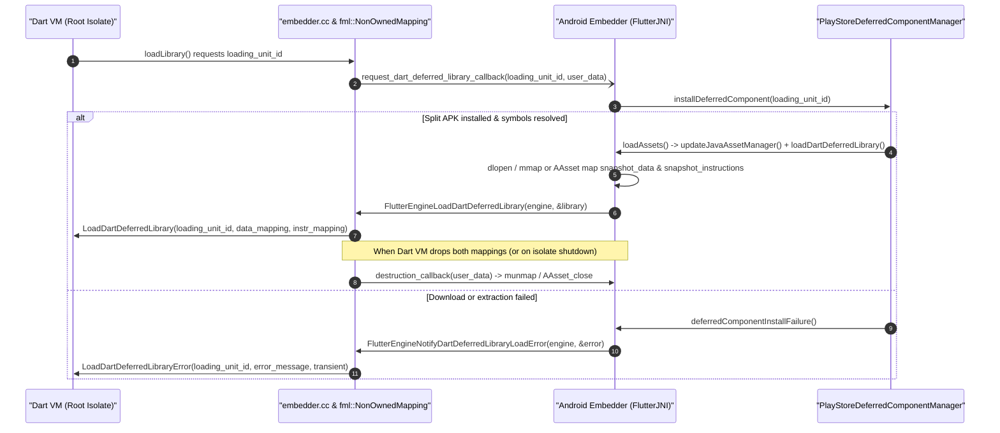

### Custom Asset and Kernel Resolution

> [!IMPORTANT]
> To resolve assets packaged inside APK or AAB archives without subclassing internal C++ [`flutter::AssetResolver`](https://github.com/flutter/flutter/blob/4762dec4fc9072cd9269814ef36364f35a9a66dc/engine/src/flutter/assets/asset_resolver.h#L23) or extracting files to disk:
>
> - **Embedder API additions (`embedder.h`)**: Adds `FlutterAssetMapping`, `FlutterCustomAssetResolver` (`FlutterAssetResolverGetAsMappingCallback`), and `FlutterProjectArgs.custom_asset_resolvers` (`custom_asset_resolvers_count`).
> - **Behavioral changes**: The engine's internal `CustomAssetResolver` wrapper returns `true` from `IsValidAfterAssetManagerChange()` so custom resolvers stay attached across hot reload and hot restart. [`APKAssetProvider`](https://github.com/flutter/flutter/blob/4762dec4fc9072cd9269814ef36364f35a9a66dc/engine/src/flutter/shell/platform/android/apk_asset_provider.h#L26) supplies a `FlutterCustomAssetResolver` that maps assets directly from the NDK [`AAssetManager`](https://developer.android.com/ndk/reference/group/asset) in `get_as_mapping_callback` and atomically swaps its `AAssetManager*` pointer inside `user_data` when `FlutterJNI.updateJavaAssetManager` runs after a split APK install.

```c
typedef struct {
  size_t struct_size;
  const uint8_t* mapping;
  size_t mapping_size;
  void* user_data;
  VoidCallback destruction_callback;
} FlutterAssetMapping;

typedef bool (*FlutterAssetResolverGetAsMappingCallback)(
    const char* asset_name,
    void* user_data,
    FlutterAssetMapping* mapping_out);

typedef struct {
  size_t struct_size;
  void* user_data;
  FlutterAssetResolverGetAsMappingCallback get_as_mapping_callback;
  VoidCallback destruction_callback;
} FlutterCustomAssetResolver;

// Appended to FlutterProjectArgs:
size_t custom_asset_resolvers_count;
const FlutterCustomAssetResolver** custom_asset_resolvers;
```

### Multi-Engine Spawning and Add-to-App

> [!IMPORTANT]
> To support [`FlutterEngineGroup`](https://github.com/flutter/flutter/blob/4762dec4fc9072cd9269814ef36364f35a9a66dc/engine/src/flutter/shell/platform/android/io/flutter/embedding/engine/FlutterEngineGroup.java#L41) and Add-to-App multi-engine sharing without calling internal [`Shell::Spawn`](https://github.com/flutter/flutter/blob/4762dec4fc9072cd9269814ef36364f35a9a66dc/engine/src/flutter/shell/common/shell.h#L204-L210) methods:
>
> - **Embedder API additions (`embedder.h`)**: Adds `FlutterEngineSpawn` and `FlutterEngineSpawnInfo`.
> - **Behavioral changes**: `AndroidEngineGroup` replaces [`AndroidShellHolder::Spawn`](https://github.com/flutter/flutter/blob/4762dec4fc9072cd9269814ef36364f35a9a66dc/engine/src/flutter/shell/platform/android/android_shell_holder.cc#L222-L285), spawning child `FlutterEngine` instances that share the parent engine's Dart VM isolate group, `io_manager`, and resolved [`impeller::Context`](https://github.com/flutter/flutter/blob/4762dec4fc9072cd9269814ef36364f35a9a66dc/engine/src/flutter/impeller/renderer/context.h#L70) (including when the parent engine initialized with `type = kDeferred` or when `renderer_config` is `nullptr`).

```c
typedef struct {
  size_t struct_size;
  const char* entrypoint;
  const char* library_uri;
  const char* initial_route;
  const char* const* entrypoint_argv;
  int entrypoint_argc;
  void* user_data;
  const FlutterProjectArgs* project_args;
  const FlutterRendererConfig* renderer_config;
} FlutterEngineSpawnInfo;

FLUTTER_EXPORT
FlutterEngineResult FlutterEngineSpawn(
    FLUTTER_API_SYMBOL(FlutterEngine) parent_engine,
    const FlutterEngineSpawnInfo* config,
    FLUTTER_API_SYMBOL(FlutterEngine)* spawned_engine_out);
```

### Image Generators, Fonts, and VM URI

> [!IMPORTANT]
> To eliminate the remaining [`//flutter/lib/ui/painting/image_generator.h`](https://github.com/flutter/flutter/blob/4762dec4fc9072cd9269814ef36364f35a9a66dc/engine/src/flutter/lib/ui/painting/image_generator.h#L27), [`//flutter/txt`](https://github.com/flutter/flutter/tree/4762dec4fc9072cd9269814ef36364f35a9a66dc/engine/src/flutter/txt), and [`//flutter/runtime/dart_service_isolate.h`](https://github.com/flutter/flutter/blob/4762dec4fc9072cd9269814ef36364f35a9a66dc/engine/src/flutter/runtime/dart_service_isolate.h#L22) inclusions in [`FlutterMain`](https://github.com/flutter/flutter/blob/4762dec4fc9072cd9269814ef36364f35a9a66dc/engine/src/flutter/shell/platform/android/flutter_main.h#L17) and [`FlutterJNI`](https://github.com/flutter/flutter/blob/4762dec4fc9072cd9269814ef36364f35a9a66dc/engine/src/flutter/shell/platform/android/io/flutter/embedding/engine/FlutterJNI.java#L108):
>
> - **Embedder API additions (`embedder.h`)**: Adds `FlutterProjectArgs.image_generators` (`FlutterImageGeneratorRegistration`, `FlutterImageGenerator`, `FlutterImageGeneratorInfo`), `FlutterEnginePrefetchDefaultFontManager`, and `FlutterProjectArgs.vm_service_uri_callback` (`FlutterVMServiceUriInfo`).
> - **Behavioral changes**: The Android embedder registers its fallback [`ImageDecoder`](https://developer.android.com/reference/android/graphics/ImageDecoder) (for HEIF and platform formats at priority `-1`) without subclassing `flutter::ImageGenerator`, and the engine keeps the encoded byte buffer alive until `destruction_callback` runs. `FlutterEnginePrefetchDefaultFontManager` warms up the process-wide default font manager on a background thread during `FlutterLoader.initAsync` before any engine exists, and `vm_service_uri_callback` delivers the Dart VM Service URI to `FlutterJNI.getVMServiceUri()`.

```c
typedef enum {
  kFlutterImageGeneratorColorTypeRGBA8888,
  kFlutterImageGeneratorColorTypeBGRA8888,
} FlutterImageGeneratorColorType;

typedef enum {
  kFlutterImageGeneratorAlphaTypeOpaque,
  kFlutterImageGeneratorAlphaTypePremul,
  kFlutterImageGeneratorAlphaTypeUnpremul,
} FlutterImageGeneratorAlphaType;

typedef struct {
  size_t struct_size;
  uint32_t width;
  uint32_t height;
  FlutterImageGeneratorColorType color_type;
  FlutterImageGeneratorAlphaType alpha_type;
} FlutterImageGeneratorInfo;

typedef bool (*FlutterImageGeneratorGetInfoCallback)(
    void* user_data,
    FlutterImageGeneratorInfo* info_out);

typedef bool (*FlutterImageGeneratorGetPixelsCallback)(
    void* user_data,
    const FlutterImageGeneratorInfo* info,
    void* pixels,
    size_t row_bytes);

typedef struct {
  size_t struct_size;
  void* user_data;
  FlutterImageGeneratorGetInfoCallback get_info;
  FlutterImageGeneratorGetPixelsCallback get_pixels;
  VoidCallback destruction_callback;
} FlutterImageGenerator;

typedef bool (*FlutterImageGeneratorFactoryCallback)(
    void* user_data,
    const uint8_t* data,
    size_t data_size,
    FlutterImageGenerator* generator_out);

typedef struct {
  size_t struct_size;
  FlutterImageGeneratorFactoryCallback create_generator;
  int32_t priority;
  void* user_data;
  VoidCallback destruction_callback;
} FlutterImageGeneratorRegistration;

typedef struct {
  size_t struct_size;
  const char* uri;
} FlutterVMServiceUriInfo;

typedef void (*FlutterVMServiceUriCallback)(
    const FlutterVMServiceUriInfo* info,
    void* user_data);

FLUTTER_EXPORT
FlutterEngineResult FlutterEnginePrefetchDefaultFontManager(void);

// Appended to FlutterProjectArgs:
size_t image_generators_count;
const FlutterImageGeneratorRegistration** image_generators;
FlutterVMServiceUriCallback vm_service_uri_callback;
```

### Platform Channel Messaging, Background Handlers, and Task Queues

> [!IMPORTANT]
> To replace the internal [`PlatformMessageHandlerAndroid`](https://github.com/flutter/flutter/blob/4762dec4fc9072cd9269814ef36364f35a9a66dc/engine/src/flutter/shell/platform/android/platform_message_handler_android.h#L18) subclass while preserving background `TaskQueue` dispatch and startup message ordering:
>
> - **Embedder API additions (`embedder.h`)**: Adds `FlutterProjectArgs.enable_direct_platform_message_dispatch` (`bool`, defaulting to `false`).
> - **Behavioral changes**: When `enable_direct_platform_message_dispatch` is `true`, [`EmbedderPlatformMessageHandler`](https://github.com/flutter/flutter/blob/4762dec4fc9072cd9269814ef36364f35a9a66dc/engine/src/flutter/shell/platform/embedder/platform_view_embedder.cc#L22-L36) invokes `platform_message_callback` directly on the calling isolate's thread (and returns `false` from `DoesHandlePlatformMessageOnPlatformThread()`), so root-isolate messages avoid an extra main-`Looper` post and background-isolate messages route directly to [`makeBackgroundTaskQueue()`](https://github.com/flutter/flutter/blob/4762dec4fc9072cd9269814ef36364f35a9a66dc/engine/src/flutter/shell/platform/android/io/flutter/embedding/engine/dart/DartMessenger.java#L184-L190) executors without bouncing through the Android main thread.

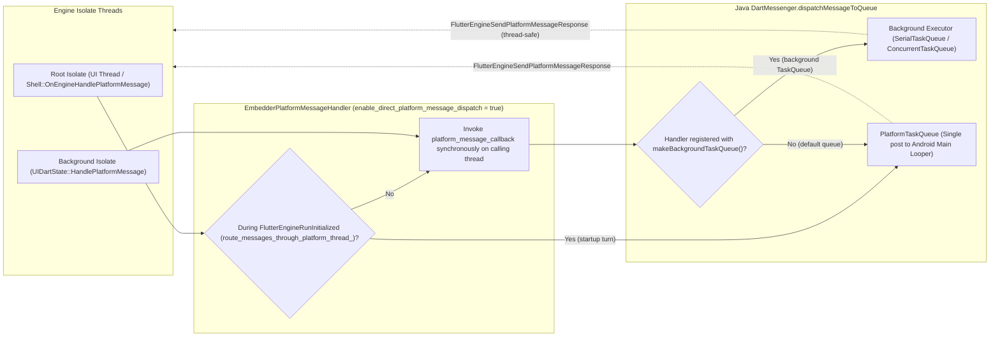

```c
  // Appended to FlutterProjectArgs:
  /// If true, the engine invokes `platform_message_callback` directly on the
  /// thread that sent the message (typically the UI thread) instead of posting
  /// a task to the platform thread. Defaults to false, which preserves the
  /// existing platform thread delivery.
  bool enable_direct_platform_message_dispatch;
```

### Viewport Metrics and Non-Linear Font Scaling

> [!IMPORTANT]
> To deliver Android window insets, display cutouts, foldable postures, and Android 14+ non-linear font scaling without internal [`//flutter/lib/ui/window/viewport_metrics.h`](https://github.com/flutter/flutter/blob/4762dec4fc9072cd9269814ef36364f35a9a66dc/engine/src/flutter/lib/ui/window/viewport_metrics.h) headers or synchronous per-layout JNI calls:
>
> - **Embedder API additions (`embedder.h`)**: Adds `FlutterEdgeInsets`, `FlutterDisplayCornerRadii`, and `FlutterDisplayFeature` (`FlutterDisplayFeatureType`, `FlutterDisplayFeatureState`), and appends `physical_padding`, `physical_system_gesture_insets`, `physical_touch_slop`, `display_corner_radii`, and `display_features` (`display_features_count`) in place to [`FlutterWindowMetricsEvent`](https://github.com/flutter/flutter/blob/4762dec4fc9072cd9269814ef36364f35a9a66dc/engine/src/flutter/shell/platform/embedder/embedder.h#L1062-L1110).
> - **Behavioral changes**:
>   - [`FlutterJNI.nativeSetViewportMetrics`](https://github.com/flutter/flutter/blob/4762dec4fc9072cd9269814ef36364f35a9a66dc/engine/src/flutter/shell/platform/android/platform_view_android_jni_impl.cc#L334-L433) populates the extended [`FlutterWindowMetricsEvent`](https://github.com/flutter/flutter/blob/4762dec4fc9072cd9269814ef36364f35a9a66dc/engine/src/flutter/shell/platform/embedder/embedder.h#L1062-L1110) and dispatches it via [`FlutterEngineSendWindowMetricsEvent`](https://github.com/flutter/flutter/blob/4762dec4fc9072cd9269814ef36364f35a9a66dc/engine/src/flutter/shell/platform/embedder/embedder.h#L3077); `embedder.cc` reads the new fields using `SAFE_ACCESS(event, member, default_value)`.
>   - Android 14+ (API 34+) non-linear font scaling replaces synchronous UI-thread JNI calls ([`PlatformView::GetScaledFontSize`](https://github.com/flutter/flutter/blob/4762dec4fc9072cd9269814ef36364f35a9a66dc/engine/src/flutter/shell/common/platform_view.h#L1023-L1024) -> [`FlutterJNI.getScaledFontSize`](https://github.com/flutter/flutter/blob/4762dec4fc9072cd9269814ef36364f35a9a66dc/engine/src/flutter/shell/platform/android/io/flutter/embedding/engine/FlutterJNI.java#L1529-L1544) and [`SettingsChannel.ConfigurationQueue`](https://github.com/flutter/flutter/blob/4762dec4fc9072cd9269814ef36364f35a9a66dc/engine/src/flutter/shell/platform/android/io/flutter/embedding/engine/systemchannels/SettingsChannel.java#L176)) by sending the 9-point `FontScaleConverter` lookup table (`fontScaleCurves`) over the `flutter/settings` channel ([`SettingsChannel.java`](https://github.com/flutter/flutter/blob/4762dec4fc9072cd9269814ef36364f35a9a66dc/engine/src/flutter/shell/platform/android/io/flutter/embedding/engine/systemchannels/SettingsChannel.java)) and interpolating in `PlatformDispatcher.scaleFontSize`.

#### `FlutterWindowMetricsEvent` In-Place Extensions

```c
/// Distances from each edge of a rectangle, in physical pixels.
/// Frozen value struct (like `FlutterRect`) embedded by value.
typedef struct {
  double left;
  double top;
  double right;
  double bottom;
} FlutterEdgeInsets;

/// Radii of the four display corners, in physical pixels.
typedef struct {
  /// The size of this struct. Must be sizeof(FlutterDisplayCornerRadii).
  size_t struct_size;
  double top_left;
  double top_right;
  double bottom_right;
  double bottom_left;
} FlutterDisplayCornerRadii;

typedef enum {
  kFlutterDisplayFeatureTypeUnknown = 0,
  kFlutterDisplayFeatureTypeFold = 1,
  kFlutterDisplayFeatureTypeHinge = 2,
  kFlutterDisplayFeatureTypeCutout = 3,
} FlutterDisplayFeatureType;

typedef enum {
  kFlutterDisplayFeatureStateUnknown = 0,
  kFlutterDisplayFeatureStatePostureFlat = 1,
  kFlutterDisplayFeatureStatePostureHalfOpened = 2,
} FlutterDisplayFeatureState;

typedef struct {
  size_t struct_size;
  FlutterRect bounds;
  FlutterDisplayFeatureType type;
  FlutterDisplayFeatureState state;
} FlutterDisplayFeature;
```

Appended to [`FlutterWindowMetricsEvent`](https://github.com/flutter/flutter/blob/4762dec4fc9072cd9269814ef36364f35a9a66dc/engine/src/flutter/shell/platform/embedder/embedder.h#L1062-L1110):

```c
  /// Physical window padding (for example, status bar, navigation bar, cutouts).
  FlutterEdgeInsets physical_padding;

  /// System gesture insets (for example, Android 10+ edge back gestures).
  FlutterEdgeInsets physical_system_gesture_insets;

  /// Physical touch slop threshold in physical pixels for scroll
  /// disambiguation. A non-positive value (<= 0.0, including zero-initialized
  /// structs) indicates that the platform does not specify a custom touch slop
  /// and the framework default should be used.
  double physical_touch_slop;

  /// Display corner radii in physical pixels, or NULL when unknown or
  /// unsupported (for example on Android < API 31 or desktop platforms).
  const FlutterDisplayCornerRadii* display_corner_radii;

  /// Number of display features in the `display_features` array.
  size_t display_features_count;

  /// Array of pointers to physical display features (foldable hinges, cutouts).
  const FlutterDisplayFeature** display_features;
```

#### Android 14+ Non-Linear Font Scaling

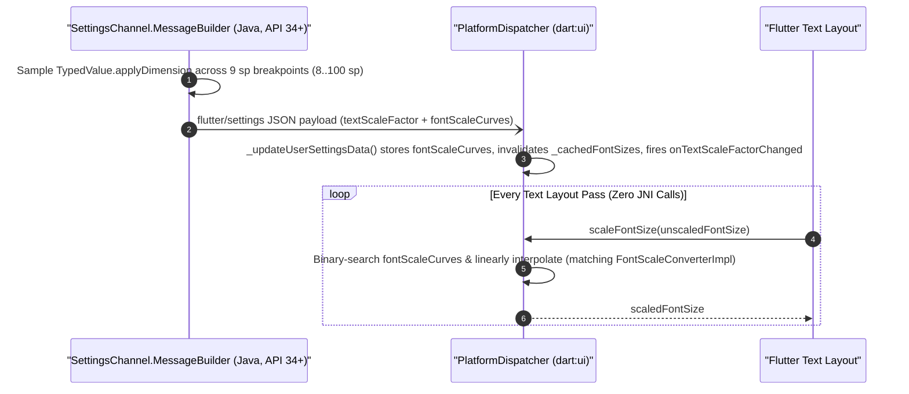

```json
{
  "textScaleFactor": 1.15,
  "platformBrightness": "light",
  "alwaysUse24HourFormat": false,
  "fontScaleCurves": [
    {"unscaled": 8.0, "scaled": 9.2},
    {"unscaled": 10.0, "scaled": 11.5},
    {"unscaled": 12.0, "scaled": 13.8},
    {"unscaled": 14.0, "scaled": 16.4},
    {"unscaled": 18.0, "scaled": 20.6},
    {"unscaled": 20.0, "scaled": 22.4},
    {"unscaled": 24.0, "scaled": 26.2},
    {"unscaled": 30.0, "scaled": 31.8},
    {"unscaled": 100.0, "scaled": 100.0}
  ]
}
```

## Target Architecture and Design Principles

> [!IMPORTANT]
> The target architecture replaces [`AndroidShellHolder`](https://github.com/flutter/flutter/blob/4762dec4fc9072cd9269814ef36364f35a9a66dc/engine/src/flutter/shell/platform/android/android_shell_holder.h#L38), [`PlatformViewAndroid`](https://github.com/flutter/flutter/blob/4762dec4fc9072cd9269814ef36364f35a9a66dc/engine/src/flutter/shell/platform/android/platform_view_android.h#L43), and [`PlatformViewAndroidJNIImpl`](https://github.com/flutter/flutter/blob/4762dec4fc9072cd9269814ef36364f35a9a66dc/engine/src/flutter/shell/platform/android/platform_view_android_jni_impl.cc) with `FlutterEmbedderNative` and single-responsibility C-API components in `:flutter_embedder_native_src` compiled with `FLUTTER_ENGINE_NO_PROTOTYPES`. Outbound C++-to-Java calls route through injectable `JniRouter` / `JniDelegate` / `JvmInvoker` interfaces so `flutter_embedder_native_unittests` run on the host without a live JVM or Android device.

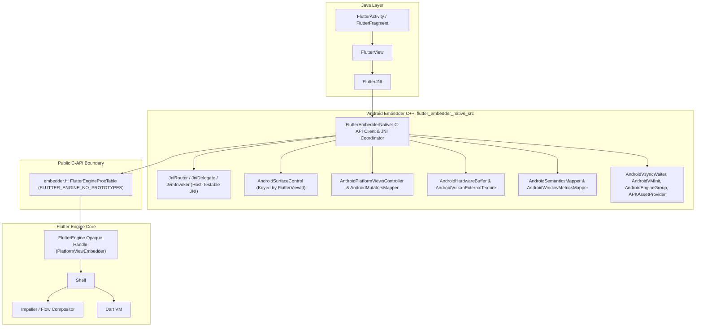

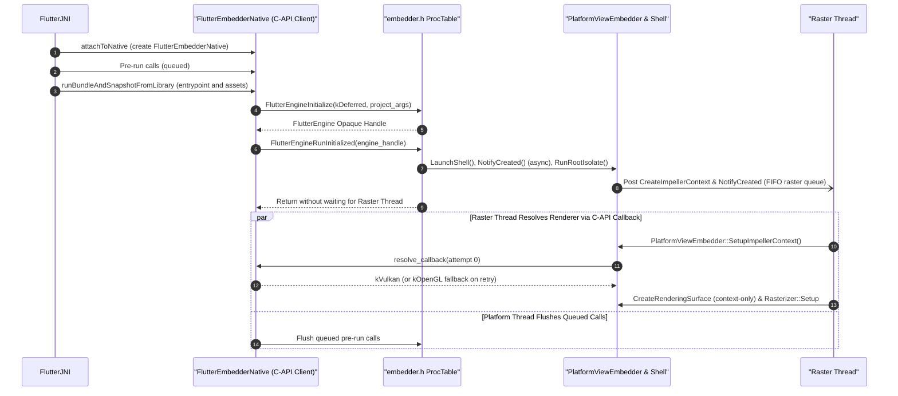

### Mapping Embedder C-APIs to Target Architecture Components

| Target Component | Eliminated Internal Engine Dependencies | Embedder C-API Additions Used | Architectural Role |
| :--- | :--- | :--- | :--- |
| **`FlutterEmbedderNative`, `AndroidVMInit`, and `AndroidEngineGroup`** | [`//flutter/shell/common`](https://github.com/flutter/flutter/tree/4762dec4fc9072cd9269814ef36364f35a9a66dc/engine/src/flutter/shell/common), [`//flutter/runtime`](https://github.com/flutter/flutter/tree/4762dec4fc9072cd9269814ef36364f35a9a66dc/engine/src/flutter/runtime), [`//flutter/lib/ui`](https://github.com/flutter/flutter/tree/4762dec4fc9072cd9269814ef36364f35a9a66dc/engine/src/flutter/lib/ui), [`//flutter/txt`](https://github.com/flutter/flutter/tree/4762dec4fc9072cd9269814ef36364f35a9a66dc/engine/src/flutter/txt) | - [`FlutterEngineSpawn`](#multi-engine-spawning-and-add-to-app) (`FlutterEngineSpawnInfo`)<br>- [`FlutterProjectArgs.enable_direct_platform_message_dispatch`](#platform-channel-messaging-background-handlers-and-task-queues)<br>- [`FlutterProjectArgs.request_dart_deferred_library_callback`](#dart-deferred-library-loading), `FlutterEngineLoadDartDeferredLibrary`, `FlutterEngineNotifyDartDeferredLibraryLoadError`<br>- [`FlutterProjectArgs.image_generators`](#image-generators-fonts-and-vm-uri) (`FlutterImageGeneratorRegistration`), `FlutterEnginePrefetchDefaultFontManager`, `FlutterProjectArgs.vm_service_uri_callback` | Owns the opaque [`FlutterEngine`](https://github.com/flutter/flutter/blob/4762dec4fc9072cd9269814ef36364f35a9a66dc/engine/src/flutter/shell/platform/embedder/embedder.h#L389) handle and `FlutterEngineProcTable`; replaces `AndroidShellHolder` and `PlatformViewAndroid`. |
| **`AndroidSurfaceControl`** | [`//flutter/shell/common`](https://github.com/flutter/flutter/tree/4762dec4fc9072cd9269814ef36364f35a9a66dc/engine/src/flutter/shell/common), [`//flutter/impeller`](https://github.com/flutter/flutter/tree/4762dec4fc9072cd9269814ef36364f35a9a66dc/engine/src/flutter/impeller), [`//flutter/vulkan`](https://github.com/flutter/flutter/tree/4762dec4fc9072cd9269814ef36364f35a9a66dc/engine/src/flutter/vulkan) | - [`kDeferred`](#initialization) (`FlutterDeferredRendererConfig`, `FlutterRendererResolveInfo`) | Keys native surfaces (`ANativeWindow*`, `ASurfaceControl*`) by `FlutterViewId` and resolves the renderer asynchronously during startup. |
| **`AndroidPlatformViewsController` and `AndroidMutatorsMapper`** | [`//flutter/flow`](https://github.com/flutter/flutter/tree/4762dec4fc9072cd9269814ef36364f35a9a66dc/engine/src/flutter/flow), [`//flutter/fml`](https://github.com/flutter/flutter/tree/4762dec4fc9072cd9269814ef36364f35a9a66dc/engine/src/flutter/fml) | - [`FlutterCompositor.merge_raster_thread_on_platform_views`](#platform-views) and `FlutterBackingStoreConfig.is_root_layer`<br>- [`FlutterCompositor.platform_view_mutation_capabilities`](#platform-view-mutator-stack-serialization), `FlutterPlatformView.mutations`, `FlutterPlatformViewMutation`, `FlutterPath` | Unifies HC, HCPP (`SurfaceControl`), TLHC, and VD behind `FlutterCompositor` and deletes `external_view_embedder/`. |
| **`AndroidHardwareBuffer` and `AndroidVulkanExternalTexture`** | [`//flutter/common/graphics`](https://github.com/flutter/flutter/tree/4762dec4fc9072cd9269814ef36364f35a9a66dc/engine/src/flutter/common/graphics) | - [`FlutterVulkanExternalTexture`](#external-textures) (`ycbcr_conversion_info`), `FlutterVulkanYcbcrConversionInfo`, `FlutterVulkanTextureFrameCallback`<br>- [`FlutterOpenGLExternalTexture`](#external-textures) (`uv_transform`), `FlutterOpenGLTextureFrameCallback` | Imports zero-copy `AHardwareBuffer` (`VkImage` / `EGLImageKHR`) and `SurfaceTexture` UV transforms without subclassing `flutter::Texture`. |
| **`AndroidSemanticsMapper` and `AndroidWindowMetricsMapper`** | [`//flutter/flow`](https://github.com/flutter/flutter/tree/4762dec4fc9072cd9269814ef36364f35a9a66dc/engine/src/flutter/flow), [`//flutter/lib/ui/window/viewport_metrics.h`](https://github.com/flutter/flutter/blob/4762dec4fc9072cd9269814ef36364f35a9a66dc/engine/src/flutter/lib/ui/window/viewport_metrics.h) | - [`FlutterSemanticsNode2`](#accessibility-and-semantics-parity) (`role`, `hit_test_child_count`, `FlutterSemanticsRole`)<br>- [`FlutterWindowMetricsEvent`](#viewport-metrics-and-non-linear-font-scaling) (`FlutterEdgeInsets`, `FlutterDisplayCornerRadii`, `FlutterDisplayFeature`) | Serializes semantics trees for Java `AccessibilityBridge` and packs insets, cutouts, and foldable features into `FlutterWindowMetricsEvent`. |
| **[`APKAssetProvider`](https://github.com/flutter/flutter/blob/4762dec4fc9072cd9269814ef36364f35a9a66dc/engine/src/flutter/shell/platform/android/apk_asset_provider.h#L26)** | [`//flutter/assets/asset_resolver.h`](https://github.com/flutter/flutter/blob/4762dec4fc9072cd9269814ef36364f35a9a66dc/engine/src/flutter/assets/asset_resolver.h) | - [`FlutterProjectArgs.custom_asset_resolvers`](#custom-asset-and-kernel-resolution), `FlutterCustomAssetResolver`, `FlutterAssetMapping` | Maps APK and split-AAB assets via NDK `AAssetManager` without subclassing `flutter::AssetResolver`. |

## Phased Implementation Strategy

Phase 1 (`shell/platform/embedder/`) and Phase 2 (`shell/platform/android/` modularization and GN partitioning) execute in parallel before converging at Phase 3:

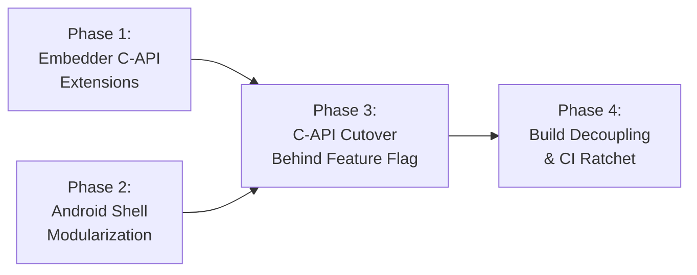

### Phase 1: Embedder C-API Extensions

Implements all C-API extensions and `shell/platform/embedder/` engine changes, validated by [`embedder_unittests`](https://github.com/flutter/flutter/blob/4762dec4fc9072cd9269814ef36364f35a9a66dc/engine/src/flutter/shell/platform/embedder/BUILD.gn#L372-L390) with zero modifications to `shell/platform/android/`:

- `kDeferred` renderer resolution (`PlatformViewEmbedder::SetupImpellerContext()` with fallback retry and Impeller's bad-driver blocklist check) and non-blocking surface initialization (`PlatformViewEmbedder::NotifyCreated()` -> `Shell::OnPlatformViewCreatedAsync()`).
- Opt-in dynamic raster thread merging (`FlutterCompositor.merge_raster_thread_on_platform_views`) in `EmbedderExternalViewEmbedder` and Impeller Vulkan backing store presentation ([#187525](https://github.com/flutter/flutter/issues/187525)).
- Platform view mutator serialization (`FlutterPlatformViewMutation`), external texture callbacks (`FlutterVulkanTextureFrameCallback`, `FlutterOpenGLTextureFrameCallback`), `FlutterSemanticsNode2` and `FlutterWindowMetricsEvent` in-place extensions, deferred library callbacks, `FlutterCustomAssetResolver`, `FlutterEngineSpawn`, direct UI-thread platform message dispatch, and process-scoped utilities.

### Phases 2–4: GN Target Partitioning, C-API Cutover, and Legacy Class Purge

In Phase 2, [`shell/platform/android/BUILD.gn`](https://github.com/flutter/flutter/blob/4762dec4fc9072cd9269814ef36364f35a9a66dc/engine/src/flutter/shell/platform/android/BUILD.gn) isolates all new C-API components inside `source_set("flutter_embedder_native_src")` with `check_includes = true` and `defines = [ "FLUTTER_ENGINE_NO_PROTOTYPES" ]`, blocking private engine headers at compile time:

```gn
# 1. Modular C-API Source Set (Compile-Time Firewall)
source_set("flutter_embedder_native_src") {
  visibility = [ ":*" ]
  check_includes = true
  defines = [ "FLUTTER_ENGINE_NO_PROTOTYPES" ]

  sources = [
    "android_engine_group.cc",
    "android_engine_group.h",
    "android_hardware_buffer.cc",
    "android_hardware_buffer.h",
    "android_mutators_mapper.cc",
    "android_mutators_mapper.h",
    "android_platform_views_controller.cc",
    "android_platform_views_controller.h",
    "android_semantics_mapper.cc",
    "android_semantics_mapper.h",
    "android_surface_control.cc",
    "android_surface_control.h",
    "android_vm_init.cc",
    "android_vm_init.h",
    "android_vsync_waiter.cc",
    "android_vsync_waiter.h",
    "android_vulkan_external_texture.cc",
    "android_vulkan_external_texture.h",
    "android_window_metrics_mapper.cc",
    "android_window_metrics_mapper.h",
    "apk_asset_provider.cc",
    "apk_asset_provider.h",
    "flutter_embedder_native.cc",
    "flutter_embedder_native.h",
    "jni_delegate.h",
    "jni_router.cc",
    "jni_router.h",
    "jvm_invoker.cc",
    "jvm_invoker.h",
  ]

  deps = [
    "//flutter/assets",
    "//flutter/common",
    "//flutter/fml",
    "//flutter/shell/platform/embedder:embedder_headers",
  ]
}

# 2. Outer Shell Source Set (Reduced to 3 files in Phase 4)
source_set("flutter_shell_native_src") {
  visibility = [ ":*" ]
  sources = [
    "flutter_main.cc",
    "flutter_main.h",
    "library_loader.cc",
  ]
  public_deps = [
    ":flutter_embedder_native_src",
    "//flutter/fml",
    "//flutter/shell/platform/embedder:embedder_as_internal_library",
  ]
}
```

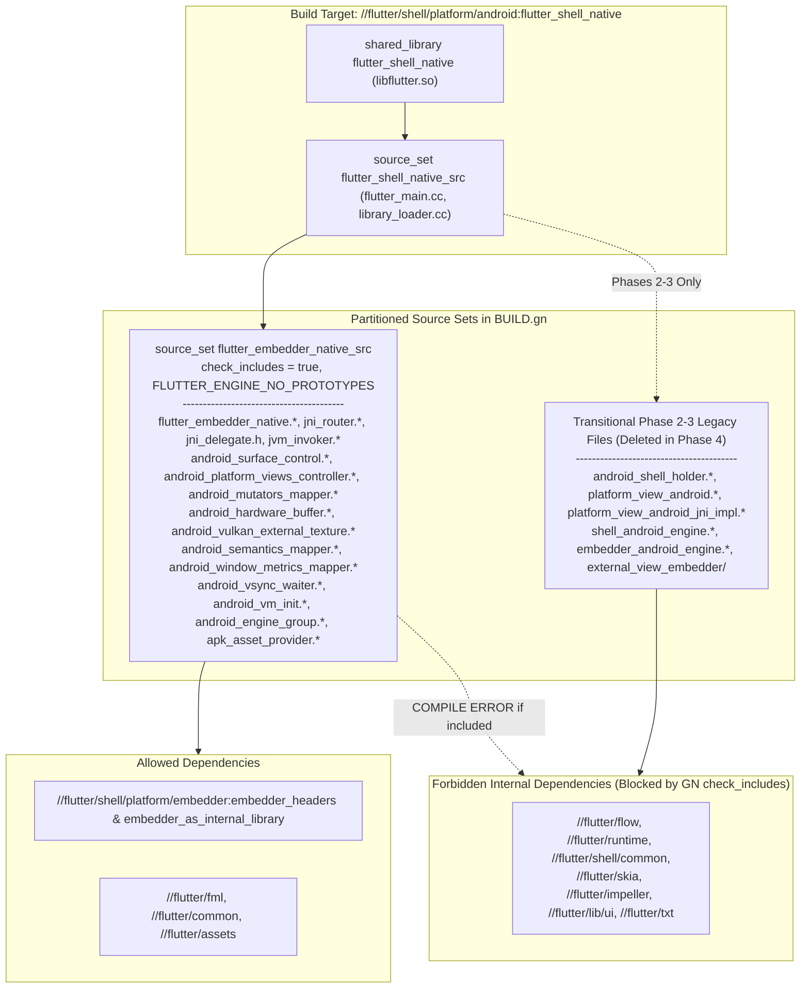

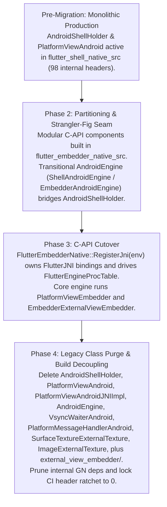

### The Dependency Ratchet Mechanism

> [!IMPORTANT]
> To guarantee monotonic removal of the 98 internal headers across Phases 2–4 without regressions or `// nogncheck` bypasses, CI enforces a three-layer ratchet driven by `check_android_embedder_deps.py` and `shell/platform/android/allowed_internal_headers.yaml`.

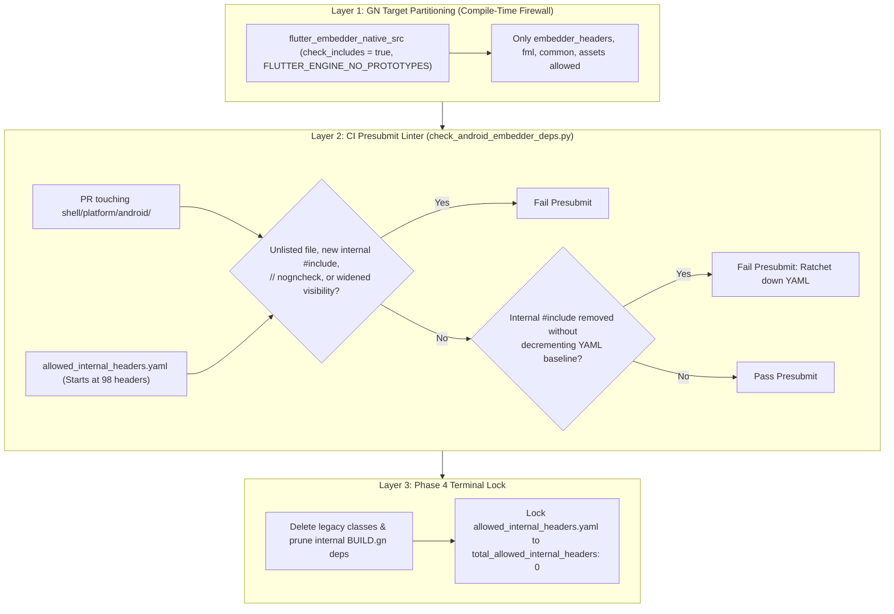

```yaml
# shell/platform/android/allowed_internal_headers.yaml (ratcheted from 98 to 0 in Phase 4)
version: 1
total_allowed_internal_headers: 98
subsystems:
  impeller:
    count: 29
    allowed_headers:
      - "flutter/impeller/renderer/backend/vulkan/context_vk.h"
      - "flutter/impeller/renderer/backend/gles/context_gles.h"
      - "flutter/impeller/toolkit/android/hardware_buffer.h"
  flow:
    count: 2
    allowed_headers:
      - "flutter/flow/embedded_views.h"
      - "flutter/flow/surface.h"
  engine_core:
    count: 11
    allowed_headers:
      - "flutter/shell/common/shell.h"
      - "flutter/shell/common/thread_host.h"
      - "flutter/shell/common/platform_view.h"
```

## Verification and Testing Plan

### Engine Unit Tests

- Host-executable C++ unit tests (`flutter_embedder_native_unittests`) test `FlutterEmbedderNative` and each modular component using mock [`FlutterEngineProcTable`](https://github.com/flutter/flutter/blob/4762dec4fc9072cd9269814ef36364f35a9a66dc/engine/src/flutter/shell/platform/embedder/embedder.h#L3651-L3827) entries and injectable `JniDelegate` / `JvmInvoker` providers without an Android JVM or device.
- [`embedder_unittests`](https://github.com/flutter/flutter/blob/4762dec4fc9072cd9269814ef36364f35a9a66dc/engine/src/flutter/shell/platform/embedder/BUILD.gn#L372-L390) cover `kDeferred` renderer resolution and fallback retry, non-blocking `FlutterEngineRunInitialized` while `resolve_renderer_callback` runs on the raster thread, opt-in dynamic raster thread merging (`merge_raster_thread_on_platform_views`), [`FlutterPlatformViewMutation`](https://github.com/flutter/flutter/blob/4762dec4fc9072cd9269814ef36364f35a9a66dc/engine/src/flutter/shell/platform/embedder/embedder.h#L2083-L2092) serialization, and per-`FlutterViewId` frame state capture.

### Android Integration and DeviceLab Tests

- Run [`flutter_shell_native_unittests`](https://github.com/flutter/flutter/blob/4762dec4fc9072cd9269814ef36364f35a9a66dc/engine/src/flutter/shell/platform/android/BUILD.gn#L42-L67), platform view composition tests across all four Android composition modes (HCPP, HC, TLHC, VD), activity stop/start and configuration-change loops (`surfaceDestroyed()` / `surfaceCreated()`), JNI platform channels, background isolate callbacks, and deferred library loading.
- Verify with golden tests that clip paths, rounded rectangles, and opacity mutators render identically across all four composition modes (HCPP, HC, TLHC, VD), and validate external texture playback across camera and video player plugins.
- Compare legacy vs C-API DeviceLab benchmarks for frame pacing, rasterization latency, HCPP/HC scrolling and fence timing, [`FlutterCustomAssetResolver`](#custom-asset-and-kernel-resolution) startup latency, cold-start time-to-first-frame (`CreateImpellerContext`), and post-`surfaceDestroyed()` GPU memory reclamation (`FlutterEngineNotifyLowMemoryWarning`).
