# RFC 410.0000: Flutter Android Embedder C-API Migration

## Executive Summary and Overview

This RFC proposes a phased, in-place migration of the Flutter Android embedder ([`engine/src/flutter/shell/platform/android/`](https://github.com/flutter/flutter/tree/4762dec4fc9072cd9269814ef36364f35a9a66dc/engine/src/flutter/shell/platform/android)) to the public Flutter Embedder C-API ([`embedder.h`](https://github.com/flutter/flutter/blob/4762dec4fc9072cd9269814ef36364f35a9a66dc/engine/src/flutter/shell/platform/embedder/embedder.h)).

Today, the Android embedder interacts directly with engine internals: it allocates task runners, instantiates [`flutter::Shell`](https://github.com/flutter/flutter/blob/4762dec4fc9072cd9269814ef36364f35a9a66dc/engine/src/flutter/shell/common/shell.h#L113), inspects internal graphics contexts, and manages platform view compositing via private `flow` headers. This coupling causes several problems:

- Internal engine refactors in Impeller, Flow, or the Dart runtime break the Android embedder.
- Compiling `libflutter.so` requires pulling internal engine translation units into the Android target.
- Third-party desktop and embedded platforms use [`embedder.h`](https://github.com/flutter/flutter/blob/4762dec4fc9072cd9269814ef36364f35a9a66dc/engine/src/flutter/shell/platform/embedder/embedder.h), while Flutter's primary mobile embedders do not. Because the Android embedder bypasses the public C-API, missing features in [`embedder.h`](https://github.com/flutter/flutter/blob/4762dec4fc9072cd9269814ef36364f35a9a66dc/engine/src/flutter/shell/platform/embedder/embedder.h) (such as dynamic thread merging, platform view mutators, and hardware buffer external textures) are not exercised by first-party code.

This document establishes the plan to decouple the Android embedder from engine internals.

### Strict Dependency Management

The dependency graph of [`shell/platform/android/`](https://github.com/flutter/flutter/tree/4762dec4fc9072cd9269814ef36364f35a9a66dc/engine/src/flutter/shell/platform/android) in [`BUILD.gn`](https://github.com/flutter/flutter/blob/4762dec4fc9072cd9269814ef36364f35a9a66dc/engine/src/flutter/shell/platform/android/BUILD.gn) will be reduced strictly to:

|Allowed Dependencies||
|---|---|
|[`//flutter/shell/platform/embedder:embedder_headers`](https://github.com/flutter/flutter/blob/4762dec4fc9072cd9269814ef36364f35a9a66dc/engine/src/flutter/shell/platform/embedder/BUILD.gn#L210)||
|[`//flutter/shell/platform/embedder:embedder_as_internal_library`](https://github.com/flutter/flutter/blob/4762dec4fc9072cd9269814ef36364f35a9a66dc/engine/src/flutter/shell/platform/embedder/BUILD.gn#L206)|Enforce dynamic `FlutterEngineProcTable` resolution with`defines = [ "FLUTTER_ENGINE_NO_PROTOTYPES" ]`|
|[`//flutter/fml`](https://github.com/flutter/flutter/tree/4762dec4fc9072cd9269814ef36364f35a9a66dc/engine/src/flutter/fml)|Optional|
|[`//flutter/common`](https://github.com/flutter/flutter/tree/4762dec4fc9072cd9269814ef36364f35a9a66dc/engine/src/flutter/common)|Optional|
|[`//flutter/assets`](https://github.com/flutter/flutter/tree/4762dec4fc9072cd9269814ef36364f35a9a66dc/engine/src/flutter/assets)|Optional|

All direct dependencies on internal engine subsystems ([`//flutter/shell/common`](https://github.com/flutter/flutter/tree/4762dec4fc9072cd9269814ef36364f35a9a66dc/engine/src/flutter/shell/common), [`//flutter/runtime`](https://github.com/flutter/flutter/tree/4762dec4fc9072cd9269814ef36364f35a9a66dc/engine/src/flutter/runtime), [`//flutter/flow`](https://github.com/flutter/flutter/tree/4762dec4fc9072cd9269814ef36364f35a9a66dc/engine/src/flutter/flow), [`//flutter/skia`](https://github.com/flutter/flutter/tree/4762dec4fc9072cd9269814ef36364f35a9a66dc/engine/src/flutter/skia), [`//flutter/impeller`](https://github.com/flutter/flutter/tree/4762dec4fc9072cd9269814ef36364f35a9a66dc/engine/src/flutter/impeller), [`//flutter/lib/ui`](https://github.com/flutter/flutter/tree/4762dec4fc9072cd9269814ef36364f35a9a66dc/engine/src/flutter/lib/ui), and [`//flutter/txt`](https://github.com/flutter/flutter/tree/4762dec4fc9072cd9269814ef36364f35a9a66dc/engine/src/flutter/txt)) will be eliminated.

### Goals

- Establish an enforced architectural boundary between Android embedder and the engine core.
- Reduce direct internal engine header inclusions in [`shell/platform/android/`](https://github.com/flutter/flutter/tree/4762dec4fc9072cd9269814ef36364f35a9a66dc/engine/src/flutter/shell/platform/android) from 98 to 0.
- Enable independent compilation and stable ABI boundaries for Android embeddings.
- Maintain complete behavioral correctness, performance parity, and accessibility support across all supported Android API levels and rendering backends (Impeller Vulkan, Impeller OpenGL, and legacy Skia).
- Ensure the embedder API exposes the features needed to create an out-of-tree embedder that is as feature-complete as Flutter Android.

### Non-Goals

- Modifying the public Java/Kotlin Flutter Android API ([`io.flutter.embedding.android.*`](https://github.com/flutter/flutter/tree/4762dec4fc9072cd9269814ef36364f35a9a66dc/engine/src/flutter/shell/platform/android/io/flutter/embedding/android)).
- Repackaging or splitting `libflutter.so` into separate shared libraries (such as `libflutter_engine.so` and `libflutter_embedder.so`). Compilation remains unified within `libflutter.so` to avoid symbol export inflation, increased APK binary size, and runtime dynamic linker overhead on Android.

## Background and Problem Statement

The Android embedder is located in [`engine/src/flutter/shell/platform/android/`](https://github.com/flutter/flutter/tree/4762dec4fc9072cd9269814ef36364f35a9a66dc/engine/src/flutter/shell/platform/android). It does not use [`embedder.h`](https://github.com/flutter/flutter/blob/4762dec4fc9072cd9269814ef36364f35a9a66dc/engine/src/flutter/shell/platform/embedder/embedder.h). Instead, it is a customized implementation that interacts directly with core engine components.

### Current Production Architecture ([`flutter_shell_native`](https://github.com/flutter/flutter/blob/4762dec4fc9072cd9269814ef36364f35a9a66dc/engine/src/flutter/shell/platform/android/BUILD.gn#L69-L75))

In the existing architecture, the Java embedding coordinates with native code through JNI interfaces, primarily [`FlutterJNI`](https://github.com/flutter/flutter/blob/4762dec4fc9072cd9269814ef36364f35a9a66dc/engine/src/flutter/shell/platform/android/io/flutter/embedding/engine/FlutterJNI.java#L108), [`PlatformViewAndroidJNI`](https://github.com/flutter/flutter/blob/4762dec4fc9072cd9269814ef36364f35a9a66dc/engine/src/flutter/shell/platform/android/jni/platform_view_android_jni.h#L38), and [`AndroidShellHolder`](https://github.com/flutter/flutter/blob/4762dec4fc9072cd9269814ef36364f35a9a66dc/engine/src/flutter/shell/platform/android/android_shell_holder.h#L38). When initializing the engine from the platform side, [`FlutterJNI.attachToNative()`](https://github.com/flutter/flutter/blob/4762dec4fc9072cd9269814ef36364f35a9a66dc/engine/src/flutter/shell/platform/android/io/flutter/embedding/engine/FlutterJNI.java#L433-L442) invokes native attachment via [`nativeAttach`](https://github.com/flutter/flutter/blob/4762dec4fc9072cd9269814ef36364f35a9a66dc/engine/src/flutter/shell/platform/android/io/flutter/embedding/engine/FlutterJNI.java#L449), which dispatches across the JNI registration table ([`RegisterApi`](https://github.com/flutter/flutter/blob/4762dec4fc9072cd9269814ef36364f35a9a66dc/engine/src/flutter/shell/platform/android/platform_view_android_jni_impl.cc#L754-L760)) into [`AttachJNI`](https://github.com/flutter/flutter/blob/4762dec4fc9072cd9269814ef36364f35a9a66dc/engine/src/flutter/shell/platform/android/platform_view_android_jni_impl.cc#L185-L197) to instantiate the shell holder:

```cpp
// Existing JNI attachment in shell/platform/android/platform_view_android_jni_impl.cc
static jlong AttachJNI(JNIEnv* env, jclass clazz, jobject flutterJNI) {
  fml::jni::JavaObjectWeakGlobalRef java_object(env, flutterJNI);
  std::shared_ptr<PlatformViewAndroidJNI> jni_facade =
      std::make_shared<PlatformViewAndroidJNIImpl>(java_object);
  auto shell_holder = std::make_unique<AndroidShellHolder>(
      FlutterMain::Get().GetSettings(), jni_facade,
      FlutterMain::Get().GetAndroidRenderingAPI());
  if (shell_holder->IsValid()) {
    return reinterpret_cast<jlong>(shell_holder.release());
  } else {
    return 0;
  }
}
```

[`AndroidShellHolder`](https://github.com/flutter/flutter/blob/4762dec4fc9072cd9269814ef36364f35a9a66dc/engine/src/flutter/shell/platform/android/android_shell_holder.h#L38) manages the lifecycle of the engine. It creates a [`flutter::ThreadHost`](https://github.com/flutter/flutter/blob/4762dec4fc9072cd9269814ef36364f35a9a66dc/engine/src/flutter/shell/common/thread_host.h#L21) on the [native side](https://github.com/flutter/flutter/blob/4762dec4fc9072cd9269814ef36364f35a9a66dc/engine/src/flutter/shell/platform/android/android_shell_holder.cc#L98-L113), instantiates a [`flutter::Shell`](https://github.com/flutter/flutter/blob/4762dec4fc9072cd9269814ef36364f35a9a66dc/engine/src/flutter/shell/common/shell.h#L113) object [directly](https://github.com/flutter/flutter/blob/4762dec4fc9072cd9269814ef36364f35a9a66dc/engine/src/flutter/shell/platform/android/android_shell_holder.cc#L158-L164) through [`flutter::Shell::Create(...)`](https://github.com/flutter/flutter/blob/4762dec4fc9072cd9269814ef36364f35a9a66dc/engine/src/flutter/shell/common/shell.h#L170-L176), and [owns an instance](https://github.com/flutter/flutter/blob/4762dec4fc9072cd9269814ef36364f35a9a66dc/engine/src/flutter/shell/platform/android/android_shell_holder.cc#L117-L128) of [`PlatformViewAndroid`](https://github.com/flutter/flutter/blob/4762dec4fc9072cd9269814ef36364f35a9a66dc/engine/src/flutter/shell/platform/android/platform_view_android.h#L43):

```cpp
// Existing Shell and ThreadHost instantiation in shell/platform/android/android_shell_holder.cc
flutter::ThreadHost::ThreadHostConfig host_config(
    thread_label, mask, AndroidPlatformThreadConfigSetter);
// ...
thread_host_ = std::make_shared<ThreadHost>(host_config);

Shell::CreateCallback<PlatformView> on_create_platform_view =
    [&jni_facade, &weak_platform_view, rendering_api](Shell& shell) {
      auto platform_view_android = std::make_unique<PlatformViewAndroid>(
          shell, shell.GetTaskRunners(), jni_facade, rendering_api);
      weak_platform_view = platform_view_android->GetWeakPtr();
      return platform_view_android;
    };

Shell::CreateCallback<Rasterizer> on_create_rasterizer = [](Shell& shell) {
  return std::make_unique<Rasterizer>(shell);
};

shell_ = Shell::Create(GetDefaultPlatformData(),  // window data
                       task_runners,              // task runners
                       settings_,                 // settings
                       on_create_platform_view,   // platform view factory
                       on_create_rasterizer       // rasterizer factory
);
```

To start execution, [`FlutterJNI.runBundleAndSnapshotFromLibrary`](https://github.com/flutter/flutter/blob/4762dec4fc9072cd9269814ef36364f35a9a66dc/engine/src/flutter/shell/platform/android/io/flutter/embedding/engine/FlutterJNI.java#L1072-L1089) forwards to [`RunBundleAndSnapshotFromLibrary`](https://github.com/flutter/flutter/blob/4762dec4fc9072cd9269814ef36364f35a9a66dc/engine/src/flutter/shell/platform/android/platform_view_android_jni_impl.cc#L298-L318). This function calls [`AndroidShellHolder::Launch`](https://github.com/flutter/flutter/blob/4762dec4fc9072cd9269814ef36364f35a9a66dc/engine/src/flutter/shell/platform/android/android_shell_holder.cc#L287-L305), which instructs the shell to [run the engine](https://github.com/flutter/flutter/blob/4762dec4fc9072cd9269814ef36364f35a9a66dc/engine/src/flutter/shell/platform/android/android_shell_holder.cc#L304) with the resolved [`RunConfiguration`](https://github.com/flutter/flutter/blob/4762dec4fc9072cd9269814ef36364f35a9a66dc/engine/src/flutter/shell/common/run_configuration.h#L29).

[`PlatformViewAndroid`](https://github.com/flutter/flutter/blob/4762dec4fc9072cd9269814ef36364f35a9a66dc/engine/src/flutter/shell/platform/android/platform_view_android.h#L43) [subclasses the engine's internal `flutter::PlatformView` class](https://github.com/flutter/flutter/blob/4762dec4fc9072cd9269814ef36364f35a9a66dc/engine/src/flutter/shell/platform/android/platform_view_android.cc#L151-L160) (defined in [`platform_view.h`](https://github.com/flutter/flutter/blob/4762dec4fc9072cd9269814ef36364f35a9a66dc/engine/src/flutter/shell/common/platform_view.h#L51)):

```cpp
// Existing subclassing of internal engine PlatformView in shell/platform/android/platform_view_android.h
class PlatformViewAndroid final : public PlatformView {
 public:
  PlatformViewAndroid(PlatformView::Delegate& delegate,
                      const flutter::TaskRunners& task_runners,
                      const std::shared_ptr<PlatformViewAndroidJNI>& jni_facade,
                      AndroidRenderingAPI rendering_api);
  // ...
  void NotifyCreated(fml::RefPtr<AndroidNativeWindow> native_window);
  void NotifyDestroyed();
};
```

This inheritance allows Android to interact directly with internal classes such as [`flutter::Rasterizer`](https://github.com/flutter/flutter/blob/4762dec4fc9072cd9269814ef36364f35a9a66dc/engine/src/flutter/shell/common/rasterizer.h#L114) (created via [rasterizer factory callbacks](https://github.com/flutter/flutter/blob/4762dec4fc9072cd9269814ef36364f35a9a66dc/engine/src/flutter/shell/platform/android/android_shell_holder.cc#L130-L132)), [`flutter::Surface`](https://github.com/flutter/flutter/blob/4762dec4fc9072cd9269814ef36364f35a9a66dc/engine/src/flutter/flow/surface.h#L26) (created directly by [`PlatformViewAndroid::CreateRenderingSurface()`](https://github.com/flutter/flutter/blob/4762dec4fc9072cd9269814ef36364f35a9a66dc/engine/src/flutter/shell/platform/android/platform_view_android.cc#L426-L431)), [`flutter::TextureRegistry`](https://github.com/flutter/flutter/blob/4762dec4fc9072cd9269814ef36364f35a9a66dc/engine/src/flutter/common/graphics/texture.h#L68) (manipulated via [`PlatformViewAndroid::RegisterExternalTexture`](https://github.com/flutter/flutter/blob/4762dec4fc9072cd9269814ef36364f35a9a66dc/engine/src/flutter/shell/platform/android/platform_view_android.cc#L337-L380)), and [`flutter::MutatorsStack`](https://github.com/flutter/flutter/blob/4762dec4fc9072cd9269814ef36364f35a9a66dc/engine/src/flutter/flow/embedded_views.h#L211) (dispatched across JNI via [`PlatformViewAndroidJNIImpl::FlutterViewOnDisplayPlatformView`](https://github.com/flutter/flutter/blob/4762dec4fc9072cd9269814ef36364f35a9a66dc/engine/src/flutter/shell/platform/android/platform_view_android_jni_impl.cc#L1748-L1775)). In addition, window and surface lifecycle events flow from Android callbacks directly into [`PlatformViewAndroid`](https://github.com/flutter/flutter/blob/4762dec4fc9072cd9269814ef36364f35a9a66dc/engine/src/flutter/shell/platform/android/platform_view_android.cc#L184-L248): [`SurfaceCreated`](https://github.com/flutter/flutter/blob/4762dec4fc9072cd9269814ef36364f35a9a66dc/engine/src/flutter/shell/platform/android/platform_view_android_jni_impl.cc#L258-L269) calls [`NotifyCreated`](https://github.com/flutter/flutter/blob/4762dec4fc9072cd9269814ef36364f35a9a66dc/engine/src/flutter/shell/platform/android/platform_view_android.cc#L184-L219) to bind the native window with a synchronous waitable event latch:

```cpp
// Existing synchronous surface lifecycle blocking in shell/platform/android/platform_view_android.cc
void PlatformViewAndroid::NotifyCreated(
    fml::RefPtr<AndroidNativeWindow> native_window) {
  if (android_surface_) {
    InstallFirstFrameCallback();
    fml::AutoResetWaitableEvent latch;
    fml::TaskRunner::RunNowOrPostTask(
        task_runners_.GetRasterTaskRunner(),
        [&latch, surface = android_surface_.get(),
         native_window = std::move(native_window), jni_facade = jni_facade_]() {
          surface->SetNativeWindow(native_window, jni_facade);
          latch.Signal();
        });
    latch.Wait();
  }
  PlatformView::NotifyCreated();
}
```

Similarly, [`SurfaceChanged`](https://github.com/flutter/flutter/blob/4762dec4fc9072cd9269814ef36364f35a9a66dc/engine/src/flutter/shell/platform/android/platform_view_android_jni_impl.cc#L285-L292) triggers [`NotifyChanged`](https://github.com/flutter/flutter/blob/4762dec4fc9072cd9269814ef36364f35a9a66dc/engine/src/flutter/shell/platform/android/platform_view_android.cc#L236-L248) to resize the onscreen surface, and [`SurfaceDestroyed`](https://github.com/flutter/flutter/blob/4762dec4fc9072cd9269814ef36364f35a9a66dc/engine/src/flutter/shell/platform/android/platform_view_android_jni_impl.cc#L294-L296) triggers [`NotifyDestroyed`](https://github.com/flutter/flutter/blob/4762dec4fc9072cd9269814ef36364f35a9a66dc/engine/src/flutter/shell/platform/android/platform_view_android.cc#L221-L234) to tear down the raster surface context synchronously.

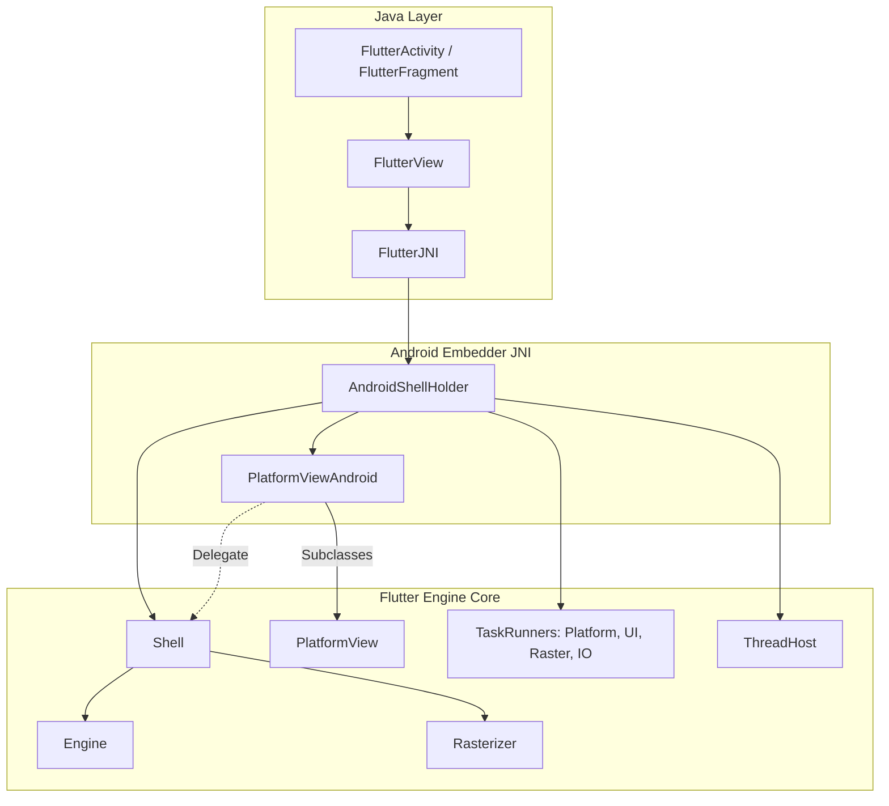

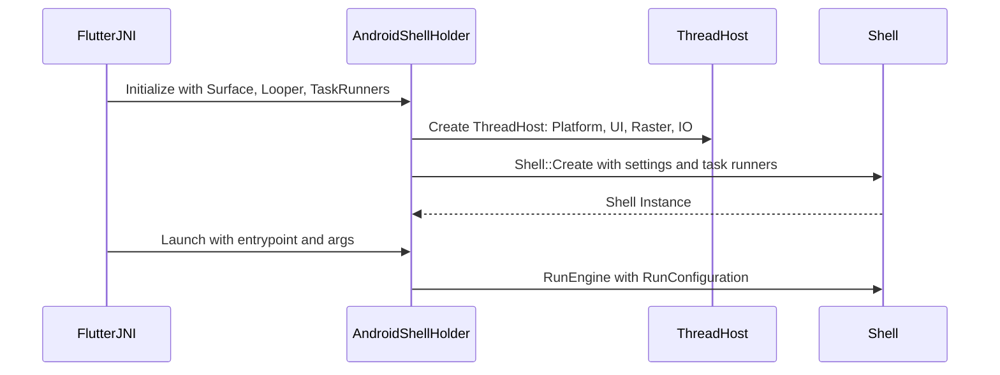

### Dependency Entanglement in [`BUILD.gn`](https://github.com/flutter/flutter/blob/4762dec4fc9072cd9269814ef36364f35a9a66dc/engine/src/flutter/shell/platform/android/BUILD.gn)

Because [`AndroidShellHolder`](https://github.com/flutter/flutter/blob/4762dec4fc9072cd9269814ef36364f35a9a66dc/engine/src/flutter/shell/platform/android/android_shell_holder.h#L38) and [`PlatformViewAndroid`](https://github.com/flutter/flutter/blob/4762dec4fc9072cd9269814ef36364f35a9a66dc/engine/src/flutter/shell/platform/android/platform_view_android.h#L43) reach directly into internal engine classes, [`flutter_shell_native_src`](https://github.com/flutter/flutter/blob/4762dec4fc9072cd9269814ef36364f35a9a66dc/engine/src/flutter/shell/platform/android/BUILD.gn#L85) in [`engine/src/flutter/shell/platform/android/BUILD.gn`](https://github.com/flutter/flutter/blob/4762dec4fc9072cd9269814ef36364f35a9a66dc/engine/src/flutter/shell/platform/android/BUILD.gn) depends on internal engine targets.

<details>

An audit of [`shell/platform/android/`](https://github.com/flutter/flutter/tree/4762dec4fc9072cd9269814ef36364f35a9a66dc/engine/src/flutter/shell/platform/android) reveals 98 internal engine headers included across Android shell files, categorized across 9 distinct subsystems:

| Subsystem & Headers | Direct GN Dependencies | Key Internal Headers | Functional Purpose in Embedder |
| :--- | :--- | :--- | :--- |
| **Impeller & Graphics Context Setup**<br/>(29 headers) | [`//flutter/impeller`](https://github.com/flutter/flutter/tree/4762dec4fc9072cd9269814ef36364f35a9a66dc/engine/src/flutter/impeller)<br/>[`//flutter/impeller/toolkit/android`](https://github.com/flutter/flutter/tree/4762dec4fc9072cd9269814ef36364f35a9a66dc/engine/src/flutter/impeller/toolkit/android)<br/>[`//flutter/impeller/toolkit/egl`](https://github.com/flutter/flutter/tree/4762dec4fc9072cd9269814ef36364f35a9a66dc/engine/src/flutter/impeller/toolkit/egl)<br/>[`//flutter/impeller/toolkit/gles`](https://github.com/flutter/flutter/tree/4762dec4fc9072cd9269814ef36364f35a9a66dc/engine/src/flutter/impeller/toolkit/gles)<br/>[`//flutter/impeller/toolkit/glvk`](https://github.com/flutter/flutter/tree/4762dec4fc9072cd9269814ef36364f35a9a66dc/engine/src/flutter/impeller/toolkit/glvk) | [`renderer/backend/vulkan/context_vk.h`](https://github.com/flutter/flutter/blob/4762dec4fc9072cd9269814ef36364f35a9a66dc/engine/src/flutter/impeller/renderer/backend/vulkan/context_vk.h)<br/>[`surface_context_vk.h`](https://github.com/flutter/flutter/blob/4762dec4fc9072cd9269814ef36364f35a9a66dc/engine/src/flutter/impeller/renderer/backend/vulkan/surface_context_vk.h)<br/>[`renderer/backend/gles/context_gles.h`](https://github.com/flutter/flutter/blob/4762dec4fc9072cd9269814ef36364f35a9a66dc/engine/src/flutter/impeller/renderer/backend/gles/context_gles.h)<br/>[`toolkit/android/hardware_buffer.h`](https://github.com/flutter/flutter/blob/4762dec4fc9072cd9269814ef36364f35a9a66dc/engine/src/flutter/impeller/toolkit/android/hardware_buffer.h)<br/>[`renderer/backend/vulkan/android/ahb_texture_source_vk.h`](https://github.com/flutter/flutter/blob/4762dec4fc9072cd9269814ef36364f35a9a66dc/engine/src/flutter/impeller/renderer/backend/vulkan/android/ahb_texture_source_vk.h) | Initializing rendering contexts on the raster thread ([`SetupImpellerContext`](https://github.com/flutter/flutter/blob/4762dec4fc9072cd9269814ef36364f35a9a66dc/engine/src/flutter/shell/platform/android/platform_view_android.h#L128)), creating Vulkan and EGL swapchains, and managing zero-copy [`AHardwareBuffer`](https://developer.android.com/ndk/reference/group/a-hardware-buffer) imports. |
| **Platform Views & Layer Compositing**<br/>(2 headers) | [`//flutter/flow`](https://github.com/flutter/flutter/tree/4762dec4fc9072cd9269814ef36364f35a9a66dc/engine/src/flutter/flow) | [`flow/embedded_views.h`](https://github.com/flutter/flutter/blob/4762dec4fc9072cd9269814ef36364f35a9a66dc/engine/src/flutter/flow/embedded_views.h)<br/>[`flow/surface.h`](https://github.com/flutter/flutter/blob/4762dec4fc9072cd9269814ef36364f35a9a66dc/engine/src/flutter/flow/surface.h) | Platform view compositing across Hybrid Composition++ (HCPP via [`SurfaceControl`](https://developer.android.com/reference/android/view/SurfaceControl)), Hybrid Composition (HC), Texture Layer Hybrid Composition (TLHC), and Virtual Displays (VD); managing geometric clipping and transforms via [`flutter::MutatorsStack`](https://github.com/flutter/flutter/blob/4762dec4fc9072cd9269814ef36364f35a9a66dc/engine/src/flutter/flow/embedded_views.h#L211), view slicing, surface pooling ([`surface_pool.h`](https://github.com/flutter/flutter/blob/4762dec4fc9072cd9269814ef36364f35a9a66dc/engine/src/flutter/shell/platform/android/external_view_embedder/surface_pool.h)), and multi-surface composition frame results ([`external_view_embedder_2.h`](https://github.com/flutter/flutter/blob/4762dec4fc9072cd9269814ef36364f35a9a66dc/engine/src/flutter/shell/platform/android/external_view_embedder/external_view_embedder_2.h)). |
| **External Textures & Surface Control**<br/>(5 headers) | [`//flutter/common/graphics`](https://github.com/flutter/flutter/tree/4762dec4fc9072cd9269814ef36364f35a9a66dc/engine/src/flutter/common/graphics)<br/>[`//flutter/display_list`](https://github.com/flutter/flutter/tree/4762dec4fc9072cd9269814ef36364f35a9a66dc/engine/src/flutter/display_list) | [`common/graphics/texture.h`](https://github.com/flutter/flutter/blob/4762dec4fc9072cd9269814ef36364f35a9a66dc/engine/src/flutter/common/graphics/texture.h)<br/>[`common/graphics/gl_context_switch.h`](https://github.com/flutter/flutter/blob/4762dec4fc9072cd9269814ef36364f35a9a66dc/engine/src/flutter/common/graphics/gl_context_switch.h)<br/>[`display_list/image/dl_image_skia.h`](https://github.com/flutter/flutter/blob/4762dec4fc9072cd9269814ef36364f35a9a66dc/engine/src/flutter/display_list/image/dl_image_skia.h)<br/>[`display_list/geometry/dl_geometry_types.h`](https://github.com/flutter/flutter/blob/4762dec4fc9072cd9269814ef36364f35a9a66dc/engine/src/flutter/display_list/geometry/dl_geometry_types.h) | Texture lifecycle and frame updates for Android [`SurfaceTexture`](https://developer.android.com/reference/android/graphics/SurfaceTexture) (OpenGL ES) and [`SurfaceProducer`](https://github.com/flutter/flutter/blob/4762dec4fc9072cd9269814ef36364f35a9a66dc/engine/src/flutter/shell/platform/android/io/flutter/view/TextureRegistry.java#L21) (Vulkan); feeding decoded video and camera frames into the [`DisplayList`](https://github.com/flutter/flutter/blob/4762dec4fc9072cd9269814ef36364f35a9a66dc/engine/src/flutter/display_list/display_list.h) compositor. |
| **Engine Core, Lifecycle & Threading**<br/>(11 headers) | [`//flutter/shell/common`](https://github.com/flutter/flutter/tree/4762dec4fc9072cd9269814ef36364f35a9a66dc/engine/src/flutter/shell/common) | [`shell/common/shell.h`](https://github.com/flutter/flutter/blob/4762dec4fc9072cd9269814ef36364f35a9a66dc/engine/src/flutter/shell/common/shell.h)<br/>[`thread_host.h`](https://github.com/flutter/flutter/blob/4762dec4fc9072cd9269814ef36364f35a9a66dc/engine/src/flutter/shell/common/thread_host.h)<br/>[`platform_view.h`](https://github.com/flutter/flutter/blob/4762dec4fc9072cd9269814ef36364f35a9a66dc/engine/src/flutter/shell/common/platform_view.h)<br/>[`rasterizer.h`](https://github.com/flutter/flutter/blob/4762dec4fc9072cd9269814ef36364f35a9a66dc/engine/src/flutter/shell/common/rasterizer.h)<br/>[`run_configuration.h`](https://github.com/flutter/flutter/blob/4762dec4fc9072cd9269814ef36364f35a9a66dc/engine/src/flutter/shell/common/run_configuration.h)<br/>[`vsync_waiter.h`](https://github.com/flutter/flutter/blob/4762dec4fc9072cd9269814ef36364f35a9a66dc/engine/src/flutter/shell/common/vsync_waiter.h)<br/>[`snapshot_surface_producer.h`](https://github.com/flutter/flutter/blob/4762dec4fc9072cd9269814ef36364f35a9a66dc/engine/src/flutter/shell/common/snapshot_surface_producer.h) | Direct instantiation of [`flutter::Shell::Create(...)`](https://github.com/flutter/flutter/blob/4762dec4fc9072cd9269814ef36364f35a9a66dc/engine/src/flutter/shell/common/shell.h#L170-L176), thread host allocation (Platform, UI, Raster, IO), vsync scheduling, snapshot generation, and rasterizer coordination. |
| **UI Layer & Message Dispatch**<br/>(5 headers) | [`//flutter/lib/ui`](https://github.com/flutter/flutter/tree/4762dec4fc9072cd9269814ef36364f35a9a66dc/engine/src/flutter/lib/ui) | [`lib/ui/window/platform_message.h`](https://github.com/flutter/flutter/blob/4762dec4fc9072cd9269814ef36364f35a9a66dc/engine/src/flutter/lib/ui/window/platform_message.h)<br/>[`platform_message_response.h`](https://github.com/flutter/flutter/blob/4762dec4fc9072cd9269814ef36364f35a9a66dc/engine/src/flutter/lib/ui/window/platform_message_response.h)<br/>[`lib/ui/plugins/callback_cache.h`](https://github.com/flutter/flutter/blob/4762dec4fc9072cd9269814ef36364f35a9a66dc/engine/src/flutter/lib/ui/plugins/callback_cache.h)<br/>[`lib/ui/painting/image_generator.h`](https://github.com/flutter/flutter/blob/4762dec4fc9072cd9269814ef36364f35a9a66dc/engine/src/flutter/lib/ui/painting/image_generator.h) | Binary message encoding and decoding for platform channels, background Dart entrypoint lookup ([`PluginUtilities.getCallbackHandle`](https://github.com/flutter/flutter/blob/4762dec4fc9072cd9269814ef36364f35a9a66dc/engine/src/flutter/lib/ui/plugins.dart#L54) via [`callback_cache.h`](https://github.com/flutter/flutter/blob/4762dec4fc9072cd9269814ef36364f35a9a66dc/engine/src/flutter/lib/ui/plugins/callback_cache.h)), and native platform image decoding. |
| **Dart VM, Runtime & Service Isolate**<br/>(2 headers) | [`//flutter/runtime`](https://github.com/flutter/flutter/tree/4762dec4fc9072cd9269814ef36364f35a9a66dc/engine/src/flutter/runtime)<br/>[`//flutter/runtime:libdart`](https://github.com/flutter/flutter/blob/4762dec4fc9072cd9269814ef36364f35a9a66dc/engine/src/flutter/runtime/BUILD.gn) | [`runtime/dart_vm.h`](https://github.com/flutter/flutter/blob/4762dec4fc9072cd9269814ef36364f35a9a66dc/engine/src/flutter/runtime/dart_vm.h)<br/>[`runtime/dart_service_isolate.h`](https://github.com/flutter/flutter/blob/4762dec4fc9072cd9269814ef36364f35a9a66dc/engine/src/flutter/runtime/dart_service_isolate.h) | Managing the Dart VM lifecycle, configuring concurrent message loops, isolate creation, and Dart service isolate initialization. |
| **Asset Management & Packaging**<br/>(1 header) | [`//flutter/assets`](https://github.com/flutter/flutter/tree/4762dec4fc9072cd9269814ef36364f35a9a66dc/engine/src/flutter/assets) | [`assets/asset_resolver.h`](https://github.com/flutter/flutter/blob/4762dec4fc9072cd9269814ef36364f35a9a66dc/engine/src/flutter/assets/asset_resolver.h) | Resolving assets and kernel blobs packaged within the Android APK via [`APKAssetProvider`](https://github.com/flutter/flutter/blob/4762dec4fc9072cd9269814ef36364f35a9a66dc/engine/src/flutter/shell/platform/android/apk_asset_provider.h#L17). |
| **GPU Backends & Surface Delegates**<br/>(5 headers) | [`//flutter/shell/gpu`](https://github.com/flutter/flutter/tree/4762dec4fc9072cd9269814ef36364f35a9a66dc/engine/src/flutter/shell/gpu)<br/>[`//flutter/vulkan`](https://github.com/flutter/flutter/tree/4762dec4fc9072cd9269814ef36364f35a9a66dc/engine/src/flutter/vulkan) | [`shell/gpu/gpu_surface_gl_impeller.h`](https://github.com/flutter/flutter/blob/4762dec4fc9072cd9269814ef36364f35a9a66dc/engine/src/flutter/shell/gpu/gpu_surface_gl_impeller.h)<br/>[`gpu_surface_vulkan_impeller.h`](https://github.com/flutter/flutter/blob/4762dec4fc9072cd9269814ef36364f35a9a66dc/engine/src/flutter/shell/gpu/gpu_surface_vulkan_impeller.h)<br/>[`vulkan/vulkan_native_surface_android.h`](https://github.com/flutter/flutter/blob/4762dec4fc9072cd9269814ef36364f35a9a66dc/engine/src/flutter/vulkan/vulkan_native_surface_android.h) | Implementing platform window surface delegates for OpenGL and Vulkan render pipelines. |
| **Foundational Utilities & Concurrency**<br/>(24 headers) | [`//flutter/fml`](https://github.com/flutter/flutter/tree/4762dec4fc9072cd9269814ef36364f35a9a66dc/engine/src/flutter/fml) | [`fml/raster_thread_merger.h`](https://github.com/flutter/flutter/blob/4762dec4fc9072cd9269814ef36364f35a9a66dc/engine/src/flutter/fml/raster_thread_merger.h)<br/>[`fml/task_runner.h`](https://github.com/flutter/flutter/blob/4762dec4fc9072cd9269814ef36364f35a9a66dc/engine/src/flutter/fml/task_runner.h)<br/>[`fml/message_loop.h`](https://github.com/flutter/flutter/blob/4762dec4fc9072cd9269814ef36364f35a9a66dc/engine/src/flutter/fml/message_loop.h)<br/>[`fml/concurrent_message_loop.h`](https://github.com/flutter/flutter/blob/4762dec4fc9072cd9269814ef36364f35a9a66dc/engine/src/flutter/fml/concurrent_message_loop.h)<br/>[`fml/platform/android/jni_util.h`](https://github.com/flutter/flutter/blob/4762dec4fc9072cd9269814ef36364f35a9a66dc/engine/src/flutter/fml/platform/android/jni_util.h)<br/>[`fml/platform/android/scoped_java_ref.h`](https://github.com/flutter/flutter/blob/4762dec4fc9072cd9269814ef36364f35a9a66dc/engine/src/flutter/fml/platform/android/scoped_java_ref.h) | Message loops, JNI handle wrappers, task scheduling, and raster thread leasing. |
</details>

### Technical Consequences of Coupling

This level of coupling creates several concrete maintenance problems:

- Fragile refactoring: Any change to private engine internals (such as Impeller backend refactors or Flow mutator stack updates) breaks the Android embedder.
- Prolonged rebuild times: Compiling `libflutter.so` requires rebuilding internal engine translation units even when only platform-specific code changes.
- Lack of API contract: No stable boundary prevents Android embedder code from reaching into private engine internals, which inhibits engine modularization.
- Feature parity lag: Because Android and iOS bypass the embedder API, public engine capabilities often lag behind engine internals, which prevents out-of-tree platforms from achieving feature parity with mobile platforms.

## Detailed Design

To allow the Android embedder to communicate with the engine exclusively through [`embedder.h`](https://github.com/flutter/flutter/blob/4762dec4fc9072cd9269814ef36364f35a9a66dc/engine/src/flutter/shell/platform/embedder/embedder.h), the C-API must be extended to cover Android-specific subsystem requirements. Each proposed extension corresponds directly to uncoupling one of the internal subsystems identified in the dependency audit and supporting a target embedder component (`FlutterEmbedderNative`, `JniRouter` / `JniDelegate` / `JvmInvoker`, `AndroidSurfaceControl`, `AndroidPlatformViewsController`, `AndroidMutatorsMapper`, `AndroidHardwareBuffer`, `AndroidVulkanExternalTexture`, `AndroidSemanticsMapper`, `AndroidWindowMetricsMapper`, `AndroidVsyncWaiter`, `AndroidVMInit`, `AndroidEngineGroup`, and [`APKAssetProvider`](https://github.com/flutter/flutter/blob/4762dec4fc9072cd9269814ef36364f35a9a66dc/engine/src/flutter/shell/platform/android/apk_asset_provider.h#L17)).

### Graphics Surface Setup, Context Ownership, and Surface Lifecycle ([`SetupImpellerContext`](https://github.com/flutter/flutter/blob/4762dec4fc9072cd9269814ef36364f35a9a66dc/engine/src/flutter/shell/platform/android/platform_view_android.h#L128))

To let the Android embedder choose between Vulkan (`kVulkan`) and OpenGL ES (`kOpenGL`) on the raster thread without blocking the Android UI thread during startup, this RFC adds a `kDeferred` renderer type (`FlutterDeferredRendererConfig`) and a `FlutterRendererConfigResolveCallback` callback to [`FlutterRendererConfig`](https://github.com/flutter/flutter/blob/4762dec4fc9072cd9269814ef36364f35a9a66dc/engine/src/flutter/shell/platform/embedder/embedder.h#L1055) (see [Deferred Backend Selection (`kDeferred`)](#deferred-backend-selection-kdeferred)):

- At startup, the Android embedder passes `type = kDeferred` with its `resolve_callback` to [`FlutterEngineInitialize`](https://github.com/flutter/flutter/blob/4762dec4fc9072cd9269814ef36364f35a9a66dc/engine/src/flutter/shell/platform/embedder/embedder.h#L2970-L2975) so the UI thread does not load `libvulkan.so` or initialize a GPU context synchronously.
- While the engine launches, the raster thread runs `CreateImpellerContext` ([`PlatformViewEmbedder::SetupImpellerContext()`](#deferring-impellercontext-and-surface-creation-in-shellplatformembedder-setupimpellercontext)) and invokes `FlutterRendererConfigResolveCallback`, which probes the device and fills in a concrete `kVulkan` or `kOpenGL` `FlutterRendererConfig`.
- If the engine rejects the returned `kVulkan` configuration (because context creation fails or the driver matches Impeller's known-bad driver list), it re-invokes `FlutterRendererConfigResolveCallback` with a `FlutterRendererResolveInfo` rejection reason so the embedder can destroy its Vulkan handles and return `kOpenGL`.

#### How `SetupImpellerContext` Works on Android Today

<details>

[`PlatformView::SetupImpellerContext()`](https://github.com/flutter/flutter/blob/4762dec4fc9072cd9269814ef36364f35a9a66dc/engine/src/flutter/shell/common/platform_view.h#L1040) was added in [#167765](https://github.com/flutter/flutter/pull/167765) because Vulkan driver and context initialization can take 100+ ms on some Android devices. During engine startup, [`Shell::CreateWithSnapshot`](https://github.com/flutter/flutter/blob/4762dec4fc9072cd9269814ef36364f35a9a66dc/engine/src/flutter/shell/common/shell.cc#L449-L509) creates [`PlatformViewAndroid`](https://github.com/flutter/flutter/blob/4762dec4fc9072cd9269814ef36364f35a9a66dc/engine/src/flutter/shell/platform/android/platform_view_android.h#L43) (which constructs [`AndroidContextDynamicImpeller`](https://github.com/flutter/flutter/blob/4762dec4fc9072cd9269814ef36364f35a9a66dc/engine/src/flutter/shell/platform/android/android_context_dynamic_impeller.h#L23) as an empty shell) on the Android UI thread and posts a `CreateImpellerContext` task ([`shell.cc#L314-L333`](https://github.com/flutter/flutter/blob/4762dec4fc9072cd9269814ef36364f35a9a66dc/engine/src/flutter/shell/common/shell.cc#L314-L333)) to the raster task runner to run [`PlatformViewAndroid::SetupImpellerContext()`](https://github.com/flutter/flutter/blob/4762dec4fc9072cd9269814ef36364f35a9a66dc/engine/src/flutter/shell/platform/android/platform_view_android.cc#L567-L570):

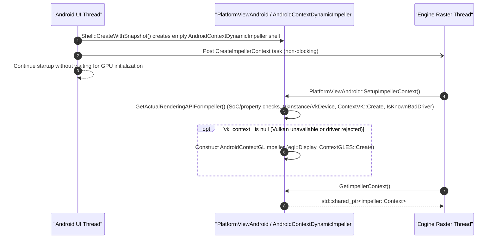

That single raster-thread call currently performs two distinct jobs inside [`shell/platform/android/`](https://github.com/flutter/flutter/tree/4762dec4fc9072cd9269814ef36364f35a9a66dc/engine/src/flutter/shell/platform/android):

1. **Choosing the backend and creating the underlying GPU device**: [`GetActualRenderingAPIForImpeller`](https://github.com/flutter/flutter/blob/4762dec4fc9072cd9269814ef36364f35a9a66dc/engine/src/flutter/shell/platform/android/android_context_dynamic_impeller.cc#L79-L120) checks system properties and a known-bad SoC list, loads `libvulkan.so`, creates the [`VkInstance`](https://registry.khronos.org/vulkan/specs/1.3-extensions/man/html/VkInstance.html) and [`VkDevice`](https://registry.khronos.org/vulkan/specs/1.3-extensions/man/html/VkDevice.html), checks Impeller's known-bad driver list ([`DriverInfoVK::IsKnownBadDriver()`](https://github.com/flutter/flutter/blob/4762dec4fc9072cd9269814ef36364f35a9a66dc/engine/src/flutter/impeller/renderer/backend/vulkan/driver_info_vk.cc#L377)) in [`AndroidContextVKImpeller`](https://github.com/flutter/flutter/blob/4762dec4fc9072cd9269814ef36364f35a9a66dc/engine/src/flutter/shell/platform/android/android_context_vk_impeller.cc#L65-L69), and falls back to OpenGL ES if any step fails.
2. **Constructing the [`impeller::Context`](https://github.com/flutter/flutter/blob/4762dec4fc9072cd9269814ef36364f35a9a66dc/engine/src/flutter/impeller/renderer/context.h#L70)**: [`AndroidContextVKImpeller`](https://github.com/flutter/flutter/blob/4762dec4fc9072cd9269814ef36364f35a9a66dc/engine/src/flutter/shell/platform/android/android_context_vk_impeller.h#L16) and [`AndroidContextGLImpeller`](https://github.com/flutter/flutter/blob/4762dec4fc9072cd9269814ef36364f35a9a66dc/engine/src/flutter/shell/platform/android/android_context_gl_impeller.h#L15) call [`impeller::ContextVK::Create`](https://github.com/flutter/flutter/blob/4762dec4fc9072cd9269814ef36364f35a9a66dc/engine/src/flutter/impeller/renderer/backend/vulkan/context_vk.h) or [`impeller::ContextGLES::Create`](https://github.com/flutter/flutter/blob/4762dec4fc9072cd9269814ef36364f35a9a66dc/engine/src/flutter/impeller/renderer/backend/gles/context_gles.h) to set up shader library mappings, the pipeline cache, the memory allocator, and descriptor/command pools.

#### Why Moving to `embedder.h` Requires Changes on Both Sides

When Android migrates to [`embedder.h`](https://github.com/flutter/flutter/blob/4762dec4fc9072cd9269814ef36364f35a9a66dc/engine/src/flutter/shell/platform/embedder/embedder.h), `PlatformViewAndroid` and `AndroidContextDynamicImpeller` are removed. The Android embedder no longer creates or owns `impeller::Context`; it creates only raw Vulkan (`VkInstance`, `VkPhysicalDevice`, `VkDevice`, [`VkQueue`](https://registry.khronos.org/vulkan/specs/1.3-extensions/man/html/VkQueue.html)) or EGL (`EGLDisplay`, `EGLContext`, `EGLConfig`) handles and passes them in [`FlutterRendererConfig`](https://github.com/flutter/flutter/blob/4762dec4fc9072cd9269814ef36364f35a9a66dc/engine/src/flutter/shell/platform/embedder/embedder.h#L1055) to [`FlutterEngineInitialize`](https://github.com/flutter/flutter/blob/4762dec4fc9072cd9269814ef36364f35a9a66dc/engine/src/flutter/shell/platform/embedder/embedder.h#L2970). Inside the engine, [`PlatformViewEmbedder`](https://github.com/flutter/flutter/blob/4762dec4fc9072cd9269814ef36364f35a9a66dc/engine/src/flutter/shell/platform/embedder/platform_view_embedder.h) and [`EmbedderSurface`](https://github.com/flutter/flutter/blob/4762dec4fc9072cd9269814ef36364f35a9a66dc/engine/src/flutter/shell/platform/embedder/embedder_surface.h) (`EmbedderSurfaceVulkanImpeller` and `EmbedderSurfaceGLImpeller`) own the `impeller::Context`.

Preserving Android's non-blocking startup behavior while staying on the existing two-phase initialization API ([`FlutterEngineInitialize`](https://github.com/flutter/flutter/blob/4762dec4fc9072cd9269814ef36364f35a9a66dc/engine/src/flutter/shell/platform/embedder/embedder.h#L2970-L2975) and [`FlutterEngineRunInitialized`](https://github.com/flutter/flutter/blob/4762dec4fc9072cd9269814ef36364f35a9a66dc/engine/src/flutter/shell/platform/embedder/embedder.h#L3006-L3007)) requires three coordinated changes:

1. **The backend choice must move to the raster thread.** [`FlutterRendererConfig`](https://github.com/flutter/flutter/blob/4762dec4fc9072cd9269814ef36364f35a9a66dc/engine/src/flutter/shell/platform/embedder/embedder.h#L1042-L1055) requires an explicit `type` (`kVulkan` or `kOpenGL`) and live Vulkan handles when [`FlutterEngineInitialize`](https://github.com/flutter/flutter/blob/4762dec4fc9072cd9269814ef36364f35a9a66dc/engine/src/flutter/shell/platform/embedder/embedder.h#L2970-L2975) is called, before [`Shell::CreateWithSnapshot`](https://github.com/flutter/flutter/blob/4762dec4fc9072cd9269814ef36364f35a9a66dc/engine/src/flutter/shell/common/shell.cc#L449-L509) or the raster thread runs. Android makes this choice inside `CreateImpellerContext` today. A new `kDeferred` renderer type lets the embedder make it there too (see [Deferred Backend Selection](#deferred-backend-selection-kdeferred)).
2. **[`PlatformViewEmbedder`](https://github.com/flutter/flutter/blob/4762dec4fc9072cd9269814ef36364f35a9a66dc/engine/src/flutter/shell/platform/embedder/platform_view_embedder.h#L36) and [`EmbedderSurface`](https://github.com/flutter/flutter/blob/4762dec4fc9072cd9269814ef36364f35a9a66dc/engine/src/flutter/shell/platform/embedder/embedder_surface.h#L15-L37) must be wired up to [`SetupImpellerContext()`](https://github.com/flutter/flutter/blob/4762dec4fc9072cd9269814ef36364f35a9a66dc/engine/src/flutter/shell/common/platform_view.h#L1040) in [`shell/platform/embedder/`](https://github.com/flutter/flutter/tree/4762dec4fc9072cd9269814ef36364f35a9a66dc/engine/src/flutter/shell/platform/embedder)**, because [#167765](https://github.com/flutter/flutter/pull/167765) only implemented [`SetupImpellerContext()`](https://github.com/flutter/flutter/blob/4762dec4fc9072cd9269814ef36364f35a9a66dc/engine/src/flutter/shell/common/platform_view.h#L1040) on [`PlatformViewAndroid`](https://github.com/flutter/flutter/blob/4762dec4fc9072cd9269814ef36364f35a9a66dc/engine/src/flutter/shell/platform/android/platform_view_android.h#L43). In [`shell/platform/embedder/`](https://github.com/flutter/flutter/tree/4762dec4fc9072cd9269814ef36364f35a9a66dc/engine/src/flutter/shell/platform/embedder) today:
   - [`PlatformViewEmbedder`](https://github.com/flutter/flutter/blob/4762dec4fc9072cd9269814ef36364f35a9a66dc/engine/src/flutter/shell/platform/embedder/platform_view_embedder.cc#L157-L160) does not override `SetupImpellerContext()`. It only overrides `GetImpellerContext()`, which calls `embedder_surface_->CreateImpellerContext()`.
   - Despite the name [`CreateImpellerContext()`](https://github.com/flutter/flutter/blob/4762dec4fc9072cd9269814ef36364f35a9a66dc/engine/src/flutter/shell/platform/embedder/embedder_surface.h#L25), both [`EmbedderSurfaceVulkanImpeller`](https://github.com/flutter/flutter/blob/4762dec4fc9072cd9269814ef36364f35a9a66dc/engine/src/flutter/shell/platform/embedder/embedder_surface_vulkan_impeller.cc#L76-L95) and [`EmbedderSurfaceGLImpeller`](https://github.com/flutter/flutter/blob/4762dec4fc9072cd9269814ef36364f35a9a66dc/engine/src/flutter/shell/platform/embedder/embedder_surface_gl_impeller.cc#L98-L125) construct `impeller::ContextVK` and `impeller::ContextGLES` synchronously in their constructors on the UI thread (inside [`InferVulkanPlatformViewCreationCallback`](https://github.com/flutter/flutter/blob/4762dec4fc9072cd9269814ef36364f35a9a66dc/engine/src/flutter/shell/platform/embedder/embedder.cc#L619-L691) and [`InferOpenGLPlatformViewCreationCallback`](https://github.com/flutter/flutter/blob/4762dec4fc9072cd9269814ef36364f35a9a66dc/engine/src/flutter/shell/platform/embedder/embedder.cc#L307-L500)), and their `CreateImpellerContext()` methods simply return the already-created `context_` member.
3. **The internal `NotifyCreated()` call in [`FlutterEngineRunInitialized`](https://github.com/flutter/flutter/blob/4762dec4fc9072cd9269814ef36364f35a9a66dc/engine/src/flutter/shell/platform/embedder/embedder.h#L3006-L3007) must not block on the raster thread.** In [`embedder.cc`](https://github.com/flutter/flutter/blob/4762dec4fc9072cd9269814ef36364f35a9a66dc/engine/src/flutter/shell/platform/embedder/embedder.cc#L2515-L2526), `FlutterEngineRunInitialized` calls `embedder_engine->LaunchShell()`, `embedder_engine->NotifyCreated()`, and `embedder_engine->RunRootIsolate()`:

   ```cpp
   // Existing implementation in shell/platform/embedder/embedder.cc (L2515-L2534)
   // Step 1: Launch the shell.
   if (!embedder_engine->LaunchShell()) {
     return LOG_EMBEDDER_ERROR(kInvalidArguments, ...);
   }

   // Step 2: Tell the platform view to initialize itself.
   if (!embedder_engine->NotifyCreated()) {
     return LOG_EMBEDDER_ERROR(kInternalInconsistency, ...);
   }

   // Step 3: Launch the root isolate.
   if (!embedder_engine->RunRootIsolate()) {
     return LOG_EMBEDDER_ERROR(kInvalidArguments, ...);
   }
   ```

   [`PlatformView::NotifyCreated()`](https://github.com/flutter/flutter/blob/4762dec4fc9072cd9269814ef36364f35a9a66dc/engine/src/flutter/shell/common/platform_view.cc#L64-L85) posts `CreateRenderingSurface()` to the FIFO raster task runner, queued **behind** `CreateImpellerContext`, and blocks the UI thread on a latch (`latch.Wait()`) before passing the surface to [`Shell::OnPlatformViewCreated`](https://github.com/flutter/flutter/blob/4762dec4fc9072cd9269814ef36364f35a9a66dc/engine/src/flutter/shell/common/shell.cc#L973-L1062). Once context creation moves to the raster thread, that latch makes the UI thread wait for `SetupImpellerContext()` anyway, and with `kDeferred` it would also wait for the embedder's resolve callback. Launching the shell doesn't have this problem: the rasterizer is created in a raster task posted before `CreateImpellerContext` ([`shell.cc#L295-L335`](https://github.com/flutter/flutter/blob/4762dec4fc9072cd9269814ef36364f35a9a66dc/engine/src/flutter/shell/common/shell.cc#L295-L335)), and `Shell::Setup` waits only for the engine, the rasterizer and the IO manager ([`shell.cc#L438-L441`](https://github.com/flutter/flutter/blob/4762dec4fc9072cd9269814ef36364f35a9a66dc/engine/src/flutter/shell/common/shell.cc#L438-L441)), which the IO thread hands over before it waits for the context ([`shell.cc#L382-L391`](https://github.com/flutter/flutter/blob/4762dec4fc9072cd9269814ef36364f35a9a66dc/engine/src/flutter/shell/common/shell.cc#L382-L391)). `FlutterEngineRunInitialized` continues to call `embedder_engine->NotifyCreated()`, and `PlatformViewEmbedder::NotifyCreated()` queues surface creation on the raster task runner instead of waiting on a latch (see [Deferring `impeller::Context` and Surface Creation](#deferring-impellercontext-and-surface-creation-in-shellplatformembedder-setupimpellercontext)). Creating that surface before Android provides an `ANativeWindow` is fine, because with a compositor it holds only the rendering context (see [Renderer Availability and Surface Lifecycle](#renderer-availability-and-surface-lifecycle)).
</details>

#### Deferred Backend Selection (`kDeferred`)

Android chooses between Vulkan and OpenGL ES on the raster thread today. To keep that, `embedder.h` adds a renderer type whose configuration is a callback. The engine calls it on the raster thread inside `CreateImpellerContext`, and the callback returns a concrete configuration:

```c
// FlutterRendererConfig gains a struct tag so that the callback below can
// refer to it. Adding a tag to a typedef'd struct is source and ABI compatible.
typedef struct FlutterRendererConfig FlutterRendererConfig;

typedef enum {
  // ... existing values ...
  /// The embedder chooses the renderer on the raster thread while the engine
  /// launches. See |FlutterDeferredRendererConfig|.
  kDeferred,
} FlutterRendererType;

typedef enum {
  kFlutterRendererRejectReasonNone = 0,
  /// The configuration failed validation (missing callbacks, a type this build
  /// or these settings do not support, or `kDeferred` itself).
  kFlutterRendererRejectReasonInvalidConfig,
  /// The engine could not create a rendering context from the configuration,
  /// for example because the Vulkan device lacks a required extension.
  kFlutterRendererRejectReasonContextCreationFailed,
  /// The Vulkan driver is on the engine's list of known-bad drivers.
  kFlutterRendererRejectReasonKnownBadDriver,
} FlutterRendererRejectReason;

typedef struct {
  /// The size of this struct. Must be sizeof(FlutterRendererResolveInfo).
  size_t struct_size;
  /// 0 on the first call; incremented after each rejected configuration.
  size_t attempt;
  /// The type of the previously returned configuration. Unset on attempt 0.
  FlutterRendererType rejected_type;
  /// Why the previous configuration was rejected. None on attempt 0.
  FlutterRendererRejectReason reject_reason;
} FlutterRendererResolveInfo;

/// @param[in]  user_data   The `user_data` passed to `FlutterEngineInitialize`
///                         or `FlutterEngineRun`.
/// @param[in]  info        Which attempt this is and, after a rejection, why.
/// @param[out] config_out  Zero-initialized, engine-owned. Set `type` to
///                         `kOpenGL`, `kSoftware`, `kMetal` or `kVulkan` and
///                         fill in that union member. Memory it references must
///                         stay valid until `FlutterEngineDeinitialize` returns
///                         for this engine and every engine spawned from it.
/// @return     `false` if no renderer can be created.
typedef bool (*FlutterRendererConfigResolveCallback)(
    void* /* user_data */,
    const FlutterRendererResolveInfo* /* info */,
    FlutterRendererConfig* /* config_out */);

typedef struct {
  /// The size of this struct. Must be sizeof(FlutterDeferredRendererConfig).
  size_t struct_size;
  /// Required. Called on the raster task runner before the engine creates its
  /// rendering context, while the engine launches. If the engine rejects the
  /// returned configuration, it releases every object it created from it
  /// (embedder-provided handles are never destroyed by the engine) and calls
  /// this again with the reason; return `false` to stop. The engine creates
  /// its rendering surface after this returns, so only
  /// `FlutterEngineDeinitialize` and `FlutterEngineShutdown` wait for it. The
  /// callback may block, but it must not wait on the platform thread.
  /// Engines created with `FlutterEngineSpawn` reuse the resolved
  /// configuration and rendering context; the callback is not called for
  /// them.
  FlutterRendererConfigResolveCallback resolve_callback;
} FlutterDeferredRendererConfig;

struct FlutterRendererConfig {
  FlutterRendererType type;
  union {
    FlutterOpenGLRendererConfig open_gl;
    FlutterSoftwareRendererConfig software;
    FlutterMetalRendererConfig metal;
    FlutterVulkanRendererConfig vulkan;
    FlutterDeferredRendererConfig deferred;
  };
};
```

**What the Android callback does.** It runs the checks Android runs today in [`GetActualRenderingAPIForImpeller`](https://github.com/flutter/flutter/blob/4762dec4fc9072cd9269814ef36364f35a9a66dc/engine/src/flutter/shell/platform/android/android_context_dynamic_impeller.cc#L79-L120): known emulators, Huawei devices (`ro.com.google.clientidbase`), MediaTek devices with `ro.vendor.build.version.sdk < 32`, and the `ro.product.board` deny-list ([`IsKnownBadSOC`](https://github.com/flutter/flutter/blob/4762dec4fc9072cd9269814ef36364f35a9a66dc/engine/src/flutter/shell/platform/android/android_context_dynamic_impeller.cc#L68-L77)). If one matches, it returns `kOpenGL` without loading Vulkan. Otherwise it loads `libvulkan.so`, creates the `VkInstance`, `VkDevice` and `VkQueue`, and returns `kVulkan`. `AndroidContextDynamicImpeller` does the same work on the raster thread today, so the UI thread never waits for it, and nothing has to start earlier on a `FlutterLoader` executor. A process-wide singleton (`VulkanDeviceOwner`) holds the device, so the callbacks of later [`FlutterEngine`](https://github.com/flutter/flutter/blob/4762dec4fc9072cd9269814ef36364f35a9a66dc/engine/src/flutter/shell/platform/android/io/flutter/embedding/engine/FlutterEngine.java#L90) instances return the same handles without probing again.

**When the engine rejects a configuration.** Android falls back to OpenGL ES today when Vulkan context creation fails or the driver is on Impeller's known-bad list ([`AndroidContextVKImpeller`](https://github.com/flutter/flutter/blob/4762dec4fc9072cd9269814ef36364f35a9a66dc/engine/src/flutter/shell/platform/android/android_context_vk_impeller.cc#L65-L69)). In the embedder path, [`impeller::ContextVK::Create`](https://github.com/flutter/flutter/blob/4762dec4fc9072cd9269814ef36364f35a9a66dc/engine/src/flutter/impeller/renderer/backend/vulkan/context_vk.cc#L176-L188) still checks the embedder's device, but a failure leaves the engine without a renderer. For a `kDeferred` configuration the engine keeps Android's fallback:

1. It validates the returned configuration and creates the rendering context from it.
2. It applies Impeller's known-bad driver check ([`DriverInfoVK::IsKnownBadDriver()`](https://github.com/flutter/flutter/blob/4762dec4fc9072cd9269814ef36364f35a9a66dc/engine/src/flutter/impeller/renderer/backend/vulkan/driver_info_vk.cc#L377)). Explicit `kVulkan` configurations from other embedders keep their current behavior.
3. If either step fails, it releases what it created from that configuration and calls the callback again with the reason. The engine never takes ownership of embedder-provided Vulkan handles, so the Android callback destroys its `VkDevice` and returns `kOpenGL`.

The driver blocklist stays in one place inside Impeller, and `embedder.h` needs no driver query function.

The callback comes with these rules:

- **Threading.** The callback runs on the raster task runner. It may block, for example while it creates the Vulkan device, but it must not wait on the platform thread, because `FlutterEngineDeinitialize` and `FlutterEngineShutdown` wait for it. No other call waits for it. The engine reads the rendering context only on the raster and IO threads, and it creates its rendering surface after resolution (see the next section).
- **Failure.** If the callback returns `false`, or the engine rejects every configuration, the engine runs without a renderer and the isolate keeps running. Frames are dropped before any backing store is requested.
- **Validation.** `FlutterEngineInitialize` checks only that `resolve_callback` is set. The checks it runs today on a concrete configuration, such as required callbacks being present and the backend being compiled in, run on the raster thread after resolution. Context-creation failures are only logged today, and `FlutterEngineRunInitialized` reports success either way.
- **External textures.** `FlutterEngineRegisterExternalTexture` may be called after `FlutterEngineRunInitialized` returns while `resolve_callback` is still running on the raster thread (textures registered before `FlutterEngineRunInitialized` are queued by `FlutterEmbedderNative` and flushed after `FlutterEngineRunInitialized`; see [Alternative Considered](#alternative-considered-splitting-startup-into-separate-shell-and-isolate-launch-apis)). Registration only records the texture ID. The engine binds it to the resolved configuration's frame callback on the raster thread, where every texture operation already runs after `CreateImpellerContext`.
- **Spawn.** Spawned engines share the parent's task runners ([`Shell::Spawn`](https://github.com/flutter/flutter/blob/4762dec4fc9072cd9269814ef36364f35a9a66dc/engine/src/flutter/shell/common/shell.cc#L718-L722)), so the parent's resolution runs first. A spawned engine reuses the resolved configuration and rendering context, and the callback is not called for it. `FlutterEngineSpawn` may be called before the parent has resolved.
- **Settings.** The resolved type must be valid for the engine's settings. Under Impeller, Android chooses only between `kVulkan` and `kOpenGL`.

#### Deferring `impeller::Context` and Surface Creation in `shell/platform/embedder/` (`SetupImpellerContext`)

To keep [`impeller::ContextVK::Create`](https://github.com/flutter/flutter/blob/4762dec4fc9072cd9269814ef36364f35a9a66dc/engine/src/flutter/impeller/renderer/backend/vulkan/context_vk.h#L106) and [`impeller::ContextGLES::Create`](https://github.com/flutter/flutter/blob/4762dec4fc9072cd9269814ef36364f35a9a66dc/engine/src/flutter/impeller/renderer/backend/gles/context_gles.h#L27-L30) on the raster thread instead of running them in the [`EmbedderSurface`](https://github.com/flutter/flutter/blob/4762dec4fc9072cd9269814ef36364f35a9a66dc/engine/src/flutter/shell/platform/embedder/embedder_surface.h#L15-L37) constructors on the UI thread, and to keep [`FlutterEngineRunInitialized`](https://github.com/flutter/flutter/blob/4762dec4fc9072cd9269814ef36364f35a9a66dc/engine/src/flutter/shell/platform/embedder/embedder.h#L3006-L3007) from waiting for the raster thread, [`shell/platform/embedder/`](https://github.com/flutter/flutter/tree/4762dec4fc9072cd9269814ef36364f35a9a66dc/engine/src/flutter/shell/platform/embedder) is updated as follows:

- [`EmbedderSurface`](https://github.com/flutter/flutter/blob/4762dec4fc9072cd9269814ef36364f35a9a66dc/engine/src/flutter/shell/platform/embedder/embedder_surface.h#L15-L37) adds `virtual void SetupImpellerContext() {}`.
- [`PlatformViewEmbedder`](https://github.com/flutter/flutter/blob/4762dec4fc9072cd9269814ef36364f35a9a66dc/engine/src/flutter/shell/platform/embedder/platform_view_embedder.cc#L157-L160) overrides `PlatformView::SetupImpellerContext()`. For a `kDeferred` configuration it calls `resolve_callback`, validates the result, builds the `EmbedderSurface` and external texture resolver for the resolved type, and creates the context, retrying as described above. For a concrete configuration it forwards the call to `embedder_surface_->SetupImpellerContext()`.
- [`EmbedderSurfaceVulkanImpeller`](https://github.com/flutter/flutter/blob/4762dec4fc9072cd9269814ef36364f35a9a66dc/engine/src/flutter/shell/platform/embedder/embedder_surface_vulkan_impeller.cc#L20-L95) validates the `VulkanDispatchTable` callbacks and stores `impeller::ContextVK::Settings` (including `EmbedderData` handles and extension lists) in its constructor without creating the Impeller context. It overrides `SetupImpellerContext()` to run `context_ = impeller::ContextVK::Create(std::move(settings_))` on the raster thread when `Shell::CreateWithSnapshot` executes the `CreateImpellerContext` task.
- [`EmbedderSurfaceGLImpeller`](https://github.com/flutter/flutter/blob/4762dec4fc9072cd9269814ef36364f35a9a66dc/engine/src/flutter/shell/platform/embedder/embedder_surface_gl_impeller.cc#L77-L132) likewise validates `gl_dispatch_table_` in its constructor and moves `gl_make_current_callback()`, `ProcTableGLES` creation, `impeller::ContextGLES::Create(...)`, and `gl_clear_current_callback()` into `EmbedderSurfaceGLImpeller::SetupImpellerContext()` on the raster thread.
- `FlutterEngineRunInitialized` continues to call `embedder_engine->NotifyCreated()` (`platform_view->NotifyCreated()`) internally unchanged. [`PlatformView::NotifyCreated()`](https://github.com/flutter/flutter/blob/4762dec4fc9072cd9269814ef36364f35a9a66dc/engine/src/flutter/shell/common/platform_view.h#L594) becomes `virtual`, and `PlatformViewEmbedder::NotifyCreated()` queues rendering surface creation on the FIFO raster task runner without waiting on a latch. That task runs right after `CreateImpellerContext`: it calls `CreateRenderingSurface()`, `Rasterizer::Setup`, and asks the UI thread to schedule a frame. Frames requested before then are dropped quietly, as they are today before a surface exists ([`rasterizer.cc#L523-L524`](https://github.com/flutter/flutter/blob/4762dec4fc9072cd9269814ef36364f35a9a66dc/engine/src/flutter/shell/common/rasterizer.cc#L523-L524)). The latches in `PlatformView::NotifyCreated()` ([`platform_view.cc#L66-L79`](https://github.com/flutter/flutter/blob/4762dec4fc9072cd9269814ef36364f35a9a66dc/engine/src/flutter/shell/common/platform_view.cc#L66-L79)) and [`Shell::OnPlatformViewCreated`](https://github.com/flutter/flutter/blob/4762dec4fc9072cd9269814ef36364f35a9a66dc/engine/src/flutter/shell/common/shell.cc#L1023-L1054) only existed to keep `platform_view` alive while the raster and IO tasks ran and to create the IO resource context; [`Shell::~Shell()`](https://github.com/flutter/flutter/blob/4762dec4fc9072cd9269814ef36364f35a9a66dc/engine/src/flutter/shell/common/shell.cc#L634-L673) already drains the raster task runner before destroying `platform_view_`, and the IO thread already creates its resource context during shell setup ([`shell.cc#L386-L391`](https://github.com/flutter/flutter/blob/4762dec4fc9072cd9269814ef36364f35a9a66dc/engine/src/flutter/shell/common/shell.cc#L386-L391)).

```cpp
// In shell/platform/embedder/platform_view_embedder.cc
void PlatformViewEmbedder::SetupImpellerContext() {
  if (!deferred_config_) {
    if (embedder_surface_ != nullptr) {
      embedder_surface_->SetupImpellerContext();
    }
    return;
  }
  FlutterRendererResolveInfo info = {};
  info.struct_size = sizeof(FlutterRendererResolveInfo);
  while (true) {
    FlutterRendererConfig config = {};
    if (!deferred_config_->resolve_callback(user_data_, &info, &config)) {
      FML_LOG(ERROR) << "The embedder could not provide a renderer.";
      return;  // The engine runs without a renderer.
    }
    // Validates the configuration, then builds the EmbedderSurface and the
    // external texture resolver for its type.
    FlutterRendererRejectReason reason = BuildEmbedderSurface(config);
    if (reason == kFlutterRendererRejectReasonNone) {
      embedder_surface_->SetupImpellerContext();
      // Context creation, then Impeller's known-bad driver check for Vulkan.
      reason = CheckImpellerContext();
    }
    if (reason == kFlutterRendererRejectReasonNone) {
      return;
    }
    embedder_surface_.reset();  // Never destroys embedder-provided handles.
    info.attempt++;
    info.rejected_type = config.type;
    info.reject_reason = reason;
  }
}

std::shared_ptr<impeller::Context> PlatformViewEmbedder::GetImpellerContext()
    const {
  if (embedder_surface_ == nullptr) {
    return nullptr;
  }
  return embedder_surface_->CreateImpellerContext();
}

void PlatformViewEmbedder::NotifyCreated() {
  // Called by FlutterEngineRunInitialized on the platform thread.
  // Queues surface creation behind CreateImpellerContext on the FIFO raster
  // task runner and returns without blocking the platform thread on a latch.
  delegate_.OnPlatformViewCreatedAsync();
}

// In shell/platform/embedder/embedder_surface_vulkan_impeller.cc
void EmbedderSurfaceVulkanImpeller::SetupImpellerContext() {
  if (context_ || !valid_) {
    return;
  }
  context_ = impeller::ContextVK::Create(std::move(settings_));
  if (!context_) {
    FML_LOG(ERROR) << "Failed to initialize Vulkan Context.";
    valid_ = false;
  }
}

// In shell/common/shell.cc
// Called on the platform thread by PlatformViewEmbedder::NotifyCreated().
// Returns without waiting; the raster task runs after CreateImpellerContext
// because the raster task runner is FIFO.
void Shell::OnPlatformViewCreatedAsync() {
  fml::TaskRunner::RunNowOrPostTask(
      task_runners_.GetRasterTaskRunner(),
      [platform_view = platform_view_.get(),
       rasterizer = rasterizer_->GetWeakPtr(),
       engine = engine_->GetWeakPtr(),
       ui_task_runner = task_runners_.GetUITaskRunner(),
       &waiting_for_first_frame = waiting_for_first_frame_]() {
        // ~Shell drains the raster task runner before destroying platform_view_.
        std::unique_ptr<Surface> surface =
            platform_view->CreateRenderingSurface();
        if (!rasterizer || !surface || !surface->IsValid()) {
          FML_LOG(ERROR) << "Could not create the rendering surface.";
          return;
        }
        rasterizer->Setup(std::move(surface));
        waiting_for_first_frame.store(true);
        fml::TaskRunner::RunNowOrPostTask(ui_task_runner, [engine]() {
          if (engine) {
            engine->ScheduleFrame();
          }
        });
      });
}
```

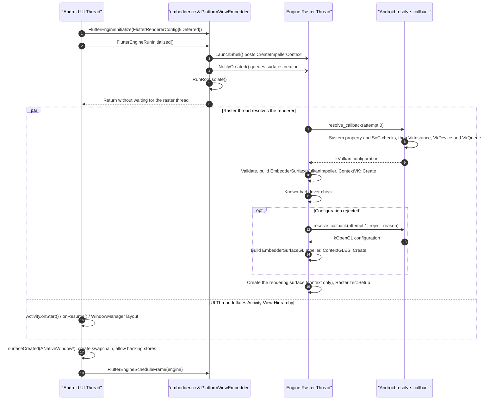

After that, the Android embedder creates and destroys `ANativeWindow` swapchains across Android [`Activity`](https://developer.android.com/reference/android/app/Activity) lifecycle events without recreating the `VkDevice`, `EGLContext`, or `impeller::Context`, and without a surface lifecycle call into the engine (see the next section).

### Renderer Availability and Surface Lifecycle

Android window surfaces ([`ANativeWindow`](https://developer.android.com/ndk/reference/group/a-native-window)) are created and destroyed by the OS during [`Activity`](https://developer.android.com/reference/android/app/Activity) transitions, configuration changes, and backgrounding while the `FlutterEngine` remains alive. Under this RFC:

- No surface lifecycle functions (`NotifyCreated` / `NotifyDestroyed`) are added to [`embedder.h`](https://github.com/flutter/flutter/blob/4762dec4fc9072cd9269814ef36364f35a9a66dc/engine/src/flutter/shell/platform/embedder/embedder.h).
- Because Android renders every frame through [`FlutterCompositor`](https://github.com/flutter/flutter/blob/4762dec4fc9072cd9269814ef36364f35a9a66dc/engine/src/flutter/shell/platform/embedder/embedder.h#L2264-L2322) with `avoid_backing_store_cache = true`, the engine's internal GPU surface is context-only (`render_to_surface = false`) and never holds the `ANativeWindow`.
- The Android embedder owns window and swapchain lifetime across `surfaceCreated`, `surfaceChanged`, and `surfaceDestroyed`—returning `false` from `create_backing_store_callback` when no window is attached or when the OS invalidates the surface mid-frame, and re-arming the first-frame callback with [`FlutterEngineSetNextFrameCallback`](https://github.com/flutter/flutter/blob/4762dec4fc9072cd9269814ef36364f35a9a66dc/engine/src/flutter/shell/platform/embedder/embedder.h#L3638-L3641).
- The Android embedder calls the existing [`FlutterEngineNotifyLowMemoryWarning`](https://github.com/flutter/flutter/blob/4762dec4fc9072cd9269814ef36364f35a9a66dc/engine/src/flutter/shell/platform/embedder/embedder.h#L3553-L3554) C API on `onTrimMemory` and when the last view detaches in `surfaceDestroyed` to release Impeller's offscreen render-target and cached texture pools (wired in [#193497](https://github.com/flutter/flutter/pull/193497)), requiring no changes to `embedder.h` or `Rasterizer::NotifyLowMemoryWarning()`.

#### Decoupling Configuration from Surface Availability

Static graphics configuration (the Vulkan device and queue handles, or the EGL context and callbacks) persists in [`FlutterRendererConfig`](https://github.com/flutter/flutter/blob/4762dec4fc9072cd9269814ef36364f35a9a66dc/engine/src/flutter/shell/platform/embedder/embedder.h#L1055) for the lifetime of the engine, while presentation surfaces attach and detach across `Activity` lifecycle events. Recreating `FlutterRendererConfig` on every window change would re-initialize the GPU context and discard Impeller pipeline caches.

In the legacy architecture, [`PlatformViewAndroid`](https://github.com/flutter/flutter/blob/4762dec4fc9072cd9269814ef36364f35a9a66dc/engine/src/flutter/shell/platform/android/platform_view_android.h#L43) calls [`PlatformView::NotifyCreated`](https://github.com/flutter/flutter/blob/4762dec4fc9072cd9269814ef36364f35a9a66dc/engine/src/flutter/shell/common/platform_view.cc#L64-L85) and [`PlatformView::NotifyDestroyed`](https://github.com/flutter/flutter/blob/4762dec4fc9072cd9269814ef36364f35a9a66dc/engine/src/flutter/shell/common/platform_view.cc#L87-L89) as an `ANativeWindow` is attached or detached. Its `AndroidSurface` renders into that window, so the raster thread has to stop using the window before `surfaceDestroyed()` returns.

Under this RFC the engine never holds the window, because Android renders every frame through [`FlutterCompositor`](https://github.com/flutter/flutter/blob/4762dec4fc9072cd9269814ef36364f35a9a66dc/engine/src/flutter/shell/platform/embedder/embedder.h#L2264-L2322) with `avoid_backing_store_cache` set to `true`:

- When a compositor is installed, the engine's own GPU surface holds only the rendering context and presents nothing. [`EmbedderSurfaceGLImpeller::CreateGPUSurface`](https://github.com/flutter/flutter/blob/4762dec4fc9072cd9269814ef36364f35a9a66dc/engine/src/flutter/shell/platform/embedder/embedder_surface_gl_impeller.cc#L203-L214) passes `render_to_surface = false` in that case, and [#193000](https://github.com/flutter/flutter/pull/193000) made `EmbedderSurfaceVulkanImpeller` do the same.
- The engine requests every backing store inside the frame that uses it ([`embedder_external_view_embedder.cc#L561-L572`](https://github.com/flutter/flutter/blob/4762dec4fc9072cd9269814ef36364f35a9a66dc/engine/src/flutter/shell/platform/embedder/embedder_external_view_embedder.cc#L561-L572)). With the cache off, it collects each one as soon as `present_view_callback` returns ([`#L627-L643`](https://github.com/flutter/flutter/blob/4762dec4fc9072cd9269814ef36364f35a9a66dc/engine/src/flutter/shell/platform/embedder/embedder_external_view_embedder.cc#L627-L643)).
- If `create_backing_store_callback` returns `false`, the engine skips that layer ([`#L261-L265`](https://github.com/flutter/flutter/blob/4762dec4fc9072cd9269814ef36364f35a9a66dc/engine/src/flutter/shell/platform/embedder/embedder_external_view_embedder.cc#L261-L265)) and still presents the frame's other layers ([`#L465-L468`](https://github.com/flutter/flutter/blob/4762dec4fc9072cd9269814ef36364f35a9a66dc/engine/src/flutter/shell/platform/embedder/embedder_external_view_embedder.cc#L465-L468)).

So `embedder.h` gains no surface lifecycle functions. The embedder owns the window's lifetime through the compositor. The engine keeps its context-only rendering surface from resolution until shutdown, and [`FlutterEngineNotifyLowMemoryWarning`](https://github.com/flutter/flutter/blob/4762dec4fc9072cd9269814ef36364f35a9a66dc/engine/src/flutter/shell/platform/embedder/embedder.h#L3553-L3554) releases the transient GPU caches inside it (see [Releasing Transient Rendering Caches (`FlutterEngineNotifyLowMemoryWarning`)](#releasing-transient-rendering-caches-flutterenginenotifylowmemorywarning)).

#### Window Ownership Contract

The Android embedder (`AndroidSurfaceControl`) follows these rules:

- Because the Android OS owns the underlying `Surface` (`BufferQueue` / `SurfaceFlinger`) and can invalidate it or dispatch `surfaceDestroyed` while a raster frame is in flight, the embedder cannot guarantee that the window remains valid from `create_backing_store_callback` through `present_view_callback`. When no window is attached or acquiring or presenting a buffer fails (such as `VK_ERROR_SURFACE_LOST_KHR`, `VK_ERROR_OUT_OF_DATE_KHR`, or `EGL_BAD_SURFACE`), `create_backing_store_callback` returns `false` (or `present_view_callback` drops the presentation) and `collect_backing_store_callback` releases any per-frame resources.
- On OpenGL ES, the engine calls `make_current` at the start of every frame and outside frames, and doesn't call `clear_current` after each frame. `make_current` therefore binds a pbuffer or a surfaceless context, and the embedder binds the window surface only while it hands out the root backing store (`is_root_layer`).
- On Vulkan, the GPU has to finish with presented images before the swapchain is destroyed, so the embedder waits for its last present to complete first.

Embedders that render without a compositor also get only per-frame handles from the engine, through `make_current`/`fbo_callback`/`present` or `get_next_image_callback`/`present_image_callback`, and can release their window the same way. Refusing in those callbacks fails the whole frame instead of one layer.

#### Lifecycle Mapping

The Android embedder maps [`SurfaceHolder.Callback`](https://developer.android.com/reference/android/view/SurfaceHolder.Callback) events on the platform thread as follows:

- [`surfaceCreated`](https://developer.android.com/reference/android/view/SurfaceHolder.Callback#surfaceCreated(android.view.SurfaceHolder)): The embedder creates its swapchain (or `SurfaceControl` tree) for the [`ANativeWindow`](https://developer.android.com/ndk/reference/group/a-native-window) and starts handing out backing stores. It re-arms its first-frame callback with [`FlutterEngineSetNextFrameCallback`](https://github.com/flutter/flutter/blob/4762dec4fc9072cd9269814ef36364f35a9a66dc/engine/src/flutter/shell/platform/embedder/embedder.h#L3638-L3641), which `PlatformViewAndroid::NotifyCreated` does internally today, and calls [`FlutterEngineScheduleFrame`](https://github.com/flutter/flutter/blob/4762dec4fc9072cd9269814ef36364f35a9a66dc/engine/src/flutter/shell/platform/embedder/embedder.h#L3620-L3621).
- [`surfaceChanged`](https://developer.android.com/reference/android/view/SurfaceHolder.Callback#surfaceChanged(android.view.SurfaceHolder,%20int,%20int,%20int)): The embedder sends the updated physical dimensions and device pixel ratio via `FlutterEngineSendWindowMetricsEvent`.
- [`surfaceDestroyed`](https://developer.android.com/reference/android/view/SurfaceHolder.Callback#surfaceDestroyed(android.view.SurfaceHolder)): The embedder stops handing out new backing stores, synchronizes with any active callback on the raster thread, destroys its swapchain, and releases the `ANativeWindow`. There is no engine teardown to wait for. If no other view of the engine is visible, it calls the existing [`FlutterEngineNotifyLowMemoryWarning`](https://github.com/flutter/flutter/blob/4762dec4fc9072cd9269814ef36364f35a9a66dc/engine/src/flutter/shell/platform/embedder/embedder.h#L3553-L3554), which releases the same engine GPU caches that `NotifyDestroyed` frees today.

#### Releasing Transient Rendering Caches (`FlutterEngineNotifyLowMemoryWarning`)

`avoid_backing_store_cache` covers only the backing stores. Impeller also keeps transient offscreen render-target and cached `DlImage` texture pools inside the engine's rendering surface (`AiksContext`). The engine allocates these itself; they never go through `create_backing_store_callback`, so the embedder cannot free them directly.

[`embedder.h`](https://github.com/flutter/flutter/blob/4762dec4fc9072cd9269814ef36364f35a9a66dc/engine/src/flutter/shell/platform/embedder/embedder.h) already provides [`FlutterEngineNotifyLowMemoryWarning`](https://github.com/flutter/flutter/blob/4762dec4fc9072cd9269814ef36364f35a9a66dc/engine/src/flutter/shell/platform/embedder/embedder.h#L3553-L3554) ([`embedder.cc#L3597-L3617`](https://github.com/flutter/flutter/blob/4762dec4fc9072cd9269814ef36364f35a9a66dc/engine/src/flutter/shell/platform/embedder/embedder.cc#L3597-L3617)):

```c
// Existing API in shell/platform/embedder/embedder.h (L3535-L3554)
FLUTTER_EXPORT
FlutterEngineResult FlutterEngineNotifyLowMemoryWarning(
    FLUTTER_API_SYMBOL(FlutterEngine) engine);
```

`FlutterEngineNotifyLowMemoryWarning` calls [`Shell::NotifyLowMemoryWarning()`](https://github.com/flutter/flutter/blob/4762dec4fc9072cd9269814ef36364f35a9a66dc/engine/src/flutter/shell/common/shell.cc#L750-L770) (which notifies the Dart VM and posts [`Rasterizer::NotifyLowMemoryWarning()`](https://github.com/flutter/flutter/blob/4762dec4fc9072cd9269814ef36364f35a9a66dc/engine/src/flutter/shell/common/rasterizer.cc#L173-L192) to the raster thread) and sends the `{"type": "memoryPressure"}` message on the `flutter/system` channel. Since [#193497](https://github.com/flutter/flutter/pull/193497), `Rasterizer::NotifyLowMemoryWarning()` calls `aiks_context->ClearRenderTargetCache()` and `aiks_context->ClearCachedTextures()` while keeping `impeller::Context` and its pipeline caches intact, so no changes to `embedder.h` or `Rasterizer::NotifyLowMemoryWarning()` are needed:

- When Android dispatches [`ComponentCallbacks2.onTrimMemory`](https://developer.android.com/reference/android/content/ComponentCallbacks2#onTrimMemory(int)) (including `TRIM_MEMORY_UI_HIDDEN = 20`, which satisfies [`level >= TRIM_MEMORY_RUNNING_LOW`](https://github.com/flutter/flutter/blob/4762dec4fc9072cd9269814ef36364f35a9a66dc/engine/src/flutter/shell/platform/android/io/flutter/embedding/android/FlutterActivityAndFragmentDelegate.java#L1043-L1047) in `FlutterActivityAndFragmentDelegate.onTrimMemory`), [`FlutterJNI.notifyLowMemoryWarning()`](https://github.com/flutter/flutter/blob/4762dec4fc9072cd9269814ef36364f35a9a66dc/engine/src/flutter/shell/platform/android/io/flutter/embedding/engine/FlutterJNI.java#L1401-L1407) invokes `FlutterEngineNotifyLowMemoryWarning(engine)`.
- When the last view of an engine detaches in `surfaceDestroyed`, `AndroidSurfaceControl` also calls `FlutterEngineNotifyLowMemoryWarning(engine)` so that cached add-to-app engines whose host app stays in the foreground release the same GPU caches that `NotifyDestroyed` frees today.

#### Alternative Considered: Splitting Startup into Separate Shell and Isolate Launch APIs

An alternative design was prototyped that split [`FlutterEngineRunInitialized`](https://github.com/flutter/flutter/blob/4762dec4fc9072cd9269814ef36364f35a9a66dc/engine/src/flutter/shell/platform/embedder/embedder.h#L3006-L3007) into separate shell-creation and isolate-launch C APIs so that [`FlutterJNI.attachToNative()`](https://github.com/flutter/flutter/blob/4762dec4fc9072cd9269814ef36364f35a9a66dc/engine/src/flutter/shell/platform/android/io/flutter/embedding/engine/FlutterJNI.java#L433-L442) could create the [`Shell`](https://github.com/flutter/flutter/blob/4762dec4fc9072cd9269814ef36364f35a9a66dc/engine/src/flutter/shell/common/shell.h#L113) before [`DartExecutor.executeDartEntrypoint()`](https://github.com/flutter/flutter/blob/4762dec4fc9072cd9269814ef36364f35a9a66dc/engine/src/flutter/shell/platform/android/io/flutter/embedding/engine/dart/DartExecutor.java#L133-L143) ([`FlutterJNI.runBundleAndSnapshotFromLibrary()`](https://github.com/flutter/flutter/blob/4762dec4fc9072cd9269814ef36364f35a9a66dc/engine/src/flutter/shell/platform/android/io/flutter/embedding/engine/FlutterJNI.java#L1072-L1089)) specified the Dart entrypoint:

```c
// Alternative C-API additions (not adopted):
// In FlutterProjectArgs:
bool defer_root_isolate_launch;
const char* initial_lifecycle_state;

typedef struct {
  size_t struct_size;
  const char* assets_path;
  const char* custom_dart_entrypoint;
  const char* dart_entrypoint_library_uri;
  size_t dart_entrypoint_argc;
  const char* const* dart_entrypoint_argv;
  size_t custom_asset_resolvers_count;
  const FlutterCustomAssetResolver** custom_asset_resolvers;
} FlutterEngineRunConfiguration;

FLUTTER_EXPORT
FlutterEngineResult FlutterEngineLaunchShell(
    FLUTTER_API_SYMBOL(FlutterEngine) engine);

FLUTTER_EXPORT
FlutterEngineResult FlutterEngineLaunchEngine(
    FLUTTER_API_SYMBOL(FlutterEngine) engine,
    const FlutterEngineRunConfiguration* config);
```

<details>

Under this alternative, [`attachToNative()`](https://github.com/flutter/flutter/blob/4762dec4fc9072cd9269814ef36364f35a9a66dc/engine/src/flutter/shell/platform/android/io/flutter/embedding/engine/FlutterJNI.java#L433-L442) called [`FlutterEngineInitialize`](https://github.com/flutter/flutter/blob/4762dec4fc9072cd9269814ef36364f35a9a66dc/engine/src/flutter/shell/platform/embedder/embedder.h#L2970-L2975) (with `defer_root_isolate_launch = true` and `initial_lifecycle_state = "AppLifecycleState.detached"`) followed by `FlutterEngineLaunchShell`, and [`runBundleAndSnapshotFromLibrary()`](https://github.com/flutter/flutter/blob/4762dec4fc9072cd9269814ef36364f35a9a66dc/engine/src/flutter/shell/platform/android/io/flutter/embedding/engine/FlutterJNI.java#L1072-L1089) later called `FlutterEngineLaunchEngine` with `FlutterEngineRunConfiguration`. The motivation was to mirror legacy [`AndroidShellHolder`](https://github.com/flutter/flutter/blob/4762dec4fc9072cd9269814ef36364f35a9a66dc/engine/src/flutter/shell/platform/android/android_shell_holder.h#L38) startup ordering so that platform messages (`flutter/localization`, `flutter/navigation` `setInitialRoute`, `flutter/settings`), viewport metrics, and external textures sent between [`attachToNative()`](https://github.com/flutter/flutter/blob/4762dec4fc9072cd9269814ef36364f35a9a66dc/engine/src/flutter/shell/platform/android/io/flutter/embedding/engine/FlutterJNI.java#L433-L442) and [`executeDartEntrypoint()`](https://github.com/flutter/flutter/blob/4762dec4fc9072cd9269814ef36364f35a9a66dc/engine/src/flutter/shell/platform/android/io/flutter/embedding/engine/dart/DartExecutor.java#L133-L143) could be buffered directly inside the engine's [`RuntimeController`](https://github.com/flutter/flutter/blob/4762dec4fc9072cd9269814ef36364f35a9a66dc/engine/src/flutter/runtime/runtime_controller.h#L52), and so [`Shell::CreateWithSnapshot`](https://github.com/flutter/flutter/blob/4762dec4fc9072cd9269814ef36364f35a9a66dc/engine/src/flutter/shell/common/shell.cc#L449-L509) could post [`CreateImpellerContext`](https://github.com/flutter/flutter/blob/4762dec4fc9072cd9269814ef36364f35a9a66dc/engine/src/flutter/shell/platform/embedder/embedder_surface.h#L25) to the raster thread during [`attachToNative()`](https://github.com/flutter/flutter/blob/4762dec4fc9072cd9269814ef36364f35a9a66dc/engine/src/flutter/shell/platform/android/io/flutter/embedding/engine/FlutterJNI.java#L433-L442).

Why does pre-run state exist in the two-phase [`FlutterEngineInitialize`](https://github.com/flutter/flutter/blob/4762dec4fc9072cd9269814ef36364f35a9a66dc/engine/src/flutter/shell/platform/embedder/embedder.h#L2970-L2975) + [`FlutterEngineRunInitialized`](https://github.com/flutter/flutter/blob/4762dec4fc9072cd9269814ef36364f35a9a66dc/engine/src/flutter/shell/platform/embedder/embedder.h#L3006-L3007) model? In [`embedder.cc`](https://github.com/flutter/flutter/blob/4762dec4fc9072cd9269814ef36364f35a9a66dc/engine/src/flutter/shell/platform/embedder/embedder.cc#L2301-L2537), `FlutterEngineInitialize` takes [`FlutterProjectArgs`](https://github.com/flutter/flutter/blob/4762dec4fc9072cd9269814ef36364f35a9a66dc/engine/src/flutter/shell/platform/embedder/embedder.h#L2527-L2841) (which includes the Dart entrypoint and asset resolvers) and constructs `EmbedderEngine` with `shell_ == nullptr`, while `FlutterEngineRunInitialized` calls both `LaunchShell()` (`Shell::Create`) and `RunRootIsolate()`. Every [`EmbedderEngine`](https://github.com/flutter/flutter/blob/4762dec4fc9072cd9269814ef36364f35a9a66dc/engine/src/flutter/shell/platform/embedder/embedder_engine.cc#L143-L195) method (`SendPlatformMessage`, `SetViewportMetrics`, `RegisterTexture`) checks `IsValid()` (`shell_ != nullptr`) and fails before `FlutterEngineRunInitialized` runs. On Android, the [`FlutterEngine`](https://github.com/flutter/flutter/blob/4762dec4fc9072cd9269814ef36364f35a9a66dc/engine/src/flutter/shell/platform/android/io/flutter/embedding/engine/FlutterEngine.java#L408-L433) constructor calls `attachToJni()` (`attachToNative()`), sends initial locales (`flutter/localization`), and registers plugins (`GeneratedPluginRegister.registerGeneratedPlugins`) **before** [`DartExecutor.executeDartEntrypoint()`](https://github.com/flutter/flutter/blob/4762dec4fc9072cd9269814ef36364f35a9a66dc/engine/src/flutter/shell/platform/android/io/flutter/embedding/engine/dart/DartExecutor.java#L133-L143) calls [`runBundleAndSnapshotFromLibrary()`](https://github.com/flutter/flutter/blob/4762dec4fc9072cd9269814ef36364f35a9a66dc/engine/src/flutter/shell/platform/android/io/flutter/embedding/engine/FlutterJNI.java#L1072-L1089) with the entrypoint and asset arguments. Because `FlutterEngineInitialize` and `FlutterEngineRunInitialized` run in `runBundleAndSnapshotFromLibrary()`, `FlutterEmbedderNative` records messages, viewport metrics, and texture IDs sent after `attachToNative()` and flushes them as soon as `FlutterEngineRunInitialized` returns.

This alternative was rejected in favor of keeping the existing two-phase [`FlutterEngineInitialize`](https://github.com/flutter/flutter/blob/4762dec4fc9072cd9269814ef36364f35a9a66dc/engine/src/flutter/shell/platform/embedder/embedder.h#L2970-L2975) and [`FlutterEngineRunInitialized`](https://github.com/flutter/flutter/blob/4762dec4fc9072cd9269814ef36364f35a9a66dc/engine/src/flutter/shell/platform/embedder/embedder.h#L3006-L3007) sequence (paired with `kDeferred` and non-blocking `NotifyCreated()`) for three reasons:

1. **Avoids a multi-stage initialization state machine in [`embedder.h`](https://github.com/flutter/flutter/blob/4762dec4fc9072cd9269814ef36364f35a9a66dc/engine/src/flutter/shell/platform/embedder/embedder.h)**: [`embedder.h`](https://github.com/flutter/flutter/blob/4762dec4fc9072cd9269814ef36364f35a9a66dc/engine/src/flutter/shell/platform/embedder/embedder.h) already separates startup into [`FlutterEngineInitialize`](https://github.com/flutter/flutter/blob/4762dec4fc9072cd9269814ef36364f35a9a66dc/engine/src/flutter/shell/platform/embedder/embedder.h#L2970-L2975) and [`FlutterEngineRunInitialized`](https://github.com/flutter/flutter/blob/4762dec4fc9072cd9269814ef36364f35a9a66dc/engine/src/flutter/shell/platform/embedder/embedder.h#L3006-L3007) so embedders can obtain the [`FlutterEngine`](https://github.com/flutter/flutter/blob/4762dec4fc9072cd9269814ef36364f35a9a66dc/engine/src/flutter/shell/platform/embedder/embedder.h#L389) handle and bind custom task runners before any tasks are posted. Splitting startup further into [`FlutterEngineInitialize`](https://github.com/flutter/flutter/blob/4762dec4fc9072cd9269814ef36364f35a9a66dc/engine/src/flutter/shell/platform/embedder/embedder.h#L2970-L2975) → `FlutterEngineLaunchShell` → `FlutterEngineLaunchEngine` introduces intermediate partially-initialized [`EmbedderEngine`](https://github.com/flutter/flutter/blob/4762dec4fc9072cd9269814ef36364f35a9a66dc/engine/src/flutter/shell/platform/embedder/embedder_engine.h#L23-L102) states, duplicates [`FlutterProjectArgs`](https://github.com/flutter/flutter/blob/4762dec4fc9072cd9269814ef36364f35a9a66dc/engine/src/flutter/shell/platform/embedder/embedder.h#L2527-L2841) fields (`assets_path`, [`custom_dart_entrypoint`](https://github.com/flutter/flutter/blob/4762dec4fc9072cd9269814ef36364f35a9a66dc/engine/src/flutter/shell/platform/embedder/embedder.h#L2687), [`dart_entrypoint_argv`](https://github.com/flutter/flutter/blob/4762dec4fc9072cd9269814ef36364f35a9a66dc/engine/src/flutter/shell/platform/embedder/embedder.h#L2765), `custom_asset_resolvers`) into `FlutterEngineRunConfiguration`, and requires seeding `initial_lifecycle_state` to keep the shell from scheduling frames before an isolate exists.
2. **Pre-run buffering is self-contained in `FlutterEmbedderNative`**: Queueing platform messages, initial route, viewport metrics, and external texture registrations in `FlutterEmbedderNative` between [`attachToNative()`](https://github.com/flutter/flutter/blob/4762dec4fc9072cd9269814ef36364f35a9a66dc/engine/src/flutter/shell/platform/android/io/flutter/embedding/engine/FlutterJNI.java#L433-L442) and [`runBundleAndSnapshotFromLibrary()`](https://github.com/flutter/flutter/blob/4762dec4fc9072cd9269814ef36364f35a9a66dc/engine/src/flutter/shell/platform/android/io/flutter/embedding/engine/FlutterJNI.java#L1072-L1089)—and flushing them immediately after [`FlutterEngineRunInitialized`](https://github.com/flutter/flutter/blob/4762dec4fc9072cd9269814ef36364f35a9a66dc/engine/src/flutter/shell/platform/embedder/embedder.h#L3006-L3007)—requires no new [`embedder.h`](https://github.com/flutter/flutter/blob/4762dec4fc9072cd9269814ef36364f35a9a66dc/engine/src/flutter/shell/platform/embedder/embedder.h) entry points or [`RuntimeController`](https://github.com/flutter/flutter/blob/4762dec4fc9072cd9269814ef36364f35a9a66dc/engine/src/flutter/runtime/runtime_controller.h#L52) lifecycle flags.
3. **Non-blocking `NotifyCreated()` already keeps [`SetupImpellerContext()`](https://github.com/flutter/flutter/blob/4762dec4fc9072cd9269814ef36364f35a9a66dc/engine/src/flutter/shell/common/platform_view.h#L1040) off the UI thread**: [`runBundleAndSnapshotFromLibrary()`](https://github.com/flutter/flutter/blob/4762dec4fc9072cd9269814ef36364f35a9a66dc/engine/src/flutter/shell/platform/android/io/flutter/embedding/engine/FlutterJNI.java#L1072-L1089) executes during `Activity.onCreate` / `onStart`, well before WindowManager dispatches `SurfaceHolder.Callback.surfaceCreated`, and [`FlutterEngineRunInitialized`](https://github.com/flutter/flutter/blob/4762dec4fc9072cd9269814ef36364f35a9a66dc/engine/src/flutter/shell/platform/embedder/embedder.h#L3006-L3007) queues surface creation on the raster thread without waiting. The raster thread therefore has the whole interval until the first frame to resolve the renderer and create the context.

With `kDeferred`, the UI thread doesn't wait for backend selection in either design. The remaining startup difference is when context creation starts: at `runBundleAndSnapshotFromLibrary()` here, and at `attachToNative()` in the alternative. The startup benchmarks in [DeviceLab Benchmarks](#devicelab-benchmarks) measure whether that changes time to first frame on low-end devices.

| Dimension | Proposed: Two-Phase Init ([`FlutterEngineInitialize`](https://github.com/flutter/flutter/blob/4762dec4fc9072cd9269814ef36364f35a9a66dc/engine/src/flutter/shell/platform/embedder/embedder.h#L2970-L2975) + [`FlutterEngineRunInitialized`](https://github.com/flutter/flutter/blob/4762dec4fc9072cd9269814ef36364f35a9a66dc/engine/src/flutter/shell/platform/embedder/embedder.h#L3006-L3007) + `kDeferred`) | Alternative: Split Shell & Isolate Launch (`FlutterEngineLaunchShell` + `FlutterEngineLaunchEngine`) |
| :--- | :--- | :--- |
| **Public C-API Surface ([`embedder.h`](https://github.com/flutter/flutter/blob/4762dec4fc9072cd9269814ef36364f35a9a66dc/engine/src/flutter/shell/platform/embedder/embedder.h))** | **Pro:** Reuses existing [`FlutterEngineInitialize`](https://github.com/flutter/flutter/blob/4762dec4fc9072cd9269814ef36364f35a9a66dc/engine/src/flutter/shell/platform/embedder/embedder.h#L2970-L2975) and [`FlutterEngineRunInitialized`](https://github.com/flutter/flutter/blob/4762dec4fc9072cd9269814ef36364f35a9a66dc/engine/src/flutter/shell/platform/embedder/embedder.h#L3006-L3007); adds the `kDeferred` renderer type and no lifecycle functions. | **Con:** Adds two new functions (`FlutterEngineLaunchShell`, `FlutterEngineLaunchEngine`), a new `FlutterEngineRunConfiguration` struct duplicating [`FlutterProjectArgs`](https://github.com/flutter/flutter/blob/4762dec4fc9072cd9269814ef36364f35a9a66dc/engine/src/flutter/shell/platform/embedder/embedder.h#L2527-L2841) fields, and two [`FlutterProjectArgs`](https://github.com/flutter/flutter/blob/4762dec4fc9072cd9269814ef36364f35a9a66dc/engine/src/flutter/shell/platform/embedder/embedder.h#L2527-L2841) fields (`defer_root_isolate_launch`, `initial_lifecycle_state`). |
| **[`EmbedderEngine`](https://github.com/flutter/flutter/blob/4762dec4fc9072cd9269814ef36364f35a9a66dc/engine/src/flutter/shell/platform/embedder/embedder_engine.h#L23-L102) State Machine** | **Pro:** Preserves the existing two-state model (initialized → running) used by all desktop embedders and `FlutterEngineSpawn`. | **Con:** Introduces a three-stage startup state machine (initialized → shell launched without isolate → isolate launched) that must also be mirrored in `FlutterEngineSpawnInfo`. |
| **Raster-Thread [`SetupImpellerContext()`](https://github.com/flutter/flutter/blob/4762dec4fc9072cd9269814ef36364f35a9a66dc/engine/src/flutter/shell/common/platform_view.h#L1040) Overlap ([`ContextVK`](https://github.com/flutter/flutter/blob/4762dec4fc9072cd9269814ef36364f35a9a66dc/engine/src/flutter/impeller/renderer/backend/vulkan/context_vk.h#L64) / [`ContextGLES`](https://github.com/flutter/flutter/blob/4762dec4fc9072cd9269814ef36364f35a9a66dc/engine/src/flutter/impeller/renderer/backend/gles/context_gles.h#L23))** | **Pro:** Runs asynchronously on the raster thread across the entire [`runBundleAndSnapshotFromLibrary()`](https://github.com/flutter/flutter/blob/4762dec4fc9072cd9269814ef36364f35a9a66dc/engine/src/flutter/shell/platform/android/io/flutter/embedding/engine/FlutterJNI.java#L1072-L1089) → `surfaceCreated()` window without blocking the UI thread. | **Pro:** Starts earlier (at [`attachToNative()`](https://github.com/flutter/flutter/blob/4762dec4fc9072cd9269814ef36364f35a9a66dc/engine/src/flutter/shell/platform/android/io/flutter/embedding/engine/FlutterJNI.java#L433-L442) rather than [`runBundleAndSnapshotFromLibrary()`](https://github.com/flutter/flutter/blob/4762dec4fc9072cd9269814ef36364f35a9a66dc/engine/src/flutter/shell/platform/android/io/flutter/embedding/engine/FlutterJNI.java#L1072-L1089)). Whether that shortens time to first frame on low-end devices has not been measured. |
| **Pre-Run State (`flutter/localization`, `setInitialRoute`, `flutter/settings`, Textures)** | **Con:** Because `FlutterProjectArgs` requires the Dart entrypoint and asset arguments passed in [`runBundleAndSnapshotFromLibrary()`](https://github.com/flutter/flutter/blob/4762dec4fc9072cd9269814ef36364f35a9a66dc/engine/src/flutter/shell/platform/android/io/flutter/embedding/engine/FlutterJNI.java#L1072-L1089) (and `EmbedderEngine` rejects calls until `FlutterEngineRunInitialized` creates the `Shell`), `FlutterEmbedderNative` must queue messages, viewport metrics, and external textures sent between [`attachToNative()`](https://github.com/flutter/flutter/blob/4762dec4fc9072cd9269814ef36364f35a9a66dc/engine/src/flutter/shell/platform/android/io/flutter/embedding/engine/FlutterJNI.java#L433-L442) and [`runBundleAndSnapshotFromLibrary()`](https://github.com/flutter/flutter/blob/4762dec4fc9072cd9269814ef36364f35a9a66dc/engine/src/flutter/shell/platform/android/io/flutter/embedding/engine/FlutterJNI.java#L1072-L1089) and flush them right after [`FlutterEngineRunInitialized`](https://github.com/flutter/flutter/blob/4762dec4fc9072cd9269814ef36364f35a9a66dc/engine/src/flutter/shell/platform/embedder/embedder.h#L3006-L3007).<br/>**Pro:** Keeps pre-run queueing internal to the Android embedder without exposing [`RuntimeController`](https://github.com/flutter/flutter/blob/4762dec4fc9072cd9269814ef36364f35a9a66dc/engine/src/flutter/runtime/runtime_controller.h#L52) state in [`embedder.h`](https://github.com/flutter/flutter/blob/4762dec4fc9072cd9269814ef36364f35a9a66dc/engine/src/flutter/shell/platform/embedder/embedder.h). | **Pro:** [`Shell`](https://github.com/flutter/flutter/blob/4762dec4fc9072cd9269814ef36364f35a9a66dc/engine/src/flutter/shell/common/shell.h#L113) and [`RuntimeController`](https://github.com/flutter/flutter/blob/4762dec4fc9072cd9269814ef36364f35a9a66dc/engine/src/flutter/runtime/runtime_controller.h#L52) exist at [`attachToNative()`](https://github.com/flutter/flutter/blob/4762dec4fc9072cd9269814ef36364f35a9a66dc/engine/src/flutter/shell/platform/android/io/flutter/embedding/engine/FlutterJNI.java#L433-L442), so pre-run platform messages and viewport metrics can be dispatched directly into the engine before the isolate launches.<br/>**Con:** Requires `initial_lifecycle_state = "AppLifecycleState.detached"` in [`FlutterProjectArgs`](https://github.com/flutter/flutter/blob/4762dec4fc9072cd9269814ef36364f35a9a66dc/engine/src/flutter/shell/platform/embedder/embedder.h#L2527-L2841) to prevent premature frame scheduling while the shell has no isolate. |
</details>

### Replacing Internal [`AndroidExternalViewEmbedder`](https://github.com/flutter/flutter/blob/4762dec4fc9072cd9269814ef36364f35a9a66dc/engine/src/flutter/shell/platform/android/external_view_embedder/external_view_embedder.h) with `FlutterCompositor` (Preserving Hybrid Composition)

To eliminate the internal C++ [`AndroidExternalViewEmbedder`](https://github.com/flutter/flutter/blob/4762dec4fc9072cd9269814ef36364f35a9a66dc/engine/src/flutter/shell/platform/android/external_view_embedder/external_view_embedder.h#L29) and [`AndroidExternalViewEmbedder2`](https://github.com/flutter/flutter/blob/4762dec4fc9072cd9269814ef36364f35a9a66dc/engine/src/flutter/shell/platform/android/external_view_embedder/external_view_embedder_2.h#L34) subclasses while preserving all four Android platform view composition modes, this RFC routes platform views through [`FlutterCompositor`](https://github.com/flutter/flutter/blob/4762dec4fc9072cd9269814ef36364f35a9a66dc/engine/src/flutter/shell/platform/embedder/embedder.h#L2264-L2322) and the external texture C API with two targeted `FlutterCompositor` additions:

- `FlutterBackingStoreConfig.is_root_layer` identifies whether a requested backing store is the bottom-most Flutter layer beneath all platform views (so the embedder can return the primary on-screen surface) or an overlay layer above a platform view (so the embedder allocates a translucent overlay buffer).
- `FlutterCompositor.merge_raster_thread_on_platform_views` is an opt-in flag that dynamically merges the raster task runner onto the platform thread during Hybrid Composition (HC) frames so Java [`PlatformViewsController`](https://github.com/flutter/flutter/blob/4762dec4fc9072cd9269814ef36364f35a9a66dc/engine/src/flutter/shell/platform/android/io/flutter/plugin/platform/PlatformViewsController.java#L54) requires no modifications.

Android's four platform view composition modes and their mechanisms map to [`embedder.h`](https://github.com/flutter/flutter/blob/4762dec4fc9072cd9269814ef36364f35a9a66dc/engine/src/flutter/shell/platform/embedder/embedder.h) as follows:

| Mode | Android Mechanism | Flutter UI Above View | `embedder.h` Boundary |
| :--- | :--- | :--- | :--- |
| **Hybrid Composition (HC)** | Places the native [`View`](https://developer.android.com/reference/android/view/View) directly in the view hierarchy (`createForPlatformViewLayer`) and converts the root surface to [`FlutterImageView`](https://github.com/flutter/flutter/blob/4762dec4fc9072cd9269814ef36364f35a9a66dc/engine/src/flutter/shell/platform/android/io/flutter/embedding/android/FlutterImageView.java#L42) ([`ImageReader`](https://developer.android.com/reference/android/media/ImageReader)). | Rendered into [`PlatformViewWrapper`](https://github.com/flutter/flutter/blob/4762dec4fc9072cd9269814ef36364f35a9a66dc/engine/src/flutter/shell/platform/android/io/flutter/plugin/platform/PlatformViewWrapper.java#L40) overlay surfaces (`createOverlaySurface` / `onDisplayOverlaySurface`) on the merged platform/raster thread. | `FlutterCompositor` (`kFlutterLayerContentTypePlatformView`, `is_root_layer`, `merge_raster_thread_on_platform_views = true`) |
| **Hybrid Composition++ (HCPP)** | Places the native `View` in the view hierarchy (`createPlatformViewHcpp`) and composites layers in [`SurfaceFlinger`](https://source.android.com/docs/core/graphics/surfaceflinger-windowmanager) via NDK [`SurfaceControl.Transaction`](https://developer.android.com/reference/android/view/SurfaceControl.Transaction) and GPU sync fences (API 34+, Vulkan). | Rendered into [`AHardwareBuffer`](https://developer.android.com/ndk/reference/group/a-hardware-buffer) swapchain slices attached to overlay `SurfaceControl` nodes on unmerged threads. | `FlutterCompositor` (`kFlutterLayerContentTypePlatformView`, `is_root_layer`, `merge_raster_thread_on_platform_views = false`) |
| **Texture Layer Hybrid Composition (TLHC)** | Attaches the native `View` to `PlatformViewWrapper` while redirecting its draw output into an offscreen [`SurfaceProducer`](https://github.com/flutter/flutter/blob/4762dec4fc9072cd9269814ef36364f35a9a66dc/engine/src/flutter/shell/platform/android/io/flutter/view/TextureRegistry.java#L21) (`AHardwareBuffer`) or [`SurfaceTexture`](https://developer.android.com/reference/android/graphics/SurfaceTexture) (`configureForTextureLayerComposition`). | Rendered directly in the single Flutter scene around the `Texture` widget. | External texture C API (`FlutterEngineRegisterExternalTexture`, `FlutterEngineMarkExternalTextureFrameAvailable`) |
| **Virtual Display (VD)** | Hosts the native `View` inside an offscreen [`VirtualDisplay`](https://developer.android.com/reference/android/hardware/display/VirtualDisplay) (`VirtualDisplayController`) backed by a `SurfaceProducer` or `SurfaceTexture` (`configureForVirtualDisplay`). | Rendered directly in the single Flutter scene around the `Texture` widget. | External texture C API (`FlutterEngineRegisterExternalTexture`, `FlutterEngineMarkExternalTextureFrameAvailable`) |

**All four platform view composition modes are preserved; retiring Hybrid Composition (HC) or Virtual Display (VD) is not an option.**

Standard Hybrid Composition and Virtual Display remain required across Android devices, API levels, and embedded view hierarchies (such as views containing `SurfaceView` or `TextureView` children where [`PlatformViewsController`](https://github.com/flutter/flutter/blob/4762dec4fc9072cd9269814ef36364f35a9a66dc/engine/src/flutter/shell/platform/android/io/flutter/plugin/platform/PlatformViewsController.java#L54) falls back from TLHC to Virtual Display). What this migration eliminates is **only the internal C++ [`flutter::ExternalViewEmbedder`](https://github.com/flutter/flutter/blob/4762dec4fc9072cd9269814ef36364f35a9a66dc/engine/src/flutter/flow/embedded_views.h#L432) subclass ([`shell/platform/android/external_view_embedder/AndroidExternalViewEmbedder`](https://github.com/flutter/flutter/blob/4762dec4fc9072cd9269814ef36364f35a9a66dc/engine/src/flutter/shell/platform/android/external_view_embedder/external_view_embedder.h#L29)) and its direct dependencies on [`//flutter/flow`](https://github.com/flutter/flutter/tree/4762dec4fc9072cd9269814ef36364f35a9a66dc/engine/src/flutter/flow) ([`embedded_views.h`](https://github.com/flutter/flutter/blob/4762dec4fc9072cd9269814ef36364f35a9a66dc/engine/src/flutter/flow/embedded_views.h)) and [`fml::RasterThreadMerger`](https://github.com/flutter/flutter/blob/4762dec4fc9072cd9269814ef36364f35a9a66dc/engine/src/flutter/fml/raster_thread_merger.h#L31)**, rather than any platform view composition mode.

In the legacy architecture, [`AndroidExternalViewEmbedder`](https://github.com/flutter/flutter/blob/4762dec4fc9072cd9269814ef36364f35a9a66dc/engine/src/flutter/shell/platform/android/external_view_embedder/external_view_embedder.h) subclassed `flutter::ExternalViewEmbedder` directly and used [`fml::RasterThreadMerger`](https://github.com/flutter/flutter/blob/4762dec4fc9072cd9269814ef36364f35a9a66dc/engine/src/flutter/fml/raster_thread_merger.h#L31) in [`PostPrerollAction`](https://github.com/flutter/flutter/blob/4762dec4fc9072cd9269814ef36364f35a9a66dc/engine/src/flutter/shell/platform/android/external_view_embedder/external_view_embedder.cc#L188-L213) to dynamically lease and merge the raster thread onto the platform thread during HC frames:

```cpp
// Existing internal ExternalViewEmbedder subclass in shell/platform/android/external_view_embedder/external_view_embedder.cc
PostPrerollResult AndroidExternalViewEmbedder::PostPrerollAction(
    const fml::RefPtr<fml::RasterThreadMerger>& raster_thread_merger) {
  if (!FrameHasPlatformLayers()) {
    return PostPrerollResult::kSuccess;
  }
  if (!raster_thread_merger->IsMerged()) {
    CancelFrame();
    raster_thread_merger->MergeWithLease(kDefaultMergedLeaseDuration);
    return PostPrerollResult::kSkipAndRetryFrame;
  }
  raster_thread_merger->ExtendLeaseTo(kDefaultMergedLeaseDuration);
  if (previous_frame_view_count_ == 0) {
    return PostPrerollResult::kResubmitFrame;
  }
  return PostPrerollResult::kSuccess;
}
```

#### How All Four Platform View Modes Work in the C-API Architecture

At the C-API boundary ([`embedder.h`](https://github.com/flutter/flutter/blob/4762dec4fc9072cd9269814ef36364f35a9a66dc/engine/src/flutter/shell/platform/embedder/embedder.h)), the four composition modes partition into two external-texture modes and two compositor-layer modes:

- **Texture Layer Hybrid Composition (TLHC) and Virtual Display (VD) via External Textures**: Both [`configureForTextureLayerComposition`](https://github.com/flutter/flutter/blob/4762dec4fc9072cd9269814ef36364f35a9a66dc/engine/src/flutter/shell/platform/android/io/flutter/plugin/platform/PlatformViewsController.java#L643-L685) and [`configureForVirtualDisplay`](https://github.com/flutter/flutter/blob/4762dec4fc9072cd9269814ef36364f35a9a66dc/engine/src/flutter/shell/platform/android/io/flutter/plugin/platform/PlatformViewsController.java#L596) allocate a `PlatformViewRenderTarget` from `TextureRegistry` (`SurfaceProducer` / `AHardwareBuffer` or `SurfaceTexture`) in Java and return its texture ID to the Dart framework `Texture` widget. At the native engine boundary, both TLHC and VD operate strictly through the C-API external texture callbacks (`FlutterEngineRegisterExternalTexture`, `FlutterEngineMarkExternalTextureFrameAvailable`, `FlutterVulkanTextureFrameCallback`, and `FlutterOpenGLTextureFrameCallback`) without creating `FlutterPlatformView` layers.
- **Hybrid Composition (HC) and Hybrid Composition++ (HCPP) via [`FlutterCompositor`](https://github.com/flutter/flutter/blob/4762dec4fc9072cd9269814ef36364f35a9a66dc/engine/src/flutter/shell/platform/embedder/embedder.h#L2264-L2322)**: The engine's internal [`EmbedderExternalViewEmbedder`](https://github.com/flutter/flutter/blob/4762dec4fc9072cd9269814ef36364f35a9a66dc/engine/src/flutter/shell/platform/embedder/embedder_external_view_embedder.h) implements `flutter::ExternalViewEmbedder` behind the public [`FlutterCompositor`](https://github.com/flutter/flutter/blob/4762dec4fc9072cd9269814ef36364f35a9a66dc/engine/src/flutter/shell/platform/embedder/embedder.h#L2264-L2322) interface (`create_backing_store_callback`, `collect_backing_store_callback`, and `present_layers_callback` / `present_view_callback`). `AndroidCompositor` and `AndroidPlatformViewsController` drive both HC and HCPP over `FlutterCompositor` without including internal `//flutter/flow` or `fml::RasterThreadMerger` headers:

1. **Backing Store Allocation ([`create_backing_store_callback`](https://github.com/flutter/flutter/blob/4762dec4fc9072cd9269814ef36364f35a9a66dc/engine/src/flutter/shell/platform/embedder/embedder.h#L2284))**: `create_backing_store_callback` is invoked during layer rasterization *before* `present_view_callback` receives the ordered `FlutterLayer` list, and [`FlutterBackingStoreConfig`](https://github.com/flutter/flutter/blob/4762dec4fc9072cd9269814ef36364f35a9a66dc/engine/src/flutter/shell/platform/embedder/embedder.h#L2160-L2168) currently passes only `size` and `view_id`:
   - An overlay layer rendered above a full-screen platform view has the exact same `size` and `view_id` as the primary window.
   - When a platform view sits at the bottom of the scene with no Flutter background behind it, the first backing store requested in the frame is an overlay (`is_root_layer == false`), not the root surface.
   - Adding `bool is_root_layer` to `FlutterBackingStoreConfig` (with [`FlutterCompositor.avoid_backing_store_cache`](https://github.com/flutter/flutter/blob/4762dec4fc9072cd9269814ef36364f35a9a66dc/engine/src/flutter/shell/platform/embedder/embedder.h#L2312) set to `true` because the engine's render-target cache keys only on size) distinguishes the bottom-most background slice from overlay slices at allocation time so the embedder can back the root slice with the primary `ANativeWindow` surface (`GetFBO()` on OpenGL ES, or the primary swapchain image on Vulkan) and allocate a translucent overlay buffer ([`PlatformViewWrapper`](https://github.com/flutter/flutter/blob/4762dec4fc9072cd9269814ef36364f35a9a66dc/engine/src/flutter/shell/platform/android/io/flutter/plugin/platform/PlatformViewWrapper.java#L40) or child [`SurfaceControl`](https://developer.android.com/reference/android/view/SurfaceControl)) for layers above a platform view:

   ```c
   typedef struct {
     /// The size of this struct. Must be sizeof(FlutterBackingStoreConfig).
     size_t struct_size;
     /// The size of the render target the engine expects to render into.
     FlutterSize size;
     /// The identifier for the view that the engine will use this backing store to
     /// render into.
     FlutterViewId view_id;
     /// True if this backing store is for the bottom-most layer of the frame for
     /// `view_id`, with no platform view composited beneath it. The engine
     /// requests at most one such backing store per view per frame, and none when
     /// all Flutter contents are composited above platform views. False for all
     /// other layers. Read this field only if `struct_size` covers it, and treat
     /// it as false otherwise.
     ///
     /// An embedder may return the view's on-screen render target (for example,
     /// the next swapchain image or default framebuffer) when this is true. The
     /// engine's backing store cache ignores this field, so such an embedder must
     /// set `FlutterCompositor.avoid_backing_store_cache` to true.
     bool is_root_layer;
   } FlutterBackingStoreConfig;
   ```

2. **Layer and Overlay Presentation ([`present_layers_callback`](https://github.com/flutter/flutter/blob/4762dec4fc9072cd9269814ef36364f35a9a66dc/engine/src/flutter/shell/platform/embedder/embedder.h#L2302) / [`present_view_callback`](https://github.com/flutter/flutter/blob/4762dec4fc9072cd9269814ef36364f35a9a66dc/engine/src/flutter/shell/platform/embedder/embedder.h#L2321))**: `AndroidCompositor::PresentLayers` begins the platform view frame (`OnBeginFrame`), iterates through the ordered [`FlutterLayer`](https://github.com/flutter/flutter/blob/4762dec4fc9072cd9269814ef36364f35a9a66dc/engine/src/flutter/shell/platform/embedder/embedder.h#L2200-L2231) array, and dispatches each layer by type:
   - The base [`kFlutterLayerContentTypeBackingStore`](https://github.com/flutter/flutter/blob/4762dec4fc9072cd9269814ef36364f35a9a66dc/engine/src/flutter/shell/platform/embedder/embedder.h#L2173) is presented to the primary `ANativeWindow`.
   - Each [`kFlutterLayerContentTypePlatformView`](https://github.com/flutter/flutter/blob/4762dec4fc9072cd9269814ef36364f35a9a66dc/engine/src/flutter/shell/platform/embedder/embedder.h#L2175) layer forwards the view identifier, physical bounds (`offset`, `size`), and serialized [`FlutterPlatformViewMutation`](https://github.com/flutter/flutter/blob/4762dec4fc9072cd9269814ef36364f35a9a66dc/engine/src/flutter/shell/platform/embedder/embedder.h#L2083-L2092) stack to `AndroidPlatformViewsController::OnDisplayPlatformView` ([`PlatformViewsController.onDisplayPlatformView`](https://github.com/flutter/flutter/blob/4762dec4fc9072cd9269814ef36364f35a9a66dc/engine/src/flutter/shell/platform/android/io/flutter/plugin/platform/PlatformViewsController.java#L1252-L1289) in Java).
   - Any [`kFlutterLayerContentTypeBackingStore`](https://github.com/flutter/flutter/blob/4762dec4fc9072cd9269814ef36364f35a9a66dc/engine/src/flutter/shell/platform/embedder/embedder.h#L2173) layer positioned above a platform view acquires an Android overlay surface ([`createOverlaySurface`](https://github.com/flutter/flutter/blob/4762dec4fc9072cd9269814ef36364f35a9a66dc/engine/src/flutter/shell/platform/android/io/flutter/plugin/platform/PlatformViewsController.java#L1402-L1425) / `GetOverlayWindow`), blits and swaps the offscreen FBO into that overlay window (`BlitAndSwapOverlaySurface`), and updates the overlay geometry ([`onDisplayOverlaySurface`](https://github.com/flutter/flutter/blob/4762dec4fc9072cd9269814ef36364f35a9a66dc/engine/src/flutter/shell/platform/android/io/flutter/plugin/platform/PlatformViewsController.java#L1291-L1309) / `showOverlaySurface`), followed by `OnEndFrame`.
3. **Removing [`external_view_embedder/`](https://github.com/flutter/flutter/tree/4762dec4fc9072cd9269814ef36364f35a9a66dc/engine/src/flutter/shell/platform/android/external_view_embedder)**: Because `AndroidCompositor` and `AndroidPlatformViewsController` handle HC overlay blitting and HCPP `SurfaceControl` transactions through [`FlutterCompositor`](https://github.com/flutter/flutter/blob/4762dec4fc9072cd9269814ef36364f35a9a66dc/engine/src/flutter/shell/platform/embedder/embedder.h#L2264-L2322) (while TLHC and VD operate through the C-API external texture pipeline), [`shell/platform/android/external_view_embedder/`](https://github.com/flutter/flutter/tree/4762dec4fc9072cd9269814ef36364f35a9a66dc/engine/src/flutter/shell/platform/android/external_view_embedder) ([`AndroidExternalViewEmbedder`](https://github.com/flutter/flutter/blob/4762dec4fc9072cd9269814ef36364f35a9a66dc/engine/src/flutter/shell/platform/android/external_view_embedder/external_view_embedder.h#L29) and [`AndroidExternalViewEmbedder2`](https://github.com/flutter/flutter/blob/4762dec4fc9072cd9269814ef36364f35a9a66dc/engine/src/flutter/shell/platform/android/external_view_embedder/external_view_embedder_2.h#L34)) is deleted in Phase 4 without removing or degrading any of the four platform view modes. No [`fml::RasterThreadMerger`](https://github.com/flutter/flutter/blob/4762dec4fc9072cd9269814ef36364f35a9a66dc/engine/src/flutter/fml/raster_thread_merger.h#L31) handles or internal flow types are exposed in [`embedder.h`](https://github.com/flutter/flutter/blob/4762dec4fc9072cd9269814ef36364f35a9a66dc/engine/src/flutter/shell/platform/embedder/embedder.h).

#### Opt-In Dynamic Raster Thread Merging for Hybrid Composition (`merge_raster_thread_on_platform_views`)

Hybrid Composition (HC) is used whenever HCPP is not active. HCPP (`enable_surface_control`) is opt-in ([`settings.h`](https://github.com/flutter/flutter/blob/4762dec4fc9072cd9269814ef36364f35a9a66dc/engine/src/flutter/common/settings.h#L237-L238)) and also requires Android 14+ (API level 34+) and Impeller Vulkan with external fence and semaphore file-descriptor extensions ([`platform_view_android.cc`](https://github.com/flutter/flutter/blob/4762dec4fc9072cd9269814ef36364f35a9a66dc/engine/src/flutter/shell/platform/android/platform_view_android.cc#L171-L174), [`external_view_embedder_wrapper.cc`](https://github.com/flutter/flutter/blob/4762dec4fc9072cd9269814ef36364f35a9a66dc/engine/src/flutter/shell/platform/android/external_view_embedder/external_view_embedder_wrapper.cc#L33-L42)). When HCPP is not active, two runtime paths route a platform view to HC instead of Texture Layer Hybrid Composition (TLHC):

1. **Explicit Hybrid Composition ([`initExpensiveAndroidView`](https://github.com/flutter/flutter/blob/4762dec4fc9072cd9269814ef36364f35a9a66dc/packages/flutter/lib/src/services/platform_views.dart#L194-L210))**: The plugin calls [`createForPlatformViewLayer`](https://github.com/flutter/flutter/blob/4762dec4fc9072cd9269814ef36364f35a9a66dc/engine/src/flutter/shell/platform/android/io/flutter/plugin/platform/PlatformViewsController.java#L168-L177), routing directly to [`PlatformViewsController.configureForHybridComposition`](https://github.com/flutter/flutter/blob/4762dec4fc9072cd9269814ef36364f35a9a66dc/engine/src/flutter/shell/platform/android/io/flutter/plugin/platform/PlatformViewsController.java#L581-L585).
2. **Embedded Child `SurfaceView` ([`VIEW_TYPES_REQUIRE_NON_TLHC`](https://github.com/flutter/flutter/blob/4762dec4fc9072cd9269814ef36364f35a9a66dc/engine/src/flutter/shell/platform/android/io/flutter/plugin/platform/PlatformViewsController.java#L68))**: When a plugin uses [`initAndroidView`](https://github.com/flutter/flutter/blob/4762dec4fc9072cd9269814ef36364f35a9a66dc/packages/flutter/lib/src/services/platform_views.dart#L134-L152) ([`createForTextureLayer`](https://github.com/flutter/flutter/blob/4762dec4fc9072cd9269814ef36364f35a9a66dc/engine/src/flutter/shell/platform/android/io/flutter/plugin/platform/PlatformViewsController.java#L194-L247)) and the embedded Android `View` hierarchy contains a `SurfaceView` child whose out-of-band buffer queue bypasses `ViewParent.onDescendantInvalidated()`, [`PlatformViewsController.createForTextureLayer`](https://github.com/flutter/flutter/blob/4762dec4fc9072cd9269814ef36364f35a9a66dc/engine/src/flutter/shell/platform/android/io/flutter/plugin/platform/PlatformViewsController.java#L223-L246) branches by `request.displayMode`:
   - **[`TEXTURE_WITH_VIRTUAL_FALLBACK`](https://github.com/flutter/flutter/blob/4762dec4fc9072cd9269814ef36364f35a9a66dc/engine/src/flutter/shell/platform/android/io/flutter/embedding/engine/systemchannels/PlatformViewCreationRequest.java#L24) (Virtual Display / VD)**: Calls [`configureForVirtualDisplay`](https://github.com/flutter/flutter/blob/4762dec4fc9072cd9269814ef36364f35a9a66dc/engine/src/flutter/shell/platform/android/io/flutter/plugin/platform/PlatformViewsController.java#L596-L638), hosting the view inside an offscreen `VirtualDisplay` backed by a [`TextureRegistry`](https://github.com/flutter/flutter/blob/4762dec4fc9072cd9269814ef36364f35a9a66dc/engine/src/flutter/shell/platform/android/io/flutter/view/TextureRegistry.java#L19) render target ([`FlutterEngineRegisterExternalTexture`](https://github.com/flutter/flutter/blob/4762dec4fc9072cd9269814ef36364f35a9a66dc/engine/src/flutter/shell/platform/embedder/embedder.h#L3227-L3229)).
   - **[`TEXTURE_WITH_HYBRID_FALLBACK`](https://github.com/flutter/flutter/blob/4762dec4fc9072cd9269814ef36364f35a9a66dc/engine/src/flutter/shell/platform/android/io/flutter/embedding/engine/systemchannels/PlatformViewCreationRequest.java#L28) (Hybrid Composition / HC)**: Calls [`configureForHybridComposition`](https://github.com/flutter/flutter/blob/4762dec4fc9072cd9269814ef36364f35a9a66dc/engine/src/flutter/shell/platform/android/io/flutter/plugin/platform/PlatformViewsController.java#L581-L585) and returns [`NON_TEXTURE_FALLBACK`](https://github.com/flutter/flutter/blob/4762dec4fc9072cd9269814ef36364f35a9a66dc/engine/src/flutter/shell/platform/android/io/flutter/embedding/engine/systemchannels/PlatformViewsChannel.java#L316) (`-2`), instructing the Dart framework to composite the view via a [`PlatformViewLayer`](https://github.com/flutter/flutter/blob/4762dec4fc9072cd9269814ef36364f35a9a66dc/engine/src/flutter/flow/layers/platform_view_layer.h#L13) ([`kFlutterLayerContentTypePlatformView`](https://github.com/flutter/flutter/blob/4762dec4fc9072cd9269814ef36364f35a9a66dc/engine/src/flutter/shell/platform/embedder/embedder.h#L2175)).

Rather than changing HC to run with the raster and platform threads unmerged (which would require cross-thread latches during `present_view_callback` ([`onEndFrame`](https://github.com/flutter/flutter/blob/4762dec4fc9072cd9269814ef36364f35a9a66dc/engine/src/flutter/shell/platform/android/io/flutter/plugin/platform/PlatformViewsController.java#L1321-L1391)), overlay allocation ([`createOverlaySurface`](https://github.com/flutter/flutter/blob/4762dec4fc9072cd9269814ef36364f35a9a66dc/engine/src/flutter/shell/platform/android/io/flutter/plugin/platform/PlatformViewsController.java#L1402-L1425)), and the first-frame [`convertToImageView()`](https://github.com/flutter/flutter/blob/4762dec4fc9072cd9269814ef36364f35a9a66dc/engine/src/flutter/shell/platform/android/io/flutter/embedding/android/FlutterView.java#L1375-L1390) surface switch), [`FlutterCompositor`](https://github.com/flutter/flutter/blob/4762dec4fc9072cd9269814ef36364f35a9a66dc/engine/src/flutter/shell/platform/embedder/embedder.h#L2264-L2322) is extended with an opt-in `merge_raster_thread_on_platform_views` flag:

```c
typedef struct {
  // ... existing fields ...
  /// When true, the engine dynamically merges the raster task runner onto the
  /// platform task runner for frames that composite one or more
  /// `kFlutterLayerContentTypePlatformView` layers, holding a short frame
  /// lease before unmerging once platform views leave the scene.
  ///
  /// While the threads are merged, `create_backing_store_callback`,
  /// `collect_backing_store_callback`, and `present_view_callback` (or
  /// `present_layers_callback`) execute on the platform thread.
  ///
  /// Requires engine-managed message loop task queues for the platform and
  /// render threads (`FlutterCustomTaskRunners.platform_task_runner` and
  /// `render_task_runner` must be NULL so the engine binds `fml::MessageLoop`
  /// to the calling platform thread and creates the raster thread).
  bool merge_raster_thread_on_platform_views;
} FlutterCompositor;
```

The Android embedder sets `merge_raster_thread_on_platform_views` to `true` when HCPP is not active, and `false` when HCPP (`enable_surface_control`) is active. Inside [`shell/platform/embedder/`](https://github.com/flutter/flutter/tree/4762dec4fc9072cd9269814ef36364f35a9a66dc/engine/src/flutter/shell/platform/embedder), [`EmbedderExternalViewEmbedder`](https://github.com/flutter/flutter/blob/4762dec4fc9072cd9269814ef36364f35a9a66dc/engine/src/flutter/shell/platform/embedder/embedder_external_view_embedder.h#L30) implements this mode in three steps:

1. **Dynamic Lease & Thread Merge (`SupportsDynamicThreadMerging` & `PostPrerollAction`)**:
   Today, [`EmbedderExternalViewEmbedder`](https://github.com/flutter/flutter/blob/4762dec4fc9072cd9269814ef36364f35a9a66dc/engine/src/flutter/shell/platform/embedder/embedder_external_view_embedder.h#L30) overrides neither `SupportsDynamicThreadMerging()` nor `PostPrerollAction()`, so [`Rasterizer::Setup()`](https://github.com/flutter/flutter/blob/4762dec4fc9072cd9269814ef36364f35a9a66dc/engine/src/flutter/shell/common/rasterizer.cc#L94-L103) never creates an [`fml::RasterThreadMerger`](https://github.com/flutter/flutter/blob/4762dec4fc9072cd9269814ef36364f35a9a66dc/engine/src/flutter/fml/raster_thread_merger.h#L31). When `merge_raster_thread_on_platform_views` is `true`, `EmbedderExternalViewEmbedder::SupportsDynamicThreadMerging()` returns `true` and `PostPrerollAction()` mirrors [`AndroidExternalViewEmbedder::PostPrerollAction()`](https://github.com/flutter/flutter/blob/4762dec4fc9072cd9269814ef36364f35a9a66dc/engine/src/flutter/shell/platform/android/external_view_embedder/external_view_embedder.cc#L188-L213):
   - If the prerolled frame has no platform views (`composition_order_.size() == 1`), `PostPrerollAction()` returns `PostPrerollResult::kSuccess`, and [`Rasterizer::DoDraw()`](https://github.com/flutter/flutter/blob/4762dec4fc9072cd9269814ef36364f35a9a66dc/engine/src/flutter/shell/common/rasterizer.cc#L618-L626) decrements the lease at the end of each frame until the queues unmerge.
   - If the frame contains platform views and `!raster_thread_merger->IsMerged()`, it calls `CancelFrame()`, merges the queues with a 10-frame lease (`MergeWithLease(kDefaultMergedLeaseDuration)`), and returns `PostPrerollResult::kSkipAndRetryFrame` so the frame is retried on the platform thread.
   - Once merged, it extends the lease (`ExtendLeaseTo(kDefaultMergedLeaseDuration)`).
2. **First-HC-Frame Surface Switch (`PostPrerollResult::kResubmitFrame` and `convertToImageView`)**:
   On the first frame that composites a platform view (`previous_frame_view_count_ == 0`), `EmbedderExternalViewEmbedder::PostPrerollAction()` returns `PostPrerollResult::kResubmitFrame` (matching [`external_view_embedder.cc#L209-L211`](https://github.com/flutter/flutter/blob/4762dec4fc9072cd9269814ef36364f35a9a66dc/engine/src/flutter/shell/platform/android/external_view_embedder/external_view_embedder.cc#L209-L211)). In [`CompositorContext::ScopedFrame::Raster()`](https://github.com/flutter/flutter/blob/4762dec4fc9072cd9269814ef36364f35a9a66dc/engine/src/flutter/flow/compositor_context.cc#L141-L143) and [`Rasterizer::DrawToSurfaceUnsafe()`](https://github.com/flutter/flutter/blob/4762dec4fc9072cd9269814ef36364f35a9a66dc/engine/src/flutter/shell/common/rasterizer.cc#L844-L864):
   - Returning `kResubmitFrame` skips `PaintLayerTree`, so no Flutter drawing operations are recorded into the layer slices ([`EmbedderExternalView::HasEngineRenderedContents()`](https://github.com/flutter/flutter/blob/4762dec4fc9072cd9269814ef36364f35a9a66dc/engine/src/flutter/shell/platform/embedder/embedder_external_view.cc#L68-L78) is `false`).
   - [`EmbedderExternalViewEmbedder::SubmitFlutterView()`](https://github.com/flutter/flutter/blob/4762dec4fc9072cd9269814ef36364f35a9a66dc/engine/src/flutter/shell/platform/embedder/embedder_external_view_embedder.cc#L571-L641) therefore skips `create_backing_store_callback` and `Render()` and invokes `present_view_callback` on the merged platform thread with the `kFlutterLayerContentTypePlatformView` layers.
   - Inside `present_view_callback`, [`PlatformViewsController.onDisplayPlatformView()`](https://github.com/flutter/flutter/blob/4762dec4fc9072cd9269814ef36364f35a9a66dc/engine/src/flutter/shell/platform/android/io/flutter/plugin/platform/PlatformViewsController.java#L1252-L1289) calls [`initializeRootImageViewIfNeeded()`](https://github.com/flutter/flutter/blob/4762dec4fc9072cd9269814ef36364f35a9a66dc/engine/src/flutter/shell/platform/android/io/flutter/plugin/platform/PlatformViewsController.java#L1174-L1179) → [`flutterView.convertToImageView()`](https://github.com/flutter/flutter/blob/4762dec4fc9072cd9269814ef36364f35a9a66dc/engine/src/flutter/shell/platform/android/io/flutter/embedding/android/FlutterView.java#L1375-L1390), switching the primary `ANativeWindow` from [`FlutterSurfaceView`](https://github.com/flutter/flutter/blob/4762dec4fc9072cd9269814ef36364f35a9a66dc/engine/src/flutter/shell/platform/android/io/flutter/embedding/android/FlutterSurfaceView.java#L35) to the [`ImageReader`](https://developer.android.com/reference/android/media/ImageReader)-backed [`FlutterImageView`](https://github.com/flutter/flutter/blob/4762dec4fc9072cd9269814ef36364f35a9a66dc/engine/src/flutter/shell/platform/android/io/flutter/embedding/android/FlutterImageView.java#L42), while [`onEndFrame()`](https://github.com/flutter/flutter/blob/4762dec4fc9072cd9269814ef36364f35a9a66dc/engine/src/flutter/shell/platform/android/io/flutter/plugin/platform/PlatformViewsController.java#L1321-L1391) keeps the platform view `View.GONE` because no `ImageReader` image has been queued yet.
   - `DrawToSurfaceUnsafe()` returns `DrawSurfaceStatus::kRetry` for `RasterStatus::kResubmit`, and `Rasterizer` immediately resubmits the frame on the merged platform thread (`previous_frame_view_count_ > 0`). On the resubmitted pass, `PostPrerollAction()` returns `PostPrerollResult::kSuccess`, `create_backing_store_callback` acquires the root backing store from the newly attached `FlutterImageView` (and any overlay backing stores), and `present_view_callback` presents all layers and runs `onEndFrame()`, which acquires the queued `ImageReader` buffers and sets the [`FlutterMutatorView`](https://github.com/flutter/flutter/blob/4762dec4fc9072cd9269814ef36364f35a9a66dc/engine/src/flutter/shell/platform/android/io/flutter/embedding/engine/mutatorsstack/FlutterMutatorView.java#L32) to `View.VISIBLE` in the same `ViewRootImpl.performTraversals()` pass.
3. **Unmerge and Revert to `FlutterSurfaceView`**:
   When the last HC view is removed (`currentFrameUsedPlatformViewIds.isEmpty()`), [`PlatformViewsController.onEndFrame()`](https://github.com/flutter/flutter/blob/4762dec4fc9072cd9269814ef36364f35a9a66dc/engine/src/flutter/shell/platform/android/io/flutter/plugin/platform/PlatformViewsController.java#L1326-L1334) calls `flutterView.revertImageView()` to return to direct `FlutterSurfaceView` presentation, and the raster thread unmerges once the 10-frame lease expires. Zero changes to the Java `PlatformViewsController` HC implementation are required.

### Hybrid Composition++ (HCPP), SurfaceControl Compositing, and Per-View Frame State

Starting with Android 14 (API level 34), Flutter supports Hybrid Composition++ (HCPP) under the Impeller Vulkan backend ([`shell/platform/android/external_view_embedder/external_view_embedder_2.h`](https://github.com/flutter/flutter/blob/4762dec4fc9072cd9269814ef36364f35a9a66dc/engine/src/flutter/shell/platform/android/external_view_embedder/external_view_embedder_2.h)). To support HCPP over [`FlutterCompositor`](https://github.com/flutter/flutter/blob/4762dec4fc9072cd9269814ef36364f35a9a66dc/engine/src/flutter/shell/platform/embedder/embedder.h#L2264-L2322):

- No new fields are added to [`FlutterBackingStorePresentInfo`](https://github.com/flutter/flutter/blob/4762dec4fc9072cd9269814ef36364f35a9a66dc/engine/src/flutter/shell/platform/embedder/embedder.h#L2190-L2198): because `AndroidSurfaceControl` owns the [`VkDevice`](https://registry.khronos.org/vulkan/specs/1.3-extensions/man/html/VkDevice.html) and [`VkQueue`](https://registry.khronos.org/vulkan/specs/1.3-extensions/man/html/VkQueue.html) passed in [`FlutterVulkanRendererConfig`](https://github.com/flutter/flutter/blob/4762dec4fc9072cd9269814ef36364f35a9a66dc/engine/src/flutter/shell/platform/embedder/embedder.h#L995-L1035) and Impeller flushes its render pass command buffers to that `VkQueue` ([`ContextVK::FlushCommandBuffers()`](https://github.com/flutter/flutter/blob/4762dec4fc9072cd9269814ef36364f35a9a66dc/engine/src/flutter/impeller/renderer/backend/vulkan/context_vk.cc#L703-L715)) before invoking `present_view_callback`, `AndroidSurfaceControl` signals its own exportable `VkSemaphore` ([`VK_KHR_external_semaphore_fd`](https://registry.khronos.org/vulkan/specs/1.3-extensions/man/html/VK_KHR_external_semaphore_fd.html) / `vkGetSemaphoreFdKHR`) on `VkQueue` inside `present_view_callback`.
- `AndroidSurfaceControl` and `AndroidPlatformViewsController` replace the internal [`AndroidExternalViewEmbedder2`](https://github.com/flutter/flutter/blob/4762dec4fc9072cd9269814ef36364f35a9a66dc/engine/src/flutter/shell/platform/android/external_view_embedder/external_view_embedder_2.h#L34) subclass, allocating [`AHardwareBuffer`](https://developer.android.com/ndk/reference/group/a-hardware-buffer)-backed Vulkan swapchains in `create_backing_store_callback` and assembling [`SurfaceControl.Transaction`](https://developer.android.com/reference/android/view/SurfaceControl.Transaction) commits (`setBuffer`, `setLayer`, `setCrop`, `setMatrix`) in `present_view_callback` on unmerged threads.
- Per-frame composition state is captured by value per [`FlutterViewId`](https://github.com/flutter/flutter/blob/4762dec4fc9072cd9269814ef36364f35a9a66dc/engine/src/flutter/shell/platform/embedder/embedder.h#L395) inside `present_view_callback` before dispatching to the platform thread to prevent cross-view and cross-frame data races.

Unlike legacy Hybrid Composition (see [Opt-In Dynamic Raster Thread Merging for Hybrid Composition](#opt-in-dynamic-raster-thread-merging-for-hybrid-composition-merge_raster_thread_on_platform_views)), which merges the raster thread into the platform thread to avoid synchronization deadlocks, HCPP delegates layer compositing directly to Android's OS window compositor ([`SurfaceFlinger`](https://source.android.com/docs/core/graphics/surfaceflinger-windowmanager)) using [`SurfaceControl`](https://developer.android.com/reference/android/view/SurfaceControl) transactions:

- Rasterization and Android view updates execute on separate threads without leasing or merging overhead.
- The embedder arranges the base Flutter surface, native platform views, and overlay slices into a tree of [`SurfaceControl`](https://developer.android.com/reference/android/view/SurfaceControl) nodes.
- Visual synchronization occurs at the GPU level via hardware sync fences ([`ASyncFence`](https://developer.android.com/ndk/reference/group/sync) exported from Vulkan binary semaphores) passed through [`SurfaceControl.Transaction`](https://developer.android.com/reference/android/view/SurfaceControl.Transaction) commits, synchronizing buffer availability without CPU blocking.
- **Per-[`FlutterViewId`](https://github.com/flutter/flutter/blob/4762dec4fc9072cd9269814ef36364f35a9a66dc/engine/src/flutter/shell/platform/embedder/embedder.h#L395) Value-Captured Frame State**: In a multiview or multi-window environment, the raster thread renders View A (`FlutterPresentViewInfo.view_id = 0`) and immediately begins rasterizing View B (`view_id = 1`) while the platform thread is still applying View A's platform view layout mutations. Storing per-frame composition state (such as `composition_order_`, `picture_bounds_`, or `views_to_recomposite_`) as mutable fields on a shared controller causes cross-thread data races between consecutive views. `AndroidPlatformViewsController` eliminates this hazard by keying active platform view hierarchies by [`FlutterViewId`](https://github.com/flutter/flutter/blob/4762dec4fc9072cd9269814ef36364f35a9a66dc/engine/src/flutter/shell/platform/embedder/embedder.h#L395) and capturing each view's ordered [`FlutterLayer`](https://github.com/flutter/flutter/blob/4762dec4fc9072cd9269814ef36364f35a9a66dc/engine/src/flutter/shell/platform/embedder/embedder.h#L2200-L2231) slice and [`FlutterPlatformViewMutation`](https://github.com/flutter/flutter/blob/4762dec4fc9072cd9269814ef36364f35a9a66dc/engine/src/flutter/shell/platform/embedder/embedder.h#L2083-L2092) parameters by value inside the [`present_view_callback`](https://github.com/flutter/flutter/blob/4762dec4fc9072cd9269814ef36364f35a9a66dc/engine/src/flutter/shell/platform/embedder/embedder.h#L2321) closure before dispatching to the platform thread.

To support HCPP through [`embedder.h`](https://github.com/flutter/flutter/blob/4762dec4fc9072cd9269814ef36364f35a9a66dc/engine/src/flutter/shell/platform/embedder/embedder.h), the public C-API provides multi-layer compositing primitives through [`FlutterCompositor`](https://github.com/flutter/flutter/blob/4762dec4fc9072cd9269814ef36364f35a9a66dc/engine/src/flutter/shell/platform/embedder/embedder.h#L2264-L2322):

1. **Compositor Backing Stores**: The embedder registers a [`FlutterCompositor`](https://github.com/flutter/flutter/blob/4762dec4fc9072cd9269814ef36364f35a9a66dc/engine/src/flutter/shell/platform/embedder/embedder.h#L2264-L2322) configuration where [`create_backing_store_callback`](https://github.com/flutter/flutter/blob/4762dec4fc9072cd9269814ef36364f35a9a66dc/engine/src/flutter/shell/platform/embedder/embedder.h#L2284) allocates [`AHardwareBuffer`](https://developer.android.com/ndk/reference/group/a-hardware-buffer)-backed Vulkan swapchains managed by an embedder-owned surface pool (`AndroidSurfaceControl`).
2. **Layer Slicing and Dispatch**: During frame presentation, [`present_view_callback`](https://github.com/flutter/flutter/blob/4762dec4fc9072cd9269814ef36364f35a9a66dc/engine/src/flutter/shell/platform/embedder/embedder.h#L2321) (or [`present_layers_callback`](https://github.com/flutter/flutter/blob/4762dec4fc9072cd9269814ef36364f35a9a66dc/engine/src/flutter/shell/platform/embedder/embedder.h#L2302)) delivers an ordered list of [`FlutterLayer`](https://github.com/flutter/flutter/blob/4762dec4fc9072cd9269814ef36364f35a9a66dc/engine/src/flutter/shell/platform/embedder/embedder.h#L2200-L2231) items scoped to [`FlutterPresentViewInfo.view_id`](https://github.com/flutter/flutter/blob/4762dec4fc9072cd9269814ef36364f35a9a66dc/engine/src/flutter/shell/platform/embedder/embedder.h#L2237):
   - [`kFlutterLayerContentTypeBackingStore`](https://github.com/flutter/flutter/blob/4762dec4fc9072cd9269814ef36364f35a9a66dc/engine/src/flutter/shell/platform/embedder/embedder.h#L2173): Rendered Flutter graphics slices (base surface or overlay surfaces).
   - [`kFlutterLayerContentTypePlatformView`](https://github.com/flutter/flutter/blob/4762dec4fc9072cd9269814ef36364f35a9a66dc/engine/src/flutter/shell/platform/embedder/embedder.h#L2175): Embedded native Android [`View`](https://developer.android.com/reference/android/view/View) nodes, accompanied by [`FlutterPlatformViewIdentifier`](https://github.com/flutter/flutter/blob/4762dec4fc9072cd9269814ef36364f35a9a66dc/engine/src/flutter/shell/platform/embedder/embedder.h#L1525) and serialized [`FlutterPlatformViewMutation`](https://github.com/flutter/flutter/blob/4762dec4fc9072cd9269814ef36364f35a9a66dc/engine/src/flutter/shell/platform/embedder/embedder.h#L2083-L2092) arrays (see Platform View Mutator Stack Serialization).
3. **Embedder-Owned Acquire Semaphore Export and Atomic Commit**: Because `AndroidSurfaceControl` owns the [`VkDevice`](https://registry.khronos.org/vulkan/specs/1.3-extensions/man/html/VkDevice.html), [`VkQueue`](https://registry.khronos.org/vulkan/specs/1.3-extensions/man/html/VkQueue.html), and [`AHardwareBuffer`](https://developer.android.com/ndk/reference/group/a-hardware-buffer)-backed `VkImage` passed to the engine, it exports the acquire `sync_fence` file descriptor directly on its `VkQueue` inside `present_view_callback` without adding a fence field to [`FlutterBackingStorePresentInfo`](https://github.com/flutter/flutter/blob/4762dec4fc9072cd9269814ef36364f35a9a66dc/engine/src/flutter/shell/platform/embedder/embedder.h#L2190-L2198).

#### Acquire Fence Lifecycle and Ownership

1. **Engine Render Pass Submission**: During [`EmbedderExternalViewEmbedder::SubmitFlutterView()`](https://github.com/flutter/flutter/blob/4762dec4fc9072cd9269814ef36364f35a9a66dc/engine/src/flutter/shell/platform/embedder/embedder_external_view_embedder.cc#L381-L387), `builder.Render()` runs [`impeller::RenderToTarget()`](https://github.com/flutter/flutter/blob/4762dec4fc9072cd9269814ef36364f35a9a66dc/engine/src/flutter/impeller/display_list/aiks_dl_atlas_benchmarks.cc) → [`Canvas::EndReplay()`](https://github.com/flutter/flutter/blob/4762dec4fc9072cd9269814ef36364f35a9a66dc/engine/src/flutter/impeller/display_list/canvas.cc#L2762) → [`ContextVK::FlushCommandBuffers()`](https://github.com/flutter/flutter/blob/4762dec4fc9072cd9269814ef36364f35a9a66dc/engine/src/flutter/impeller/renderer/backend/vulkan/context_vk.cc#L703-L715), which calls `vkQueueSubmit` on the `VkQueue` provided in [`FlutterVulkanRendererConfig`](https://github.com/flutter/flutter/blob/4762dec4fc9072cd9269814ef36364f35a9a66dc/engine/src/flutter/shell/platform/embedder/embedder.h#L995-L1035) before invoking [`present_view_callback`](https://github.com/flutter/flutter/blob/4762dec4fc9072cd9269814ef36364f35a9a66dc/engine/src/flutter/shell/platform/embedder/embedder.h#L2321).
2. **Embedder Barrier and Semaphore Export**: Because Vulkan executes submissions on the same `VkQueue` in submission order, `AndroidSurfaceControl` submits its image-layout transition barrier on that `VkQueue` inside `present_view_callback`, signals an embedder-owned exportable `VkSemaphore` ([`VK_KHR_external_semaphore_fd`](https://registry.khronos.org/vulkan/specs/1.3-extensions/man/html/VK_KHR_external_semaphore_fd.html) with `VK_EXTERNAL_SEMAPHORE_HANDLE_TYPE_SYNC_FD_BIT`, matching [`external_semaphore_vk.cc`](https://github.com/flutter/flutter/blob/4762dec4fc9072cd9269814ef36364f35a9a66dc/engine/src/flutter/impeller/renderer/backend/vulkan/android/external_semaphore_vk.cc#L13-L59)), and calls `vkGetSemaphoreFdKHR` to obtain a POSIX `sync_fence` file descriptor.
3. **Buffer Attachment**: `AndroidPlatformViewsController` and `AndroidSurfaceControl` translate the ordered [`FlutterLayer`](https://github.com/flutter/flutter/blob/4762dec4fc9072cd9269814ef36364f35a9a66dc/engine/src/flutter/shell/platform/embedder/embedder.h#L2200-L2231) sequence into atomic [`SurfaceControl.Transaction`](https://developer.android.com/reference/android/view/SurfaceControl.Transaction) operations (`setLayer`, `setCrop`, `setMatrix`) and attach each backing store `AHardwareBuffer` and acquire fence file descriptor via [`setBuffer(SurfaceControl, HardwareBuffer, SyncFence, Consumer)`](https://developer.android.com/reference/android/view/SurfaceControl.Transaction#setBuffer(android.view.SurfaceControl,%20android.hardware.HardwareBuffer,%20android.hardware.SyncFence,%20java.util.function.Consumer)) (or NDK [`ASurfaceTransaction_setBuffer`](https://developer.android.com/ndk/reference/group/surface-control#asurfacetransaction_setbuffer)).
4. **SurfaceFlinger Wait & Buffer Release**: Android's window compositor ([`SurfaceFlinger`](https://source.android.com/docs/core/graphics/surfaceflinger-windowmanager)) waits on the acquire fence on the GPU before compositing. Once compositing completes, SurfaceFlinger signals the transaction's release fence callback, allowing `AndroidSurfaceControl` to recycle the backing store back to its surface pool.

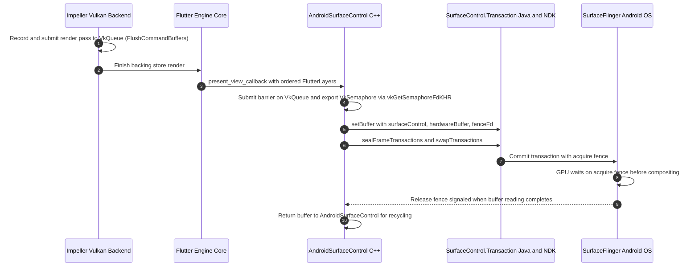

### Platform View Mutator Stack Serialization

Platform views embedded within Flutter require spatial transformations, opacity adjustments, and geometric clips across Android composition modes (HCPP, legacy HC, and TLHC). To pass these mutators across [`embedder.h`](https://github.com/flutter/flutter/blob/4762dec4fc9072cd9269814ef36364f35a9a66dc/engine/src/flutter/shell/platform/embedder/embedder.h) without exposing internal `//flutter/flow` or `SkPath` headers:

- `FlutterPath` (`FlutterPathFillType`, `FlutterPathVerb`), `kFlutterPlatformViewMutationTypeClipPath`, and `FlutterCompositor.platform_view_mutation_capabilities` (`FlutterPlatformViewMutationCapability`) are added to `embedder.h` so arbitrary path clips serialize into an ABI-stable structure-of-arrays layout.
- Rounded-superellipse clips (`MutatorType::kClipRSE`) continue to be approximated as `kFlutterPlatformViewMutationTypeClipRoundedRect` by the engine, and conic path verbs (`kFlutterPathVerbConic`) are converted to quadratic Beziers by the engine unless the compositor opts in via `kFlutterPlatformViewMutationCapabilityPathConics` (which Android sets on API 34+).
- `AndroidMutatorsMapper` replaces direct `flutter::MutatorsStack` iteration in `PlatformViewAndroidJNIImpl`, translating the `FlutterPlatformView.mutations` array into Java [`FlutterMutatorView`](https://github.com/flutter/flutter/blob/4762dec4fc9072cd9269814ef36364f35a9a66dc/engine/src/flutter/shell/platform/android/io/flutter/embedding/engine/mutatorsstack/FlutterMutatorView.java#L32) and `SurfaceControl.Transaction` transforms.

Internally, these operations are managed by [`flutter::MutatorsStack`](https://github.com/flutter/flutter/blob/4762dec4fc9072cd9269814ef36364f35a9a66dc/engine/src/flutter/flow/embedded_views.h#L211) in [`flow/embedded_views.h`](https://github.com/flutter/flutter/blob/4762dec4fc9072cd9269814ef36364f35a9a66dc/engine/src/flutter/flow/embedded_views.h). Because `flow` and `SkPath` headers cannot cross the C-API boundary, mutators must be serialized into an ABI-stable array of C structs:

```c
typedef enum {
  kFlutterPlatformViewMutationTypeOpacity,
  kFlutterPlatformViewMutationTypeClipRect,
  kFlutterPlatformViewMutationTypeClipRoundedRect,
  kFlutterPlatformViewMutationTypeTransformation,
  kFlutterPlatformViewMutationTypeClipPath,
} FlutterPlatformViewMutationType;

typedef struct {
  FlutterPlatformViewMutationType type;
  union {
    double opacity;
    FlutterRect clip_rect;
    FlutterRoundedRect clip_rounded_rect;
    FlutterTransformation transformation;
    const FlutterPath* clip_path;
  };
} FlutterPlatformViewMutation;
```

Rounded-superellipse clips ([`MutatorType::kClipRSE`](https://github.com/flutter/flutter/blob/4762dec4fc9072cd9269814ef36364f35a9a66dc/engine/src/flutter/flow/embedded_views.h#L38)) continue to be approximated as [`kFlutterPlatformViewMutationTypeClipRoundedRect`](https://github.com/flutter/flutter/blob/4762dec4fc9072cd9269814ef36364f35a9a66dc/engine/src/flutter/shell/platform/embedder/embedder.h#L2077) by the engine ([`embedder_layers.cc`](https://github.com/flutter/flutter/blob/4762dec4fc9072cd9269814ef36364f35a9a66dc/engine/src/flutter/shell/platform/embedder/embedder_layers.cc#L162-L167)), matching what Android HC and HCPP do today (`DlRoundSuperellipse::ToApproximateRoundRect()`).

Arbitrary clips need a path representation that does not drag [`SkPath`](https://github.com/google/skia/blob/main/include/core/SkPath.h) across the boundary. In [`embedder.h`](https://github.com/flutter/flutter/blob/4762dec4fc9072cd9269814ef36364f35a9a66dc/engine/src/flutter/shell/platform/embedder/embedder.h), `FlutterPath` uses a structure-of-arrays layout with an explicit fill rule and conservative control-point bounds:

```c
typedef enum {
  kFlutterPathFillTypeNonZero,
  kFlutterPathFillTypeEvenOdd,
} FlutterPathFillType;

typedef enum {
  kFlutterPathVerbMove,
  kFlutterPathVerbLine,
  kFlutterPathVerbQuad,
  kFlutterPathVerbConic,
  kFlutterPathVerbCubic,
  kFlutterPathVerbClose,
} FlutterPathVerb;

typedef struct {
  /// The size of this struct. Must be sizeof(FlutterPath).
  size_t struct_size;
  /// The fill rule for this path.
  FlutterPathFillType fill_type;
  /// The number of entries in `verbs`.
  size_t verbs_count;
  /// The path verbs, in drawing order. Every contour begins with
  /// `kFlutterPathVerbMove`. Valid only for the duration of the frame
  /// presentation callback.
  const FlutterPathVerb* verbs;
  /// The number of entries in `points`. Equals the sum of the points used by
  /// each verb: move 1, line 1, quad 2, conic 2, cubic 3, close 0.
  size_t points_count;
  /// The points, consumed in verb order. Valid only for the duration of the
  /// frame presentation callback.
  const FlutterPoint* points;
  /// The number of entries in `conic_weights`. Equals the number of
  /// `kFlutterPathVerbConic` verbs.
  size_t conic_weights_count;
  /// The conic weights, consumed in verb order. Valid only for the duration of
  /// the frame presentation callback.
  const double* conic_weights;
  /// Conservative control-point bounds containing all points of the path, in
  /// the same coordinate space. An embedder that cannot clip to a path clips
  /// to this rectangle.
  FlutterRect bounds;
} FlutterPath;

/// Optional platform view mutation features that a compositor can consume.
///
/// The engine only emits a mutation type or path verb that is gated by one of
/// these bits when the compositor sets that bit in
/// `FlutterCompositor.platform_view_mutation_capabilities`.
typedef enum {
  /// Only the default mutation types and path verbs are emitted.
  kFlutterPlatformViewMutationCapabilityDefault = 0,
  /// Clip paths may contain `kFlutterPathVerbConic` verbs. Without this bit,
  /// the engine converts conics to quadratic Bezier curves before handing
  /// paths to the embedder.
  kFlutterPlatformViewMutationCapabilityPathConics = 1 << 0,
} FlutterPlatformViewMutationCapability;
```

[`FlutterCompositor`](https://github.com/flutter/flutter/blob/4762dec4fc9072cd9269814ef36364f35a9a66dc/engine/src/flutter/shell/platform/embedder/embedder.h#L2264-L2322) is extended with `uint64_t platform_view_mutation_capabilities;` (a bitmask of `FlutterPlatformViewMutationCapability` values, defaulting to `0` when omitted by older embedders). On Android API 34+, where `android.graphics.Path.conicTo` is available and HCPP applies path clips to [`FlutterMutatorView`](https://github.com/flutter/flutter/blob/4762dec4fc9072cd9269814ef36364f35a9a66dc/engine/src/flutter/shell/platform/android/io/flutter/embedding/engine/mutatorsstack/FlutterMutatorView.java#L32), the Android compositor sets `kFlutterPlatformViewMutationCapabilityPathConics` so conic arcs are passed through without quadratic approximation.

Mutations ride on [`FlutterPlatformView`](https://github.com/flutter/flutter/blob/4762dec4fc9072cd9269814ef36364f35a9a66dc/engine/src/flutter/shell/platform/embedder/embedder.h#L2094-L2117), which the engine hands to the embedder inside a [`FlutterLayer`](https://github.com/flutter/flutter/blob/4762dec4fc9072cd9269814ef36364f35a9a66dc/engine/src/flutter/shell/platform/embedder/embedder.h#L2200-L2231) through the compositor's [`present_layers_callback`](https://github.com/flutter/flutter/blob/4762dec4fc9072cd9269814ef36364f35a9a66dc/engine/src/flutter/shell/platform/embedder/embedder.h#L2302):

```c
typedef struct {
  size_t struct_size;
  FlutterPlatformViewIdentifier identifier;
  size_t mutations_count;
  /// Applied in order. The first entry is a transformation mutation when a
  /// device pixel ratio or root surface transformation is in effect, so that
  /// subsequent mutations are already in the correct coordinate space.
  const FlutterPlatformViewMutation** mutations;
} FlutterPlatformView;
```

The array is an array of pointers rather than an array of values. Indexing strides by pointer width instead of `sizeof(FlutterPlatformViewMutation)`, so a future mutation type that widens the union does not shift the stride out from under an already-compiled embedder. This is the same technique [`FlutterSemanticsUpdate2`](https://github.com/flutter/flutter/blob/4762dec4fc9072cd9269814ef36364f35a9a66dc/engine/src/flutter/shell/platform/embedder/embedder.h#L1868-L1881) uses.

Android does not apply backdrop filter mutators over HC or HCPP platform views today: neither [`AndroidExternalViewEmbedder`](https://github.com/flutter/flutter/blob/4762dec4fc9072cd9269814ef36364f35a9a66dc/engine/src/flutter/shell/platform/android/external_view_embedder/external_view_embedder.h#L29) nor [`AndroidExternalViewEmbedder2`](https://github.com/flutter/flutter/blob/4762dec4fc9072cd9269814ef36364f35a9a66dc/engine/src/flutter/shell/platform/android/external_view_embedder/external_view_embedder_2.h#L34) overrides the no-op [`ExternalViewEmbedder::PushFilterToVisitedPlatformViews`](https://github.com/flutter/flutter/blob/4762dec4fc9072cd9269814ef36364f35a9a66dc/engine/src/flutter/flow/embedded_views.h#L538-L558), and both JNI serializers skip `kBackdropFilter` and the backdrop clip mutators ([HC](https://github.com/flutter/flutter/blob/4762dec4fc9072cd9269814ef36364f35a9a66dc/engine/src/flutter/shell/platform/android/platform_view_android_jni_impl.cc#L1840-L1849), [HCPP](https://github.com/flutter/flutter/blob/4762dec4fc9072cd9269814ef36364f35a9a66dc/engine/src/flutter/shell/platform/android/platform_view_android_jni_impl.cc#L2355-L2362)). TLHC and VD render the platform view as an external texture into Flutter's own canvas ([`TextureLayer::Paint`](https://github.com/flutter/flutter/blob/4762dec4fc9072cd9269814ef36364f35a9a66dc/engine/src/flutter/flow/layers/texture_layer.cc#L48-L67)), so backdrop filters already work in those modes without platform view mutators. The Android embedder skips `FlutterPlatformViewMutationType` values it does not handle, and any future backdrop-filter support over HC or HCPP views will consume the backdrop-blur mutation added by the iOS embedder migration RFC rather than defining an Android-specific mutation type.

### External Textures (Zero-Copy Vulkan and OpenGL ES)

To replace the internal `flutter::Texture` subclasses ([`ImageExternalTexture`](https://github.com/flutter/flutter/blob/4762dec4fc9072cd9269814ef36364f35a9a66dc/engine/src/flutter/shell/platform/android/image_external_texture.h#L36) and [`SurfaceTextureExternalTexture`](https://github.com/flutter/flutter/blob/4762dec4fc9072cd9269814ef36364f35a9a66dc/engine/src/flutter/shell/platform/android/surface_texture_external_texture.h#L33)) across both [`SurfaceProducer`](https://github.com/flutter/flutter/blob/4762dec4fc9072cd9269814ef36364f35a9a66dc/engine/src/flutter/shell/platform/android/io/flutter/view/TextureRegistry.java#L21) (`AHardwareBuffer`) and [`SurfaceTexture`](https://developer.android.com/reference/android/graphics/SurfaceTexture) (`GL_TEXTURE_EXTERNAL_OES`) pipelines:

- `FlutterVulkanYcbcrConversionInfo` and `FlutterVulkanExternalTexture.ycbcr_conversion_info` are added to [`embedder.h`](https://github.com/flutter/flutter/blob/4762dec4fc9072cd9269814ef36364f35a9a66dc/engine/src/flutter/shell/platform/embedder/embedder.h) so the Vulkan renderer can sample multi-planar and vendor-specific external YCbCr camera and video frames (`VkSamplerYcbcrConversion`) without exposing Android `AHardwareBuffer` types in `embedder.h`.
- `FlutterOpenGLExternalTexture` (with `FlutterTransformation uv_transform`) and `FlutterOpenGLRendererConfig.external_texture_frame_callback` are added to `embedder.h` (deprecating `gl_external_texture_frame_callback`) so the OpenGL ES renderer applies `SurfaceTexture.getTransformMatrix()` UV transforms while keeping `FlutterOpenGLTexture` unchanged for render targets.
- `AndroidHardwareBuffer` and `AndroidVulkanExternalTexture` import `AHardwareBuffer` frames into `VkImage` (Vulkan) or `EGLImageKHR` (OpenGL ES) inside the Android embedder and register textures through `FlutterEngineRegisterExternalTexture` and `FlutterEngineMarkExternalTextureFrameAvailable`.

Android provides two distinct mechanisms for external textures:

- [`SurfaceProducer`](https://github.com/flutter/flutter/blob/4762dec4fc9072cd9269814ef36364f35a9a66dc/engine/src/flutter/shell/platform/android/io/flutter/view/TextureRegistry.java#L21): A zero-copy pipeline backed by `ImageReader` and [`AHardwareBuffer`](https://developer.android.com/ndk/reference/group/a-hardware-buffer) on API 29+ (falling back to `SurfaceTexture` below API 29 and on Huawei devices at API 29).
- [`SurfaceTexture`](https://developer.android.com/reference/android/graphics/SurfaceTexture): An OpenGL ES consumer path where native frames latch into a `GL_TEXTURE_EXTERNAL_OES` texture via [`SurfaceTexture.updateTexImage()`](https://developer.android.com/reference/android/graphics/SurfaceTexture#updateTexImage()).

Because the Android embedder owns the `VkDevice` on Vulkan and the `EGLContext` on OpenGL ES, it imports `AHardwareBuffer` frames into backend-native GPU handles itself (`VkImage` via `VK_ANDROID_external_memory_android_hardware_buffer` on Vulkan, and `EGLImage` / `GL_TEXTURE_EXTERNAL_OES` via `eglCreateImageKHR(EGL_NATIVE_BUFFER_ANDROID)` on OpenGL ES, mirroring [`ImageExternalTextureGL`](https://github.com/flutter/flutter/blob/4762dec4fc9072cd9269814ef36364f35a9a66dc/engine/src/flutter/shell/platform/android/image_external_texture_gl.cc#L87-L115)). This keeps `embedder.h` free of Android-specific `AHardwareBuffer` types.

On Vulkan, [`flutter/flutter#188855`](https://github.com/flutter/flutter/pull/188855) added [`FlutterVulkanExternalTexture`](https://github.com/flutter/flutter/blob/c5b32231ecba26acab0179de3a054163bb71a324/engine/src/flutter/shell/platform/embedder/embedder.h#L971-L1001), `FlutterVulkanTextureFrameCallback`, and `FlutterVulkanRendererConfig.external_texture_frame_callback`. However, camera and video decoder `AHardwareBuffer`s on Android frequently use vendor-specific external YCbCr formats (`VkAndroidHardwareBufferFormatPropertiesANDROID.format == VK_FORMAT_UNDEFINED`) that cannot be sampled without a `VkSamplerYcbcrConversion`. To support multi-planar and external-format `VkImage`s without leaking `AHardwareBuffer` into `embedder.h`, `FlutterVulkanExternalTexture` is extended with an optional `FlutterVulkanYcbcrConversionInfo` pointer:

```c
/// VkComponentSwizzle values for FlutterVulkanComponentMapping.
typedef enum {
  kFlutterVulkanComponentSwizzleIdentity = 0,
  kFlutterVulkanComponentSwizzleZero = 1,
  kFlutterVulkanComponentSwizzleOne = 2,
  kFlutterVulkanComponentSwizzleR = 3,
  kFlutterVulkanComponentSwizzleG = 4,
  kFlutterVulkanComponentSwizzleB = 5,
  kFlutterVulkanComponentSwizzleA = 6,
} FlutterVulkanComponentSwizzle;

/// Equivalent to VkComponentMapping for YCbCr conversion.
typedef struct {
  FlutterVulkanComponentSwizzle r;
  FlutterVulkanComponentSwizzle g;
  FlutterVulkanComponentSwizzle b;
  FlutterVulkanComponentSwizzle a;
} FlutterVulkanComponentMapping;

/// Parameters for creating a VkSamplerYcbcrConversion when sampling an
/// external-format or YCbCr-encoded VkImage (mirrors
/// VkSamplerYcbcrConversionCreateInfo and VkExternalFormatANDROID).
typedef struct {
  /// The size of this struct. Must be sizeof(FlutterVulkanYcbcrConversionInfo).
  size_t struct_size;
  /// The VkFormat of the image, or VK_FORMAT_UNDEFINED (0) when using
  /// `external_format`.
  uint32_t format;
  /// VkSamplerYcbcrModelConversion value.
  uint32_t ycbcr_model;
  /// VkSamplerYcbcrRange value.
  uint32_t ycbcr_range;
  /// Component swizzle mapping.
  FlutterVulkanComponentMapping components;
  /// VkChromaLocation for X chroma samples.
  uint32_t x_chroma_offset;
  /// VkChromaLocation for Y chroma samples.
  uint32_t y_chroma_offset;
  /// VkFilter for chroma reconstruction.
  uint32_t chroma_filter;
  /// Whether explicit chroma reconstruction is forced (VkBool32).
  bool force_explicit_reconstruction;
  /// VkFormatFeatureFlags for the external format.
  uint32_t format_features;
  /// Platform-defined external format identifier (for example from
  /// VkAndroidHardwareBufferFormatPropertiesANDROID.externalFormat), or 0
  /// if `format` is a known Vulkan format.
  uint64_t external_format;
} FlutterVulkanYcbcrConversionInfo;

typedef struct {
  // ... existing members from flutter/flutter#188855 (struct_size, image,
  // format, user_data, destruction_callback, width, height) ...

  /// Optional YCbCr sampler conversion info for multi-planar or
  /// external-format images. NULL for standard RGBA sampling.
  const FlutterVulkanYcbcrConversionInfo* ycbcr_conversion_info;
} FlutterVulkanExternalTexture;
```

For [`SurfaceTexture`](https://developer.android.com/reference/android/graphics/SurfaceTexture)-backed textures—used by the public `TextureRegistry.createSurfaceTexture()` / `registerSurfaceTexture()` APIs, by `SurfaceProducer` below API 29 (and on Huawei devices at API 29), and by TLHC/VD render targets below API 29—[`SurfaceTexture.getTransformMatrix()`](https://developer.android.com/reference/android/graphics/SurfaceTexture#getTransformMatrix(float[])) provides a 4x4 UV coordinate transformation matrix accounting for camera sensor rotation, video decoder padding, and vertical coordinate inversion (`ImageReader` buffers carry no matrix because `handlesCropAndRotation()` is `false`). Under Vulkan, `SurfaceTexture` requires an OpenGL ES context to latch frames, so the GL-to-Vulkan blit into an `AHardwareBuffer` ([`SurfaceTextureExternalTextureVKImpeller`](https://github.com/flutter/flutter/blob/4762dec4fc9072cd9269814ef36364f35a9a66dc/engine/src/flutter/shell/platform/android/surface_texture_external_texture_vk_impeller.cc#L24-L161)) runs inside the Android embedder with the UV matrix baked into the blit. Under OpenGL ES, however, the engine samples the texture directly and needs the UV matrix from the embedder.

Because [`FlutterOpenGLTexture`](https://github.com/flutter/flutter/blob/4762dec4fc9072cd9269814ef36364f35a9a66dc/engine/src/flutter/shell/platform/embedder/embedder.h#L519-L540) has no `struct_size` and is embedded by value inside [`FlutterOpenGLBackingStore`](https://github.com/flutter/flutter/blob/4762dec4fc9072cd9269814ef36364f35a9a66dc/engine/src/flutter/shell/platform/embedder/embedder.h#L1982-L1996) as a render target, it stays unchanged and undeprecated. Instead, `embedder.h` introduces `FlutterOpenGLExternalTexture` (mirroring `FlutterMetalExternalTexture` and `FlutterVulkanExternalTexture`) and appends `FlutterOpenGLTextureFrameCallback external_texture_frame_callback;` to `FlutterOpenGLRendererConfig` (marking `gl_external_texture_frame_callback` `@deprecated` in documentation and rejecting configs that set both):

```c
typedef struct {
  /// The size of this struct. Must be sizeof(FlutterOpenGLExternalTexture).
  size_t struct_size;
  /// Target texture of the active texture unit (for example GL_TEXTURE_2D or
  /// GL_TEXTURE_EXTERNAL_OES).
  uint32_t target;
  /// The name of the texture.
  uint32_t name;
  /// The texture format (for example GL_RGBA8). Use GL_RGBA8 when `target`
  /// is GL_TEXTURE_EXTERNAL_OES.
  uint32_t format;
  /// User data to be returned on the invocation of the destruction callback.
  void* user_data;
  /// Callback invoked (on an engine-managed thread) that asks the embedder
  /// to collect the texture.
  VoidCallback destruction_callback;
  /// Width of the texture in pixels.
  size_t width;
  /// Height of the texture in pixels.
  size_t height;
  /// Transformation applied to normalized texture coordinates before
  /// sampling, for example from SurfaceTexture.getTransformMatrix(). An
  /// all-zero or identity matrix draws the texture untransformed.
  FlutterTransformation uv_transform;
} FlutterOpenGLExternalTexture;

typedef bool (*FlutterOpenGLTextureFrameCallback)(
    void* /* user data */,
    int64_t /* texture identifier */,
    size_t /* width */,
    size_t /* height */,
    FlutterOpenGLExternalTexture* /* texture out */);

// Appended to FlutterOpenGLRendererConfig:
FlutterOpenGLTextureFrameCallback external_texture_frame_callback;
```

Under OpenGL ES, platform view compositing also faces constraints: because [`SurfaceControl`](https://developer.android.com/reference/android/view/SurfaceControl) transaction sync fences depend on Vulkan hardware synchronization, OpenGL platform views must use Texture Layer Hybrid Composition (TLHC) or legacy Hybrid Composition rather than HCPP.

### Accessibility and Semantics Parity ([`FlutterSemanticsNode2`](https://github.com/flutter/flutter/blob/4762dec4fc9072cd9269814ef36364f35a9a66dc/engine/src/flutter/shell/platform/embedder/embedder.h#L1677-L1783) In-Place Extension)

To deliver the complete semantics tree to Java [`AccessibilityBridge`](https://github.com/flutter/flutter/blob/4762dec4fc9072cd9269814ef36364f35a9a66dc/engine/src/flutter/shell/platform/android/io/flutter/view/AccessibilityBridge.java#L80) without including internal [`lib/ui/semantics/semantics_node.h`](https://github.com/flutter/flutter/blob/4762dec4fc9072cd9269814ef36364f35a9a66dc/engine/src/flutter/lib/ui/semantics/semantics_node.h) headers:

- `FlutterSemanticsRole` and nine node fields (`max_value_length`, `current_value_length`, `link_url`, `locale`, `min_value`, `max_value`, `hit_test_transform`, `role`, and `hit_test_child_count`) are appended in place to [`FlutterSemanticsNode2`](https://github.com/flutter/flutter/blob/4762dec4fc9072cd9269814ef36364f35a9a66dc/engine/src/flutter/shell/platform/embedder/embedder.h#L1677-L1783) in [`embedder.h`](https://github.com/flutter/flutter/blob/4762dec4fc9072cd9269814ef36364f35a9a66dc/engine/src/flutter/shell/platform/embedder/embedder.h).
- `hit_test_child_count` separates the length of `children_in_hit_test_order` from `child_count` (`children_in_traversal_order`), which can differ when the framework grafts nodes such as `OverlayPortal`.
- `AndroidSemanticsMapper` consumes `FlutterSemanticsUpdate2` via `FlutterProjectArgs.update_semantics_callback2` and packs the direct `ByteBuffer` and string pool arrays expected by `AccessibilityBridge`, while accessibility actions route back through `FlutterEngineSendSemanticsAction`.

`FlutterSemanticsRole` mirrors [`flutter::SemanticsRole`](https://github.com/flutter/flutter/blob/c5b32231ecba26acab0179de3a054163bb71a324/engine/src/flutter/lib/ui/semantics/semantics_node.h#L74-L111), and the remaining fields required by Android's [`AccessibilityBridge`](https://github.com/flutter/flutter/blob/4762dec4fc9072cd9269814ef36364f35a9a66dc/engine/src/flutter/shell/platform/android/io/flutter/view/AccessibilityBridge.java#L80) are appended to the end of [`FlutterSemanticsNode2`](https://github.com/flutter/flutter/blob/4762dec4fc9072cd9269814ef36364f35a9a66dc/engine/src/flutter/shell/platform/embedder/embedder.h#L1677-L1783):

```c
typedef enum {
  kFlutterSemanticsRoleNone = 0,
  kFlutterSemanticsRoleTab = 1,
  kFlutterSemanticsRoleTabBar = 2,
  kFlutterSemanticsRoleTabPanel = 3,
  kFlutterSemanticsRoleDialog = 4,
  kFlutterSemanticsRoleAlertDialog = 5,
  kFlutterSemanticsRoleTable = 6,
  kFlutterSemanticsRoleCell = 7,
  kFlutterSemanticsRoleRow = 8,
  kFlutterSemanticsRoleColumnHeader = 9,
  kFlutterSemanticsRoleDragHandle = 10,
  kFlutterSemanticsRoleSpinButton = 11,
  kFlutterSemanticsRoleComboBox = 12,
  kFlutterSemanticsRoleMenuBar = 13,
  kFlutterSemanticsRoleMenu = 14,
  kFlutterSemanticsRoleMenuItem = 15,
  kFlutterSemanticsRoleMenuItemCheckbox = 16,
  kFlutterSemanticsRoleMenuItemRadio = 17,
  kFlutterSemanticsRoleList = 18,
  kFlutterSemanticsRoleListItem = 19,
  kFlutterSemanticsRoleForm = 20,
  kFlutterSemanticsRoleTooltip = 21,
  kFlutterSemanticsRoleLoadingSpinner = 22,
  kFlutterSemanticsRoleProgressBar = 23,
  kFlutterSemanticsRoleHotKey = 24,
  kFlutterSemanticsRoleRadioGroup = 25,
  kFlutterSemanticsRoleStatus = 26,
  kFlutterSemanticsRoleAlert = 27,
  kFlutterSemanticsRoleComplementary = 28,
  kFlutterSemanticsRoleContentInfo = 29,
  kFlutterSemanticsRoleMain = 30,
  kFlutterSemanticsRoleNavigation = 31,
  kFlutterSemanticsRoleRegion = 32,
  kFlutterSemanticsRoleSearch = 33,
  kFlutterSemanticsRoleSlider = 34,
  kFlutterSemanticsRoleListBox = 35,
  kFlutterSemanticsRoleOption = 36,
} FlutterSemanticsRole;

// Appended to FlutterSemanticsNode2 in embedder.h:
int32_t max_value_length;
int32_t current_value_length;
const char* link_url;
const char* locale;
const char* min_value;
const char* max_value;
FlutterTransformation hit_test_transform;
FlutterSemanticsRole role;
/// The number of entries in `children_in_hit_test_order` (which may differ
/// from `child_count`, the length of `children_in_traversal_order`).
size_t hit_test_child_count;
```

### Dart Deferred Library Loading

Android supports dynamic delivery through Google Play Feature Delivery / split APKs: when Dart code requests a deferred library via `deferred as`, the embedder downloads or extracts the split APK and loads the compiled snapshot into the running isolate. To support deferred loading through [`embedder.h`](https://github.com/flutter/flutter/blob/4762dec4fc9072cd9269814ef36364f35a9a66dc/engine/src/flutter/shell/platform/embedder/embedder.h):

- `FlutterRequestDartDeferredLibraryCallback` (`FlutterProjectArgs.request_dart_deferred_library_callback`), `FlutterDartDeferredLibrary` (with `destruction_callback`), `FlutterEngineLoadDartDeferredLibrary`, and `FlutterEngineNotifyDartDeferredLibraryLoadError` (`FlutterDartDeferredLibraryLoadError`) are added to `embedder.h`.
- Instead of calling internal [`PlatformViewAndroid::LoadDartDeferredLibrary`](https://github.com/flutter/flutter/blob/4762dec4fc9072cd9269814ef36364f35a9a66dc/engine/src/flutter/shell/platform/android/platform_view_android.cc#L508-L514) methods directly, the Android embedder receives loading unit requests via `request_dart_deferred_library_callback`, resolves the split APK snapshot buffers, and supplies them to `FlutterEngineLoadDartDeferredLibrary` (or reports failures via `FlutterEngineNotifyDartDeferredLibraryLoadError`), releasing mapped resources when `destruction_callback` fires.

Currently, this is handled through private calls across JNI in [`LoadDartDeferredLibrary`](https://github.com/flutter/flutter/blob/4762dec4fc9072cd9269814ef36364f35a9a66dc/engine/src/flutter/shell/platform/android/platform_view_android_jni_impl.cc#L701-L735) into [`PlatformViewAndroid::LoadDartDeferredLibrary`](https://github.com/flutter/flutter/blob/4762dec4fc9072cd9269814ef36364f35a9a66dc/engine/src/flutter/shell/platform/android/platform_view_android.cc#L508-L514):

```cpp
// Existing JNI deferred loading invocation in shell/platform/android/platform_view_android_jni_impl.cc
static void LoadDartDeferredLibrary(JNIEnv* env,
                                    jobject obj,
                                    jlong shell_holder,
                                    jint jLoadingUnitId,
                                    jobjectArray jSearchPaths) {
  // ... resolve symbols data_mapping and instructions_mapping via dlopen ...
  ANDROID_SHELL_HOLDER->GetPlatformView()->LoadDartDeferredLibrary(
      loading_unit_id, std::move(data_mapping),
      std::move(instructions_mapping));
}
```

[`embedder.h`](https://github.com/flutter/flutter/blob/4762dec4fc9072cd9269814ef36364f35a9a66dc/engine/src/flutter/shell/platform/embedder/embedder.h) is extended with callbacks and entry points mirroring the Dart SDK deferred loading API:

```c
/// Callback invoked by the engine when Dart requests loading of a deferred
/// library / loading unit.
///
/// This callback runs on the platform task runner thread.
///
/// @param[in]  loading_unit_id  The ID of the loading unit to load.
/// @param[in]  user_data        The user data supplied to `FlutterEngineRun` or
///                              `FlutterEngineInitialize`.
typedef void (*FlutterRequestDartDeferredLibraryCallback)(
    intptr_t loading_unit_id,
    void* user_data);

/// Information passed to `FlutterEngineLoadDartDeferredLibrary`.
typedef struct {
  /// The size of this struct. Must be sizeof(FlutterDartDeferredLibrary).
  size_t struct_size;

  /// The ID of the loading unit being loaded.
  intptr_t loading_unit_id;

  /// The snapshot data buffer containing the Dart deferred library. Must not be null.
  const uint8_t* snapshot_data;

  /// The size of the snapshot data buffer in bytes.
  size_t snapshot_data_size;

  /// The snapshot instructions buffer containing the Dart deferred library.
  const uint8_t* snapshot_instructions;

  /// The size of the snapshot instructions buffer in bytes.
  size_t snapshot_instructions_size;

  /// Optional user data pointer passed to `destruction_callback`.
  void* user_data;

  /// Optional callback invoked when the engine releases its references to
  /// `snapshot_data` and `snapshot_instructions`.
  ///
  /// If null, the embedder must ensure the buffers remain valid until
  /// `FlutterEngineShutdown` returns. If non-null, this callback is invoked
  /// once both snapshot buffers are no longer referenced by the engine (for
  /// example, on isolate shutdown or if loading fails).
  VoidCallback destruction_callback;
} FlutterDartDeferredLibrary;

FLUTTER_EXPORT
FlutterEngineResult FlutterEngineLoadDartDeferredLibrary(
    FLUTTER_API_SYMBOL(FlutterEngine) engine,
    const FlutterDartDeferredLibrary* library);

typedef struct {
  size_t struct_size;
  intptr_t loading_unit_id;
  const char* error_message;
  bool transient;
} FlutterDartDeferredLibraryLoadError;

FLUTTER_EXPORT
FlutterEngineResult FlutterEngineNotifyDartDeferredLibraryLoadError(
    FLUTTER_API_SYMBOL(FlutterEngine) engine,
    const FlutterDartDeferredLibraryLoadError* error);
```

In [`FlutterProjectArgs`](https://github.com/flutter/flutter/blob/4762dec4fc9072cd9269814ef36364f35a9a66dc/engine/src/flutter/shell/platform/embedder/embedder.h#L2527-L2841):

```c
  /// The callback invoked by the engine when Dart requests a deferred library
  /// (loading unit). The callback is invoked from a task posted to the
  /// platform thread. The embedder answers each request with
  /// `FlutterEngineLoadDartDeferredLibrary` or
  /// `FlutterEngineNotifyDartDeferredLibraryLoadError`. If null, the engine
  /// fails every request with a non-transient load error.
  FlutterRequestDartDeferredLibraryCallback
      request_dart_deferred_library_callback;
```

#### Deferred Library Memory Lifetime Management

Because split APK assets on Android are loaded via `AAssetManager` or memory-mapped (`mmap`) from disk, buffer lifetime must be explicitly managed:

1. When Dart requests a library, [`FlutterRequestDartDeferredLibraryCallback`](#dart-deferred-library-loading) runs asynchronously (`void` return type), so the embedder can initiate download or extraction without blocking the engine thread.
2. When loading completes, `FlutterDartDeferredLibrary.destruction_callback` provides the unmap trigger. In the proposed [`embedder.cc`](https://github.com/flutter/flutter/blob/4762dec4fc9072cd9269814ef36364f35a9a66dc/engine/src/flutter/shell/platform/embedder/embedder.cc) implementation, the engine captures this callback in a [`DeferredLibraryLifetime`](#deferred-library-memory-lifetime-management) handle held by [`fml::NonOwnedMapping`](https://github.com/flutter/flutter/blob/4762dec4fc9072cd9269814ef36364f35a9a66dc/engine/src/flutter/fml/mapping.h#L115). When the Dart VM finishes loading and drops its references to both data and instruction buffers, the destructor triggers `destruction_callback(user_data)`, which permits the Android embedder to safely `munmap()` or close the underlying [`AAsset`](https://developer.android.com/ndk/reference/group/asset).

### Custom Asset and Kernel Resolution (APK / In-Memory Mapping)

To resolve assets packaged inside APK or AAB archives without subclassing internal C++ [`flutter::AssetResolver`](https://github.com/flutter/flutter/blob/4762dec4fc9072cd9269814ef36364f35a9a66dc/engine/src/flutter/assets/asset_resolver.h#L23) or extracting files to disk:

- `FlutterAssetMapping`, `FlutterCustomAssetResolver` (`FlutterAssetResolverGetAsMappingCallback`), and `FlutterProjectArgs.custom_asset_resolvers` (`custom_asset_resolvers_count`) are added to [`embedder.h`](https://github.com/flutter/flutter/blob/4762dec4fc9072cd9269814ef36364f35a9a66dc/engine/src/flutter/shell/platform/embedder/embedder.h).
- [`APKAssetProvider`](https://github.com/flutter/flutter/blob/4762dec4fc9072cd9269814ef36364f35a9a66dc/engine/src/flutter/shell/platform/android/apk_asset_provider.h#L26) supplies a `FlutterCustomAssetResolver` that maps assets directly from the NDK [`AAssetManager`](https://developer.android.com/ndk/reference/group/asset) in `get_as_mapping_callback` and atomically swaps its `AAssetManager*` pointer inside `user_data` when `FlutterJNI.updateJavaAssetManager` runs after a split APK install.

Desktop embedders load assets from loose files in a filesystem directory passed to [`FlutterProjectArgs.assets_path`](https://github.com/flutter/flutter/blob/4762dec4fc9072cd9269814ef36364f35a9a66dc/engine/src/flutter/shell/platform/embedder/embedder.h#L2533). On Android, assets are packaged inside APK or AAB archives and accessed through the NDK [`AAssetManager`](https://developer.android.com/ndk/reference/group/asset) via [`APKAssetProvider`](https://github.com/flutter/flutter/blob/4762dec4fc9072cd9269814ef36364f35a9a66dc/engine/src/flutter/shell/platform/android/apk_asset_provider.h#L26), which previously subclassed the internal engine [`AssetResolver`](https://github.com/flutter/flutter/blob/4762dec4fc9072cd9269814ef36364f35a9a66dc/engine/src/flutter/assets/asset_resolver.h#L23):

```cpp
// Existing internal AssetResolver inheritance in shell/platform/android/apk_asset_provider.h
class APKAssetProvider final : public AssetResolver {
 public:
  explicit APKAssetProvider(JNIEnv* env,
                            jobject assetManager,
                            std::string directory);
  std::unique_ptr<APKAssetProvider> Clone() const;
};
```

Passing file paths would require extracting all assets to disk during startup, which causes latency and disk consumption.

[`embedder.h`](https://github.com/flutter/flutter/blob/4762dec4fc9072cd9269814ef36364f35a9a66dc/engine/src/flutter/shell/platform/embedder/embedder.h) receives a custom asset resolver callback interface on [`FlutterProjectArgs`](https://github.com/flutter/flutter/blob/4762dec4fc9072cd9269814ef36364f35a9a66dc/engine/src/flutter/shell/platform/embedder/embedder.h#L2527-L2841) that maps assets into memory directly from the APK archive:

```c
typedef struct {
  size_t struct_size;
  const uint8_t* mapping;
  size_t mapping_size;
  void* user_data;
  VoidCallback destruction_callback;
} FlutterAssetMapping;

typedef bool (*FlutterAssetResolverGetAsMappingCallback)(
    const char* asset_name,
    void* user_data,
    FlutterAssetMapping* mapping_out);

typedef struct {
  size_t struct_size;
  void* user_data;
  FlutterAssetResolverGetAsMappingCallback get_as_mapping_callback;
  VoidCallback destruction_callback;
} FlutterCustomAssetResolver;
```

In [`FlutterProjectArgs`](https://github.com/flutter/flutter/blob/4762dec4fc9072cd9269814ef36364f35a9a66dc/engine/src/flutter/shell/platform/embedder/embedder.h#L2527-L2841):

```c
  /// The number of entries in `custom_asset_resolvers`.
  size_t custom_asset_resolvers_count;

  /// Embedder-provided resolvers that the engine queries in array order for
  /// assets, including `kernel_blob.bin` in JIT mode. When
  /// `custom_asset_resolvers_count` is non-zero, `assets_path` may be null.
  const FlutterCustomAssetResolver** custom_asset_resolvers;
```

Resolvers configured via `FlutterProjectArgs.custom_asset_resolvers` remain active across the lifetime of the engine, including hot reload, hot restart, and dynamic feature installation:

- **Hot Restart and Hot Reload**: [`Shell::OnServiceProtocolRunInView`](https://github.com/flutter/flutter/blob/4762dec4fc9072cd9269814ef36364f35a9a66dc/engine/src/flutter/shell/common/shell.cc#L1992-L2043) and [`Shell::OnServiceProtocolSetAssetBundlePath`](https://github.com/flutter/flutter/blob/4762dec4fc9072cd9269814ef36364f35a9a66dc/engine/src/flutter/shell/common/shell.cc#L2168-L2203) automatically re-attach every existing resolver whose `IsValidAfterAssetManagerChange()` returns `true` (which the engine's `FlutterCustomAssetResolver` wrapper implements), so the engine continues invoking `get_as_mapping_callback` alongside the updated `devFS` directory.
- **Play Store Deferred Component Split Installation**: When [`PlayStoreDeferredComponentManager.loadAssets`](https://github.com/flutter/flutter/blob/4762dec4fc9072cd9269814ef36364f35a9a66dc/engine/src/flutter/shell/platform/android/io/flutter/embedding/engine/deferredcomponents/PlayStoreDeferredComponentManager.java#L383-L399) creates a refreshed package context after a split APK install and calls `FlutterJNI.updateJavaAssetManager`, the Android embedder atomically swaps the `AAssetManager*` and global Java `AssetManager` reference inside the struct pointed to by the resolver's `user_data`.

### Multi-Engine Spawning and Add-to-App (`FlutterEngineSpawn`)

To support [`FlutterEngineGroup`](https://github.com/flutter/flutter/blob/4762dec4fc9072cd9269814ef36364f35a9a66dc/engine/src/flutter/shell/platform/android/io/flutter/embedding/engine/FlutterEngineGroup.java#L41) and Add-to-App multi-engine sharing without calling internal [`Shell::Spawn`](https://github.com/flutter/flutter/blob/4762dec4fc9072cd9269814ef36364f35a9a66dc/engine/src/flutter/shell/common/shell.h#L204-L210) methods:

- `FlutterEngineSpawn` and `FlutterEngineSpawnInfo` are added to [`embedder.h`](https://github.com/flutter/flutter/blob/4762dec4fc9072cd9269814ef36364f35a9a66dc/engine/src/flutter/shell/platform/embedder/embedder.h).
- `AndroidEngineGroup` replaces [`AndroidShellHolder::Spawn`](https://github.com/flutter/flutter/blob/4762dec4fc9072cd9269814ef36364f35a9a66dc/engine/src/flutter/shell/platform/android/android_shell_holder.cc#L222-L285), spawning child `FlutterEngine` instances that share the parent engine's Dart VM isolate group, `io_manager`, and resolved [`impeller::Context`](https://github.com/flutter/flutter/blob/4762dec4fc9072cd9269814ef36364f35a9a66dc/engine/src/flutter/impeller/renderer/context.h#L70) (including when the parent engine initialized with `type = kDeferred`).

In the existing architecture, [`AndroidShellHolder::Spawn`](https://github.com/flutter/flutter/blob/4762dec4fc9072cd9269814ef36364f35a9a66dc/engine/src/flutter/shell/platform/android/android_shell_holder.cc#L222-L285) reaches directly into [`shell_->Spawn(...)`](https://github.com/flutter/flutter/blob/4762dec4fc9072cd9269814ef36364f35a9a66dc/engine/src/flutter/shell/common/shell.h#L204-L210):

```cpp
// Existing spawning in shell/platform/android/android_shell_holder.cc
std::unique_ptr<flutter::Shell> shell =
    shell_->Spawn(std::move(config.value()), initial_route,
                  on_create_platform_view, on_create_rasterizer);

return std::unique_ptr<AndroidShellHolder>(new AndroidShellHolder(
    GetSettings(), jni_facade, thread_host_, std::move(shell),
    apk_asset_provider_->Clone(), weak_platform_view,
    android_context->RenderingApi()));
```

The public C-API lacked a spawn API, which prevented multi-engine groups from operating without internal [`Shell`](https://github.com/flutter/flutter/blob/4762dec4fc9072cd9269814ef36364f35a9a66dc/engine/src/flutter/shell/common/shell.h) methods. [`embedder.h`](https://github.com/flutter/flutter/blob/4762dec4fc9072cd9269814ef36364f35a9a66dc/engine/src/flutter/shell/platform/embedder/embedder.h) receives [`FlutterEngineSpawn`](#multi-engine-spawning-and-add-to-app-flutterenginespawn):

```c
typedef struct {
  size_t struct_size;
  const char* entrypoint;
  const char* library_uri;
  const char* initial_route;
  const char* const* entrypoint_argv;
  int entrypoint_argc;
  void* user_data;
  const FlutterProjectArgs* project_args;
  const FlutterRendererConfig* renderer_config;
} FlutterEngineSpawnInfo;

FLUTTER_EXPORT
FlutterEngineResult FlutterEngineSpawn(
    FLUTTER_API_SYMBOL(FlutterEngine) parent_engine,
    const FlutterEngineSpawnInfo* config,
    FLUTTER_API_SYMBOL(FlutterEngine)* spawned_engine_out);
```

The [`FlutterEngineSpawnInfo`](#multi-engine-spawning-and-add-to-app-flutterenginespawn) struct uses the info struct pattern (`struct_size`) to maintain forward ABI compatibility. The `initial_route` parameter matches [`Shell::Spawn`](https://github.com/flutter/flutter/blob/4762dec4fc9072cd9269814ef36364f35a9a66dc/engine/src/flutter/shell/common/shell.h#L204) and [`AndroidShellHolder::Spawn`](https://github.com/flutter/flutter/blob/4762dec4fc9072cd9269814ef36364f35a9a66dc/engine/src/flutter/shell/platform/android/android_shell_holder.cc#L222-L285) so that spawned isolates mount distinct route hierarchies immediately upon launch. When `renderer_config` is `nullptr` (or when the parent engine used `kDeferred`), the spawned engine reuses the parent's resolved renderer configuration and [`impeller::Context`](https://github.com/flutter/flutter/blob/4762dec4fc9072cd9269814ef36364f35a9a66dc/engine/src/flutter/impeller/renderer/context.h#L70).

Spawned shells share the parent engine's resolved [`impeller::Context`](https://github.com/flutter/flutter/blob/4762dec4fc9072cd9269814ef36364f35a9a66dc/engine/src/flutter/impeller/renderer/context.h#L70) (Vulkan instance, physical device, logical device, queue handles, pipeline cache, and texture pools) in addition to sharing the Dart VM and root isolate group. This sharing avoids driver re-initialization and eliminates pipeline compilation spikes when creating secondary Flutter views in Add-to-App configurations.

#### Relationship to Single-Isolate Multiview (`FlutterEngineAddView`)

`FlutterEngineSpawn` and single-isolate multiview ([`FlutterEngineAddView`](https://github.com/flutter/flutter/blob/4762dec4fc9072cd9269814ef36364f35a9a66dc/engine/src/flutter/shell/platform/embedder/embedder.h#L3035-L3037) / [`FlutterEngineRemoveView`](https://github.com/flutter/flutter/blob/4762dec4fc9072cd9269814ef36364f35a9a66dc/engine/src/flutter/shell/platform/embedder/embedder.h#L3062)) address distinct concurrency and isolation trade-offs on Android:

1. **Multi-Isolate Engine Groups (`FlutterEngineSpawn` / [`FlutterEngineGroup`](https://github.com/flutter/flutter/blob/4762dec4fc9072cd9269814ef36364f35a9a66dc/engine/src/flutter/shell/platform/android/io/flutter/embedding/engine/FlutterEngineGroup.java#L41))**: Each spawned [`FlutterEngine`](https://github.com/flutter/flutter/blob/4762dec4fc9072cd9269814ef36364f35a9a66dc/engine/src/flutter/shell/platform/android/io/flutter/embedding/engine/FlutterEngine.java#L90) runs an independent Dart root isolate within the shared Dart VM isolate group and [`impeller::Context`](https://github.com/flutter/flutter/blob/4762dec4fc9072cd9269814ef36364f35a9a66dc/engine/src/flutter/impeller/renderer/context.h#L70). A long-running computation or frame drop in one view cannot stall the UI thread of another view, while native memory overhead remains low (~180 KB per additional isolate).
2. **Single-Isolate Multiview ([`FlutterEngineAddView`](https://github.com/flutter/flutter/blob/4762dec4fc9072cd9269814ef36364f35a9a66dc/engine/src/flutter/shell/platform/embedder/embedder.h#L3035-L3037) / [`FlutterEngineRemoveView`](https://github.com/flutter/flutter/blob/4762dec4fc9072cd9269814ef36364f35a9a66dc/engine/src/flutter/shell/platform/embedder/embedder.h#L3062-L3064))**: A single [`FlutterEngine`](https://github.com/flutter/flutter/blob/4762dec4fc9072cd9269814ef36364f35a9a66dc/engine/src/flutter/shell/platform/android/io/flutter/embedding/engine/FlutterEngine.java#L90) and single Dart isolate drive multiple [`FlutterView`](https://github.com/flutter/flutter/blob/4762dec4fc9072cd9269814ef36364f35a9a66dc/engine/src/flutter/shell/platform/android/io/flutter/embedding/android/FlutterView.java#L112) targets simultaneously, allowing widgets in distinct native windows or surfaces to read and mutate the same Dart object graph directly without cross-isolate message serialization.

Migrating the Android embedder onto [`embedder.h`](https://github.com/flutter/flutter/blob/4762dec4fc9072cd9269814ef36364f35a9a66dc/engine/src/flutter/shell/platform/embedder/embedder.h) and [`FlutterCompositor`](https://github.com/flutter/flutter/blob/4762dec4fc9072cd9269814ef36364f35a9a66dc/engine/src/flutter/shell/platform/embedder/embedder.h#L2264-L2322) unlocks both patterns: `FlutterEngineSpawn` supports [`FlutterEngineGroup`](https://github.com/flutter/flutter/blob/4762dec4fc9072cd9269814ef36364f35a9a66dc/engine/src/flutter/shell/platform/android/io/flutter/embedding/engine/FlutterEngineGroup.java#L41), while per-view [`FlutterCompositor`](https://github.com/flutter/flutter/blob/4762dec4fc9072cd9269814ef36364f35a9a66dc/engine/src/flutter/shell/platform/embedder/embedder.h#L2264-L2322) callbacks ([`FlutterPresentViewInfo.view_id`](https://github.com/flutter/flutter/blob/4762dec4fc9072cd9269814ef36364f35a9a66dc/engine/src/flutter/shell/platform/embedder/embedder.h#L2237) and [`FlutterBackingStoreConfig.view_id`](https://github.com/flutter/flutter/blob/4762dec4fc9072cd9269814ef36364f35a9a66dc/engine/src/flutter/shell/platform/embedder/embedder.h#L2167)) provide the foundation for single-isolate multiview and multi-window rendering.

### Task Runner Configuration, Thread Priorities, and Threading Modes

To configure Android thread scheduling, [`ALooper`](https://developer.android.com/ndk/reference/group/looper) binding, and thread merging through [`embedder.h`](https://github.com/flutter/flutter/blob/4762dec4fc9072cd9269814ef36364f35a9a66dc/engine/src/flutter/shell/platform/embedder/embedder.h) without instantiating internal [`flutter::ThreadHost`](https://github.com/flutter/flutter/blob/4762dec4fc9072cd9269814ef36364f35a9a66dc/engine/src/flutter/shell/common/thread_host.h#L21) directly:

- No new functions or structs are added to `embedder.h`.
- The Android embedder sets [`FlutterCustomTaskRunners.thread_priority_setter`](https://github.com/flutter/flutter/blob/4762dec4fc9072cd9269814ef36364f35a9a66dc/engine/src/flutter/shell/platform/embedder/embedder.h#L1975) to apply Android's Linux scheduling priorities (`setpriority()`) and CPU core affinity while leaving `platform_task_runner` and `render_task_runner` set to `nullptr`.
- Leaving `platform_task_runner` and `render_task_runner` `nullptr` causes [`EmbedderThreadHost`](https://github.com/flutter/flutter/blob/4762dec4fc9072cd9269814ef36364f35a9a66dc/engine/src/flutter/shell/platform/embedder/embedder_thread_host.cc#L175-L216) to bind [`fml::MessageLoopAndroid`](https://github.com/flutter/flutter/blob/4762dec4fc9072cd9269814ef36364f35a9a66dc/engine/src/flutter/fml/platform/android/message_loop_android.cc#L66-L86) to the calling Android UI thread's NDK `ALooper` and create engine-managed worker threads with valid [`fml::TaskQueueId`](https://github.com/flutter/flutter/blob/4762dec4fc9072cd9269814ef36364f35a9a66dc/engine/src/flutter/fml/task_queue_id.h#L16)s required for dynamic raster thread merging (`FlutterCompositor.merge_raster_thread_on_platform_views`).
- Merged platform/UI threading (`kMergeAfterLaunch`) is configured by passing `--merged-platform-ui-thread=mergeAfterLaunch` via `FlutterProjectArgs.command_line_argv`.

When `platform_task_runner` and `render_task_runner` are `nullptr`, [`EmbedderThreadHost::CreateEmbedderManagedPlatformThreadHost()`](https://github.com/flutter/flutter/blob/4762dec4fc9072cd9269814ef36364f35a9a66dc/engine/src/flutter/shell/platform/embedder/embedder_thread_host.cc#L175-L216) calls [`fml::MessageLoop::EnsureInitializedForCurrentThread()`](https://github.com/flutter/flutter/blob/4762dec4fc9072cd9269814ef36364f35a9a66dc/engine/src/flutter/fml/message_loop.cc#L46-L56) on the calling Android UI thread (which binds [`fml::MessageLoopAndroid`](https://github.com/flutter/flutter/blob/4762dec4fc9072cd9269814ef36364f35a9a66dc/engine/src/flutter/fml/platform/android/message_loop_android.cc#L66-L86) directly to the thread's NDK [`ALooper`](https://developer.android.com/ndk/reference/group/looper) via `ALooper_forThread()`) and spawns the engine's dedicated worker threads (`ui`, `raster`, `io`). Because both the platform and raster runners are backed by [`fml::TaskRunner`](https://github.com/flutter/flutter/blob/4762dec4fc9072cd9269814ef36364f35a9a66dc/engine/src/flutter/fml/task_runner.h#L26) instances with valid [`fml::TaskQueueId`](https://github.com/flutter/flutter/blob/4762dec4fc9072cd9269814ef36364f35a9a66dc/engine/src/flutter/fml/task_queue_id.h#L16)s (unlike [`EmbedderTaskRunner`](https://github.com/flutter/flutter/blob/4762dec4fc9072cd9269814ef36364f35a9a66dc/engine/src/flutter/shell/platform/embedder/embedder_task_runner.cc#L14-L20), which uses `TaskQueueId::kInvalid`), [`fml::MessageLoopTaskQueues::Merge()`](https://github.com/flutter/flutter/blob/4762dec4fc9072cd9269814ef36364f35a9a66dc/engine/src/flutter/fml/message_loop_task_queues.cc#L212-L261) can dynamically merge and unmerge the raster and platform queues when `FlutterCompositor.merge_raster_thread_on_platform_views` is enabled.

Thread priority configuration on Android requires system-level tuning. In the existing architecture, [`AndroidPlatformThreadConfigSetter`](https://github.com/flutter/flutter/blob/4762dec4fc9072cd9269814ef36364f35a9a66dc/engine/src/flutter/shell/platform/android/android_shell_holder.cc#L35) (located in [`android_shell_holder.cc`](https://github.com/flutter/flutter/blob/4762dec4fc9072cd9269814ef36364f35a9a66dc/engine/src/flutter/shell/platform/android/android_shell_holder.cc#L35-L75)) uses `setpriority()` system calls to set Linux thread scheduling priorities:

```cpp
// Existing thread priority configuration in shell/platform/android/android_shell_holder.cc
static void AndroidPlatformThreadConfigSetter(
    const fml::Thread::ThreadConfig& config) {
  fml::Thread::SetCurrentThreadName(config);
  switch (config.priority) {
    case fml::Thread::ThreadPriority::kBackground: {
      fml::RequestAffinity(fml::CpuAffinity::kEfficiency);
      if (::setpriority(PRIO_PROCESS, 0, 10) != 0) {
        FML_LOG(ERROR) << "Failed to set IO task runner priority";
      }
      break;
    }
    case fml::Thread::ThreadPriority::kDisplay: {
      fml::RequestAffinity(fml::CpuAffinity::kNotEfficiency);
      if (::setpriority(PRIO_PROCESS, 0, -1) != 0) {
        FML_LOG(ERROR) << "Failed to set UI task runner priority";
      }
      break;
    }
    case fml::Thread::ThreadPriority::kRaster: {
      fml::RequestAffinity(fml::CpuAffinity::kNotEfficiency);
      if (::setpriority(PRIO_PROCESS, 0, -5) != 0) {
        if (::setpriority(PRIO_PROCESS, 0, -2) != 0) {
          FML_LOG(ERROR) << "Failed to set raster task runner priority";
        }
      }
      break;
    }
    default:
      fml::RequestAffinity(fml::CpuAffinity::kNotPerformance);
      if (::setpriority(PRIO_PROCESS, 0, 0) != 0) {
        FML_LOG(ERROR) << "Failed to set priority";
      }
  }
}
```

The C-API embedder wires [`thread_priority_setter`](https://github.com/flutter/flutter/blob/4762dec4fc9072cd9269814ef36364f35a9a66dc/engine/src/flutter/shell/platform/embedder/embedder.h#L1975) in [`FlutterCustomTaskRunners`](https://github.com/flutter/flutter/blob/4762dec4fc9072cd9269814ef36364f35a9a66dc/engine/src/flutter/shell/platform/embedder/embedder.h#L1960-L1980) to execute `setpriority()`. This reconciles the priority discrepancy between Android's embedder (which configures the IO task runner to `kNormal` priority, Linux nice value 0) and the engine-managed default (`kBackground`, Linux nice value 10).

Internal consumers relying on the `kMergeAfterLaunch` threading model are supported without adding public fields to [`embedder.h`](https://github.com/flutter/flutter/blob/4762dec4fc9072cd9269814ef36364f35a9a66dc/engine/src/flutter/shell/platform/embedder/embedder.h). The embedder passes the engine switch `--merged-platform-ui-thread=mergeAfterLaunch` via `FlutterProjectArgs.command_line_argv`. In Java, [`FlutterLoader.ensureInitializationComplete`](https://github.com/flutter/flutter/blob/4762dec4fc9072cd9269814ef36364f35a9a66dc/engine/src/flutter/shell/platform/android/io/flutter/embedding/engine/loader/FlutterLoader.java#L303-L465) synthesizes this command-line argument dynamically from application manifest metadata and runtime configuration.

### Process-Scoped Utilities, Image Decoding, and Diagnostics C-APIs

To eliminate the remaining [`//flutter/lib/ui`](https://github.com/flutter/flutter/tree/4762dec4fc9072cd9269814ef36364f35a9a66dc/engine/src/flutter/lib/ui), [`//flutter/txt`](https://github.com/flutter/flutter/tree/4762dec4fc9072cd9269814ef36364f35a9a66dc/engine/src/flutter/txt), and [`//flutter/runtime`](https://github.com/flutter/flutter/tree/4762dec4fc9072cd9269814ef36364f35a9a66dc/engine/src/flutter/runtime) header inclusions in [`FlutterMain`](https://github.com/flutter/flutter/blob/4762dec4fc9072cd9269814ef36364f35a9a66dc/engine/src/flutter/shell/platform/android/flutter_main.h#L17) and [`FlutterJNI`](https://github.com/flutter/flutter/blob/4762dec4fc9072cd9269814ef36364f35a9a66dc/engine/src/flutter/shell/platform/android/io/flutter/embedding/engine/FlutterJNI.java#L108):

- No callback-cache functions or structs are added to [`embedder.h`](https://github.com/flutter/flutter/blob/4762dec4fc9072cd9269814ef36364f35a9a66dc/engine/src/flutter/shell/platform/embedder/embedder.h): the non-Dart `{name, class_name, library_path}` JSON cache table in [`DartCallbackCache`](https://github.com/flutter/flutter/blob/4762dec4fc9072cd9269814ef36364f35a9a66dc/engine/src/flutter/lib/ui/plugins/callback_cache.h#L24) is moved from `//flutter/lib/ui/plugins/callback_cache.{h,cc}` to [`//flutter/fml`](https://github.com/flutter/flutter/tree/4762dec4fc9072cd9269814ef36364f35a9a66dc/engine/src/flutter/fml) (keeping only `LookupDartClosure` in `//flutter/lib/ui`) and lazily loads `flutter_callback_cache.json` from [`fml::paths::GetCachesDirectory()`](https://github.com/flutter/flutter/blob/4762dec4fc9072cd9269814ef36364f35a9a66dc/engine/src/flutter/fml/paths.h#L27) on first lookup or insert.
- `FlutterProjectArgs.image_generators` (`FlutterImageGeneratorRegistration`, `FlutterImageGenerator`, `FlutterImageGeneratorInfo`) is added to `embedder.h` so the Android embedder can register its fallback [`ImageDecoder`](https://developer.android.com/reference/android/graphics/ImageDecoder) (for HEIF and platform formats) without subclassing `flutter::ImageGenerator`.
- `FlutterEnginePrefetchDefaultFontManager` is added to `embedder.h` and `FlutterEngineProcTable` to warm up the process-wide default font manager on a background thread during `FlutterLoader.initAsync`.
- `FlutterProjectArgs.vm_service_uri_callback` (`FlutterVMServiceUriInfo`) is added to `embedder.h` to deliver the Dart VM Service URI to `FlutterJNI.getVMServiceUri()`.
- No screenshot C API is added to `embedder.h`; `FlutterRenderer.getBitmap()` is implemented on the platform side via Android [`PixelCopy`](https://developer.android.com/reference/android/view/PixelCopy) so that Hybrid Composition and HCPP platform views are captured alongside Flutter content.

The default font manager is a process-wide singleton that Android warms up before any engine exists, so `FlutterEnginePrefetchDefaultFontManager` takes no engine handle, like the existing [`FlutterEngineRunsAOTCompiledDartCode`](https://github.com/flutter/flutter/blob/4762dec4fc9072cd9269814ef36364f35a9a66dc/engine/src/flutter/shell/platform/embedder/embedder.h#L3501-L3502). Image decoders and the VM service URI notification are per-engine `FlutterProjectArgs` fields. Every new function is added to `FlutterEngineProcTable`, because `flutter_embedder_native_src` builds with `FLUTTER_ENGINE_NO_PROTOTYPES`:

1. **Process-Scoped Callback Cache ([`//flutter/lib/ui/plugins/callback_cache.h`](https://github.com/flutter/flutter/blob/4762dec4fc9072cd9269814ef36364f35a9a66dc/engine/src/flutter/lib/ui/plugins/callback_cache.h#L24) Severance)**: In [`//flutter/lib/ui/plugins/callback_cache.cc`](https://github.com/flutter/flutter/blob/4762dec4fc9072cd9269814ef36364f35a9a66dc/engine/src/flutter/lib/ui/plugins/callback_cache.cc#L38-L148), the persisted `{name, class_name, library_path}` JSON map (`SetCachePath`, `LoadCacheFromDisk`, `GetCallbackInformation`, and `GetCallbackHandle`) has no dependency on `dart:ui` or `dart_api.h`; only `GetCallback(int64_t) -> Dart_Handle` (called by `LookupDartClosure` in [`dart_runtime_hooks.cc`](https://github.com/flutter/flutter/blob/4762dec4fc9072cd9269814ef36364f35a9a66dc/engine/src/flutter/lib/ui/dart_runtime_hooks.cc#L255)) touches the Dart VM C API. Moving the non-Dart JSON cache table into [`//flutter/fml`](https://github.com/flutter/flutter/tree/4762dec4fc9072cd9269814ef36364f35a9a66dc/engine/src/flutter/fml) (resolving the existing `TODO` in [`flutter_main.cc`](https://github.com/flutter/flutter/blob/4762dec4fc9072cd9269814ef36364f35a9a66dc/engine/src/flutter/shell/platform/android/flutter_main.cc#L143)) and lazily loading `flutter_callback_cache.json` from [`fml::paths::GetCachesDirectory()`](https://github.com/flutter/flutter/blob/4762dec4fc9072cd9269814ef36364f35a9a66dc/engine/src/flutter/fml/paths.h#L27) on the first `GetCallbackInformation` or `GetCallbackHandle` call severs [`//flutter/lib/ui/plugins/callback_cache.h`](https://github.com/flutter/flutter/blob/4762dec4fc9072cd9269814ef36364f35a9a66dc/engine/src/flutter/lib/ui/plugins/callback_cache.h) from `shell/platform/android/` without adding callback-cache functions to `embedder.h`, and removes synchronous disk I/O from the Android main thread during [`FlutterMain::Init`](https://github.com/flutter/flutter/blob/4762dec4fc9072cd9269814ef36364f35a9a66dc/engine/src/flutter/shell/platform/android/flutter_main.cc#L148-L157).

2. **Embedder Image Decoders ([`//flutter/lib/ui/painting/image_generator.h`](https://github.com/flutter/flutter/blob/4762dec4fc9072cd9269814ef36364f35a9a66dc/engine/src/flutter/lib/ui/painting/image_generator.h#L27) Severance)**: [`AndroidShellHolder`](https://github.com/flutter/flutter/blob/4762dec4fc9072cd9269814ef36364f35a9a66dc/engine/src/flutter/shell/platform/android/android_shell_holder.cc#L173-L178) registers a fallback decoder backed by Android's [`ImageDecoder`](https://developer.android.com/reference/android/graphics/ImageDecoder) (API 28+, using [`ALLOCATOR_SOFTWARE`](https://github.com/flutter/flutter/blob/4762dec4fc9072cd9269814ef36364f35a9a66dc/engine/src/flutter/shell/platform/android/io/flutter/embedding/engine/image/ImageDecoderDefaultImpl.java#L49-L53)) at priority `-1` for formats the built-in decoders reject, such as HEIF. Because the `ImageGeneratorRegistry` belongs to each `Engine`, decoders are configured via `FlutterProjectArgs.image_generators` (`image_generators_count`), and the engine keeps the encoded byte buffer alive until the generator's `destruction_callback` runs so the embedder can wrap it in a direct `ByteBuffer` without copying:

   ```c
   typedef enum {
     kFlutterImageGeneratorColorTypeRGBA8888,
     kFlutterImageGeneratorColorTypeBGRA8888,
   } FlutterImageGeneratorColorType;

   typedef enum {
     kFlutterImageGeneratorAlphaTypeOpaque,
     kFlutterImageGeneratorAlphaTypePremul,
     kFlutterImageGeneratorAlphaTypeUnpremul,
   } FlutterImageGeneratorAlphaType;

   typedef struct {
     size_t struct_size;
     uint32_t width;
     uint32_t height;
     FlutterImageGeneratorColorType color_type;
     FlutterImageGeneratorAlphaType alpha_type;
   } FlutterImageGeneratorInfo;

   typedef bool (*FlutterImageGeneratorGetInfoCallback)(
       void* user_data,
       FlutterImageGeneratorInfo* info_out);

   typedef bool (*FlutterImageGeneratorGetPixelsCallback)(
       void* user_data,
       const FlutterImageGeneratorInfo* info,
       void* pixels,
       size_t row_bytes);

   typedef struct {
     size_t struct_size;
     void* user_data;
     FlutterImageGeneratorGetInfoCallback get_info;
     FlutterImageGeneratorGetPixelsCallback get_pixels;
     VoidCallback destruction_callback;
   } FlutterImageGenerator;

   typedef bool (*FlutterImageGeneratorFactoryCallback)(
       void* user_data,
       const uint8_t* data,
       size_t data_size,
       FlutterImageGenerator* generator_out);

   typedef struct {
     size_t struct_size;
     FlutterImageGeneratorFactoryCallback create_generator;
     int32_t priority;
     void* user_data;
     VoidCallback destruction_callback;
   } FlutterImageGeneratorRegistration;

   // Appended to FlutterProjectArgs:
   size_t image_generators_count;
   const FlutterImageGeneratorRegistration** image_generators;
   ```

3. **Font Manager Prefetching ([`//flutter/txt`](https://github.com/flutter/flutter/tree/4762dec4fc9072cd9269814ef36364f35a9a66dc/engine/src/flutter/txt) Severance)**: During [`FlutterLoader.initAsync`](https://github.com/flutter/flutter/blob/4762dec4fc9072cd9269814ef36364f35a9a66dc/engine/src/flutter/shell/platform/android/io/flutter/embedding/engine/loader/FlutterLoader.java#L276-L279), Android warms up the process-wide default system font manager on a background worker before `FlutterEngineInitialize` and passes `--prefetched-default-font-manager` in `command_line_argv`:

   ```c
   FLUTTER_EXPORT
   FlutterEngineResult FlutterEnginePrefetchDefaultFontManager(void);
   ```

4. **VM Service URI Discovery ([`//flutter/runtime/dart_service_isolate.h`](https://github.com/flutter/flutter/blob/4762dec4fc9072cd9269814ef36364f35a9a66dc/engine/src/flutter/runtime/dart_service_isolate.h#L22) Severance)**: Tooling and integration tests (such as the `espresso` package) read the Dart VM Service URL via [`FlutterJNI.getVMServiceUri()`](https://github.com/flutter/flutter/blob/4762dec4fc9072cd9269814ef36364f35a9a66dc/engine/src/flutter/shell/platform/android/io/flutter/embedding/engine/FlutterJNI.java#L273-L275). [`FlutterProjectArgs`](https://github.com/flutter/flutter/blob/4762dec4fc9072cd9269814ef36364f35a9a66dc/engine/src/flutter/shell/platform/embedder/embedder.h#L2527-L2841) adds `vm_service_uri_callback`, invoked on the platform thread once the VM service is listening (and never invoked after [`FlutterEngineShutdown`](https://github.com/flutter/flutter/blob/4762dec4fc9072cd9269814ef36364f35a9a66dc/engine/src/flutter/shell/platform/embedder/embedder.h#L2947-L2948)):

   ```c
   typedef struct {
     size_t struct_size;
     const char* uri;
   } FlutterVMServiceUriInfo;

   typedef void (*FlutterVMServiceUriCallback)(
       const FlutterVMServiceUriInfo* info,
       void* user_data);

   // Appended to FlutterProjectArgs:
   FlutterVMServiceUriCallback vm_service_uri_callback;
   ```

**Platform-Side Screenshot Capture ([`FlutterRenderer.getBitmap()`](https://github.com/flutter/flutter/blob/4762dec4fc9072cd9269814ef36364f35a9a66dc/engine/src/flutter/shell/platform/android/io/flutter/embedding/engine/renderer/FlutterRenderer.java#L1342-L1345))**: No screenshot entry point is added to [`embedder.h`](https://github.com/flutter/flutter/blob/4762dec4fc9072cd9269814ef36364f35a9a66dc/engine/src/flutter/shell/platform/embedder/embedder.h). Engine-side [`Rasterizer::Screenshot`](https://github.com/flutter/flutter/blob/4762dec4fc9072cd9269814ef36364f35a9a66dc/engine/src/flutter/shell/common/rasterizer.cc#L1075-L1140) re-rasterizes the last layer tree with a null [`ExternalViewEmbedder`](https://github.com/flutter/flutter/blob/4762dec4fc9072cd9269814ef36364f35a9a66dc/engine/src/flutter/flow/embedded_views.h#L432) ([`rasterizer.cc`](https://github.com/flutter/flutter/blob/4762dec4fc9072cd9269814ef36364f35a9a66dc/engine/src/flutter/shell/common/rasterizer.cc#L910-L920)), which omits HC and HCPP platform views. Instead, the Android embedder implements `FlutterRenderer.getBitmap()` in platform code using [`PixelCopy`](https://developer.android.com/reference/android/view/PixelCopy) (available from `minSdk` 24), matching how the macOS embedder serves `flutter/screenshot` from its front `IOSurface`.

### Platform Channel Messaging, Background Handlers, and Task Queues

To replace the internal [`PlatformMessageHandlerAndroid`](https://github.com/flutter/flutter/blob/4762dec4fc9072cd9269814ef36364f35a9a66dc/engine/src/flutter/shell/platform/android/platform_message_handler_android.h#L18) subclass while preserving background `TaskQueue` dispatch and startup message ordering:

- `FlutterProjectArgs.enable_direct_platform_message_dispatch` (`bool`, defaulting to `false`) is added to [`embedder.h`](https://github.com/flutter/flutter/blob/4762dec4fc9072cd9269814ef36364f35a9a66dc/engine/src/flutter/shell/platform/embedder/embedder.h).
- When `enable_direct_platform_message_dispatch` is `true`, [`EmbedderPlatformMessageHandler`](https://github.com/flutter/flutter/blob/4762dec4fc9072cd9269814ef36364f35a9a66dc/engine/src/flutter/shell/platform/embedder/platform_view_embedder.cc#L22-L36) invokes `platform_message_callback` directly on the calling isolate's thread (and returns `false` from `DoesHandlePlatformMessageOnPlatformThread()`), so root-isolate messages avoid an extra main-`Looper` post and background-isolate messages route directly to [`makeBackgroundTaskQueue()`](https://github.com/flutter/flutter/blob/4762dec4fc9072cd9269814ef36364f35a9a66dc/engine/src/flutter/shell/platform/android/io/flutter/embedding/engine/dart/DartMessenger.java#L184-L190) executors without bouncing through the Android main thread.

In the existing Android architecture, [`PlatformMessageHandlerAndroid::HandlePlatformMessage`](https://github.com/flutter/flutter/blob/4762dec4fc9072cd9269814ef36364f35a9a66dc/engine/src/flutter/shell/platform/android/platform_message_handler_android.cc#L56-L67) invokes `FlutterJNI.handlePlatformMessage` synchronously on the calling thread—either the UI thread (via [`Shell::OnEngineHandlePlatformMessage`](https://github.com/flutter/flutter/blob/4762dec4fc9072cd9269814ef36364f35a9a66dc/engine/src/flutter/shell/common/shell.cc#L1532-L1579)) or a background Dart isolate's thread (via [`UIDartState::HandlePlatformMessage`](https://github.com/flutter/flutter/blob/4762dec4fc9072cd9269814ef36364f35a9a66dc/engine/src/flutter/lib/ui/ui_dart_state.cc#L223-L240)):

```cpp
// Existing Android message dispatch in shell/platform/android/platform_message_handler_android.cc
void PlatformMessageHandlerAndroid::HandlePlatformMessage(
    std::unique_ptr<flutter::PlatformMessage> message) {
  // Called from any thread.
  int response_id = next_response_id_.fetch_add(1);
  if (auto response = message->response()) {
    std::lock_guard lock(pending_responses_mutex_);
    pending_responses_[response_id] = response;
  }
  jni_facade_->FlutterViewHandlePlatformMessage(std::move(message),
                                                response_id);
}
```

Inside Java, [`DartMessenger.dispatchMessageToQueue`](https://github.com/flutter/flutter/blob/4762dec4fc9072cd9269814ef36364f35a9a66dc/engine/src/flutter/shell/platform/android/io/flutter/embedding/engine/dart/DartMessenger.java#L299-L327) inspects the handler's registered `TaskQueue` and either dispatches to a background `SerialTaskQueue` / `ConcurrentTaskQueue` executor (`makeBackgroundTaskQueue()`) or posts to the main `Looper`'s `PlatformTaskQueue`. Meanwhile, [`PlatformMessageHandlerAndroid::DoesHandlePlatformMessageOnPlatformThread()`](https://github.com/flutter/flutter/blob/4762dec4fc9072cd9269814ef36364f35a9a66dc/engine/src/flutter/shell/platform/android/platform_message_handler_android.h#L23-L25) returns `false`, which tells [`Shell::OnEngineHandlePlatformMessage`](https://github.com/flutter/flutter/blob/4762dec4fc9072cd9269814ef36364f35a9a66dc/engine/src/flutter/shell/common/shell.cc#L1532-L1571) to bounce messages emitted during engine startup (`route_messages_through_platform_thread_`) through the platform thread before dispatching them so that plugins registered immediately after `FlutterEngineRun` in the same platform-thread turn do not miss messages sent during `main()`.

In contrast, [`EmbedderPlatformMessageHandler::HandlePlatformMessage`](https://github.com/flutter/flutter/blob/4762dec4fc9072cd9269814ef36364f35a9a66dc/engine/src/flutter/shell/platform/embedder/platform_view_embedder.cc#L22-L36) in `shell/platform/embedder/` unconditionally posts every message to `platform_task_runner_` and returns `true` from `DoesHandlePlatformMessageOnPlatformThread()`.

#### Rationale for Direct Platform Message Dispatch

Although the platform and UI threads are merged by default on Android ([`settings.h`](https://github.com/flutter/flutter/blob/4762dec4fc9072cd9269814ef36364f35a9a66dc/engine/src/flutter/common/settings.h#L381-L382))—meaning root-isolate platform messages already originate on the Android main thread and `makeBackgroundTaskQueue()` handlers still run on a background executor either way—invoking `platform_message_callback` directly in `HandlePlatformMessage` (and returning `false` from `DoesHandlePlatformMessageOnPlatformThread()`) preserves behavioral parity in two ways:

1. **Avoiding an Extra Main-`Looper` Turn for Root-Isolate Messages**: With direct dispatch, [`DartMessenger.handleMessageFromDart`](https://github.com/flutter/flutter/blob/4762dec4fc9072cd9269814ef36364f35a9a66dc/engine/src/flutter/shell/platform/android/io/flutter/embedding/engine/dart/DartMessenger.java#L330-L361) runs synchronously inside the send call instead of queuing an extra `PostTask` at the tail of the main `Looper`. Handlers registered with [`makeBackgroundTaskQueue()`](https://github.com/flutter/flutter/blob/4762dec4fc9072cd9269814ef36364f35a9a66dc/engine/src/flutter/shell/platform/android/io/flutter/embedding/engine/dart/DartMessenger.java#L184-L190) are submitted to their background executor immediately while the current frame finishes on the main thread, and default-queue handlers take one main-`Looper` post (via [`PlatformTaskQueue`](https://github.com/flutter/flutter/blob/4762dec4fc9072cd9269814ef36364f35a9a66dc/engine/src/flutter/shell/platform/android/io/flutter/embedding/engine/dart/PlatformTaskQueue.java#L13-L22)) instead of two—matching the iOS embedder migration RFC.
2. **Keeping Background-Isolate Messages Off the Main Thread**: Background isolates registered via [`PlatformDispatcher.registerBackgroundIsolate`](https://github.com/flutter/flutter/blob/4762dec4fc9072cd9269814ef36364f35a9a66dc/engine/src/flutter/lib/ui/platform_dispatcher.dart#L720-L722) invoke [`UIDartState::HandlePlatformMessage`](https://github.com/flutter/flutter/blob/4762dec4fc9072cd9269814ef36364f35a9a66dc/engine/src/flutter/lib/ui/ui_dart_state.cc#L223-L240) on their own isolate thread ([`ui_dart_state.cc`](https://github.com/flutter/flutter/blob/4762dec4fc9072cd9269814ef36364f35a9a66dc/engine/src/flutter/lib/ui/ui_dart_state.cc#L223-L240)). Direct dispatch allows a background isolate communicating with a `makeBackgroundTaskQueue()` plugin handler to dispatch directly from the background isolate thread to the plugin's background executor without bouncing through the main `Looper`.

#### C-ABI Specification

To reconcile this discrepancy without breaking existing desktop embedders, [`embedder.h`](https://github.com/flutter/flutter/blob/4762dec4fc9072cd9269814ef36364f35a9a66dc/engine/src/flutter/shell/platform/embedder/embedder.h) appends an opt-in field to [`FlutterProjectArgs`](https://github.com/flutter/flutter/blob/4762dec4fc9072cd9269814ef36364f35a9a66dc/engine/src/flutter/shell/platform/embedder/embedder.h#L2527-L2841) and updates the threading documentation of the existing `platform_message_callback`:

```c
  /// The callback invoked by the engine in order to give the embedder the
  /// chance to respond to platform messages from the Dart application.
  /// The callback will be invoked on the thread on which the `FlutterEngineRun`
  /// call is made, unless `enable_direct_platform_message_dispatch` is true.
  /// The second parameter, `user_data`, is supplied when `FlutterEngineRun` or
  /// `FlutterEngineInitialize` is called.
  FlutterPlatformMessageCallback platform_message_callback;

  // ... existing members ...

  /// If true, the engine invokes `platform_message_callback` directly on the
  /// thread that sent the message (typically the UI thread) instead of posting
  /// a task to the platform thread. Defaults to false, which preserves the
  /// existing platform thread delivery.
  bool enable_direct_platform_message_dispatch;
```

#### Android and iOS Cross-Platform Parity

This configuration field satisfies both mobile embedder targets:

- **Zero-Initialization Safety**: Existing desktop embedders (Linux, macOS, Windows) zero-initialize [`FlutterProjectArgs`](https://github.com/flutter/flutter/blob/4762dec4fc9072cd9269814ef36364f35a9a66dc/engine/src/flutter/shell/platform/embedder/embedder.h#L2527-L2841), which defaults the field to `false` and preserves their single-threaded platform message assumptions.
- **Mobile Embedder Parity**: Both Android and iOS explicitly set `enable_direct_platform_message_dispatch = true`. On iOS, [`PlatformMessageHandlerIos::DoesHandlePlatformMessageOnPlatformThread()`](https://github.com/flutter/flutter/blob/4762dec4fc9072cd9269814ef36364f35a9a66dc/engine/src/flutter/shell/platform/darwin/ios/platform_message_handler_ios.h#L22) returns `false` to dispatch directly to custom task queues or background GCD dispatch queues. On Android, incoming messages delivered to [`platform_message_callback`](#platform-channel-messaging-background-handlers-and-task-queues) on the UI thread inspect registered channel handlers in [`DartMessenger`](https://github.com/flutter/flutter/blob/4762dec4fc9072cd9269814ef36364f35a9a66dc/engine/src/flutter/shell/platform/android/io/flutter/embedding/engine/dart/DartMessenger.java#L32):
  - If registered with a [`BinaryMessenger.TaskQueue`](https://github.com/flutter/flutter/blob/4762dec4fc9072cd9269814ef36364f35a9a66dc/engine/src/flutter/shell/platform/android/io/flutter/plugin/common/BinaryMessenger.java#L37), the task is dispatched directly to that queue's background executor pool.
  - If registered on the default queue, the task posts to the Android platform [`Looper`](https://developer.android.com/reference/android/os/Looper).
  - Responses submitted via [`FlutterEngineSendPlatformMessageResponse`](https://github.com/flutter/flutter/blob/4762dec4fc9072cd9269814ef36364f35a9a66dc/engine/src/flutter/shell/platform/embedder/embedder.h#L3185-L3189) execute safely from any thread without main-thread hops.

For empty platform messages, the C-API guarantees that a message where `message_size == 0` and `message == nullptr` is delivered to the framework as an empty byte buffer without triggering null-pointer dereferences or serialization assertions.

### Pointer Input Events, Viewport Metrics, and System Configuration

To route pointer input, edge-to-edge/foldable window metrics, and system configuration without internal [`//flutter/lib/ui/window/viewport_metrics.h`](https://github.com/flutter/flutter/blob/4762dec4fc9072cd9269814ef36364f35a9a66dc/engine/src/flutter/lib/ui/window/viewport_metrics.h) headers or synchronous JNI calls:

- `FlutterEdgeInsets`, `FlutterDisplayCornerRadii`, and `FlutterDisplayFeature` (`FlutterDisplayFeatureType`, `FlutterDisplayFeatureState`) are added to [`embedder.h`](https://github.com/flutter/flutter/blob/4762dec4fc9072cd9269814ef36364f35a9a66dc/engine/src/flutter/shell/platform/embedder/embedder.h), and `physical_padding`, `physical_system_gesture_insets`, `physical_touch_slop`, `display_corner_radii`, and `display_features` (`display_features_count`) are appended in place to [`FlutterWindowMetricsEvent`](https://github.com/flutter/flutter/blob/4762dec4fc9072cd9269814ef36364f35a9a66dc/engine/src/flutter/shell/platform/embedder/embedder.h#L1062-L1110).
- Pointer input and locale updates use the existing [`FlutterEngineSendPointerEvent`](https://github.com/flutter/flutter/blob/4762dec4fc9072cd9269814ef36364f35a9a66dc/engine/src/flutter/shell/platform/embedder/embedder.h#L3082) and [`FlutterEngineUpdateLocales`](https://github.com/flutter/flutter/blob/4762dec4fc9072cd9269814ef36364f35a9a66dc/engine/src/flutter/shell/platform/embedder/embedder.h#L3479-L3481) C APIs without `embedder.h` additions.
- Android 14+ non-linear font scaling replaces synchronous UI-thread JNI calls (`PlatformView::GetScaledFontSize` and `SettingsChannel.ConfigurationQueue`) by sending the 9-point `FontScaleConverter` lookup table (`fontScaleCurves`) over the existing `flutter/settings` JSON channel and interpolating in `PlatformDispatcher.scaleFontSize`.

#### Pointer Input Events

Input events processed in [`AndroidTouchProcessor.java`](https://github.com/flutter/flutter/blob/4762dec4fc9072cd9269814ef36364f35a9a66dc/engine/src/flutter/shell/platform/android/io/flutter/embedding/android/AndroidTouchProcessor.java#L372-L445) provide axis and device metadata. The C-API embedder populates [`FlutterPointerEvent`](https://github.com/flutter/flutter/blob/4762dec4fc9072cd9269814ef36364f35a9a66dc/engine/src/flutter/shell/platform/embedder/embedder.h#L1362-L1409) with:

- Device kind: [`kFlutterPointerDeviceKindTouch`](https://github.com/flutter/flutter/blob/4762dec4fc9072cd9269814ef36364f35a9a66dc/engine/src/flutter/shell/platform/embedder/embedder.h#L1321), [`kFlutterPointerDeviceKindMouse`](https://github.com/flutter/flutter/blob/4762dec4fc9072cd9269814ef36364f35a9a66dc/engine/src/flutter/shell/platform/embedder/embedder.h#L1320), [`kFlutterPointerDeviceKindStylus`](https://github.com/flutter/flutter/blob/4762dec4fc9072cd9269814ef36364f35a9a66dc/engine/src/flutter/shell/platform/embedder/embedder.h#L1322), or [`kFlutterPointerDeviceKindTrackpad`](https://github.com/flutter/flutter/blob/4762dec4fc9072cd9269814ef36364f35a9a66dc/engine/src/flutter/shell/platform/embedder/embedder.h#L1323).
- Axis values: `tilt`, `orientation`, `pressure`, and secondary scroll axes.
- Button states: [`kFlutterPointerButtonMousePrimary`](https://github.com/flutter/flutter/blob/4762dec4fc9072cd9269814ef36364f35a9a66dc/engine/src/flutter/shell/platform/embedder/embedder.h#L1330), [`kFlutterPointerButtonMouseSecondary`](https://github.com/flutter/flutter/blob/4762dec4fc9072cd9269814ef36364f35a9a66dc/engine/src/flutter/shell/platform/embedder/embedder.h#L1331), and stylus button bitmasks.

#### Viewport Metrics, Edge-to-Edge Insets, and Foldables

Android delivers window configuration metrics through [`FlutterJNI.nativeSetViewportMetrics`](https://github.com/flutter/flutter/blob/4762dec4fc9072cd9269814ef36364f35a9a66dc/engine/src/flutter/shell/platform/android/platform_view_android_jni_impl.cc#L334-L433):

- Physical padding (status bar, navigation bar, display cutouts)
- Physical view insets (software IME keyboard)
- System gesture insets (Android 10+ edge back gestures)
- Physical touch slop threshold for scroll disambiguation
- Physical display corner radii
- Display features (hinge bounds, display feature types, and device posture state)

[`FlutterWindowMetricsEvent`](https://github.com/flutter/flutter/blob/4762dec4fc9072cd9269814ef36364f35a9a66dc/engine/src/flutter/shell/platform/embedder/embedder.h#L1062-L1110) in `embedder.h` historically provided only `width`, `height`, and `pixel_ratio`.

Rather than creating a separate struct, [`FlutterWindowMetricsEvent`](https://github.com/flutter/flutter/blob/4762dec4fc9072cd9269814ef36364f35a9a66dc/engine/src/flutter/shell/platform/embedder/embedder.h#L1062-L1110) is extended directly in place:

1. [`FlutterWindowMetricsEvent`](https://github.com/flutter/flutter/blob/4762dec4fc9072cd9269814ef36364f35a9a66dc/engine/src/flutter/shell/platform/embedder/embedder.h#L1062-L1110) contains a `struct_size` field and is passed by pointer (`const FlutterWindowMetricsEvent* event`).
2. This follows the existing precedent in [`embedder.h`](https://github.com/flutter/flutter/blob/4762dec4fc9072cd9269814ef36364f35a9a66dc/engine/src/flutter/shell/platform/embedder/embedder.h), which appended window constraint fields directly to `FlutterWindowMetricsEvent`.
3. Engine implementations use `SAFE_ACCESS(event, member, default_value)` to read new fields, which guarantees that existing desktop embedders passing the baseline struct size continue to work without modification.

```c
/// Distances from each edge of a rectangle, in physical pixels.
/// Frozen value struct (like `FlutterRect`) embedded by value.
typedef struct {
  double left;
  double top;
  double right;
  double bottom;
} FlutterEdgeInsets;

/// Radii of the four display corners, in physical pixels.
typedef struct {
  /// The size of this struct. Must be sizeof(FlutterDisplayCornerRadii).
  size_t struct_size;
  double top_left;
  double top_right;
  double bottom_right;
  double bottom_left;
} FlutterDisplayCornerRadii;

typedef enum {
  kFlutterDisplayFeatureTypeUnknown = 0,
  kFlutterDisplayFeatureTypeFold = 1,
  kFlutterDisplayFeatureTypeHinge = 2,
  kFlutterDisplayFeatureTypeCutout = 3,
} FlutterDisplayFeatureType;

typedef enum {
  kFlutterDisplayFeatureStateUnknown = 0,
  kFlutterDisplayFeatureStatePostureFlat = 1,
  kFlutterDisplayFeatureStatePostureHalfOpened = 2,
} FlutterDisplayFeatureState;

typedef struct {
  size_t struct_size;
  FlutterRect bounds;
  FlutterDisplayFeatureType type;
  FlutterDisplayFeatureState state;
} FlutterDisplayFeature;
```

The following fields are appended to [`FlutterWindowMetricsEvent`](https://github.com/flutter/flutter/blob/4762dec4fc9072cd9269814ef36364f35a9a66dc/engine/src/flutter/shell/platform/embedder/embedder.h#L1062-L1110):

```c
  /// Physical window padding (for example, status bar, navigation bar, cutouts).
  FlutterEdgeInsets physical_padding;

  /// System gesture insets (for example, Android 10+ edge back gestures).
  FlutterEdgeInsets physical_system_gesture_insets;

  /// Physical touch slop threshold in physical pixels for scroll
  /// disambiguation. A non-positive value (<= 0.0, including zero-initialized
  /// structs) indicates that the platform does not specify a custom touch slop
  /// and the framework default should be used.
  double physical_touch_slop;

  /// Display corner radii in physical pixels, or NULL when unknown or
  /// unsupported (for example on Android < API 31 or desktop platforms).
  const FlutterDisplayCornerRadii* display_corner_radii;

  /// Number of display features in the `display_features` array.
  size_t display_features_count;

  /// Array of pointers to physical display features (foldable hinges, cutouts).
  const FlutterDisplayFeature** display_features;
```

#### System Channels: Locale and Non-Linear Font Scaling

Features that communicate standard framework and platform configuration use platform message channels rather than custom additions to [`embedder.h`](https://github.com/flutter/flutter/blob/4762dec4fc9072cd9269814ef36364f35a9a66dc/engine/src/flutter/shell/platform/embedder/embedder.h):

1. **Locale Configuration**: The embedder uses the standard `flutter/localization` platform message channel ([`LocalizationChannel.java`](https://github.com/flutter/flutter/blob/4762dec4fc9072cd9269814ef36364f35a9a66dc/engine/src/flutter/shell/platform/android/io/flutter/embedding/engine/systemchannels/LocalizationChannel.java#L61-L97)). In the engine ([`embedder.cc:3410-3467`](https://github.com/flutter/flutter/blob/4762dec4fc9072cd9269814ef36364f35a9a66dc/engine/src/flutter/shell/platform/embedder/embedder.cc#L3410-L3467)), [`FlutterEngineUpdateLocales`](https://github.com/flutter/flutter/blob/4762dec4fc9072cd9269814ef36364f35a9a66dc/engine/src/flutter/shell/platform/embedder/embedder.h#L3479-L3481) serializes locale data into a JSON message on this channel. No new C-API entry point is added for locale settings.

2. **Android 14+ Non-Linear Font Scaling**: Android 14 (API level 34+) uses piecewise-linear font scaling curves (`FontScaleConverter`) so that large typography scales at lower ratios than body text, preventing UI clipping. In the legacy architecture, this was serviced through a synchronous JNI query ([`PlatformDispatcher._getScaledFontSize`](https://github.com/flutter/flutter/blob/4762dec4fc9072cd9269814ef36364f35a9a66dc/engine/src/flutter/lib/ui/platform_dispatcher.dart#L1634) -> [`PlatformView::GetScaledFontSize`](https://github.com/flutter/flutter/blob/4762dec4fc9072cd9269814ef36364f35a9a66dc/engine/src/flutter/shell/common/platform_view.h#L1023-L1024) -> [`FlutterJNI.getScaledFontSize`](https://github.com/flutter/flutter/blob/4762dec4fc9072cd9269814ef36364f35a9a66dc/engine/src/flutter/shell/platform/android/io/flutter/embedding/engine/FlutterJNI.java#L1529-L1544)) paired with [`SettingsChannel.ConfigurationQueue`](https://github.com/flutter/flutter/blob/4762dec4fc9072cd9269814ef36364f35a9a66dc/engine/src/flutter/shell/platform/android/io/flutter/embedding/engine/systemchannels/SettingsChannel.java#L176). Because `PlatformViewEmbedder` does not override `GetScaledFontSize`, invoking `_getScaledFontSize` under `embedder.h` hits the base `PlatformView::GetScaledFontSize` implementation (`FML_UNREACHABLE()`).

   To support non-linear scaling without synchronous UI-thread JNI queries, [`ConfigurationQueue`](https://github.com/flutter/flutter/blob/4762dec4fc9072cd9269814ef36364f35a9a66dc/engine/src/flutter/shell/platform/android/io/flutter/embedding/engine/systemchannels/SettingsChannel.java#L176) generation tracking, or new C-APIs in [`embedder.h`](https://github.com/flutter/flutter/blob/4762dec4fc9072cd9269814ef36364f35a9a66dc/engine/src/flutter/shell/platform/embedder/embedder.h), the existing `flutter/settings` channel ([`SettingsChannel.java`](https://github.com/flutter/flutter/blob/4762dec4fc9072cd9269814ef36364f35a9a66dc/engine/src/flutter/shell/platform/android/io/flutter/embedding/engine/systemchannels/SettingsChannel.java)) is extended:

   - During startup and configuration changes on API 34+ (when [`SettingsChannel.hasNonlinearTextScalingSupport()`](https://github.com/flutter/flutter/blob/4762dec4fc9072cd9269814ef36364f35a9a66dc/engine/src/flutter/shell/platform/android/io/flutter/embedding/engine/systemchannels/SettingsChannel.java#L45-L47) is true and `textScaleFactor != 1.0`), [`SettingsChannel.MessageBuilder.send()`](https://github.com/flutter/flutter/blob/4762dec4fc9072cd9269814ef36364f35a9a66dc/engine/src/flutter/shell/platform/android/io/flutter/embedding/engine/systemchannels/SettingsChannel.java#L105-L128) samples `TypedValue.applyDimension(TypedValue.COMPLEX_UNIT_SP, sp, displayMetrics) / displayMetrics.density` across Android's standard piecewise-linear lookup table breakpoints (`8, 10, 12, 14, 18, 20, 24, 30, 100` sp) and includes the resulting `(unscaled, scaled)` curve points in the `flutter/settings` JSON payload:

     ```json
     {
       "textScaleFactor": 1.15,
       "platformBrightness": "light",
       "alwaysUse24HourFormat": false,
       "fontScaleCurves": [
         {"unscaled": 8.0, "scaled": 9.2},
         {"unscaled": 10.0, "scaled": 11.5},
         {"unscaled": 12.0, "scaled": 13.8},
         {"unscaled": 14.0, "scaled": 16.4},
         {"unscaled": 18.0, "scaled": 20.6},
         {"unscaled": 20.0, "scaled": 22.4},
         {"unscaled": 24.0, "scaled": 26.2},
         {"unscaled": 30.0, "scaled": 31.8},
         {"unscaled": 100.0, "scaled": 100.0}
       ]
     }
     ```

   - In `dart:ui`, [`PlatformDispatcher._updateUserSettingsData`](https://github.com/flutter/flutter/blob/4762dec4fc9072cd9269814ef36364f35a9a66dc/engine/src/flutter/lib/ui/platform_dispatcher.dart#L1286-L1366) parses `fontScaleCurves` into `_PlatformConfiguration` and compares it against `previousConfiguration.fontScaleCurves`. When either `textScaleFactorChanged` or `fontScaleCurvesChanged` is true, `_updateUserSettingsData` invalidates `_cachedFontSizes` and invokes `onTextScaleFactorChanged` (in addition to `onPlatformConfigurationChanged`).
   - [`PlatformDispatcher.scaleFontSize(double unscaledFontSize)`](https://github.com/flutter/flutter/blob/4762dec4fc9072cd9269814ef36364f35a9a66dc/engine/src/flutter/lib/ui/platform_dispatcher.dart#L1553-L1577) evaluates scaled sizes purely in Dart from `_configuration.fontScaleCurves`:
     - If `textScaleFactor == 1.0` or `_configuration.fontScaleCurves` is null/empty, it returns `unscaledFontSize * textScaleFactor`.
     - Otherwise, it binary-searches the sorted `(unscaled, scaled)` breakpoints in `fontScaleCurves` and linearly interpolates between the two bounding points (`lower.scaled + (upper.scaled - lower.scaled) * ((unscaledFontSize - lower.unscaled) / (upper.unscaled - lower.unscaled))`), interpolating from `(0.0, 0.0)` below the first breakpoint and scaling proportionally (`last.scaled * (unscaledFontSize / last.unscaled)`) above the final breakpoint to match Android's `FontScaleConverterImpl`. This removes synchronous JNI round-trips during text layout and eliminates [`SettingsChannel.ConfigurationQueue`](https://github.com/flutter/flutter/blob/4762dec4fc9072cd9269814ef36364f35a9a66dc/engine/src/flutter/shell/platform/android/io/flutter/embedding/engine/systemchannels/SettingsChannel.java#L176).

## Target Architecture and Design Principles

The target architecture establishes a strict C-ABI boundary between the Android embedder and the engine core, replacing the legacy [`AndroidShellHolder`](https://github.com/flutter/flutter/blob/4762dec4fc9072cd9269814ef36364f35a9a66dc/engine/src/flutter/shell/platform/android/android_shell_holder.h#L38) and [`PlatformViewAndroid`](https://github.com/flutter/flutter/blob/4762dec4fc9072cd9269814ef36364f35a9a66dc/engine/src/flutter/shell/platform/android/platform_view_android.h#L43) hierarchy with `FlutterEmbedderNative` and modular, single-responsibility C-API components.

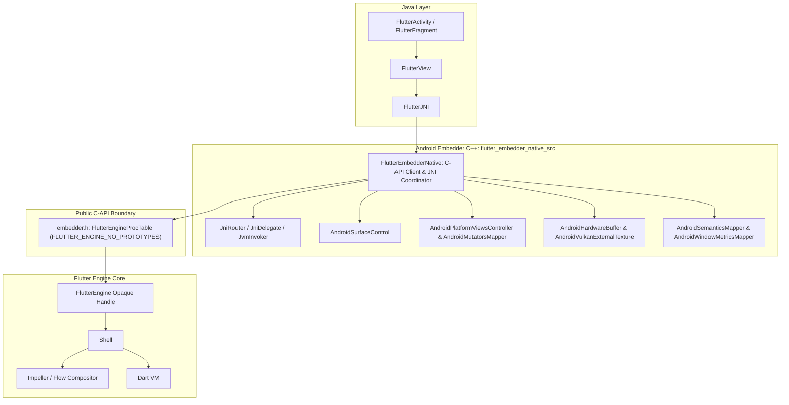

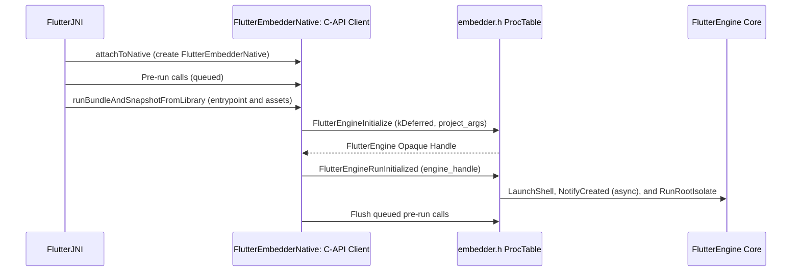

### Pure Embedder API Client (`FLUTTER_ENGINE_NO_PROTOTYPES`)

In the target architecture:

- `FlutterEmbedderNative` holds only an opaque [`FLUTTER_API_SYMBOL(FlutterEngine)`](https://github.com/flutter/flutter/blob/4762dec4fc9072cd9269814ef36364f35a9a66dc/engine/src/flutter/shell/platform/embedder/embedder.h#L389) handle and dispatches all engine calls through an initialized `FlutterEngineProcTable` (`FlutterEngineGetProcAddresses`).
- The `:flutter_embedder_native_src` GN source set compiles with `defines = [ "FLUTTER_ENGINE_NO_PROTOTYPES" ]`. This enforces at compile time that all C-API symbols are invoked through the function pointer table rather than direct static symbol linkage.
- Event dispatch (touch, window metrics, platform messages, accessibility actions) calls public functions: [`FlutterEngineSendPointerEvent`](https://github.com/flutter/flutter/blob/4762dec4fc9072cd9269814ef36364f35a9a66dc/engine/src/flutter/shell/platform/embedder/embedder.h#L3082), [`FlutterEngineSendWindowMetricsEvent`](https://github.com/flutter/flutter/blob/4762dec4fc9072cd9269814ef36364f35a9a66dc/engine/src/flutter/shell/platform/embedder/embedder.h#L3077), [`FlutterEngineSendPlatformMessage`](https://github.com/flutter/flutter/blob/4762dec4fc9072cd9269814ef36364f35a9a66dc/engine/src/flutter/shell/platform/embedder/embedder.h#L3114), and [`FlutterEngineSendSemanticsAction`](https://github.com/flutter/flutter/blob/4762dec4fc9072cd9269814ef36364f35a9a66dc/engine/src/flutter/shell/platform/embedder/embedder.h#L3330-L3336).
- Engine initialization delegates thread creation to the engine via [`FlutterEngineInitialize`](https://github.com/flutter/flutter/blob/4762dec4fc9072cd9269814ef36364f35a9a66dc/engine/src/flutter/shell/platform/embedder/embedder.h#L2970) and [`FlutterEngineRunInitialized`](https://github.com/flutter/flutter/blob/4762dec4fc9072cd9269814ef36364f35a9a66dc/engine/src/flutter/shell/platform/embedder/embedder.h#L3006).

### Decomposition and Elimination of [`AndroidShellHolder`](https://github.com/flutter/flutter/blob/4762dec4fc9072cd9269814ef36364f35a9a66dc/engine/src/flutter/shell/platform/android/android_shell_holder.h#L38) and [`PlatformViewAndroid`](https://github.com/flutter/flutter/blob/4762dec4fc9072cd9269814ef36364f35a9a66dc/engine/src/flutter/shell/platform/android/platform_view_android.h#L43)

In the legacy architecture, the native Android embedding is split across three tightly coupled classes that reach directly into 9 internal engine subsystems (98 internal headers):

1. [`PlatformViewAndroidJNIImpl`](https://github.com/flutter/flutter/blob/4762dec4fc9072cd9269814ef36364f35a9a66dc/engine/src/flutter/shell/platform/android/platform_view_android_jni_impl.cc): A monolithic JNI binding file that directly casts `jlong` handles to `AndroidShellHolder*` and calls internal C++ methods across `Shell` and `PlatformViewAndroid`.
2. [`AndroidShellHolder`](https://github.com/flutter/flutter/blob/4762dec4fc9072cd9269814ef36364f35a9a66dc/engine/src/flutter/shell/platform/android/android_shell_holder.h#L38): The legacy C++ orchestrator instantiated by [`FlutterJNI`](https://github.com/flutter/flutter/blob/4762dec4fc9072cd9269814ef36364f35a9a66dc/engine/src/flutter/shell/platform/android/io/flutter/embedding/engine/FlutterJNI.java#L108). It allocates `fml::ThreadHost`, instantiates [`flutter::Shell`](https://github.com/flutter/flutter/blob/4762dec4fc9072cd9269814ef36364f35a9a66dc/engine/src/flutter/shell/common/shell.h#L113), and owns [`PlatformViewAndroid`](https://github.com/flutter/flutter/blob/4762dec4fc9072cd9269814ef36364f35a9a66dc/engine/src/flutter/shell/platform/android/platform_view_android.h#L43).
3. [`PlatformViewAndroid`](https://github.com/flutter/flutter/blob/4762dec4fc9072cd9269814ef36364f35a9a66dc/engine/src/flutter/shell/platform/android/platform_view_android.h#L43): An internal engine class subclassing [`flutter::PlatformView`](https://github.com/flutter/flutter/blob/4762dec4fc9072cd9269814ef36364f35a9a66dc/engine/src/flutter/shell/common/platform_view.h) that centralizes window surfaces, platform view composition, external textures, and semantics.

In the completed target architecture, [`AndroidShellHolder`](https://github.com/flutter/flutter/blob/4762dec4fc9072cd9269814ef36364f35a9a66dc/engine/src/flutter/shell/platform/android/android_shell_holder.h#L38), [`PlatformViewAndroid`](https://github.com/flutter/flutter/blob/4762dec4fc9072cd9269814ef36364f35a9a66dc/engine/src/flutter/shell/platform/android/platform_view_android.h#L43), and [`PlatformViewAndroidJNIImpl`](https://github.com/flutter/flutter/blob/4762dec4fc9072cd9269814ef36364f35a9a66dc/engine/src/flutter/shell/platform/android/platform_view_android_jni_impl.cc) are completely deleted. In their place, `:flutter_embedder_native_src` organizes the Android embedder into a clean coordinator-component architecture:

- `FlutterEmbedderNative` (`flutter_embedder_native.cc` / `flutter_embedder_native.h`): Is the exclusive top-level JNI coordinator (`FlutterEmbedderNative::RegisterJni(env)` in [`library_loader.cc`](https://github.com/flutter/flutter/blob/4762dec4fc9072cd9269814ef36364f35a9a66dc/engine/src/flutter/shell/platform/android/library_loader.cc#L12)). It owns the opaque [`FLUTTER_API_SYMBOL(FlutterEngine)`](https://github.com/flutter/flutter/blob/4762dec4fc9072cd9269814ef36364f35a9a66dc/engine/src/flutter/shell/platform/embedder/embedder.h#L389) handle, manages the `FlutterEngineProcTable`, and coordinates the modular subsystem components.
- `JniRouter`, `JniDelegate`, and `JvmInvoker` (`jni_router.h`, `jni_delegate.h`, `jvm_invoker.h`): Decouple outbound C++-to-Java JNI invocations from live Android `JNIEnv*` state through injectable delegate and provider interfaces (`FlutterJniProvider`, `HardwareBufferProvider`, `SurfaceControlProvider`, `SurfaceTransactionProvider`, and `ChoreographerProvider`). This allows the entire C-API embedder (`flutter_embedder_native_unittests`) to be unit-tested on the host machine without an Android JVM or device.
- `AndroidSurfaceControl` (`android_surface_control.cc`): Coordinates native window surfaces ([`ANativeWindow`](https://developer.android.com/ndk/reference/group/a-native-window)) and NDK [`ASurfaceControl`](https://developer.android.com/ndk/reference/group/surface-control) / [`ASurfaceTransaction`](https://developer.android.com/ndk/reference/group/surface-control) pipelines keyed by `FlutterViewId`, and implements the window ownership contract: in [`surfaceDestroyed()`](https://developer.android.com/reference/android/view/SurfaceHolder.Callback#surfaceDestroyed(android.view.SurfaceHolder)) it stops handing out backing stores and waits only for the frame in flight before it releases the window.
- `AndroidPlatformViewsController` and `AndroidMutatorsMapper` (`android_platform_views_controller.cc`, `android_mutators_mapper.cc`): Manage platform view composition across Hybrid Composition (HC), Hybrid Composition++ (HCPP via `SurfaceControl` on API 34+), Texture Layer Hybrid Composition (TLHC), and Virtual Display (VD), deserialize [`FlutterPlatformViewMutation`](https://github.com/flutter/flutter/blob/4762dec4fc9072cd9269814ef36364f35a9a66dc/engine/src/flutter/shell/platform/embedder/embedder.h#L2083-L2092) arrays, capture per-[`FlutterViewId`](https://github.com/flutter/flutter/blob/4762dec4fc9072cd9269814ef36364f35a9a66dc/engine/src/flutter/shell/platform/embedder/embedder.h#L395) frame state by value to prevent cross-thread multi-view races, and attach exported Vulkan acquire fences to `SurfaceControl.Transaction` commits.
- `AndroidHardwareBuffer` and `AndroidVulkanExternalTexture` (`android_hardware_buffer.cc`, `android_vulkan_external_texture.cc`): Manage [`SurfaceTexture`](https://developer.android.com/reference/android/graphics/SurfaceTexture) and `EGLImageKHR` (OpenGL ES) with UV transformation matrices (`FlutterOpenGLExternalTexture` and `FlutterOpenGLTextureFrameCallback`) and zero-copy [`SurfaceProducer`](https://github.com/flutter/flutter/blob/4762dec4fc9072cd9269814ef36364f35a9a66dc/engine/src/flutter/shell/platform/android/io/flutter/view/TextureRegistry.java#L21) ([`AHardwareBuffer`](https://developer.android.com/ndk/reference/group/a-hardware-buffer) imported into `VkImage` on Vulkan) texture callbacks (`FlutterVulkanExternalTexture`, `FlutterVulkanYcbcrConversionInfo`, and `FlutterVulkanTextureFrameCallback`).
- `AndroidSemanticsMapper` and `AndroidWindowMetricsMapper` (`android_semantics_mapper.cc`, `android_window_metrics_mapper.cc`): Translate [`FlutterSemanticsUpdate2`](https://github.com/flutter/flutter/blob/4762dec4fc9072cd9269814ef36364f35a9a66dc/engine/src/flutter/shell/platform/embedder/embedder.h#L1868-L1881) trees into JNI byte buffers for Java [`AccessibilityBridge`](https://github.com/flutter/flutter/blob/4762dec4fc9072cd9269814ef36364f35a9a66dc/engine/src/flutter/shell/platform/android/io/flutter/view/AccessibilityBridge.java#L80) and pack viewport metrics, insets, corner radii, and foldable display features into [`FlutterWindowMetricsEvent`](https://github.com/flutter/flutter/blob/4762dec4fc9072cd9269814ef36364f35a9a66dc/engine/src/flutter/shell/platform/embedder/embedder.h#L1062-L1110).
- `AndroidVsyncWaiter` (`android_vsync_waiter.cc`): Bridges Android NDK [`AChoreographer`](https://developer.android.com/ndk/reference/group/choreographer) and Java [`Choreographer`](https://developer.android.com/reference/android/view/Choreographer) frame callbacks to `FlutterProjectArgs.vsync_callback` and forwards frame pacing timestamps via `FlutterEngineOnVsync`.
- `AndroidVMInit` and `AndroidEngineGroup` (`android_vm_init.cc`, `android_engine_group.cc`): Coordinate initial Dart VM argument synthesis, Linux thread priority tuning ([`thread_priority_setter`](https://github.com/flutter/flutter/blob/4762dec4fc9072cd9269814ef36364f35a9a66dc/engine/src/flutter/shell/platform/embedder/embedder.h#L1975)), and multi-engine group spawning via `FlutterEngineSpawn`.
- [`APKAssetProvider`](https://github.com/flutter/flutter/blob/4762dec4fc9072cd9269814ef36364f35a9a66dc/engine/src/flutter/shell/platform/android/apk_asset_provider.h#L26) ([`apk_asset_provider.cc`](https://github.com/flutter/flutter/blob/4762dec4fc9072cd9269814ef36364f35a9a66dc/engine/src/flutter/shell/platform/android/apk_asset_provider.cc)): Implements `FlutterCustomAssetResolver` to stream kernel blobs and application assets directly from Android APK or AAB archives via NDK [`AAssetManager`](https://developer.android.com/ndk/reference/group/asset) memory mapping without disk extraction.

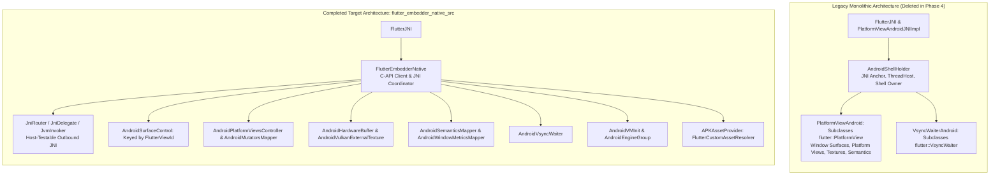

#### Mapping Embedder C-APIs to Target Architecture Components

The extensions to [`embedder.h`](https://github.com/flutter/flutter/blob/4762dec4fc9072cd9269814ef36364f35a9a66dc/engine/src/flutter/shell/platform/embedder/embedder.h) correspond directly to severing private engine headers and uncoupling each internal subsystem into an independent target component:

| Target Component | Eliminated Internal Engine Dependencies | Required Embedder C-API Additions | Architectural Decoupling Benefit |
| :--- | :--- | :--- | :--- |
| **`FlutterEmbedderNative`, `AndroidVMInit`, and `AndroidEngineGroup`** | [`//flutter/shell/common`](https://github.com/flutter/flutter/tree/4762dec4fc9072cd9269814ef36364f35a9a66dc/engine/src/flutter/shell/common) ([`shell.h`](https://github.com/flutter/flutter/blob/4762dec4fc9072cd9269814ef36364f35a9a66dc/engine/src/flutter/shell/common/shell.h), [`run_configuration.h`](https://github.com/flutter/flutter/blob/4762dec4fc9072cd9269814ef36364f35a9a66dc/engine/src/flutter/shell/common/run_configuration.h))<br>[`//flutter/runtime`](https://github.com/flutter/flutter/tree/4762dec4fc9072cd9269814ef36364f35a9a66dc/engine/src/flutter/runtime) ([`dart_vm.h`](https://github.com/flutter/flutter/blob/4762dec4fc9072cd9269814ef36364f35a9a66dc/engine/src/flutter/runtime/dart_vm.h), [`dart_service_isolate.h`](https://github.com/flutter/flutter/blob/4762dec4fc9072cd9269814ef36364f35a9a66dc/engine/src/flutter/runtime/dart_service_isolate.h))<br>[`//flutter/lib/ui`](https://github.com/flutter/flutter/tree/4762dec4fc9072cd9269814ef36364f35a9a66dc/engine/src/flutter/lib/ui) ([`platform_message.h`](https://github.com/flutter/flutter/blob/4762dec4fc9072cd9269814ef36364f35a9a66dc/engine/src/flutter/lib/ui/window/platform_message.h), [`callback_cache.h`](https://github.com/flutter/flutter/blob/4762dec4fc9072cd9269814ef36364f35a9a66dc/engine/src/flutter/lib/ui/plugins/callback_cache.h), [`image_generator.h`](https://github.com/flutter/flutter/blob/4762dec4fc9072cd9269814ef36364f35a9a66dc/engine/src/flutter/lib/ui/painting/image_generator.h))<br>[`//flutter/txt`](https://github.com/flutter/flutter/tree/4762dec4fc9072cd9269814ef36364f35a9a66dc/engine/src/flutter/txt) | - `FlutterEngineInitialize` / `FlutterEngineRunInitialized`<br>- [`FlutterEngineSpawn`](#multi-engine-spawning-and-add-to-app-flutterenginespawn) (`FlutterEngineSpawnInfo`)<br>- `FlutterProjectArgs.enable_direct_platform_message_dispatch`<br>- `FlutterProjectArgs.request_dart_deferred_library_callback`, `FlutterEngineLoadDartDeferredLibrary` & `FlutterEngineNotifyDartDeferredLibraryLoadError`<br>- `FlutterProjectArgs.image_generators` (`FlutterImageGeneratorRegistration`)<br>- `FlutterEnginePrefetchDefaultFontManager` & `FlutterProjectArgs.vm_service_uri_callback` (`FlutterVMServiceUriCallback`) | Holds only an opaque handle [`FLUTTER_API_SYMBOL(FlutterEngine)`](https://github.com/flutter/flutter/blob/4762dec4fc9072cd9269814ef36364f35a9a66dc/engine/src/flutter/shell/platform/embedder/embedder.h#L389) invoked via `FlutterEngineProcTable` (`FLUTTER_ENGINE_NO_PROTOTYPES`). Completely eliminates `AndroidShellHolder` and `PlatformViewAndroid`. |
| **`AndroidSurfaceControl`** | [`//flutter/shell/common`](https://github.com/flutter/flutter/tree/4762dec4fc9072cd9269814ef36364f35a9a66dc/engine/src/flutter/shell/common) ([`platform_view.h`](https://github.com/flutter/flutter/blob/4762dec4fc9072cd9269814ef36364f35a9a66dc/engine/src/flutter/shell/common/platform_view.h), [`rasterizer.h`](https://github.com/flutter/flutter/blob/4762dec4fc9072cd9269814ef36364f35a9a66dc/engine/src/flutter/shell/common/rasterizer.h))<br>[`//flutter/impeller`](https://github.com/flutter/flutter/tree/4762dec4fc9072cd9269814ef36364f35a9a66dc/engine/src/flutter/impeller) (context setup headers)<br>[`//flutter/vulkan`](https://github.com/flutter/flutter/tree/4762dec4fc9072cd9269814ef36364f35a9a66dc/engine/src/flutter/vulkan) ([`vulkan_native_surface_android.h`](https://github.com/flutter/flutter/blob/4762dec4fc9072cd9269814ef36364f35a9a66dc/engine/src/flutter/vulkan/vulkan_native_surface_android.h)) | - `kDeferred` ([`FlutterDeferredRendererConfig`](#deferred-backend-selection-kdeferred), `FlutterRendererResolveInfo`)<br>- [`FlutterCompositor.avoid_backing_store_cache`](#window-ownership-contract) window ownership contract<br>- [`FlutterEngineNotifyLowMemoryWarning`](#releasing-transient-rendering-caches-flutterenginenotifylowmemorywarning) (extended `Rasterizer::NotifyLowMemoryWarning()`)<br>- [`FlutterEngineAddView`](https://github.com/flutter/flutter/blob/4762dec4fc9072cd9269814ef36364f35a9a66dc/engine/src/flutter/shell/platform/embedder/embedder.h#L3035-L3037) & [`FlutterEngineRemoveView`](https://github.com/flutter/flutter/blob/4762dec4fc9072cd9269814ef36364f35a9a66dc/engine/src/flutter/shell/platform/embedder/embedder.h#L3062)<br>- `FlutterOpenGLRendererConfig` & `FlutterVulkanRendererConfig` | Replaces protected surface methods on `PlatformViewAndroid`. Keys native surfaces (`ANativeWindow*`, `ASurfaceControl*`) by `FlutterViewId` for multi-window support, and releases each view's window on `surfaceDestroyed` without an engine round trip. |
| **`AndroidPlatformViewsController` and `AndroidMutatorsMapper`** | [`//flutter/flow`](https://github.com/flutter/flutter/tree/4762dec4fc9072cd9269814ef36364f35a9a66dc/engine/src/flutter/flow) ([`embedded_views.h`](https://github.com/flutter/flutter/blob/4762dec4fc9072cd9269814ef36364f35a9a66dc/engine/src/flutter/flow/embedded_views.h), [`surface.h`](https://github.com/flutter/flutter/blob/4762dec4fc9072cd9269814ef36364f35a9a66dc/engine/src/flutter/flow/surface.h))<br>[`//flutter/fml`](https://github.com/flutter/flutter/tree/4762dec4fc9072cd9269814ef36364f35a9a66dc/engine/src/flutter/fml) ([`raster_thread_merger.h`](https://github.com/flutter/flutter/blob/4762dec4fc9072cd9269814ef36364f35a9a66dc/engine/src/flutter/fml/raster_thread_merger.h)) | - `FlutterCompositor` (`create_backing_store_callback`, `present_view_callback`, `avoid_backing_store_cache`, `platform_view_mutation_capabilities`, [`merge_raster_thread_on_platform_views`](#opt-in-dynamic-raster-thread-merging-for-hybrid-composition-merge_raster_thread_on_platform_views))<br>- `FlutterBackingStoreConfig.is_root_layer`<br>- `FlutterPlatformView` (`mutations`)<br>- `FlutterPlatformViewMutation`, `FlutterPlatformViewMutationCapability`, and `FlutterPath` | Unifies platform view composition behind `FlutterCompositor` without subclassing `flutter::ExternalViewEmbedder`. Delegates dynamic raster thread merging for HC to `EmbedderExternalViewEmbedder`, captures per-`FlutterViewId` frame state by value, and eliminates `external_view_embedder/` from `shell/platform/android/`. |
| **`AndroidHardwareBuffer` and `AndroidVulkanExternalTexture`** | [`//flutter/common/graphics`](https://github.com/flutter/flutter/tree/4762dec4fc9072cd9269814ef36364f35a9a66dc/engine/src/flutter/common/graphics) ([`texture.h`](https://github.com/flutter/flutter/blob/4762dec4fc9072cd9269814ef36364f35a9a66dc/engine/src/flutter/common/graphics/texture.h), [`gl_context_switch.h`](https://github.com/flutter/flutter/blob/4762dec4fc9072cd9269814ef36364f35a9a66dc/engine/src/flutter/common/graphics/gl_context_switch.h)) | - [`FlutterVulkanExternalTexture`](#external-textures-zero-copy-vulkan-and-opengl-es) (`ycbcr_conversion_info`), [`FlutterVulkanYcbcrConversionInfo`](#external-textures-zero-copy-vulkan-and-opengl-es), and [`FlutterVulkanTextureFrameCallback`](#external-textures-zero-copy-vulkan-and-opengl-es)<br>- [`FlutterOpenGLExternalTexture`](#external-textures-zero-copy-vulkan-and-opengl-es) (`uv_transform`) and [`FlutterOpenGLTextureFrameCallback`](#external-textures-zero-copy-vulkan-and-opengl-es)<br>- [`FlutterEngineMarkExternalTextureFrameAvailable`](https://github.com/flutter/flutter/blob/4762dec4fc9072cd9269814ef36364f35a9a66dc/engine/src/flutter/shell/platform/embedder/embedder.h#L3262-L3264) | Eliminates subclassing of internal C++ `flutter::Texture`. Supports zero-copy `AHardwareBuffer` import into `VkImage` (Vulkan) and `EGLImageKHR` (OpenGL ES) as well as UV transformation matrices for `SurfaceTexture` camera and video streams. |
| **`AndroidSemanticsMapper` and `AndroidWindowMetricsMapper`** | [`//flutter/flow`](https://github.com/flutter/flutter/tree/4762dec4fc9072cd9269814ef36364f35a9a66dc/engine/src/flutter/flow) ([`flow/semantics/semantics_node.h`](https://github.com/flutter/flutter/blob/4762dec4fc9072cd9269814ef36364f35a9a66dc/engine/src/flutter/lib/ui/semantics/semantics_node.h))<br>[`//flutter/lib/ui/window/viewport_metrics.h`](https://github.com/flutter/flutter/blob/4762dec4fc9072cd9269814ef36364f35a9a66dc/engine/src/flutter/lib/ui/window/viewport_metrics.h) | - [`FlutterSemanticsNode2`](https://github.com/flutter/flutter/blob/4762dec4fc9072cd9269814ef36364f35a9a66dc/engine/src/flutter/shell/platform/embedder/embedder.h#L1730-L1783) in-place extension (`FlutterSemanticsRole`, `hit_test_child_count`)<br>- `FlutterWindowMetricsEvent` in-place extension (`FlutterDisplayFeature`, `FlutterEdgeInsets`, `FlutterDisplayCornerRadii`) | Delivers complete accessibility semantics metadata to Java `AccessibilityBridge` and foldable/edge-to-edge metrics to the engine without coupling to internal Flow or `lib/ui` headers. |
| **[`APKAssetProvider`](https://github.com/flutter/flutter/blob/4762dec4fc9072cd9269814ef36364f35a9a66dc/engine/src/flutter/shell/platform/android/apk_asset_provider.h#L26)** | [`//flutter/assets`](https://github.com/flutter/flutter/tree/4762dec4fc9072cd9269814ef36364f35a9a66dc/engine/src/flutter/assets) ([`asset_resolver.h`](https://github.com/flutter/flutter/blob/4762dec4fc9072cd9269814ef36364f35a9a66dc/engine/src/flutter/assets/asset_resolver.h)) | - `FlutterProjectArgs.custom_asset_resolvers`<br>- `FlutterCustomAssetResolver` & `FlutterAssetMapping` | Decouples APK asset loading from internal `flutter::AssetResolver` C++ virtual tables while preserving zero-copy NDK `AAssetManager` memory mapping across hot restarts and split APK installs. |
| **`AndroidVsyncWaiter`** | [`//flutter/shell/common`](https://github.com/flutter/flutter/tree/4762dec4fc9072cd9269814ef36364f35a9a66dc/engine/src/flutter/shell/common) ([`vsync_waiter.h`](https://github.com/flutter/flutter/blob/4762dec4fc9072cd9269814ef36364f35a9a66dc/engine/src/flutter/shell/common/vsync_waiter.h#L24)) | None (uses existing [`FlutterProjectArgs.vsync_callback`](https://github.com/flutter/flutter/blob/4762dec4fc9072cd9269814ef36364f35a9a66dc/engine/src/flutter/shell/platform/embedder/embedder.h#L2678) and [`FlutterEngineOnVsync`](https://github.com/flutter/flutter/blob/4762dec4fc9072cd9269814ef36364f35a9a66dc/engine/src/flutter/shell/platform/embedder/embedder.h#L3366-L3369)) | Replaces internal inheritance from `flutter::VsyncWaiter`. Interacts with Android `AChoreographer` and Java `Choreographer` to forward vsync frame start and target timestamps to `FlutterEngineOnVsync`. |

## Phased Implementation Strategy

To maintain continuous test coverage and avoid architectural traps, the migration is structured into four phases—with Phase 1 (`shell/platform/embedder/`) and Phase 2 (`shell/platform/android/` modularization and GN partitioning) executing in parallel before converging at Phase 3:

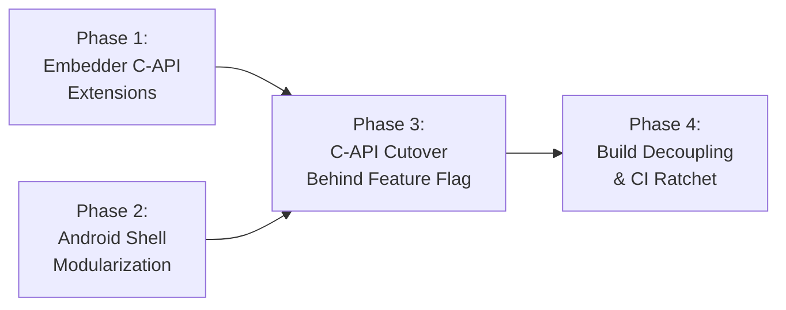

### Phase 1: Embedder C-API Extensions ([`embedder.h`](https://github.com/flutter/flutter/blob/4762dec4fc9072cd9269814ef36364f35a9a66dc/engine/src/flutter/shell/platform/embedder/embedder.h))

All C-API extensions specified in Detailed Design are implemented in [`embedder.h`](https://github.com/flutter/flutter/blob/4762dec4fc9072cd9269814ef36364f35a9a66dc/engine/src/flutter/shell/platform/embedder/embedder.h) and [`embedder.cc`](https://github.com/flutter/flutter/blob/4762dec4fc9072cd9269814ef36364f35a9a66dc/engine/src/flutter/shell/platform/embedder/embedder.cc).

Each new API is validated with automated engine unit tests ([`embedder_unittests`](https://github.com/flutter/flutter/blob/4762dec4fc9072cd9269814ef36364f35a9a66dc/engine/src/flutter/shell/platform/embedder/BUILD.gn#L372-L390)) using mock platform delegates. No Android-specific files are modified in Phase 1.

Phase 1 also includes the engine changes those APIs depend on:

- Renderer resolution in `PlatformViewEmbedder::SetupImpellerContext()`, including the retry and Impeller's known-bad driver check for `kDeferred` configurations.
- Non-blocking rendering surface creation in `PlatformViewEmbedder::NotifyCreated()` (`Shell::OnPlatformViewCreatedAsync()`).
- Opt-in dynamic raster thread merging (`FlutterCompositor.merge_raster_thread_on_platform_views`) in `EmbedderExternalViewEmbedder` (`SupportsDynamicThreadMerging()` and `PostPrerollAction()`).
- Impeller rendering into Vulkan backing stores, which every Vulkan `FlutterCompositor` path on Android needs and `embedder.cc` doesn't implement yet ([#187525](https://github.com/flutter/flutter/issues/187525)).

Because Phase 1 modifies only `shell/platform/embedder/` and `embedder_unittests`, it proceeds in parallel with Phase 2's in-place modularization of `shell/platform/android/`, and both converge before Phase 3 cutover.

### Phase 2: Android Shell Modularization and GN Target Partitioning

Phase 2 reorganizes the Android embedder C++ codebase in-place to establish clean component boundaries before enabling C-API cutover in Phase 3. In the existing architecture, [`AndroidShellHolder`](https://github.com/flutter/flutter/blob/4762dec4fc9072cd9269814ef36364f35a9a66dc/engine/src/flutter/shell/platform/android/android_shell_holder.h#L38) and [`PlatformViewAndroid`](https://github.com/flutter/flutter/blob/4762dec4fc9072cd9269814ef36364f35a9a66dc/engine/src/flutter/shell/platform/android/platform_view_android.h#L43) are monolithic entities that conflate engine execution, platform message delivery, surface lifecycle management, external texture tracking, and platform view composition.

Phase 2 accomplishes two mandatory structural goals:

1. It establishes a hard compile-time firewall in GN (`:flutter_embedder_native_src`) that isolates new C-API code from legacy internal engine headers and enforces `FLUTTER_ENGINE_NO_PROTOTYPES`.
2. It decomposes the monolithic [`PlatformViewAndroid`](https://github.com/flutter/flutter/blob/4762dec4fc9072cd9269814ef36364f35a9a66dc/engine/src/flutter/shell/platform/android/platform_view_android.h#L43) into focused modular components (`FlutterEmbedderNative`, `JniRouter`, `AndroidSurfaceControl`, `AndroidPlatformViewsController`, `AndroidMutatorsMapper`, `AndroidHardwareBuffer`, `AndroidVulkanExternalTexture`, `AndroidSemanticsMapper`, `AndroidWindowMetricsMapper`, `AndroidVsyncWaiter`, `AndroidVMInit`, `AndroidEngineGroup`, and [`APKAssetProvider`](https://github.com/flutter/flutter/blob/4762dec4fc9072cd9269814ef36364f35a9a66dc/engine/src/flutter/shell/platform/android/apk_asset_provider.h#L26)) and decouples them from internal engine classes.

#### Compile-Time Firewall via GN Target Partitioning

To guarantee that new modular components cannot inadvertently include private engine headers (such as [`//flutter/flow`](https://github.com/flutter/flutter/tree/4762dec4fc9072cd9269814ef36364f35a9a66dc/engine/src/flutter/flow), [`//flutter/runtime`](https://github.com/flutter/flutter/tree/4762dec4fc9072cd9269814ef36364f35a9a66dc/engine/src/flutter/runtime), [`//flutter/skia`](https://github.com/flutter/flutter/tree/4762dec4fc9072cd9269814ef36364f35a9a66dc/engine/src/flutter/skia), or [`//flutter/impeller`](https://github.com/flutter/flutter/tree/4762dec4fc9072cd9269814ef36364f35a9a66dc/engine/src/flutter/impeller)), [`shell/platform/android/BUILD.gn`](https://github.com/flutter/flutter/blob/4762dec4fc9072cd9269814ef36364f35a9a66dc/engine/src/flutter/shell/platform/android/BUILD.gn) isolates the new C-API implementation inside `source_set("flutter_embedder_native_src")`:

```gn
# GN Target Partitioning in shell/platform/android/BUILD.gn:

# 1. Modular C-API Source Set (Compile-Time Firewall)
source_set("flutter_embedder_native_src") {
  visibility = [ ":*" ]
  check_includes = true
  defines = [ "FLUTTER_ENGINE_NO_PROTOTYPES" ]

  sources = [
    "android_engine_group.cc",
    "android_engine_group.h",
    "android_hardware_buffer.cc",
    "android_hardware_buffer.h",
    "android_mutators_mapper.cc",
    "android_mutators_mapper.h",
    "android_platform_views_controller.cc",
    "android_platform_views_controller.h",
    "android_semantics_mapper.cc",
    "android_semantics_mapper.h",
    "android_surface_control.cc",
    "android_surface_control.h",
    "android_vm_init.cc",
    "android_vm_init.h",
    "android_vsync_waiter.cc",
    "android_vsync_waiter.h",
    "android_vulkan_external_texture.cc",
    "android_vulkan_external_texture.h",
    "android_window_metrics_mapper.cc",
    "android_window_metrics_mapper.h",
    "apk_asset_provider.cc",
    "apk_asset_provider.h",
    "flutter_embedder_native.cc",
    "flutter_embedder_native.h",
    "jni_delegate.h",
    "jni_router.cc",
    "jni_router.h",
    "jvm_invoker.cc",
    "jvm_invoker.h",
  ]

  # Strict dependencies: ONLY public embedder headers and foundational utilities
  deps = [
    "//flutter/assets",
    "//flutter/common",
    "//flutter/fml",
    "//flutter/shell/platform/embedder:embedder_headers",
  ]
}

# 2. Outer Shell Source Set (Reduced to 3 files in Phase 4 once legacy classes are purged)
source_set("flutter_shell_native_src") {
  visibility = [ ":*" ]

  sources = [
    "flutter_main.cc",
    "flutter_main.h",
    "library_loader.cc",
  ]

  public_deps = [
    ":flutter_embedder_native_src",
    "//flutter/fml",
    "//flutter/shell/platform/embedder:embedder_as_internal_library",
  ]
}
```

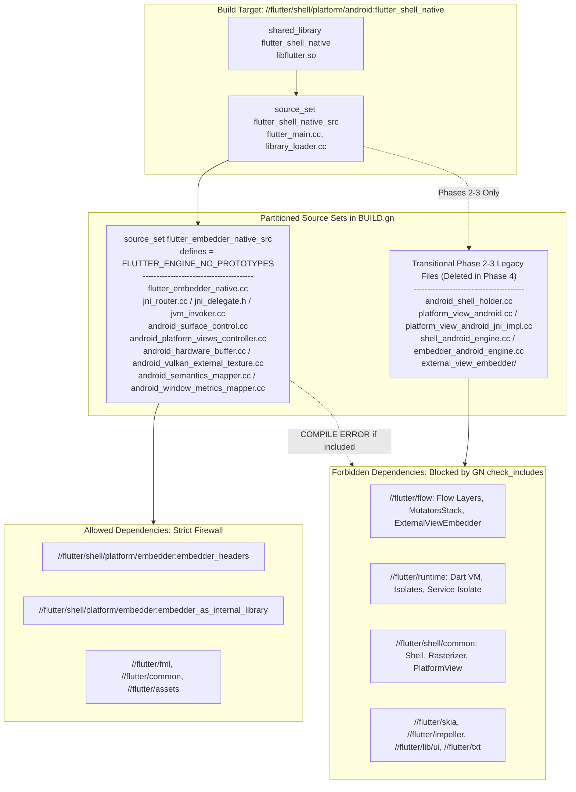

GN enforces `check_includes = true` and `defines = [ "FLUTTER_ENGINE_NO_PROTOTYPES" ]` on `flutter_embedder_native_src`. If any file in `flutter_embedder_native_src` attempts to include a private engine header (such as [`platform_view.h`](https://github.com/flutter/flutter/blob/4762dec4fc9072cd9269814ef36364f35a9a66dc/engine/src/flutter/shell/common/platform_view.h), [`shell.h`](https://github.com/flutter/flutter/blob/4762dec4fc9072cd9269814ef36364f35a9a66dc/engine/src/flutter/shell/common/shell.h), or [`embedded_views.h`](https://github.com/flutter/flutter/blob/4762dec4fc9072cd9269814ef36364f35a9a66dc/engine/src/flutter/flow/embedded_views.h)) or call an `embedder.h` function outside `FlutterEngineProcTable`, the build fails immediately.

#### Elimination and Decomposition of `AndroidShellHolder` and `PlatformViewAndroid`

In the legacy architecture, [`PlatformViewAndroid`](https://github.com/flutter/flutter/blob/4762dec4fc9072cd9269814ef36364f35a9a66dc/engine/src/flutter/shell/platform/android/platform_view_android.h#L43) directly [subclasses the internal engine class `flutter::PlatformView`](https://github.com/flutter/flutter/blob/4762dec4fc9072cd9269814ef36364f35a9a66dc/engine/src/flutter/shell/platform/android/platform_view_android.cc#L151-L160). This inheritance models Android as an internal engine subsystem rather than an external client embedder. Both `AndroidShellHolder` and `PlatformViewAndroid` are eliminated by decomposing their responsibilities across `FlutterEmbedderNative` and the modular components in `:flutter_embedder_native_src`.

In contrast, external embedders communicating via [`embedder.h`](https://github.com/flutter/flutter/blob/4762dec4fc9072cd9269814ef36364f35a9a66dc/engine/src/flutter/shell/platform/embedder/embedder.h) never subclass `flutter::PlatformView`. Instead, the embedder library ([`//flutter/shell/platform/embedder:embedder_as_internal_library`](https://github.com/flutter/flutter/blob/4762dec4fc9072cd9269814ef36364f35a9a66dc/engine/src/flutter/shell/platform/embedder/BUILD.gn#L206)) internally instantiates a generic [`flutter::PlatformViewEmbedder`](https://github.com/flutter/flutter/blob/4762dec4fc9072cd9269814ef36364f35a9a66dc/engine/src/flutter/shell/platform/embedder/platform_view_embedder.h) to satisfy the [`flutter::Shell`](https://github.com/flutter/flutter/blob/4762dec4fc9072cd9269814ef36364f35a9a66dc/engine/src/flutter/shell/common/shell.h#L113) class contract.

#### Lifecycle and Deletion of Legacy Classes (`AndroidShellHolder` and `PlatformViewAndroid`)

[`AndroidShellHolder`](https://github.com/flutter/flutter/blob/4762dec4fc9072cd9269814ef36364f35a9a66dc/engine/src/flutter/shell/platform/android/android_shell_holder.h#L38) and [`PlatformViewAndroid`](https://github.com/flutter/flutter/blob/4762dec4fc9072cd9269814ef36364f35a9a66dc/engine/src/flutter/shell/platform/android/platform_view_android.h#L43) progress across four migration stages culminating in their complete removal:

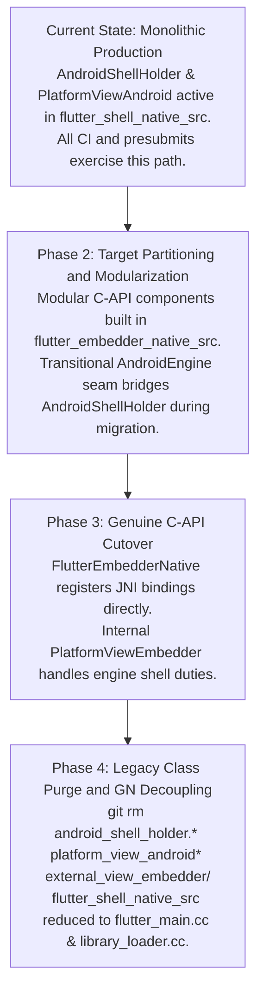

1. **Pre-Migration**: [`AndroidShellHolder`](https://github.com/flutter/flutter/blob/4762dec4fc9072cd9269814ef36364f35a9a66dc/engine/src/flutter/shell/platform/android/android_shell_holder.h#L38) and [`PlatformViewAndroid`](https://github.com/flutter/flutter/blob/4762dec4fc9072cd9269814ef36364f35a9a66dc/engine/src/flutter/shell/platform/android/platform_view_android.h#L43) handle 100% of production traffic and link to 98 internal engine headers.
2. **Phase 2 (Partitioning & Strangler-Fig Seam)**: Modular components are constructed inside `flutter_embedder_native_src` with `check_includes = true` and `FLUTTER_ENGINE_NO_PROTOTYPES`. During incremental slice development, a transitional polymorphic delegate interface (`AndroidEngine`, implemented by `ShellAndroidEngine` and `EmbedderAndroidEngine`) allows individual subsystems to be migrated and tested against [`AndroidShellHolder`](https://github.com/flutter/flutter/blob/4762dec4fc9072cd9269814ef36364f35a9a66dc/engine/src/flutter/shell/platform/android/android_shell_holder.h#L38) without breaking existing [`flutter_shell_native_unittests`](https://github.com/flutter/flutter/blob/4762dec4fc9072cd9269814ef36364f35a9a66dc/engine/src/flutter/shell/platform/android/BUILD.gn#L42-L67).
3. **Phase 3 (C-API Cutover)**: `FlutterEmbedderNative` assumes direct ownership of the [`FlutterJNI`](https://github.com/flutter/flutter/blob/4762dec4fc9072cd9269814ef36364f35a9a66dc/engine/src/flutter/shell/platform/android/io/flutter/embedding/engine/FlutterJNI.java#L108) native bindings (`FlutterEmbedderNative::RegisterJni(env)`) and drives the engine exclusively through [`FlutterEngineProcTable`](https://github.com/flutter/flutter/blob/4762dec4fc9072cd9269814ef36364f35a9a66dc/engine/src/flutter/shell/platform/embedder/embedder.h#L3651-L3827). Inside the core engine, the embedder runtime uses [`PlatformViewEmbedder`](https://github.com/flutter/flutter/blob/4762dec4fc9072cd9269814ef36364f35a9a66dc/engine/src/flutter/shell/platform/embedder/platform_view_embedder.h) and `EmbedderExternalViewEmbedder` to fulfill the shell's internal requirements.
4. **Phase 4 (Legacy Class Purge & Build Decoupling)**: Once `FlutterEmbedderNative` and `flutter_embedder_native_unittests` reach full parity, [`AndroidShellHolder`](https://github.com/flutter/flutter/blob/4762dec4fc9072cd9269814ef36364f35a9a66dc/engine/src/flutter/shell/platform/android/android_shell_holder.h#L38), [`PlatformViewAndroid`](https://github.com/flutter/flutter/blob/4762dec4fc9072cd9269814ef36364f35a9a66dc/engine/src/flutter/shell/platform/android/platform_view_android.h#L43), [`PlatformViewAndroidJNIImpl`](https://github.com/flutter/flutter/blob/4762dec4fc9072cd9269814ef36364f35a9a66dc/engine/src/flutter/shell/platform/android/platform_view_android_jni_impl.cc), `AndroidEngine`, `ShellAndroidEngine`, `EmbedderAndroidEngine`, and [`external_view_embedder/`](https://github.com/flutter/flutter/tree/4762dec4fc9072cd9269814ef36364f35a9a66dc/engine/src/flutter/shell/platform/android/external_view_embedder) are permanently deleted from the repository (`legacy-class-purge`). [`:flutter_shell_native_src`](https://github.com/flutter/flutter/blob/4762dec4fc9072cd9269814ef36364f35a9a66dc/engine/src/flutter/shell/platform/android/BUILD.gn#L85) is reduced to just three files ([`flutter_main.cc`](https://github.com/flutter/flutter/blob/4762dec4fc9072cd9269814ef36364f35a9a66dc/engine/src/flutter/shell/platform/android/flutter_main.cc), [`flutter_main.h`](https://github.com/flutter/flutter/blob/4762dec4fc9072cd9269814ef36364f35a9a66dc/engine/src/flutter/shell/platform/android/flutter_main.h#L17), and [`library_loader.cc`](https://github.com/flutter/flutter/blob/4762dec4fc9072cd9269814ef36364f35a9a66dc/engine/src/flutter/shell/platform/android/library_loader.cc#L12)), and the Android embedder retains zero subclassing of internal engine classes.

### Phase 3: Genuine C-API Cutover (`FlutterEmbedderNative`)

In Phase 3, `FlutterEmbedderNative` initializes [`FlutterEngine`](https://github.com/flutter/flutter/blob/4762dec4fc9072cd9269814ef36364f35a9a66dc/engine/src/flutter/shell/platform/embedder/embedder.h#L389) via [`FlutterEngineInitialize`](https://github.com/flutter/flutter/blob/4762dec4fc9072cd9269814ef36364f35a9a66dc/engine/src/flutter/shell/platform/embedder/embedder.h#L2970) and [`FlutterEngineRunInitialized`](https://github.com/flutter/flutter/blob/4762dec4fc9072cd9269814ef36364f35a9a66dc/engine/src/flutter/shell/platform/embedder/embedder.h#L3006) through `FlutterEngineProcTable`.

Event dispatch routes directly to public C-API entry points:

- Touch events: [`FlutterEngineSendPointerEvent`](https://github.com/flutter/flutter/blob/4762dec4fc9072cd9269814ef36364f35a9a66dc/engine/src/flutter/shell/platform/embedder/embedder.h#L3082)
- Viewport metrics: [`FlutterEngineSendWindowMetricsEvent`](https://github.com/flutter/flutter/blob/4762dec4fc9072cd9269814ef36364f35a9a66dc/engine/src/flutter/shell/platform/embedder/embedder.h#L3077)
- Platform messages: [`FlutterEngineSendPlatformMessage`](https://github.com/flutter/flutter/blob/4762dec4fc9072cd9269814ef36364f35a9a66dc/engine/src/flutter/shell/platform/embedder/embedder.h#L3114)
- Semantics actions: [`FlutterEngineSendSemanticsAction`](https://github.com/flutter/flutter/blob/4762dec4fc9072cd9269814ef36364f35a9a66dc/engine/src/flutter/shell/platform/embedder/embedder.h#L3330-L3336)
- Texture registrations: [`FlutterEngineRegisterExternalTexture`](https://github.com/flutter/flutter/blob/4762dec4fc9072cd9269814ef36364f35a9a66dc/engine/src/flutter/shell/platform/embedder/embedder.h#L3227)
- Compositor and multi-surface presentation: [`FlutterCompositor`](https://github.com/flutter/flutter/blob/4762dec4fc9072cd9269814ef36364f35a9a66dc/engine/src/flutter/shell/platform/embedder/embedder.h#L2264-L2322) layer presentation (`present_view_callback`) coordinating [`SurfaceControl.Transaction`](https://developer.android.com/reference/android/view/SurfaceControl.Transaction) commits via `AndroidSurfaceControl` and `AndroidPlatformViewsController`.

#### Transitional Polymorphic Delegation via `AndroidEngine` (Phases 2–3)

During Phases 2 and 3, before [`AndroidShellHolder`](https://github.com/flutter/flutter/blob/4762dec4fc9072cd9269814ef36364f35a9a66dc/engine/src/flutter/shell/platform/android/android_shell_holder.h#L38) is deleted in Phase 4, incremental subsystem migration is bridged using the transitional `AndroidEngine` seam:

1. **`ShellAndroidEngine` (Legacy Path)**:
   - Directs lifecycle and events to internal engine components: [`flutter::Shell`](https://github.com/flutter/flutter/blob/4762dec4fc9072cd9269814ef36364f35a9a66dc/engine/src/flutter/shell/common/shell.h#L113), [`PlatformViewAndroid`](https://github.com/flutter/flutter/blob/4762dec4fc9072cd9269814ef36364f35a9a66dc/engine/src/flutter/shell/platform/android/platform_view_android.h#L43), and [`fml::ThreadHost`](https://github.com/flutter/flutter/blob/4762dec4fc9072cd9269814ef36364f35a9a66dc/engine/src/flutter/shell/common/thread_host.h#L21).
   - Retains private engine dependencies ([`//flutter/flow`](https://github.com/flutter/flutter/tree/4762dec4fc9072cd9269814ef36364f35a9a66dc/engine/src/flutter/flow), [`//flutter/runtime`](https://github.com/flutter/flutter/tree/4762dec4fc9072cd9269814ef36364f35a9a66dc/engine/src/flutter/runtime), [`//flutter/impeller`](https://github.com/flutter/flutter/tree/4762dec4fc9072cd9269814ef36364f35a9a66dc/engine/src/flutter/impeller)) until Phase 4 deletion.

2. **`EmbedderAndroidEngine` / `FlutterEmbedderNative` (C-API Target Path)**:
   - Encapsulates the opaque [`FlutterEngine`](https://github.com/flutter/flutter/blob/4762dec4fc9072cd9269814ef36364f35a9a66dc/engine/src/flutter/shell/platform/embedder/embedder.h#L389) handle and [`FlutterEngineProcTable`](https://github.com/flutter/flutter/blob/4762dec4fc9072cd9269814ef36364f35a9a66dc/engine/src/flutter/shell/platform/embedder/embedder.h#L3651-L3827).
   - Forwards all operations strictly through the public C-API in [`embedder.h`](https://github.com/flutter/flutter/blob/4762dec4fc9072cd9269814ef36364f35a9a66dc/engine/src/flutter/shell/platform/embedder/embedder.h).
   - Once `FlutterEmbedderNative` registers JNI directly in [`library_loader.cc`](https://github.com/flutter/flutter/blob/4762dec4fc9072cd9269814ef36364f35a9a66dc/engine/src/flutter/shell/platform/android/library_loader.cc#L12), both [`AndroidShellHolder`](https://github.com/flutter/flutter/blob/4762dec4fc9072cd9269814ef36364f35a9a66dc/engine/src/flutter/shell/platform/android/android_shell_holder.h#L38) and the transitional `AndroidEngine` classes become dead code and are removed in Phase 4.

### Phase 4: Build Decoupling and Legacy Class Purge

Once `FlutterEmbedderNative` passes all functional and performance tests, [`BUILD.gn`](https://github.com/flutter/flutter/blob/4762dec4fc9072cd9269814ef36364f35a9a66dc/engine/src/flutter/shell/platform/android/BUILD.gn) and `shell/platform/android/` are permanently decoupled:

- Delete [`AndroidShellHolder`](https://github.com/flutter/flutter/blob/4762dec4fc9072cd9269814ef36364f35a9a66dc/engine/src/flutter/shell/platform/android/android_shell_holder.h#L38), [`PlatformViewAndroid`](https://github.com/flutter/flutter/blob/4762dec4fc9072cd9269814ef36364f35a9a66dc/engine/src/flutter/shell/platform/android/platform_view_android.h#L43), [`PlatformViewAndroidJNIImpl`](https://github.com/flutter/flutter/blob/4762dec4fc9072cd9269814ef36364f35a9a66dc/engine/src/flutter/shell/platform/android/platform_view_android_jni_impl.cc), `AndroidEngine`, `EmbedderAndroidEngine`, `ShellAndroidEngine`, [`VsyncWaiterAndroid`](https://github.com/flutter/flutter/blob/4762dec4fc9072cd9269814ef36364f35a9a66dc/engine/src/flutter/shell/platform/android/vsync_waiter_android.h#L19), [`PlatformMessageHandlerAndroid`](https://github.com/flutter/flutter/blob/4762dec4fc9072cd9269814ef36364f35a9a66dc/engine/src/flutter/shell/platform/android/platform_message_handler_android.h#L18), [`SurfaceTextureExternalTexture`](https://github.com/flutter/flutter/blob/4762dec4fc9072cd9269814ef36364f35a9a66dc/engine/src/flutter/shell/platform/android/surface_texture_external_texture.h#L33), [`ImageExternalTexture`](https://github.com/flutter/flutter/blob/4762dec4fc9072cd9269814ef36364f35a9a66dc/engine/src/flutter/shell/platform/android/image_external_texture.h#L36), and the [`external_view_embedder/`](https://github.com/flutter/flutter/tree/4762dec4fc9072cd9269814ef36364f35a9a66dc/engine/src/flutter/shell/platform/android/external_view_embedder) directory.
- Reduce [`:flutter_shell_native_src`](https://github.com/flutter/flutter/blob/4762dec4fc9072cd9269814ef36364f35a9a66dc/engine/src/flutter/shell/platform/android/BUILD.gn#L85) to [`flutter_main.cc`](https://github.com/flutter/flutter/blob/4762dec4fc9072cd9269814ef36364f35a9a66dc/engine/src/flutter/shell/platform/android/flutter_main.cc), [`flutter_main.h`](https://github.com/flutter/flutter/blob/4762dec4fc9072cd9269814ef36364f35a9a66dc/engine/src/flutter/shell/platform/android/flutter_main.h#L17), and [`library_loader.cc`](https://github.com/flutter/flutter/blob/4762dec4fc9072cd9269814ef36364f35a9a66dc/engine/src/flutter/shell/platform/android/library_loader.cc#L12) (which calls `FlutterEmbedderNative::RegisterJni(env)`).
- Remove dependencies on [`//flutter/runtime`](https://github.com/flutter/flutter/tree/4762dec4fc9072cd9269814ef36364f35a9a66dc/engine/src/flutter/runtime), [`//flutter/flow`](https://github.com/flutter/flutter/tree/4762dec4fc9072cd9269814ef36364f35a9a66dc/engine/src/flutter/flow), [`//flutter/skia`](https://github.com/flutter/flutter/tree/4762dec4fc9072cd9269814ef36364f35a9a66dc/engine/src/flutter/skia), [`//flutter/impeller`](https://github.com/flutter/flutter/tree/4762dec4fc9072cd9269814ef36364f35a9a66dc/engine/src/flutter/impeller), [`//flutter/lib/ui`](https://github.com/flutter/flutter/tree/4762dec4fc9072cd9269814ef36364f35a9a66dc/engine/src/flutter/lib/ui), [`//flutter/txt`](https://github.com/flutter/flutter/tree/4762dec4fc9072cd9269814ef36364f35a9a66dc/engine/src/flutter/txt), and [`//flutter/shell/common`](https://github.com/flutter/flutter/tree/4762dec4fc9072cd9269814ef36364f35a9a66dc/engine/src/flutter/shell/common).
- Restrict dependencies strictly to:
  - [`//flutter/shell/platform/embedder:embedder_headers`](https://github.com/flutter/flutter/blob/4762dec4fc9072cd9269814ef36364f35a9a66dc/engine/src/flutter/shell/platform/embedder/BUILD.gn#L210) and [`//flutter/shell/platform/embedder:embedder_as_internal_library`](https://github.com/flutter/flutter/blob/4762dec4fc9072cd9269814ef36364f35a9a66dc/engine/src/flutter/shell/platform/embedder/BUILD.gn#L206) (with `defines = [ "FLUTTER_ENGINE_NO_PROTOTYPES" ]`)
  - [`//flutter/fml`](https://github.com/flutter/flutter/tree/4762dec4fc9072cd9269814ef36364f35a9a66dc/engine/src/flutter/fml)
  - [`//flutter/common`](https://github.com/flutter/flutter/tree/4762dec4fc9072cd9269814ef36364f35a9a66dc/engine/src/flutter/common)
  - [`//flutter/assets`](https://github.com/flutter/flutter/tree/4762dec4fc9072cd9269814ef36364f35a9a66dc/engine/src/flutter/assets)
- Lock the CI ratchet tool to zero allowed internal headers.

### The Dependency Ratchet Mechanism

In a large codebase with active development, multi-quarter refactoring efforts face persistent regression risks: developers resolving defects or introducing features may inadvertently add new `#include` directives referencing private engine headers, or introduce `// nogncheck` annotations to bypass visibility boundaries.

To enforce that dependency reduction is strictly monotonic throughout the migration, an automated ratchet system operates across three distinct layers:

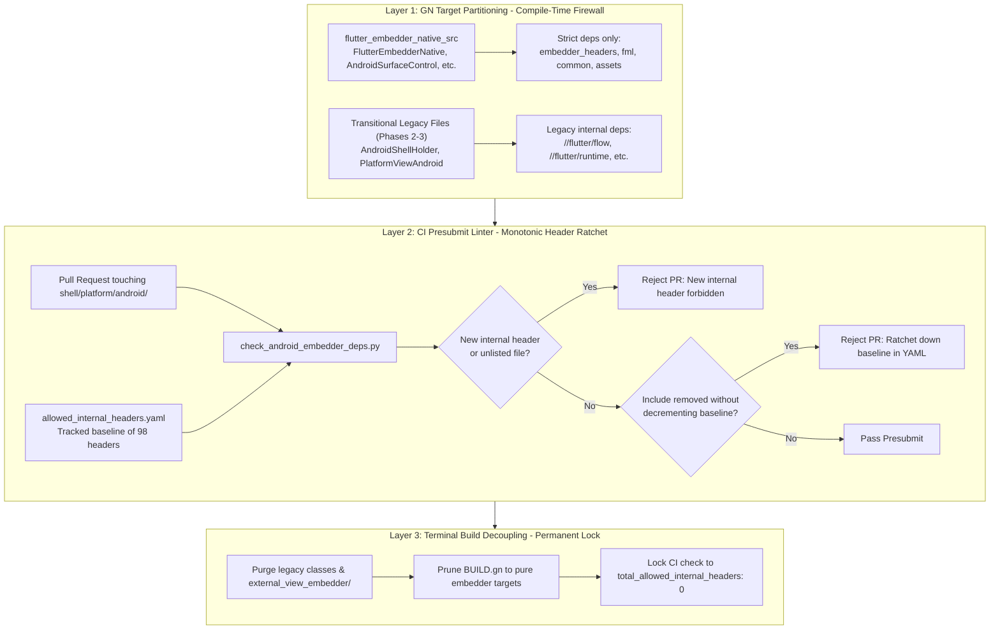

#### Layer 1: GN Target Partitioning (Compile-Time Firewall)

In Phase 2, the Android native source set in [`shell/platform/android/BUILD.gn`](https://github.com/flutter/flutter/blob/4762dec4fc9072cd9269814ef36364f35a9a66dc/engine/src/flutter/shell/platform/android/BUILD.gn) isolates all C-API code in `flutter_embedder_native_src` (`FlutterEmbedderNative`, `JniRouter`, `AndroidSurfaceControl`, `AndroidPlatformViewsController`, `AndroidMutatorsMapper`, `AndroidHardwareBuffer`, `AndroidVulkanExternalTexture`, `AndroidSemanticsMapper`, `AndroidWindowMetricsMapper`, `AndroidVsyncWaiter`, `AndroidVMInit`, `AndroidEngineGroup`, and `APKAssetProvider`). This target sets `defines = [ "FLUTTER_ENGINE_NO_PROTOTYPES" ]` and declares dependencies strictly on [`//flutter/shell/platform/embedder:embedder_headers`](https://github.com/flutter/flutter/blob/4762dec4fc9072cd9269814ef36364f35a9a66dc/engine/src/flutter/shell/platform/embedder/BUILD.gn#L210), [`//flutter/fml`](https://github.com/flutter/flutter/tree/4762dec4fc9072cd9269814ef36364f35a9a66dc/engine/src/flutter/fml), [`//flutter/common`](https://github.com/flutter/flutter/tree/4762dec4fc9072cd9269814ef36364f35a9a66dc/engine/src/flutter/common), and [`//flutter/assets`](https://github.com/flutter/flutter/tree/4762dec4fc9072cd9269814ef36364f35a9a66dc/engine/src/flutter/assets). Because GN evaluates `check_includes = true` during builds, any attempt to include headers from undeclared targets (such as [`//flutter/flow`](https://github.com/flutter/flutter/tree/4762dec4fc9072cd9269814ef36364f35a9a66dc/engine/src/flutter/flow) or [`//flutter/runtime`](https://github.com/flutter/flutter/tree/4762dec4fc9072cd9269814ef36364f35a9a66dc/engine/src/flutter/runtime)) causes a compilation error immediately.

#### Layer 2: Monotonic Header Inclusion Ratchet ([`check_android_embedder_deps.py`](#the-dependency-ratchet-mechanism))

To prevent the quarantined legacy files from accumulating additional internal includes during Phase 2 and Phase 3, an automated presubmit linter enforces a monotonic reduction policy.

The linter references a version-controlled baseline configuration file located at [`shell/platform/android/allowed_internal_headers.yaml`](https://github.com/flutter/flutter/tree/4762dec4fc9072cd9269814ef36364f35a9a66dc/engine/src/flutter/shell/platform/android):

```yaml
version: 1
total_allowed_internal_headers: 98
subsystems:
  impeller:
    count: 29
    allowed_headers:
      - "flutter/impeller/renderer/backend/vulkan/context_vk.h"
      - "flutter/impeller/renderer/backend/gles/context_gles.h"
      - "flutter/impeller/toolkit/android/hardware_buffer.h"
  flow:
    count: 2
    allowed_headers:
      - "flutter/flow/embedded_views.h"
      - "flutter/flow/surface.h"
  engine_core:
    count: 11
    allowed_headers:
      - "flutter/shell/common/shell.h"
      - "flutter/shell/common/thread_host.h"
      - "flutter/shell/common/platform_view.h"
```

The presubmit linter enforces four deterministic rules on incoming pull requests:

1. *Zero new files*: Only source files explicitly registered in [`allowed_internal_headers.yaml`](#the-dependency-ratchet-mechanism) may contain internal engine includes. Any inclusion in an unlisted file fails presubmit.
2. *Zero new headers*: New `#include "flutter/..."` directives not in the allowlist fail presubmit, requiring the API to be routed through [`embedder.h`](https://github.com/flutter/flutter/blob/4762dec4fc9072cd9269814ef36364f35a9a66dc/engine/src/flutter/shell/platform/embedder/embedder.h).
3. *Monotonic decrement*: When an incremental refactoring removes an internal header, the pull request must remove it from `allowed_internal_headers.yaml` and decrement `total_allowed_internal_headers`. Once merged, the ratchet locks the lower count permanently.
4. *No escape hatches*: The linter parses [`shell/platform/android/BUILD.gn`](https://github.com/flutter/flutter/blob/4762dec4fc9072cd9269814ef36364f35a9a66dc/engine/src/flutter/shell/platform/android/BUILD.gn) and rejects modifications introducing `// nogncheck` or widening GN target visibility.

#### Layer 3: Terminal Build Decoupling (Permanent Lock)

Following Phase 3 cutover validation:

1. All legacy classes ([`AndroidShellHolder`](https://github.com/flutter/flutter/blob/4762dec4fc9072cd9269814ef36364f35a9a66dc/engine/src/flutter/shell/platform/android/android_shell_holder.h#L38), [`PlatformViewAndroid`](https://github.com/flutter/flutter/blob/4762dec4fc9072cd9269814ef36364f35a9a66dc/engine/src/flutter/shell/platform/android/platform_view_android.h#L43), [`PlatformViewAndroidJNIImpl`](https://github.com/flutter/flutter/blob/4762dec4fc9072cd9269814ef36364f35a9a66dc/engine/src/flutter/shell/platform/android/platform_view_android_jni_impl.cc), [`external_view_embedder/`](https://github.com/flutter/flutter/tree/4762dec4fc9072cd9269814ef36364f35a9a66dc/engine/src/flutter/shell/platform/android/external_view_embedder)) are deleted from the repository.
2. The allowlist configuration is locked permanently:

   ```yaml
   total_allowed_internal_headers: 0
   subsystems: {}
   ```

3. All internal GN dependencies ([`//flutter/runtime`](https://github.com/flutter/flutter/tree/4762dec4fc9072cd9269814ef36364f35a9a66dc/engine/src/flutter/runtime), [`//flutter/flow`](https://github.com/flutter/flutter/tree/4762dec4fc9072cd9269814ef36364f35a9a66dc/engine/src/flutter/flow), [`//flutter/lib/ui`](https://github.com/flutter/flutter/tree/4762dec4fc9072cd9269814ef36364f35a9a66dc/engine/src/flutter/lib/ui), [`//flutter/impeller`](https://github.com/flutter/flutter/tree/4762dec4fc9072cd9269814ef36364f35a9a66dc/engine/src/flutter/impeller), [`//flutter/skia`](https://github.com/flutter/flutter/tree/4762dec4fc9072cd9269814ef36364f35a9a66dc/engine/src/flutter/skia), [`//flutter/txt`](https://github.com/flutter/flutter/tree/4762dec4fc9072cd9269814ef36364f35a9a66dc/engine/src/flutter/txt), [`//flutter/shell/common`](https://github.com/flutter/flutter/tree/4762dec4fc9072cd9269814ef36364f35a9a66dc/engine/src/flutter/shell/common)) are pruned from [`shell/platform/android/BUILD.gn`](https://github.com/flutter/flutter/blob/4762dec4fc9072cd9269814ef36364f35a9a66dc/engine/src/flutter/shell/platform/android/BUILD.gn).
4. Any future pull request including an internal header will fail both `gn check` at compile time and the presubmit ratchet script, which permanently prevents architectural regressions.

## Verification and Testing Plan

Because Android is Flutter's largest mobile deployment target, verification must confirm that behavioral correctness, performance benchmarks, and accessibility support match the existing embedder.

### Engine Unit Tests (`flutter_embedder_native_unittests`)

- Host-executable C++ unit tests (`flutter_embedder_native_unittests`) for `FlutterEmbedderNative` and each modularized component (`AndroidSurfaceControl`, `AndroidPlatformViewsController`, `AndroidMutatorsMapper`, `AndroidHardwareBuffer`, `AndroidVulkanExternalTexture`, `AndroidSemanticsMapper`, `AndroidWindowMetricsMapper`, `AndroidVsyncWaiter`, `AndroidVMInit`, and `AndroidEngineGroup`) using mock [`FlutterEngineProcTable`](https://github.com/flutter/flutter/blob/4762dec4fc9072cd9269814ef36364f35a9a66dc/engine/src/flutter/shell/platform/embedder/embedder.h#L3651-L3827) entries and injectable `JniDelegate` / `JvmInvoker` provider interfaces without requiring a live Android JVM or device.
- [`embedder_unittests`](https://github.com/flutter/flutter/blob/4762dec4fc9072cd9269814ef36364f35a9a66dc/engine/src/flutter/shell/platform/embedder/BUILD.gn#L372-L390) cases for the engine behavior this RFC adds: `kDeferred` resolution and retry (a rejected Vulkan configuration leads to a second call that returns OpenGL ES), `FlutterEngineRunInitialized` returning while the resolve callback is still running, and opt-in dynamic raster thread merging (`merge_raster_thread_on_platform_views`).
- Unit tests validating the serialization and deserialization of [`FlutterPlatformViewMutation`](https://github.com/flutter/flutter/blob/4762dec4fc9072cd9269814ef36364f35a9a66dc/engine/src/flutter/shell/platform/embedder/embedder.h#L2083-L2092) structs and per-`FlutterViewId` frame state capture.

### Android Integration Tests

- [`flutter_shell_native_unittests`](https://github.com/flutter/flutter/blob/4762dec4fc9072cd9269814ef36364f35a9a66dc/engine/src/flutter/shell/platform/android/BUILD.gn#L42-L67) and `flutter_embedder_native_unittests` executed across the CI test matrix.
- Platform view lifecycle and composition tests verifying Hybrid Composition++ (HCPP with [`SurfaceControl`](https://developer.android.com/reference/android/view/SurfaceControl) on API 34+), legacy Hybrid Composition (HC), Texture Layer Hybrid Composition (TLHC), and Virtual Displays (VD) under both flag configurations.
- Android embedding integration tests verifying JNI message channels, background isolate callbacks, and deferred library loading.
- Activity stop/start and configuration-change loops with HC and HCPP on Vulkan and OpenGL ES, checking that nothing renders into a window after `surfaceDestroyed()` returns and that rendering resumes after `surfaceCreated()`.

### DeviceLab Benchmarks

- Frame pacing and rasterization latency benchmarks (comparing legacy vs C-API) to verify that the C-ABI abstraction does not introduce frame drops or scheduling jitter.
- Platform view scrolling benchmarks across HCPP and HC modes to measure GPU sync fence latency, [`SurfaceControl.Transaction`](https://developer.android.com/reference/android/view/SurfaceControl.Transaction) submission timing, and touch response.
- Startup latency benchmarks on low-end and high-end devices to verify that [`FlutterAssetResolver`](#custom-asset-and-kernel-resolution-apk--in-memory-mapping) memory mapping maintains zero-copy asset loading performance.
- Cold-start traces on low-end and high-end devices that compare when `CreateImpellerContext` runs and the time to first frame, legacy versus C-API, to check that resolving the renderer at `runBundleAndSnapshotFromLibrary()` doesn't delay the first frame.
- Memory after `surfaceDestroyed()`, legacy (`NotifyDestroyed`) versus C-API (`FlutterEngineNotifyLowMemoryWarning`), to check that a hidden engine releases the same GPU memory.

### Golden and Conformance Tests

- Platform view rendering goldens validating that clipping paths, rounded rectangles, and opacity mutators render identically across both compositor modes (HCPP with [`SurfaceControl`](https://developer.android.com/reference/android/view/SurfaceControl) Vulkan and HC) and external-texture modes (TLHC and VD).
- External texture playback verification across video player and camera plugins.
