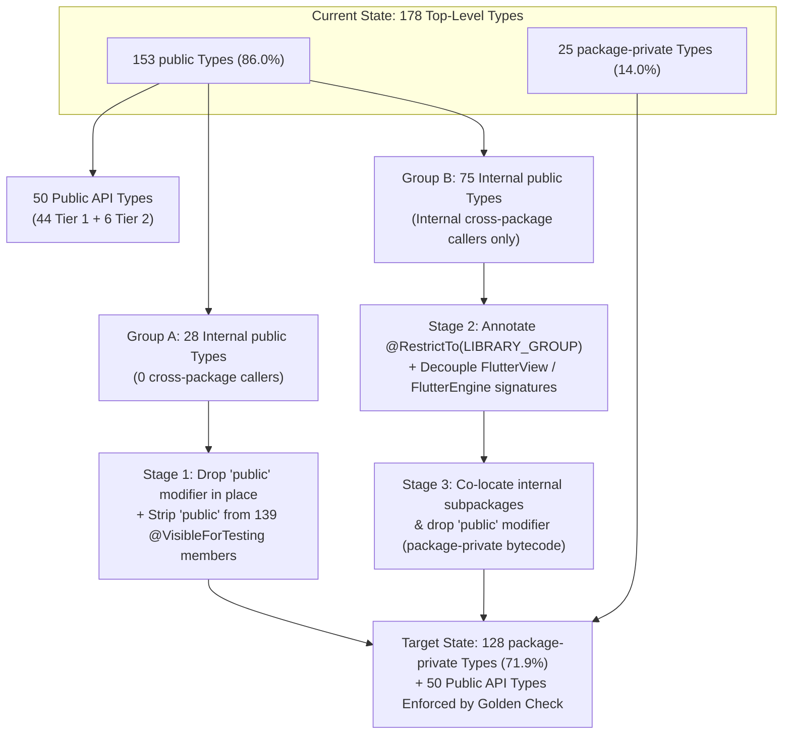

# RFC 410.0000: Flutter Android Embedder Public API Surface and Encapsulation

## Executive Summary

Today, **86.0% (153 of 178)** of all top-level Java classes, interfaces, and enums in the Flutter Android embedder (`engine/src/flutter/shell/platform/android/io/flutter/`) are declared `public`, and the Javadoc generator (`engine/src/flutter/tools/javadoc/gen_javadoc.py`) publishes **20 of 23** packages directly to `https://api.flutter.dev/javadoc/` without filtering out internal implementation details. Because Java's `package-private` visibility does not cross subpackage boundaries, classes that were created purely as internal engine plumbing—such as `FlutterJNI`, `AccessibilityBridge`, `PlatformViewsController`, `TextInputPlugin`, `AndroidTouchProcessor`, `KeyboardManager`, `FlutterMutatorsStack`, and all 22 classes in `io.flutter.embedding.engine.systemchannels`—were declared `public` solely so other packages inside `io.flutter.*` could call them. Furthermore, core public entrypoints such as `FlutterEngine` and `FlutterView` leak internal implementation types through `public` constructors, `public` getters, implemented internal delegate interfaces, and **139** `@VisibleForTesting` annotations that widen package-internal methods to `public`.

This accidental exposure prevents the Flutter Android team from evolving internal architecture (such as migrating from `FlutterJNI` to the C Embedder API, refactoring platform view composition, or consolidating system channels) without risking ecosystem breakage.

This RFC:

1. **Audits real-world usage** of the Android embedder across Add-to-App host applications, all first-party plugins in `flutter/packages`, `flutter/flutter` integration tests and templates, and public GitHub repositories.
2. **Defines the normative Public Android API Surface** (**44** supported top-level types and **6** transitional/deprecated types across **16** packages) required for Add-to-App integration and Android plugin development.
3. **Proposes a phased architecture to lock down all 128 internal top-level types and internal members on public classes as `package-private`**, enforced at both the Java compiler (`javac`) and Android Runtime (ART bytecode verifier) levels, backed by a CI API signature golden test (`public_api.txt`) and restricted Javadoc generation.

---

## Table of Contents

1. [Overview & Goals](#1-overview--goals)
2. [Background & Problem Statement](#2-background--problem-statement)
3. [Empirical Audit of Ecosystem Usage](#3-empirical-audit-of-ecosystem-usage)
4. [Normative Specification: Public Android API Surface](#4-normative-specification-public-android-api-surface)
5. [Member-Level Lockdown on Public Entrypoint Classes](#5-member-level-lockdown-on-public-entrypoint-classes)
6. [Architecture for Locking Down Internal APIs as Package-Private](#6-architecture-for-locking-down-internal-apis-as-package-private)
7. [Tooling, Javadoc, and CI API Governance](#7-tooling-javadoc-and-ci-api-governance)
8. [Rollout & Deprecation Plan](#8-rollout--deprecation-plan)
9. [Alternatives Considered](#9-alternatives-considered)

---

## 1. Overview & Goals

### 1.1 Goals

- **Establish an explicit, minimal Public API Contract**: Define the exact set of packages, classes, interfaces, enums, constructors, and methods in `flutter.jar` that are supported for external consumption by Android app developers (full-Flutter and Add-to-App) and plugin authors.
- **Lock down internal APIs as `package-private`**: Reduce all internal implementation classes, internal constructors, internal helper methods, and `@VisibleForTesting` members from `public` to `package-private` (default Java visibility) so that unauthorized access is rejected at compile time by `javac`/`kotlinc` and at runtime by ART's bytecode verifier.
- **Decouple public classes from internal types**: Eliminate internal types (`FlutterJNI`, `PlatformViewsController`, `MouseCursorPlugin.MouseCursorViewDelegate`, `KeyboardManager.ViewDelegate`, internal `systemchannels`) from the `public` method signatures and `implements` clauses of `FlutterEngine`, `FlutterView`, `FlutterActivity`, `FlutterFragment`, `FlutterRenderer`, `DartExecutor`, and `TextureRegistry`.
- **Remediate existing first-party leaks**: Fix the 4 accidental usages of internal embedder APIs found in `flutter/packages` (`video_player_android`, `google_maps_flutter_android`, `camera_android` / `camera_android_camerax`, and `espresso`).
- **Enforce the boundary in CI and documentation**: Restrict `gen_javadoc.py` to public API symbols and introduce an automated public API surface golden check in CI so no new `public` symbol can be added unintentionally.

### 1.2 Non-Goals

- **Redesigning the v2 plugin or Activity/Fragment embedding architecture**: The existing v2 embedding APIs (`FlutterActivity`, `FlutterFragment`, `FlutterView`, `FlutterEngine`, `FlutterEngineGroup`, `FlutterPlugin`, `ActivityAware`, `MethodChannel`, `PlatformView`, `TextureRegistry`) remain the supported public contract.
- **Modifying the C++ engine or Dart framework wire format**: System channel names and binary message protocols between the Android embedder and the Dart framework are unaffected; only their Java visibility is restricted.

### 1.3 Relationship to Other RFCs

This RFC is a foundational prerequisite and companion to the **Flutter Android Embedder C-API Migration** (`RFC 410.0000`). Migrating the Android embedder's native boundary from direct C++ internals (`FlutterJNI`) to `libflutter_engine.so` requires replacing or refactoring `FlutterJNI`, `PlatformViewsController`, `AccessibilityBridge`, and internal system channels. Locking down those classes as `package-private` ensures that the native boundary can evolve without breaking external callers.

---

## 2. Background & Problem Statement

### 2.1 Quantitative Baseline of `io.flutter.*`

An automated static analysis of all `.java` source files under `engine/src/flutter/shell/platform/android/io/flutter/` reveals the following baseline across **23 packages**:

| Metric | Count | Percentage |
| :--- | ---: | ---: |
| Total Java packages under `io/flutter/` | 23 | 100.0% |
| Packages published to `api.flutter.dev/javadoc/` by `gen_javadoc.py` | 20 | 87.0% |
| Total top-level types (`class`, `interface`, `enum`, `@interface`) | 178 | 100.0% |
| Top-level types currently declared `public` | 153 | 86.0% |
| Top-level types currently declared `package-private` | 25 | 14.0% |
| Top-level `public` types that are **genuinely Public API (Tier 1 + Tier 2)** | 50 | 28.1% |
| Top-level `public` types that are **Internal Implementation (Tier 3)** | 103 | 57.9% |
| `@VisibleForTesting` annotations across `io/flutter/` | 139 | — |

Nearly two-thirds (**103 of 153**) of all `public` top-level types in `flutter.jar` are internal implementation details that were never intended to be part of the public SDK.

### 2.2 Why Internal APIs Became `public`

There are four structural reasons why internal implementation classes and methods became `public` in the Android embedder:

1. **Java Subpackage Visibility Rules**: In Java, subpackages (`io.flutter.embedding.android`, `io.flutter.embedding.engine`, `io.flutter.embedding.engine.systemchannels`, `io.flutter.plugin.editing`, `io.flutter.plugin.platform`, `io.flutter.view`) are completely unrelated visibility scopes. A `package-private` class in `io.flutter.embedding.engine.systemchannels` cannot be referenced by `FlutterEngine` in `io.flutter.embedding.engine` or `FlutterView` in `io.flutter.embedding.android`. When the v2 Android embedding was organized into 23 fine-grained subpackages, every class that crossed a subpackage boundary was marked `public`.
2. **`@VisibleForTesting` Misuse**: Across `io/flutter/`, **139** fields, constructors, and methods are annotated with `@VisibleForTesting` and marked `public` so Robolectric unit tests can access them. However, all unit tests in `engine/src/flutter/shell/platform/android/test/io/flutter/` are already placed in the **exact same Java packages** as the production classes they test. Marking `@VisibleForTesting` members `public` instead of `package-private` unnecessarily exposed over 100 internal methods and test-injection constructors to every consumer of `flutter.jar`.
3. **Public Entrypoints Implementing Internal Delegate Interfaces**: `FlutterView` directly declares `implements MouseCursorPlugin.MouseCursorViewDelegate, KeyboardManager.ViewDelegate`. Because Java requires all interface methods to be `public`, `FlutterView` is forced to expose internal plumbing methods (`getSystemPointerIcon`, `getBinaryMessenger`, `onTextInputKeyEvent`, `redispatch`) as part of its `public` API, and `MouseCursorPlugin` and `KeyboardManager` are forced to remain `public`.
4. **Unfiltered Javadoc Generation**: `engine/src/flutter/tools/javadoc/gen_javadoc.py` passes a hardcoded list of 20 packages to `javadoc` without the `-public` flag and without excluding internal packages. As a result, internal classes like `FlutterMutatorsStack`, `ScribeChannel`, `TextInputPlugin`, `PlatformViewsController`, and `ViewUtils` are published on `https://api.flutter.dev/javadoc/` alongside `FlutterActivity` and `FlutterEngine`, signaling to developers that they are supported APIs.

---

## 3. Empirical Audit of Ecosystem Usage

To ensure the proposed public API surface covers every legitimate integration scenario without breaking existing apps or plugins, we conducted a multi-part audit across:

1. **Official Add-to-App documentation and samples** (`docs.flutter.dev/add-to-app`, `flutter/samples/add_to_app`, and `flutter/flutter/dev/integration_tests/`).
2. **All first-party plugins in `flutter/packages`** (`packages/*/android/src/main/**/*.{java,kt}`).
3. **All Android host apps, templates, and integration tests in `flutter/flutter`** (`packages/flutter_tools/templates/`, `dev/`, `examples/`).
4. **Public GitHub repositories** indexing `import io.flutter.*` in Android host apps and third-party plugins.

### 3.1 Verified Add-to-App Usage Patterns

Add-to-App integrations fall into three levels of customization, each requiring a specific set of public types:

| Integration Level | Scenarios | Required Public Types |
| :--- | :--- | :--- |
| **Level 1: Standard Host Containers** | Launching a full-screen or embedded Flutter screen via `Intent` or `FragmentTransaction`, using single or cached engines, or spawning lightweight engines via `FlutterEngineGroup`. | `FlutterActivity`, `FlutterFragmentActivity`, `FlutterFragment`, `FlutterActivityLaunchConfigs` (`BackgroundMode`), `RenderMode`, `TransparencyMode`, `FlutterEngine`, `FlutterEngineCache`, `FlutterEngineGroup` (`Options`), `FlutterEngineGroupCache`, `FlutterPlayStoreSplitApplication` |
| **Level 2: Custom `Activity`/`Fragment` Lifecycle & Engine Configuration** | Providing or configuring a `FlutterEngine` from a custom host `Activity`/`Fragment`, intercepting back navigation, forwarding activity results/permissions to plugins, or pre-initializing the engine loader. | `FlutterEngineProvider`, `FlutterEngineConfigurator`, `ExclusiveAppComponent`, `ActivityControlSurface`, `FlutterLoader` (`Settings`), `DartExecutor` (`DartEntrypoint`, `DartCallback`, `IsolateServiceIdListener`), `GeneratedPluginRegister` |
| **Level 3: Custom `FlutterView` Host Integration** | Attaching a `FlutterEngine` directly to a `FlutterView` inside a custom Android `ViewGroup` or non-`FlutterActivity` host, managing surface rendering, and forwarding app lifecycle, route navigation, state restoration, and memory pressure events. | `FlutterView`, `FlutterSurfaceView`, `FlutterTextureView`, `FlutterImageView`, `FlutterRenderer` (`ViewportMetrics`, `DisplayFeature`, `DisplayFeatureType`, `DisplayFeatureState`), `FlutterUiDisplayListener`, `RenderSurface`, plus engine lifecycle/navigation/restoration/system notifications (currently accessed via `LifecycleChannel`, `NavigationChannel`, `RestorationChannel`, `SystemChannel` on `FlutterEngine`—see [Section 5.2](#52-flutterengine-encapsulating-internal-channels-and-constructors)) |

### 3.2 Verified Plugin Usage Patterns (`flutter/packages` & Third-Party Ecosystem)

Across all first-party plugins in `flutter/packages` and surveyed third-party plugins on GitHub/pub.dev, plugin usage maps cleanly onto five public subsystems:

1. **Plugin Lifecycle & Component Bindings**:
   - `FlutterPlugin` (`FlutterPluginBinding`, `FlutterAssets`), `PluginRegistry` (`io.flutter.embedding.engine.plugins`).
   - `ActivityAware`, `ActivityPluginBinding` (`OnSaveInstanceStateListener`), and the callback listener interfaces in `io.flutter.plugin.common.PluginRegistry` (`RequestPermissionsResultListener`, `ActivityResultListener`, `NewIntentListener`, `UserLeaveHintListener`, `WindowFocusChangedListener`).
   - `ServiceAware`, `ServicePluginBinding`, `BroadcastReceiverAware`, `BroadcastReceiverPluginBinding`, `ContentProviderAware`, `ContentProviderPluginBinding`.
   - `FlutterLifecycleAdapter` (in `flutter_plugin_android_lifecycle`, which unwraps `HiddenLifecycleReference` from `ActivityPluginBinding.getLifecycle()`).
2. **Platform Channels & Codecs (`io.flutter.plugin.common`)**:
   - `BinaryMessenger` (`TaskQueue`, `TaskQueueOptions`, `BinaryMessageHandler`, `BinaryReply`).
   - `MethodChannel` (`MethodCallHandler`, `Result`), `MethodCall`, `BasicMessageChannel` (`MessageHandler`, `Reply`), `EventChannel` (`StreamHandler`, `EventSink`).
   - `MessageCodec`, `MethodCodec`, `StandardMessageCodec`, `StandardMethodCodec`, `BinaryCodec`, `StringCodec`, `JSONMessageCodec`, `JSONMethodCodec`, `FlutterException` (heavily used both directly and by Pigeon-generated code).
3. **Platform Views (`io.flutter.plugin.platform`)**:
   - `PlatformView`, `PlatformViewFactory`, `PlatformViewRegistry` (used by `webview_flutter_android`, `google_maps_flutter_android`, `video_player_android`, `google_mobile_ads`, etc.).
4. **External Textures (`io.flutter.view` & `io.flutter.embedding.engine.renderer`)**:
   - `TextureRegistry` (`SurfaceProducer`, `SurfaceProducer.Callback`, `SurfaceLifecycle`, `TextureEntry`, `SurfaceTextureEntry`, `ImageTextureEntry`, `OnFrameConsumedListener`, `OnTrimMemoryListener`) and `FlutterRenderer` (used by `camera_android_camerax`, `camera_android`, `video_player_android`).
5. **Background Isolates & Logging (`io.flutter.view` & `io.flutter`)**:
   - `FlutterCallbackInformation` (`lookupCallbackInformation`, used with `DartExecutor.DartCallback` by background isolate plugins such as `workmanager`, `firebase_messaging`, `flutter_local_notifications`, and `geofencing`).
   - `io.flutter.Log` (used by `GeneratedPluginRegistrant` and plugins).

### 3.3 Accidental Internal API Leaks in `flutter/packages` and Their Remediation

Our automated scan of all 31,000+ lines of Java and Kotlin across `flutter/packages` identified **only 4 cases** where first-party plugins reference types outside the public API surface defined in Section 4. Every single one is an accidental bypass of an existing public API:

| Package & File | Internal Symbol Referenced | Root Cause | Remediation |
| :--- | :--- | :--- | :--- |
| `video_player_android` (`VideoPlayerPlugin.java`) & `google_maps_flutter_android` (`Convert.java`) | `FlutterInjector.instance().flutterLoader().getLookupKeyForAsset(...)` | Bypassed `FlutterPluginBinding.getFlutterAssets()` to resolve asset keys via global singleton. | Replace with `FlutterPluginBinding.getFlutterAssets().getAssetFilePathByName(...)` (already passed to `onAttachedToEngine`). |
| `camera_android` (`DeviceOrientationManager.java`, `FocusPointFeature.java`) & `camera_android_camerax` (`DeviceOrientationManager.java`) | `io.flutter.embedding.engine.systemchannels.PlatformChannel.DeviceOrientation` | Imported the engine's internal channel enum solely as a 4-value enum (`PORTRAIT_UP`, `PORTRAIT_DOWN`, `LANDSCAPE_LEFT`, `LANDSCAPE_RIGHT`) and called `.toString()` / `.name()`. | Define a package-local `DeviceOrientation` enum (or Pigeon enum) inside `camera_android` and `camera_android_camerax`. |
| `camera_android` (`NoiseReductionFeature.java`) | `import io.flutter.BuildConfig;` | Unused dead import left over from debugging. | Delete the unused `import` statement. |
| `espresso` (`FlutterViewAction.java`) | `import io.flutter.embedding.engine.FlutterJNI;` | Unused dead import in test action helper. | Delete the unused `import` statement. |

Notably, **zero** first-party plugins in `flutter/packages` reference `AccessibilityBridge`, `PlatformViewsController`, `PlatformViewsController2`, `TextInputPlugin`, `ScribePlugin`, `SpellCheckPlugin`, `MouseCursorPlugin`, `LocalizationPlugin`, `ProcessTextPlugin`, `SensitiveContentPlugin`, `PlatformPlugin`, `AndroidTouchProcessor`, `KeyboardManager`, `FlutterMutatorsStack`, `FlutterMutatorView`, `io.flutter.util.*`, or any class in `io.flutter.embedding.engine.systemchannels` (other than the `DeviceOrientation` enum above).

---

## 4. Normative Specification: Public Android API Surface

Every top-level type in the Flutter Android embedder is classified into one of three tiers:

- **Tier 1 — Public Supported API (44 top-level types)**: Stable, documented public types intended for Add-to-App developers and plugin authors. Retained as `public` and included in Javadoc.
- **Tier 2 — Public Deprecated / Transitional API (6 top-level types)**: Public types that are either already `@Deprecated` (`FlutterApplication`, `FlutterShellArgs`) or retained temporarily as deprecated facades during migration (`LifecycleChannel`, `NavigationChannel`, `RestorationChannel`, `SystemChannel`, `HiddenLifecycleReference`).
- **Tier 3 — Internal Implementation (128 top-level types)**: Internal embedder implementation details (25 already `package-private`, 103 currently `public`). Target state: **`package-private`** and excluded from Javadoc.

### 4.1 Package-Level Visibility Summary

| Package | Total Types | Currently `public` | Target `public` (Tier 1 + Tier 2) | Target `package-private` (Tier 3) | Public Package Status |
| :--- | ---: | ---: | ---: | ---: | :--- |
| `io.flutter` | 4 | 4 | 1 (`Log`) | 3 (`Build`, `BuildConfig`, `FlutterInjector`) | Public (1 class) |
| `io.flutter.app` | 1 | 1 | 1 (`FlutterApplication` — Tier 2 `@Deprecated`) | 0 | Deprecated Legacy |
| `io.flutter.embedding.android` | 28 | 24 | 14 | 14 | Public |
| `io.flutter.embedding.engine` | 8 | 7 | 5 (incl. `FlutterShellArgs` — Tier 2 `@Deprecated`) | 3 (`FlutterEngineConnectionRegistry`, `FlutterJNI`, `FlutterOverlaySurface`) | Public |
| `io.flutter.embedding.engine.dart` | 4 | 3 | 1 (`DartExecutor`) | 3 (`DartMessenger`, `PlatformMessageHandler`, `PlatformTaskQueue`) | Public |
| `io.flutter.embedding.engine.deferredcomponents` | 2 | 2 | 0 | 2 (`DeferredComponentManager`, `PlayStoreDeferredComponentManager`) | **Internal Only** |
| `io.flutter.embedding.engine.flags` | 2 | 2 | 0 | 2 (`FlutterEngineFlags`, `FlutterEngineFlagsProvider`) | **Internal Only** |
| `io.flutter.embedding.engine.image` | 9 | 2 | 0 | 9 (all 9 image decoder/metadata classes) | **Internal Only** |
| `io.flutter.embedding.engine.loader` | 4 | 3 | 1 (`FlutterLoader`) | 3 (`ApplicationInfoLoader`, `FlutterApplicationInfo`, `ResourceExtractor`) | Public |
| `io.flutter.embedding.engine.mutatorsstack` | 2 | 2 | 0 | 2 (`FlutterMutatorView`, `FlutterMutatorsStack`) | **Internal Only** |
| `io.flutter.embedding.engine.plugins` | 2 | 2 | 2 (`FlutterPlugin`, `PluginRegistry`) | 0 | Public |
| `io.flutter.embedding.engine.plugins.activity` | 3 | 3 | 3 (`ActivityAware`, `ActivityControlSurface`, `ActivityPluginBinding`) | 0 | Public |
| `io.flutter.embedding.engine.plugins.broadcastreceiver` | 3 | 3 | 3 (`BroadcastReceiverAware`, `BroadcastReceiverControlSurface`, `BroadcastReceiverPluginBinding`) | 0 | Public |
| `io.flutter.embedding.engine.plugins.contentprovider` | 3 | 3 | 3 (`ContentProviderAware`, `ContentProviderControlSurface`, `ContentProviderPluginBinding`) | 0 | Public |
| `io.flutter.embedding.engine.plugins.lifecycle` | 1 | 1 | 1 (`HiddenLifecycleReference` — Tier 2) | 0 | Transitional |
| `io.flutter.embedding.engine.plugins.service` | 3 | 3 | 3 (`ServiceAware`, `ServiceControlSurface`, `ServicePluginBinding`) | 0 | Public |
| `io.flutter.embedding.engine.plugins.util` | 1 | 1 | 1 (`GeneratedPluginRegister`) | 0 | Public |
| `io.flutter.embedding.engine.renderer` | 6 | 5 | 3 (`FlutterRenderer`, `FlutterUiDisplayListener`, `RenderSurface`) | 3 (`FlutterUiResizeListener`, `SurfaceTextureSurfaceProducer`, `SurfaceTextureWrapper`) | Public |
| `io.flutter.embedding.engine.systemchannels` | 22 | 22 | 0 (4 Tier 2 transitional facades deprecated in favor of `FlutterEngine` methods) | 22 | **Internal Only** |
| `io.flutter.plugin.common` | 17 | 17 | 15 | 2 (`ErrorLogResult`, `JSONUtil`) | Public |
| `io.flutter.plugin.editing` | 8 | 5 | 0 | 8 (all text input, Scribe, and spellcheck classes) | **Internal Only** |
| `io.flutter.plugin.localization` | 1 | 1 | 0 | 1 (`LocalizationPlugin`) | **Internal Only** |
| `io.flutter.plugin.mouse` | 1 | 1 | 0 | 1 (`MouseCursorPlugin`) | **Internal Only** |
| `io.flutter.plugin.platform` | 22 | 16 | 3 (`PlatformView`, `PlatformViewFactory`, `PlatformViewRegistry`) | 19 (all controllers, render targets, wrappers, presentation helpers) | Public (3 types) |
| `io.flutter.plugin.text` | 1 | 1 | 0 | 1 (`ProcessTextPlugin`) | **Internal Only** |
| `io.flutter.plugin.view` | 1 | 1 | 0 | 1 (`SensitiveContentPlugin`) | **Internal Only** |
| `io.flutter.util` | 5 | 5 | 0 | 5 (`HandlerCompat`, `PathUtils`, `Preconditions`, `TraceSection`, `ViewUtils`) | **Internal Only** |
| `io.flutter.view` | 14 | 13 | 2 (`TextureRegistry`, `FlutterCallbackInformation`) | 12 (`AccessibilityBridge`, `VsyncWaiter`, and 10 accessibility configurators) | Public (2 types) |
| **Total (23 Packages)** | **178** | **153 (86.0%)** | **50 (28.1%)** | **128 (71.9%)** | **12 Public / 11 Internal** |

### 4.2 Complete Class-by-Class Normative Classification

#### 4.2.1 `io.flutter` and `io.flutter.app`

| Type | Current Visibility | Target Visibility | Tier | Rationale |
| :--- | :--- | :--- | :--- | :--- |
| `io.flutter.Log` | `public` | `public` | Tier 1 | Used by `GeneratedPluginRegistrant`, plugins, and host apps to configure log levels and log messages. |
| `io.flutter.Build` | `public` | `package-private` | Tier 3 | Internal API-level constants helper (`Build.API_LEVELS`); zero external usage. |
| `io.flutter.BuildConfig` | `public` | `package-private` | Tier 3 | Internal build mode flags (`DEBUG`, `PROFILE`, `RELEASE`, `JIT_RELEASE`). Note: `FlutterEngine` or `FlutterLoader` can expose a public `isDebugBuild()` query if needed by tools. |
| `io.flutter.FlutterInjector` | `public` | `package-private` | Tier 3 | Internal dependency-injection singleton for `FlutterLoader`, `FlutterJNI.Factory`, and `DeferredComponentManager`. External callers should use `FlutterLoader` or `FlutterPluginBinding.getFlutterAssets()`. |
| `io.flutter.app.FlutterApplication` | `public` (`@Deprecated`) | `public` (`@Deprecated`) | Tier 2 | Legacy v1 base `Application` class; already `@Deprecated`, retained only until v1 removal completes. |

#### 4.2.2 `io.flutter.embedding.android`

| Type | Current Visibility | Target Visibility | Tier | Rationale |
| :--- | :--- | :--- | :--- | :--- |
| `FlutterActivity` | `public` | `public` | Tier 1 | Primary Activity host container (`IntentBuilder`, `NewEngineIntentBuilder`, `CachedEngineIntentBuilder`, `NewEngineInGroupIntentBuilder`). |
| `FlutterFragmentActivity` | `public` | `public` | Tier 1 | `FragmentActivity` host container for apps/plugins requiring AndroidX `FragmentActivity`. |
| `FlutterFragment` | `public` | `public` | Tier 1 | Primary Fragment host container (`NewEngineFragmentBuilder`, `CachedEngineFragmentBuilder`, `NewEngineInGroupFragmentBuilder`). |
| `FlutterView` | `public` | `public` | Tier 1 | Primary Android `ViewGroup` rendering a `FlutterEngine`. (Internal delegate interfaces and methods locked down per Section 5.1). |
| `FlutterSurfaceView` | `public` | `public` | Tier 1 | `SurfaceView`-backed `RenderSurface` implementation used by `FlutterView` and custom `FlutterView` constructors. |
| `FlutterTextureView` | `public` | `public` | Tier 1 | `TextureView`-backed `RenderSurface` implementation used by `FlutterView` and custom `FlutterView` constructors. |
| `FlutterImageView` | `public` | `public` | Tier 1 | `ImageReader`-backed `RenderSurface` used for hybrid composition fallbacks and `FlutterView(Context, FlutterImageView)`. |
| `FlutterActivityLaunchConfigs` | `public` | `public` | Tier 1 | Exposes `BackgroundMode` (`opaque`, `transparent`); internal launch intent extra constants made `package-private`. |
| `RenderMode` | `public` | `public` | Tier 1 | Public enum (`surface`, `texture`, `image`) for configuring `FlutterActivity`, `FlutterFragment`, and `FlutterView`. |
| `TransparencyMode` | `public` | `public` | Tier 1 | Public enum (`opaque`, `transparent`) for configuring `FlutterActivity`, `FlutterFragment`, and `FlutterView`. |
| `FlutterEngineProvider` | `public` | `public` | Tier 1 | Add-to-App callback interface implemented by host `Activity`/`Fragment` to provide a custom `FlutterEngine`. |
| `FlutterEngineConfigurator` | `public` | `public` | Tier 1 | Add-to-App callback interface implemented by host `Activity`/`Fragment` to configure a `FlutterEngine` on attach/cleanup. |
| `ExclusiveAppComponent` | `public` | `public` | Tier 1 | Public contract representing an `Activity` (or other exclusive host) attached to `ActivityControlSurface`. |
| `FlutterPlayStoreSplitApplication` | `public` | `public` | Tier 1 | Public `SplitCompatApplication` subclass for Flutter apps using Play Store deferred components. |
| `AndroidTouchProcessor` | `public` | `package-private` | Tier 3 | Internal `MotionEvent`-to-ByteBuffer serializer. |
| `ContentSizingFlag` | `package-private` | `package-private` | Tier 3 | Already `package-private`. |
| `FlutterActivityAndFragmentDelegate` | `package-private` | `package-private` | Tier 3 | Already `package-private`. |
| `FlutterMeasureSpec` | `package-private` | `package-private` | Tier 3 | Already `package-private`. |
| `FlutterViewDelegate` | `public` | `package-private` | Tier 3 | Internal window insets / caption bar helper for `FlutterView`; zero cross-package callers. |
| `IntentUtils` | `package-private` | `package-private` | Tier 3 | Already `package-private`. |
| `KeyChannelResponder` | `public` | `package-private` | Tier 3 | Internal key responder implementation; zero cross-package callers. |
| `KeyData` | `public` | `package-private` | Tier 3 | Internal key event binary packet serializer; zero cross-package callers. |
| `KeyEmbedderResponder` | `public` | `package-private` | Tier 3 | Internal key embedder responder; zero cross-package callers. |
| `KeyboardManager` | `public` | `package-private` | Tier 3 | Internal keyboard dispatch coordinator; only referenced outside package by `TextInputPlugin`. |
| `KeyboardMap` | `public` | `package-private` | Tier 3 | Internal generated keycode mapping table; zero cross-package callers. |
| `MotionEventTracker` | `public` | `package-private` | Tier 3 | Internal `MotionEvent` queue used only by `AndroidTouchProcessor` and `PlatformViewsController`. |
| `SurfaceHolderCallbackCompat` | `public` | `package-private` | Tier 3 | Internal `SurfaceHolder.Callback2` compatibility wrapper; zero cross-package callers. |
| `WindowInfoRepositoryCallbackAdapterWrapper` | `public` | `package-private` | Tier 3 | Internal AndroidX Window wrapper for `FlutterView`; zero cross-package callers. |

#### 4.2.3 `io.flutter.embedding.engine` and Subpackages

| Type | Current Visibility | Target Visibility | Tier | Rationale |
| :--- | :--- | :--- | :--- | :--- |
| `FlutterEngine` | `public` | `public` | Tier 1 | Core engine execution container. (Internal `FlutterJNI` constructors and internal channel/controller getters locked down per Section 5.2). |
| `FlutterEngineCache` | `public` | `public` | Tier 1 | Singleton cache for pre-warmed `FlutterEngine` instances in Add-to-App. |
| `FlutterEngineGroup` (`Options`) | `public` | `public` | Tier 1 | Multi-engine factory sharing heap/GPU resources across multiple `FlutterEngine` instances in Add-to-App. |
| `FlutterEngineGroupCache` | `public` | `public` | Tier 1 | Singleton cache for named `FlutterEngineGroup` instances. |
| `FlutterShellArgs` | `public` (`@Deprecated`) | `public` (`@Deprecated`) | Tier 2 | Already `@Deprecated` (slated for removal per `#193256` in favor of `AndroidManifest.xml` flags). |
| `FlutterEngineConnectionRegistry` | `package-private` | `package-private` | Tier 3 | Already `package-private` implementation of `PluginRegistry` and `*ControlSurface`. |
| `FlutterJNI` | `public` | `package-private` | Tier 3 | Raw JNI bridge to C++ engine. Exposing `FlutterJNI` prevents C-API migration and breaks engine encapsulation. |
| `FlutterOverlaySurface` | `public` | `package-private` | Tier 3 | Internal platform view overlay surface descriptor used only by `FlutterJNI` and `PlatformViewsController`. |
| `dart.DartExecutor` (`DartEntrypoint`, `DartCallback`, `IsolateServiceIdListener`) | `public` | `public` | Tier 1 | Executes Dart entrypoints and callbacks; implements `BinaryMessenger`. (`DartExecutor(FlutterJNI, AssetManager)` constructor made `package-private`). |
| `dart.DartMessenger` | `package-private` | `package-private` | Tier 3 | Already `package-private`. |
| `dart.PlatformMessageHandler` | `public` | `package-private` | Tier 3 | Internal callback interface between `FlutterJNI` and `DartMessenger`. |
| `dart.PlatformTaskQueue` | `public` | `package-private` | Tier 3 | Internal `TaskQueue` implementation; zero cross-package callers. |
| `deferredcomponents.DeferredComponentManager` | `public` | `package-private` | Tier 3 | Internal deferred component contract. |
| `deferredcomponents.PlayStoreDeferredComponentManager` | `public` | `package-private` | Tier 3 | Internal Play Core split-install implementation instantiated by `FlutterPlayStoreSplitApplication`. |
| `flags.FlutterEngineFlags` | `public` | `package-private` | Tier 3 | Internal manifest flag definitions. |
| `flags.FlutterEngineFlagsProvider` | `public` | `package-private` | Tier 3 | Internal interface; zero callers. |
| `image.*` (All 9 classes: `FlutterImageDecoder`, `BitmapMetadataReader`, `ExifMetadataReader`, `ImageDecoderDefaultImpl`, `ImageDecoderHeifApi36Impl`, `ImageDecoderHeifPre36Impl`, `ImageUtils`, `MediaMetadataReader`, `Metadata`) | 2 `public`, 7 `package-private` | All 9 `package-private` | Tier 3 | Internal image decoding helpers invoked exclusively from `FlutterJNI` over JNI. |
| `loader.FlutterLoader` (`Settings`) | `public` | `public` | Tier 1 | Public engine initialization and asset lookup API (`startInitialization`, `ensureInitializationComplete`, `findAppBundlePath`, `getLookupKeyForAsset`). |
| `loader.ApplicationInfoLoader` | `public` | `package-private` | Tier 3 | Internal manifest metadata parser for `FlutterLoader`. |
| `loader.FlutterApplicationInfo` | `public` | `package-private` | Tier 3 | Internal data holder for `ApplicationInfoLoader`. |
| `loader.ResourceExtractor` | `package-private` | `package-private` | Tier 3 | Already `package-private`. |
| `mutatorsstack.FlutterMutatorView` | `public` | `package-private` | Tier 3 | Internal wrapper `FrameLayout` applying clipping/transform matrices to hybrid platform views. |
| `mutatorsstack.FlutterMutatorsStack` | `public` | `package-private` | Tier 3 | Internal transform/clip stack populated by JNI for platform views. |
| `plugins.FlutterPlugin` (`FlutterPluginBinding`, `FlutterAssets`) | `public` | `public` | Tier 1 | Core v2 plugin interface. |
| `plugins.PluginRegistry` | `public` | `public` | Tier 1 | Public registry on `FlutterEngine.getPlugins()` for adding/querying `FlutterPlugin` instances. |
| `plugins.activity.ActivityAware`, `ActivityPluginBinding` (`OnSaveInstanceStateListener`), `ActivityControlSurface` | `public` | `public` | Tier 1 | Public contract for Activity-aware plugins and custom Activity hosts. |
| `plugins.service.ServiceAware`, `ServicePluginBinding`, `ServiceControlSurface` | `public` | `public` | Tier 1 | Public contract for Service-aware plugins and custom Service hosts. |
| `plugins.broadcastreceiver.BroadcastReceiverAware`, `BroadcastReceiverPluginBinding`, `BroadcastReceiverControlSurface` | `public` | `public` | Tier 1 | Public contract for BroadcastReceiver-aware plugins and hosts. |
| `plugins.contentprovider.ContentProviderAware`, `ContentProviderPluginBinding`, `ContentProviderControlSurface` | `public` | `public` | Tier 1 | Public contract for ContentProvider-aware plugins and hosts. |
| `plugins.lifecycle.HiddenLifecycleReference` | `public` | `public` (`@Deprecated` Tier 2) | Tier 2 | Used by `FlutterLifecycleAdapter` in `flutter_plugin_android_lifecycle`. Replaced by adding `default Lifecycle getLifecycle()` directly on `ActivityPluginBinding` and `ServicePluginBinding`, deprecating `HiddenLifecycleReference`, and making its constructor `package-private`. |
| `plugins.util.GeneratedPluginRegister` | `public` | `public` | Tier 1 | Public helper (`registerGeneratedPlugins(FlutterEngine)`) called by custom Add-to-App hosts and `FlutterActivity`. |
| `renderer.FlutterRenderer` (`ViewportMetrics`, `DisplayFeature`, `DisplayFeatureType`, `DisplayFeatureState`) | `public` | `public` | Tier 1 | Public renderer and `TextureRegistry` implementation returned by `FlutterEngine.getRenderer()`. (Internal methods locked down per Section 5.3). |
| `renderer.FlutterUiDisplayListener` | `public` | `public` | Tier 1 | Public callback listener for first-frame rendering notifications (`onFlutterUiDisplayed`, `onFlutterUiNoLongerDisplayed`). |
| `renderer.RenderSurface` | `public` | `public` | Tier 1 | Public interface implemented by `FlutterSurfaceView`, `FlutterTextureView`, and `FlutterImageView`. |
| `renderer.FlutterUiResizeListener` | `public` | `package-private` | Tier 3 | Internal resize callback between `FlutterJNI` and `FlutterView`. |
| `renderer.SurfaceTextureSurfaceProducer` | `package-private` | `package-private` | Tier 3 | Already `package-private`. |
| `renderer.SurfaceTextureWrapper` | `public` | `package-private` | Tier 3 | Internal synchronization wrapper around `SurfaceTexture` used only by `FlutterRenderer` and `FlutterJNI`. |
| `systemchannels.*` (All 22 classes: `AccessibilityChannel`, `BackGestureChannel`, `DeferredComponentChannel`, `KeyEventChannel`, `KeyboardChannel`, `LifecycleChannel`, `LocalizationChannel`, `MouseCursorChannel`, `NavigationChannel`, `PlatformChannel`, `PlatformViewCreationRequest`, `PlatformViewTouch`, `PlatformViewsChannel`, `PlatformViewsChannel2`, `ProcessTextChannel`, `RestorationChannel`, `ScribeChannel`, `SensitiveContentChannel`, `SettingsChannel`, `SpellCheckChannel`, `SystemChannel`, `TextInputChannel`) | All 22 `public` | All 22 `package-private` (4 Tier 2 transitional) | Tier 3 (4 Tier 2) | Wire-protocol system channels between the Android embedder and Flutter framework. The 4 channels documented for custom `FlutterView` hosts (`LifecycleChannel`, `NavigationChannel`, `RestorationChannel`, `SystemChannel`) are superseded by first-class methods on `FlutterEngine` (Section 5.2) and deprecated before becoming `package-private`. |

#### 4.2.4 `io.flutter.plugin.*`, `io.flutter.util.*`, and `io.flutter.view.*`

| Type | Current Visibility | Target Visibility | Tier | Rationale |
| :--- | :--- | :--- | :--- | :--- |
| `plugin.common.BinaryMessenger` (`TaskQueue`, `TaskQueueOptions`, `BinaryMessageHandler`, `BinaryReply`) | `public` | `public` | Tier 1 | Core binary messaging transport for all platform channels and Pigeon APIs. |
| `plugin.common.MethodChannel` (`MethodCallHandler`, `Result`), `MethodCall` | `public` | `public` | Tier 1 | Core asynchronous method invocation channel. |
| `plugin.common.BasicMessageChannel` (`MessageHandler`, `Reply`) | `public` | `public` | Tier 1 | Core typed message channel (used directly and by all Pigeon-generated bindings). |
| `plugin.common.EventChannel` (`StreamHandler`, `EventSink`) | `public` | `public` | Tier 1 | Core event stream channel. |
| `plugin.common.MessageCodec`, `MethodCodec`, `StandardMessageCodec`, `StandardMethodCodec`, `BinaryCodec`, `StringCodec`, `JSONMessageCodec`, `JSONMethodCodec`, `FlutterException` | `public` | `public` | Tier 1 | Standard message and method codecs and exception container. |
| `plugin.common.PluginRegistry` (Listener sub-interfaces: `RequestPermissionsResultListener`, `ActivityResultListener`, `NewIntentListener`, `UserLeaveHintListener`, `WindowFocusChangedListener`, `ViewDestroyListener`) | `public` | `public` | Tier 1 | Activity/permission callback interfaces used by `ActivityPluginBinding`. (Deprecated v1 `Registrar` and `PluginRegistrantCallback` interfaces remain `@Deprecated` until v1 removal). |
| `plugin.common.ErrorLogResult` | `public` | `package-private` | Tier 3 | Internal `MethodChannel.Result` helper; zero cross-package or external callers. |
| `plugin.common.JSONUtil` | `public` | `package-private` | Tier 3 | Internal JSON unwrap/wrap utility for `JSONMessageCodec`; zero cross-package callers. |
| `plugin.editing.*` (All 8 classes: `FlutterTextUtils`, `ImeSyncDeferringInsetsCallback`, `InputConnectionAdaptor`, `ListenableEditingState`, `ScribePlugin`, `SpellCheckPlugin`, `TextEditingDelta`, `TextInputPlugin`) | 5 `public`, 3 `package-private` | All 8 `package-private` | Tier 3 | Internal IME, text input, Scribe stylus, and spellcheck implementation owned by `FlutterView`. |
| `plugin.localization.LocalizationPlugin` | `public` | `package-private` | Tier 3 | Internal locale resolution plugin owned by `FlutterEngine`. |
| `plugin.mouse.MouseCursorPlugin` | `public` | `package-private` | Tier 3 | Internal pointer icon handler owned by `FlutterView`. |
| `plugin.platform.PlatformView`, `PlatformViewFactory`, `PlatformViewRegistry` | `public` | `public` | Tier 1 | The 3 public platform view extensibility types used by plugins to register and provide native Android `View` instances. |
| `plugin.platform.*` (Remaining 19 classes: `AccessibilityEventsDelegate`, `ImageReaderPlatformViewRenderTarget`, `PlatformOverlayView`, `PlatformPlugin`, `PlatformViewGestureTracker`, `PlatformViewRegistryImpl`, `PlatformViewRenderTarget`, `PlatformViewWrapper`, `PlatformViewsAccessibilityDelegate`, `PlatformViewsController`, `PlatformViewsController2`, `PlatformViewsControllerDelegator`, `SingleViewFakeWindowViewGroup`, `SingleViewPresentation`, `SingleViewWindowManager`, `SurfaceProducerPlatformViewRenderTarget`, `SurfaceTexturePlatformViewRenderTarget`, `VirtualDisplayController`, `WindowManagerHandler`) | 13 `public`, 6 `package-private` | All 19 `package-private` | Tier 3 | Internal platform view composition, virtual display, overlay surface, and system UI chrome controllers. |
| `plugin.text.ProcessTextPlugin` | `public` | `package-private` | Tier 3 | Internal Android `ACTION_PROCESS_TEXT` handler. |
| `plugin.view.SensitiveContentPlugin` | `public` | `package-private` | Tier 3 | Internal Android API 35+ sensitive content protection handler. |
| `util.*` (All 5 classes: `HandlerCompat`, `PathUtils`, `Preconditions`, `TraceSection`, `ViewUtils`) | All 5 `public` | All 5 `package-private` | Tier 3 | Internal utility classes (`io.flutter.util.PathUtils` was historically confused with the `path_provider` plugin; all 5 have zero first-party plugin usages). |
| `view.TextureRegistry` (`SurfaceProducer`, `SurfaceProducer.Callback`, `SurfaceLifecycle`, `TextureEntry`, `SurfaceTextureEntry`, `ImageTextureEntry`, `OnFrameConsumedListener`, `OnTrimMemoryListener`) | `public` | `public` | Tier 1 | Core external texture registration API for camera, video, and GPU plugins. (Internal `GLTextureConsumer` and `ImageConsumer` sub-interfaces extracted into `package-private` internal interfaces). |
| `view.FlutterCallbackInformation` | `public` | `public` | Tier 1 | Public JNI callback handle resolver required by `DartExecutor.DartCallback` for background isolates. |
| `view.AccessibilityBridge`, `VsyncWaiter`, and all 10 Accessibility Role Configurators (`AccessibilityNodeConfigurator`, `AccessibilityStringBuilder`, `AccessibilityViewEmbedder`, `BaseRoleConfigurator`, `ClassNameRoleConfigurator`, `ComboBoxRoleConfigurator`, `MenuRoleConfigurator`, `ProgressBarRoleConfigurator`, `RoleConfiguratorFactory`, `SliderRoleConfigurator`) | 11 `public`, 1 `package-private` | All 12 `package-private` | Tier 3 | Internal accessibility tree bridge and choreographer vsync waiter. |

---

## 5. Member-Level Lockdown on Public Entrypoint Classes

Making internal top-level classes `package-private` requires removing those internal types from the `public` method and constructor signatures of the Tier 1 public classes (`javac` emits an `exported-type-in-public-signature` warning/error if a `public` method returns or accepts a `package-private` type). Moreover, several Tier 1 classes expose internal lifecycle or hybrid-composition hooks as `public` methods.

### 5.1 `FlutterView`: Removing Implemented Internal Interfaces and Hybrid Composition Plumbing

Today, `FlutterView` declares:

```java
public class FlutterView extends FrameLayout
    implements MouseCursorPlugin.MouseCursorViewDelegate, KeyboardManager.ViewDelegate { ... }
```

Because Java interface methods are implicitly `public`, implementing `MouseCursorViewDelegate` and `KeyboardManager.ViewDelegate` forces `FlutterView` to expose internal methods (`getSystemPointerIcon(int)`, `getBinaryMessenger()`, `onTextInputKeyEvent(KeyEvent)`, `redispatch(KeyEvent)`) as `public` methods, and forces `MouseCursorPlugin` and `KeyboardManager` to be `public`.

**Proposed Changes to `FlutterView`:**

1. **Replace `implements MouseCursorViewDelegate, KeyboardManager.ViewDelegate` with private inner delegate fields**: `FlutterView` passes a private anonymous/inner delegate instance to `MouseCursorPlugin` and `KeyboardManager`. The 4 interface methods are removed from `FlutterView`'s public class hierarchy.
2. **Lock down internal hybrid-composition and test methods as `package-private`**:
   - `convertToImageView()`, `revertImageView(Runnable)`, `attachOverlaySurfaceToRender(FlutterImageView)`, `acquireLatestImageViewFrame()`, `createImageView()` — invoked exclusively by `PlatformViewsController` during hybrid composition.
   - `setDelegate(FlutterViewDelegate)` and all 17 `@VisibleForTesting public` constructors/methods (`FlutterView(Context, AttributeSet, FlutterSurfaceView, ...)`, `findViewByAccessibilityIdTraversal`, `resetWillNotDraw`, `sendUserSettingsToFlutter`, `calculateShouldZeroSides`, etc.) — reduced from `public` to `package-private`.
3. **Retained Public API on `FlutterView`**:
   - Constructors: `FlutterView(Context)`, `FlutterView(Context, AttributeSet)`, `FlutterView(Context, RenderMode)`, `FlutterView(Context, TransparencyMode)`, `FlutterView(Context, RenderMode, TransparencyMode)`, `FlutterView(Context, FlutterSurfaceView)`, `FlutterView(Context, FlutterTextureView)`, `FlutterView(Context, FlutterImageView)`.
   - Engine attachment & rendering: `attachToFlutterEngine(FlutterEngine)`, `detachFromFlutterEngine()`, `isAttachedToFlutterEngine()`, `getAttachedFlutterEngine()`, `addOnEngineAttachListener(OnEngineAttachmentListener)`, `removeOnEngineAttachListener(OnEngineAttachmentListener)`, `addFlutterEngineAttachmentListener(...)`, `removeFlutterEngineAttachmentListener(...)`, `addFlutterUiDisplayListener(FlutterUiDisplayListener)`, `removeFlutterUiDisplayListener(FlutterUiDisplayListener)`, `hasRenderedFirstFrame()`.

### 5.2 `FlutterEngine`: Encapsulating Internal Channels and Constructors

Today, `FlutterEngine` exposes **10 constructors** (6 of which accept internal `FlutterJNI` and `PlatformViewsController`/`PlatformViewsController2` instances) and **20 channel/controller getters**, 16 of which expose internal wire-protocol channels that external callers should never touch:

| Member on `FlutterEngine` | Current Visibility | Target Visibility | Notes |
| :--- | :--- | :--- | :--- |
| `FlutterEngine(Context)` | `public` | `public` | Primary public constructor. |
| `FlutterEngine(Context, String[] dartVmArgs)` | `public` | `public` | Public constructor with VM args. |
| `FlutterEngine(Context, String[] dartVmArgs, boolean automaticallyRegisterPlugins)` | `public` | `public` | Public constructor. |
| `FlutterEngine(Context, String[] dartVmArgs, boolean automaticallyRegisterPlugins, boolean waitForRestorationData)` | `public` | `public` | Public constructor. |
| `FlutterEngine(Context, FlutterLoader, FlutterJNI, PlatformViewsController, ...)` (all 6 overloads accepting `FlutterJNI` / `PlatformViewsController*`) | `public` | `package-private` | Internal test/engine-group constructors. |
| `destroy()`, `getDartExecutor()`, `getRenderer()`, `getPlugins()`, `getPlatformViewsController()` -> `getPlatformViewRegistry()` (see below), `getActivityControlSurface()`, `getServiceControlSurface()`, `getBroadcastReceiverControlSurface()`, `getContentProviderControlSurface()`, `addEngineLifecycleListener(...)`, `removeEngineLifecycleListener(...)` | `public` | `public` | Core public `FlutterEngine` API. |
| `getAccessibilityChannel()`, `getBackGestureChannel()`, `getDeferredComponentChannel()`, `getKeyEventChannel()`, `getLocalizationChannel()`, `getMouseCursorChannel()`, `getPlatformChannel()`, `getProcessTextChannel()`, `getScribeChannel()`, `getSensitiveContentChannel()`, `getSettingsChannel()`, `getSpellCheckChannel()`, `getTextInputChannel()`, `getLocalizationPlugin()` | `public` | `package-private` | Purely internal engine-to-framework channels; zero external Add-to-App or plugin usage. |
| `getPlatformViewsController()`, `getPlatformViewsController2()`, `getPlatformViewsControllerDelegator()` | `public` | `package-private` | Internal platform view controllers. For custom hosts that attach platform views or register factories directly on an engine without a `FlutterPluginBinding`, `FlutterEngine` exposes `public PlatformViewRegistry getPlatformViewRegistry()`. |
| `getLifecycleChannel()`, `getNavigationChannel()`, `getRestorationChannel()`, `getSystemChannel()` | `public` | Deprecated (Tier 2) -> `package-private` | Replaced by first-class host methods on `FlutterEngine` (see below). |

**First-Class Host Lifecycle, Navigation, and Restoration Methods on `FlutterEngine`:**

Custom Add-to-App `FlutterView` hosts currently reach into `flutterEngine.getLifecycleChannel().appIsResumed()`, `flutterEngine.getNavigationChannel().setInitialRoute(...)`, `flutterEngine.getRestorationChannel().setRestorationData(...)`, and `flutterEngine.getSystemChannel().sendMemoryPressureWarning()` because `FlutterEngine` did not provide direct methods for custom view hosts. To eliminate the need for `io.flutter.embedding.engine.systemchannels.*` to be public at all, `FlutterEngine` will expose narrow, self-contained host methods (or a public `FlutterEngineHostControl` facade):

- **App Lifecycle notifications**: `notifyAppIsResumed()`, `notifyAppIsInactive()`, `notifyAppIsPaused()`, `notifyAppIsDetached()`, `notifyMemoryPressureWarning()`.
- **Route Navigation**: `setInitialRoute(String route)`, `pushRoute(String route)`, `pushRouteInformation(String route, @Nullable String state)`, `popRoute()`.
- **State Restoration**: `getRestorationData()` (`@Nullable byte[]`), `setRestorationData(byte[] data)`.

Once these methods are available on `FlutterEngine`, the 4 getters (`getLifecycleChannel()`, `getNavigationChannel()`, `getRestorationChannel()`, `getSystemChannel()`) are marked `@Deprecated` for one migration cycle and then made `package-private` along with the entire `io.flutter.embedding.engine.systemchannels` package.

### 5.3 `FlutterRenderer`, `DartExecutor`, `TextureRegistry`, and `ActivityPluginBinding`

1. **`FlutterRenderer`**:
   - **Make `package-private`**: Constructor `FlutterRenderer(FlutterJNI)`, `loadLibrary(Context)`, `onTrimMemory(int)`, `setSemanticsEnabled(boolean)`, `setAccessibilityFeatures(int)`, `dispatchSemanticsAction(int, int, ByteBuffer, int)`, `registerTexture(long, SurfaceTextureWrapper)`, `scheduleEngineFrame()`, and all 15 `@VisibleForTesting` methods (`isDisplayingFlutterUi()`, `getShotCount()`, etc.).
   - **Keep `public`**: `createSurfaceProducer()`, `createSurfaceProducer(SurfaceLifecycle)`, `createSurfaceTexture()`, `registerSurfaceTexture(SurfaceTexture)`, `createImageTexture()`, `isSoftwareRenderingEnabled()`, `addIsDisplayingFlutterUiListener(FlutterUiDisplayListener)`, `removeIsDisplayingFlutterUiListener(FlutterUiDisplayListener)`, `startRenderingToSurface(Surface, boolean)`, `stopRenderingToSurface()`, `surfaceChanged(int, int)`, `surfaceWindowChanged(Surface)`, `setViewportMetrics(ViewportMetrics)`, `getBitmap()`, `dispatchPointerDataPacket(ByteBuffer, int)`.
2. **`DartExecutor`**:
   - **Make `package-private`**: Constructor `DartExecutor(FlutterJNI, AssetManager)`, `onAttachedToJNI()`, `onDetachedFromJNI()`.
   - **Keep `public`**: `executeDartEntrypoint(DartEntrypoint)`, `executeDartEntrypoint(DartEntrypoint, List<String>)`, `executeDartCallback(DartCallback)`, `isExecutingDart()`, `getBinaryMessenger()`, `getIsolateServiceId()`, `setIsolateServiceIdListener(IsolateServiceIdListener)`, `notifyLowMemoryWarning()`, and `BinaryMessenger` methods (`send`, `setMessageHandler`, `makeBackgroundTaskQueue`).
3. **`TextureRegistry`**:
   - **Extract `GLTextureConsumer` and `ImageConsumer`**: These two sub-interfaces on `TextureRegistry` are internal engine consumption contracts implemented by `SurfaceTextureSurfaceProducer` and `ImageTextureEntry` and called by `FlutterJNI` / C++ rendering code—never by plugins (plugins are texture *producers*, not *consumers*). Extract them into `package-private` interfaces in the internal renderer package.
4. **`ActivityPluginBinding` & `HiddenLifecycleReference`**:
   - Today, `ActivityPluginBinding.getLifecycle()` returns `Object` (specifically an instance of `HiddenLifecycleReference`), forcing plugins to depend on the `flutter_plugin_android_lifecycle` wrapper package (`FlutterLifecycleAdapter.getActivityLifecycle(binding)`). This indirection was created in 2019 before `flutter.jar` had a direct compile dependency on `androidx.lifecycle:lifecycle-common`.
   - Since `androidx.lifecycle` is now a standard transitive dependency of the Android embedding, add `default androidx.lifecycle.Lifecycle getActivityLifecycle()` to `ActivityPluginBinding` (and `getServiceLifecycle()` to `ServicePluginBinding`), mark `HiddenLifecycleReference` and `getLifecycle()` as `@Deprecated`, and make the `HiddenLifecycleReference(Lifecycle)` constructor `package-private`.

---

## 6. Architecture for Locking Down Internal APIs as Package-Private

The **103** currently `public` internal top-level types fall into two distinct groups based on their internal reference graph:

- **Group A (28 Top-Level Types + 100+ `@VisibleForTesting` Members — Zero Cross-Package Callers)**: Referenced *only* by classes within their own Java package (and by unit tests in `test/io/flutter/` that share the same package).
- **Group B (75 Top-Level Types — Internal Cross-Package Callers)**: Referenced by other internal classes across subpackages in `io.flutter.*`, but **not** part of the public API surface.



### 6.1 Stage 1: Immediate In-Place `package-private` Lockdown (Group A)

Our static dependency graph proves that **28 top-level `public` classes and interfaces** have **zero external references** and **zero internal cross-package references**. Dropping the `public` keyword from their class declarations requires **zero file moves** and **zero changes to any other package**:

1. **`io.flutter.embedding.android` (7 types)**:
   - `FlutterViewDelegate`
   - `KeyChannelResponder`
   - `KeyData`
   - `KeyEmbedderResponder`
   - `KeyboardMap`
   - `SurfaceHolderCallbackCompat`
   - `WindowInfoRepositoryCallbackAdapterWrapper`
2. **`io.flutter.embedding.engine.dart` (1 type)**:
   - `PlatformTaskQueue`
3. **`io.flutter.embedding.engine.flags` (1 type)**:
   - `FlutterEngineFlagsProvider`
4. **`io.flutter.embedding.engine.image` (1 type)**:
   - `BitmapMetadataReader`
5. **`io.flutter.plugin.common` (2 types)**:
   - `ErrorLogResult`
   - `JSONUtil`
6. **`io.flutter.plugin.platform` (7 types)**:
   - `ImageReaderPlatformViewRenderTarget`
   - `PlatformOverlayView`
   - `PlatformViewRegistryImpl`
   - `PlatformViewRenderTarget`
   - `PlatformViewWrapper`
   - `SurfaceProducerPlatformViewRenderTarget`
   - `SurfaceTexturePlatformViewRenderTarget`
7. **`io.flutter.view` (9 types)**:
   - `AccessibilityNodeConfigurator`
   - `AccessibilityStringBuilder`
   - `BaseRoleConfigurator`
   - `ClassNameRoleConfigurator`
   - `ComboBoxRoleConfigurator`
   - `MenuRoleConfigurator`
   - `ProgressBarRoleConfigurator`
   - `RoleConfiguratorFactory`
   - `SliderRoleConfigurator`

In the same stage, all `@VisibleForTesting public` methods, fields, and constructors across `io.flutter.*` that are only called from unit tests in the matching package under `engine/src/flutter/shell/platform/android/test/io/flutter/` are reduced from `public` to `package-private`.

### 6.2 Stage 2: Cross-Package Internal Lockdown (`@RestrictTo` + Package Co-location)

For the **75 internal top-level types in Group B** that currently have callers in other `io.flutter.*` subpackages, why not stop at `@RestrictTo(RestrictTo.Scope.LIBRARY_GROUP)`?

- **`@RestrictTo` is an AndroidX Lint check, not a JVM/ART access modifier**: While `@RestrictTo(RestrictTo.Scope.LIBRARY_GROUP)` (available in `//flutter/third_party/android_embedding_dependencies/lib/annotation-jvm-1.8.1.jar`) triggers an Android Lint error in Android Studio/AGP for projects that run Lint, it leaves the bytecode modifier as `ACC_PUBLIC` (`0x0001`). Apps that suppress Lint, disable `RestrictedApi` checks, or invoke code from libraries where Android Lint is not run can still compile and link against `@RestrictTo` classes, and reflection/bytecode consumers face no runtime barrier.
- **`package-private` is enforced by both `javac`/`kotlinc` and the ART Runtime Verifier**: When a class or method is `package-private` (default access, without `ACC_PUBLIC` or `ACC_PROTECTED`), any external compile attempt fails unconditionally in `javac` and `kotlinc`, and any external runtime invocation across classloaders or packages throws `java.lang.IllegalAccessError` in ART.

Therefore, we use `@RestrictTo(RestrictTo.Scope.LIBRARY_GROUP)` as an **immediate Stage 2 transitional guard**, followed in **Stage 3** by co-locating internal implementation classes into their owning packages so they become **`package-private` in bytecode**.

### 6.3 Stage 3: Package Consolidation Map for Full `package-private` Encapsulation

Because the 75 Group B classes are purely internal, their package names are not part of the public API contract once Stage 2 completes. Moving internal classes into the package of their primary owner (or consolidating internal engine subsystems into shared package scopes) eliminates cross-package boundaries and allows all 75 classes to drop the `public` modifier:

| Internal Subsystem | Classes to Consolidate & Make `package-private` | Target Package Scope | Why This Eliminates `public` |
| :--- | :--- | :--- | :--- |
| **View Input, IME, Mouse, Touch & Window Delegates** | `TextInputPlugin`, `InputConnectionAdaptor`, `ListenableEditingState`, `FlutterTextUtils`, `ImeSyncDeferringInsetsCallback`, `ScribePlugin`, `SpellCheckPlugin`, `TextEditingDelta`, `MouseCursorPlugin`, `SensitiveContentPlugin`, `PlatformPlugin`, `AndroidTouchProcessor`, `KeyboardManager`, `MotionEventTracker` | `io.flutter.embedding.android` | All 14 classes are instantiated and driven by `FlutterView`, `FlutterActivity`, `FlutterFragment`, and `FlutterActivityAndFragmentDelegate` in `io.flutter.embedding.android`. Co-locating them makes all 14 `package-private`. |
| **Core Engine, Native Bridge, System Channels, Flags, Image Decoder & Deferred Components** | `FlutterJNI`, `FlutterOverlaySurface`, `FlutterEngineFlags`, `FlutterImageDecoder` (+ 8 `image.*` helpers), `ApplicationInfoLoader`, `FlutterApplicationInfo`, `DeferredComponentManager`, `PlayStoreDeferredComponentManager`, `LocalizationPlugin`, `ProcessTextPlugin`, `VsyncWaiter`, and all 22 `systemchannels.*` classes | `io.flutter.embedding.engine` | All of these classes are instantiated and wired together by `FlutterEngine` (and `FlutterJNI`). Note: If `FlutterJNI`'s C++ `RegisterNatives` descriptor in `platform_view_android_jni_impl.cc` remains `"io/flutter/embedding/engine/FlutterJNI"`, it is *already* in `io.flutter.embedding.engine`! Moving its internal collaborators into `io.flutter.embedding.engine` makes `FlutterJNI` and all 35+ engine helpers `package-private` without even changing JNI class descriptors. |
| **Platform Views, Mutator Stack & Accessibility** | `PlatformViewsController`, `PlatformViewsController2`, `PlatformViewsControllerDelegator`, `PlatformViewGestureTracker`, `PlatformViewsAccessibilityDelegate`, `FlutterMutatorView`, `FlutterMutatorsStack`, `AccessibilityBridge`, `AccessibilityViewEmbedder` | `io.flutter.embedding.engine` (or `io.flutter.plugin.platform` with a package-private bridge) | `PlatformViewsController*`, `FlutterMutatorView`, and `AccessibilityBridge` form a tightly coupled triad with `FlutterEngine` and `FlutterJNI`. Co-locating them allows all 9 classes to be `package-private`. |
| **Internal Utilities** | `Build`, `BuildConfig`, `FlutterInjector`, `HandlerCompat`, `PathUtils`, `Preconditions`, `TraceSection`, `ViewUtils` | Package-private utilities or inlined into `io.flutter.embedding.engine` / `io.flutter.embedding.android` | These 8 classes are tiny static helpers (ranging from 15 to 120 lines of code each) with zero external callers after fixing the 2 `FlutterInjector` calls in `flutter/packages`. |

> **JNI Compatibility Note**: The Android NDK `env->FindClass(...)` and `env->RegisterNatives(...)` C++ APIs do **not** require a Java class or its `@Keep` methods to be `public`; JNI bypasses Java language visibility modifiers. Keeping `FlutterJNI` in `io.flutter.embedding.engine` while changing `public class FlutterJNI` to `class FlutterJNI` (package-private) works transparently with `platform_view_android_jni_impl.cc` and R8 `@Keep` rules.

---

## 7. Tooling, Javadoc, and CI API Governance

Locking down the API surface is only durable if automated tooling prevents accidental regressions. We propose three CI enforcement mechanisms:

### 7.1 Bytecode-Level Public API Golden Check (`public_api.txt`)

We will add a deterministic public API surface golden file at `engine/src/flutter/shell/platform/android/api/public_api.txt` (inspired by AndroidX's Metalava `api/current.txt`) and a verification test in `engine/src/flutter/shell/platform/android/test/io/flutter/external/PublicApiSurfaceTest.java` (or a standalone Dart verification tool in `engine/src/flutter/tools/android_lint/`).

- **How it works**: The tool inspects the compiled `flutter.jar` (`ClassFile` bytecode via `javap -public -protected` or ASM/ClassGraph) and extracts a sorted canonical manifest of every `public` and `protected` class, interface, enum, constructor, method, and field across `io.flutter.**`.
- **CI Enforcement**: On every PR touching `engine/src/flutter/shell/platform/android/`, CI diffs the extracted `flutter.jar` public signature against `api/public_api.txt`.
- Any unapproved `public` class, method, constructor, or `@VisibleForTesting public` leak fails presubmit immediately with instructions to either make the symbol `package-private` or obtain an explicit API review updating `api/public_api.txt`.

### 7.2 Restricting `gen_javadoc.py` to Public API Packages and `-public`

We will update `engine/src/flutter/tools/javadoc/gen_javadoc.py` so that `https://api.flutter.dev/javadoc/` only documents the supported public contract:

1. Pass `-public` to the `javadoc` command so only `public` classes and members are emitted.
2. Remove internal-only packages from the `packages` list in `gen_javadoc.py`:
   - Remove `io.flutter.embedding.engine.deferredcomponents`
   - Remove `io.flutter.embedding.engine.mutatorsstack`
   - Remove `io.flutter.embedding.engine.systemchannels`
   - Remove `io.flutter.plugin.editing`
   - Remove `io.flutter.plugin.localization`
   - Remove `io.flutter.plugin.mouse`
   - Remove `io.flutter.plugin.text`
   - Remove `io.flutter.plugin.view`
   - Remove `io.flutter.util`

### 7.3 Expanding `test/io/flutter/external/` Smoke Tests

Today, `engine/src/flutter/shell/platform/android/test/io/flutter/external/FlutterLaunchTests.java` resides in the `io.flutter.external` package (outside all embedder packages) to verify that an external caller can construct and launch `FlutterActivity`, `FlutterFragment`, `FlutterView`, and `FlutterEngine`, as documented in `test/io/flutter/external/README.md`.

We will expand `test/io/flutter/external/` to cover all Tier 1 public workflows from an external package perspective:

1. **Add-to-App Host Suite**: `FlutterActivity`, `FlutterFragmentActivity`, `FlutterFragment`, `FlutterView`, `FlutterEngine`, `FlutterEngineGroup`, `FlutterEngineCache`, `FlutterEngineGroupCache`, `DartExecutor`, `FlutterLoader`, and the new first-class lifecycle/navigation/restoration methods on `FlutterEngine`.
2. **Plugin Author Suite**: Implementing `FlutterPlugin`, `ActivityAware`, `ServiceAware`, `MethodChannel`, `BasicMessageChannel`, `EventChannel`, `PlatformViewFactory`, `PlatformView`, and `TextureRegistry.SurfaceProducer` purely from `io.flutter.external` without importing any internal package.
3. **Negative Encapsulation Verification**: Asserting via reflection over `flutter.jar` that `FlutterJNI`, `AccessibilityBridge`, `PlatformViewsController`, `TextInputPlugin`, and internal `systemchannels` are not `Modifier.isPublic(clazz.getModifiers())`.

---

## 8. Rollout & Deprecation Plan

To comply with the [Flutter Breaking Change Policy](https://docs.flutter.dev/release/breaking-changes) while making immediate progress on zero-risk internal classes, the rollout is structured into three phases:

### Phase 1: Immediate Non-Breaking Encapsulation & Tooling (Immediate)

1. **Fix the 4 first-party leaks in `flutter/packages`**:
   - Migrate `video_player_android` and `google_maps_flutter_android` from `FlutterInjector.instance().flutterLoader()` to `FlutterPluginBinding.getFlutterAssets()`.
   - Replace `PlatformChannel.DeviceOrientation` in `camera_android` and `camera_android_camerax` with a local enum.
   - Remove unused `BuildConfig` and `FlutterJNI` imports in `camera_android` and `espresso`.
2. **Make all 28 Group A top-level classes and 100+ `@VisibleForTesting` methods `package-private`**: Because these symbols have zero cross-package callers and zero ecosystem usage, they can be locked down immediately.
3. **Decouple `FlutterView` delegate interfaces**: Replace `implements MouseCursorPlugin.MouseCursorViewDelegate, KeyboardManager.ViewDelegate` on `FlutterView` with private inner delegates.
4. **Add new public replacement APIs**:
   - Add first-class host lifecycle, navigation, restoration, and `getPlatformViewRegistry()` methods to `FlutterEngine`.
   - Add `default Lifecycle getActivityLifecycle()` to `ActivityPluginBinding`.
5. **Update `gen_javadoc.py` and land `api/public_api.txt`**: Restrict Javadoc generation to the public API and lock in the baseline `public_api.txt` golden check in CI so no new `public` leaks can be introduced.

### Phase 2: Deprecation & `@RestrictTo(LIBRARY_GROUP)` Transition (1 Stable Release Window)

1. Annotate all 75 Group B internal classes and all internal constructors/methods on `FlutterEngine`, `FlutterView`, `FlutterRenderer`, and `DartExecutor` with `@RestrictTo(RestrictTo.Scope.LIBRARY_GROUP)` and `@Deprecated(forRemoval = true)`.
2. Publish a migration guide on `docs.flutter.dev` (and update `docs.flutter.dev/add-to-app`) directing custom `FlutterView` hosts to the new `FlutterEngine` lifecycle/navigation/restoration methods and plugin authors to `FlutterPluginBinding.getFlutterAssets()` and `ActivityPluginBinding.getActivityLifecycle()`.

### Phase 3: Full Bytecode `package-private` Lockdown (Post-Deprecation Window)

1. Execute the Stage 3 package consolidation (Section 6.3) and remove the `public` modifier from all 75 Group B internal classes, internal `FlutterEngine`/`FlutterView`/`FlutterRenderer`/`DartExecutor` constructors and methods, and `TextureRegistry` consumer interfaces (`GLTextureConsumer`, `ImageConsumer`).
2. Update `api/public_api.txt` so that only the 44 Tier 1 (and remaining Tier 2) public types exist as `public` in `flutter.jar`.

---

## 9. Alternatives Considered

### 9.1 Relying Solely on `@RestrictTo(RestrictTo.Scope.LIBRARY_GROUP)` Without `package-private`

- **Description**: Keep all 153 classes `public` at the Java bytecode level and only annotate internal classes and methods with `@RestrictTo(RestrictTo.Scope.LIBRARY_GROUP)`.
- **Why Rejected**: `@RestrictTo` is an advisory annotation checked only by Android Lint. It is not enforced by `javac`, `kotlinc`, or the Android ART runtime verifier. Experience across Android frameworks shows that if a class is `public` in `flutter.jar`, third-party plugins will continue to import it (suppressing Lint warnings with `@SuppressLint("RestrictedApi")`) or invoke it reflectively, leaving the Flutter team unable to delete or rename internal classes like `FlutterJNI` during the C-API migration. Using `@RestrictTo` during the Phase 2 deprecation window and then enforcing `package-private` in Phase 3 provides both a smooth migration warning and a hard compiler/runtime boundary.

### 9.2 Java Platform Module System (JPMS `module-info.java`)

- **Description**: Keep internal classes `public` across subpackages and use a Java 9+ `module-info.java` descriptor to `exports` only the public packages while keeping internal packages unexported.
- **Why Rejected**: Android's DEX bytecode format (`d8`/`r8`) and the Android Runtime (ART) do not enforce JPMS module boundaries at runtime, and standard Android Gradle Plugin (AGP) app/plugin builds compile against `flutter.jar` on the classpath rather than the module path. Only `package-private` visibility is natively enforced by both `javac`/`kotlinc` and ART DEX verification.

### 9.3 Migrating Internal Classes to Kotlin `internal` Visibility

- **Description**: Rewrite internal Java classes in Kotlin and mark them `internal`, which restricts visibility to the current compilation module across subpackages.
- **Why Rejected**: In Kotlin, `internal` declarations compile down to **`public` in JVM/DEX bytecode** (with mangled method names and `@Metadata` annotations that only `kotlinc` respects). Java callers can still instantiate `internal` Kotlin classes and call `internal` constructors unless they are `package-private`. Furthermore, rewriting 100+ Java classes in Kotlin is orthogonal to locking down visibility and is not required to achieve true `package-private` bytecode encapsulation.

### 9.4 Build-Time Bytecode Repackaging / Shading (JarJar / R8 Rewriting)

- **Description**: Keep the current subpackage layout in source code and run a build-time bytecode transformer on `flutter.jar` to move internal classes or rewrite their access flags from `ACC_PUBLIC` to `package-private`.
- **Why Rejected**: Post-processing access flags in bytecode without matching source-level package organization causes `IllegalAccessError` at runtime whenever classes in different packages call each other, and diverges source code from stack traces, debugger symbols, and Robolectric tests. Co-locating internal classes at the source level and using native Java `package-private` visibility is transparent, zero-overhead, and verifiable directly by `javac`.
