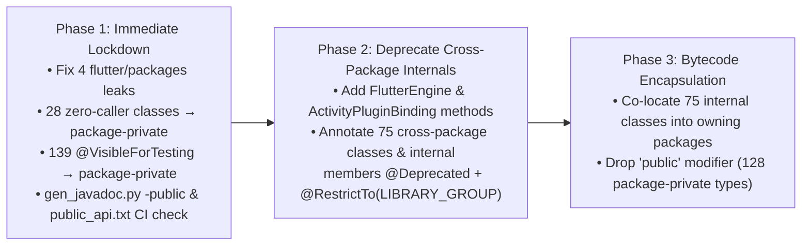

# RFC 410.0000: Flutter Android Embedder Public API Surface and Encapsulation

## Overview

> [!IMPORTANT]
> This RFC defines the supported public Java/Kotlin API surface of the Flutter Android embedder (**50** types across **16** packages) and locks down the remaining **128** internal types, internal constructors, and `@VisibleForTesting` methods as `package-private`.

Why:

- **86% (153 of 178)** of top-level types in [`engine/src/flutter/shell/platform/android/io/flutter/`](https://github.com/flutter/flutter/tree/66b3ad90177ccbd2963836a5556076b370622fe4/engine/src/flutter/shell/platform/android/io/flutter) are `public`, and [`gen_javadoc.py`](https://github.com/flutter/flutter/blob/66b3ad90177ccbd2963836a5556076b370622fe4/engine/src/flutter/tools/javadoc/gen_javadoc.py) publishes **20 of 23** packages—including `FlutterJNI`, `PlatformViewsController`, `AccessibilityBridge`, `TextInputPlugin`, and `systemchannels.*`—to `api.flutter.dev/javadoc/`.
- Internal classes were marked `public` only because Java's `package-private` visibility does not cross subpackages (`io.flutter.embedding.android` vs. `io.flutter.embedding.engine` vs. `io.flutter.plugin.platform`).
- **139** `@VisibleForTesting` members are marked `public` even though unit tests in [`test/io/flutter/`](https://github.com/flutter/flutter/tree/66b3ad90177ccbd2963836a5556076b370622fe4/engine/src/flutter/shell/platform/android/test/io/flutter) already reside in the same Java packages.
- Leaving internal plumbing `public` blocks the [Android Embedder C-API Migration](https://github.com/flutter/rfc/pull/24), which needs to refactor or remove `FlutterJNI`, `PlatformViewsController`, and internal channels without breaking external callers.

### Goals

- Define the supported public API surface for Add-to-App hosts and Android plugins.
- Lock down all **128** internal types and internal members on public classes as `package-private`.
- Migrate the 4 internal API usages in `flutter/packages` to existing public APIs.
- Enforce the boundary in CI (`public_api.txt`) and [`gen_javadoc.py`](https://github.com/flutter/flutter/blob/66b3ad90177ccbd2963836a5556076b370622fe4/engine/src/flutter/tools/javadoc/gen_javadoc.py).

### Non-Goals

- Redesigning the v2 plugin or Activity/Fragment embedding architecture.
- Changing Dart-to-engine platform channel names or binary wire formats.

## Background

### Current vs. Target API Surface

| Metric | Current | Target |
| :--- | ---: | ---: |
| Top-level `public` types | 153 (86.0%) | **50 (28.1%)** (44 supported + 6 deprecated) |
| Top-level `package-private` types | 25 (14.0%) | **128 (71.9%)** |
| Packages published by [`gen_javadoc.py`](https://github.com/flutter/flutter/blob/66b3ad90177ccbd2963836a5556076b370622fe4/engine/src/flutter/tools/javadoc/gen_javadoc.py) | 20 | **12** (with `-public`) |
| `@VisibleForTesting public` members | 139 | **0** (all `package-private`) |

### Ecosystem Audit

Scanning `flutter/flutter`, `flutter/packages`, `flutter/samples`, and public GitHub repositories confirms that Add-to-App hosts and plugins only require the 50 public types listed in [Proposal](#proposal). Across all of `flutter/packages`, only **4** accidental references to internal types exist:

| Plugin & File | Internal API Used | Fix |
| :--- | :--- | :--- |
| `video_player_android` ([`VideoPlayerPlugin.java`](https://github.com/flutter/packages/blob/fc56a0d548439c9776466e25e5567921f43e382a/packages/video_player/video_player_android/android/src/main/java/io/flutter/plugins/videoplayer/VideoPlayerPlugin.java#L96-L103)) & `google_maps_flutter_android` ([`Convert.java`](https://github.com/flutter/packages/blob/fc56a0d548439c9776466e25e5567921f43e382a/packages/google_maps_flutter/google_maps_flutter_android/android/src/main/java/io/flutter/plugins/googlemaps/Convert.java#L276-L283)) | `FlutterInjector.instance().flutterLoader().getLookupKeyForAsset(...)` | Use `FlutterPluginBinding.getFlutterAssets().getAssetFilePathByName(...)`. |
| `camera_android` & `camera_android_camerax` ([`DeviceOrientationManager.java`](https://github.com/flutter/packages/blob/fc56a0d548439c9776466e25e5567921f43e382a/packages/camera/camera_android_camerax/android/src/main/java/io/flutter/plugins/camerax/DeviceOrientationManager.java#L21)) | `PlatformChannel.DeviceOrientation` (used only for `.toString()`) | Use a plugin-local enum. |
| `camera_android` ([`NoiseReductionFeature.java`](https://github.com/flutter/packages/blob/fc56a0d548439c9776466e25e5567921f43e382a/packages/camera/camera_android/android/src/main/java/io/flutter/plugins/camera/features/noisereduction/NoiseReductionFeature.java#L13)) | `import io.flutter.BuildConfig;` | Delete unused import. |
| `espresso` ([`FlutterViewAction.java`](https://github.com/flutter/packages/blob/fc56a0d548439c9776466e25e5567921f43e382a/packages/espresso/android/src/main/java/androidx/test/espresso/flutter/action/FlutterViewAction.java#L31)) | `import io.flutter.embedding.engine.FlutterJNI;` | Delete unused import. |

## Proposal

### 1. Public API Surface (50 Types)

Only the following **44 supported** and **6 deprecated/transitional** top-level types remain `public`:

| Category | Public Types |
| :--- | :--- |
| **Host Containers (`io.flutter.embedding.android`)** | `FlutterActivity`, `FlutterFragmentActivity`, `FlutterFragment`, `FlutterView`, `FlutterSurfaceView`, `FlutterTextureView`, `FlutterImageView`, `FlutterActivityLaunchConfigs` (`BackgroundMode`), `RenderMode`, `TransparencyMode`, `FlutterEngineProvider`, `FlutterEngineConfigurator`, `ExclusiveAppComponent`, `FlutterPlayStoreSplitApplication` |
| **Engine & Dart Execution (`io.flutter.embedding.engine.*`)** | `FlutterEngine`, `FlutterEngineCache`, `FlutterEngineGroup` (`Options`), `FlutterEngineGroupCache`, `DartExecutor` (`DartEntrypoint`, `DartCallback`, `IsolateServiceIdListener`), `FlutterLoader` (`Settings`), `GeneratedPluginRegister` |
| **Plugin Lifecycle (`io.flutter.embedding.engine.plugins.*`)** | `FlutterPlugin` (`FlutterPluginBinding`, `FlutterAssets`), `PluginRegistry`, `ActivityAware`, `ActivityPluginBinding` (`OnSaveInstanceStateListener`), `ActivityControlSurface`, `ServiceAware`, `ServicePluginBinding`, `ServiceControlSurface`, `BroadcastReceiverAware`, `BroadcastReceiverPluginBinding`, `BroadcastReceiverControlSurface`, `ContentProviderAware`, `ContentProviderPluginBinding`, `ContentProviderControlSurface` |
| **Channels & Codecs (`io.flutter.plugin.common`)** | `BinaryMessenger` (`TaskQueue`, `TaskQueueOptions`, `BinaryMessageHandler`, `BinaryReply`), `MethodChannel` (`MethodCallHandler`, `Result`), `MethodCall`, `BasicMessageChannel` (`MessageHandler`, `Reply`), `EventChannel` (`StreamHandler`, `EventSink`), `MessageCodec`, `MethodCodec`, `StandardMessageCodec`, `StandardMethodCodec`, `BinaryCodec`, `StringCodec`, `JSONMessageCodec`, `JSONMethodCodec`, `FlutterException`, `PluginRegistry` (activity/permission listener interfaces) |
| **Platform Views, Rendering & Utilities** | `PlatformView`, `PlatformViewFactory`, `PlatformViewRegistry` (`io.flutter.plugin.platform`); `FlutterRenderer` (`ViewportMetrics`, `DisplayFeature`, `DisplayFeatureType`, `DisplayFeatureState`), `FlutterUiDisplayListener`, `RenderSurface` (`io.flutter.embedding.engine.renderer`); `TextureRegistry` (`SurfaceProducer`, `SurfaceLifecycle`, `TextureEntry`, `SurfaceTextureEntry`, `ImageTextureEntry`, `OnFrameConsumedListener`, `OnTrimMemoryListener`), `FlutterCallbackInformation` (`io.flutter.view`); `Log` (`io.flutter`) |
| **Deprecated / Transitional (6 Types)** | `FlutterApplication` (`io.flutter.app`), `FlutterShellArgs` (`io.flutter.embedding.engine`), `HiddenLifecycleReference` (`io.flutter.embedding.engine.plugins.lifecycle`), and transitional custom-host channels `LifecycleChannel`, `NavigationChannel`, `RestorationChannel`, `SystemChannel` (superseded by methods on `FlutterEngine` below) |

Complete package-by-package breakdown (all 178 types across 23 packages)

| Package | Total | Currently `public` | Target `public` | Target `package-private` (Internal Types) |
| :--- | ---: | ---: | ---: | :--- |
| `io.flutter` | 4 | 4 | 1 (`Log`) | 3 (`Build`, `BuildConfig`, `FlutterInjector`) |
| `io.flutter.app` | 1 | 1 | 1 (`FlutterApplication`) | 0 |
| `io.flutter.embedding.android` | 28 | 24 | 14 | 14 (`AndroidTouchProcessor`, `ContentSizingFlag`, `FlutterActivityAndFragmentDelegate`, `FlutterMeasureSpec`, `FlutterViewDelegate`, `IntentUtils`, `KeyChannelResponder`, `KeyData`, `KeyEmbedderResponder`, `KeyboardManager`, `KeyboardMap`, `MotionEventTracker`, `SurfaceHolderCallbackCompat`, `WindowInfoRepositoryCallbackAdapterWrapper`) |
| `io.flutter.embedding.engine` | 8 | 7 | 5 | 3 (`FlutterEngineConnectionRegistry`, `FlutterJNI`, `FlutterOverlaySurface`) |
| `io.flutter.embedding.engine.dart` | 4 | 3 | 1 (`DartExecutor`) | 3 (`DartMessenger`, `PlatformMessageHandler`, `PlatformTaskQueue`) |
| `io.flutter.embedding.engine.deferredcomponents` | 2 | 2 | 0 | 2 (`DeferredComponentManager`, `PlayStoreDeferredComponentManager`) |
| `io.flutter.embedding.engine.flags` | 2 | 2 | 0 | 2 (`FlutterEngineFlags`, `FlutterEngineFlagsProvider`) |
| `io.flutter.embedding.engine.image` | 9 | 2 | 0 | 9 (`BitmapMetadataReader`, `ExifMetadataReader`, `FlutterImageDecoder`, `ImageDecoderDefaultImpl`, `ImageDecoderHeifApi36Impl`, `ImageDecoderHeifPre36Impl`, `ImageUtils`, `MediaMetadataReader`, `Metadata`) |
| `io.flutter.embedding.engine.loader` | 4 | 3 | 1 (`FlutterLoader`) | 3 (`ApplicationInfoLoader`, `FlutterApplicationInfo`, `ResourceExtractor`) |
| `io.flutter.embedding.engine.mutatorsstack` | 2 | 2 | 0 | 2 (`FlutterMutatorView`, `FlutterMutatorsStack`) |
| `io.flutter.embedding.engine.plugins` | 2 | 2 | 2 | 0 |
| `io.flutter.embedding.engine.plugins.activity` | 3 | 3 | 3 | 0 |
| `io.flutter.embedding.engine.plugins.broadcastreceiver` | 3 | 3 | 3 | 0 |
| `io.flutter.embedding.engine.plugins.contentprovider` | 3 | 3 | 3 | 0 |
| `io.flutter.embedding.engine.plugins.lifecycle` | 1 | 1 | 1 (`HiddenLifecycleReference`) | 0 |
| `io.flutter.embedding.engine.plugins.service` | 3 | 3 | 3 | 0 |
| `io.flutter.embedding.engine.plugins.util` | 1 | 1 | 1 (`GeneratedPluginRegister`) | 0 |
| `io.flutter.embedding.engine.renderer` | 6 | 5 | 3 | 3 (`FlutterUiResizeListener`, `SurfaceTextureSurfaceProducer`, `SurfaceTextureWrapper`) |
| `io.flutter.embedding.engine.systemchannels` | 22 | 22 | 0 (4 transitional) | 22 (All 22 channel classes) |
| `io.flutter.plugin.common` | 17 | 17 | 15 | 2 (`ErrorLogResult`, `JSONUtil`) |
| `io.flutter.plugin.editing` | 8 | 5 | 0 | 8 (`FlutterTextUtils`, `ImeSyncDeferringInsetsCallback`, `InputConnectionAdaptor`, `ListenableEditingState`, `ScribePlugin`, `SpellCheckPlugin`, `TextEditingDelta`, `TextInputPlugin`) |
| `io.flutter.plugin.localization` | 1 | 1 | 0 | 1 (`LocalizationPlugin`) |
| `io.flutter.plugin.mouse` | 1 | 1 | 0 | 1 (`MouseCursorPlugin`) |
| `io.flutter.plugin.platform` | 22 | 16 | 3 (`PlatformView`, `PlatformViewFactory`, `PlatformViewRegistry`) | 19 (`AccessibilityEventsDelegate`, `ImageReaderPlatformViewRenderTarget`, `PlatformOverlayView`, `PlatformPlugin`, `PlatformViewGestureTracker`, `PlatformViewRegistryImpl`, `PlatformViewRenderTarget`, `PlatformViewWrapper`, `PlatformViewsAccessibilityDelegate`, `PlatformViewsController`, `PlatformViewsController2`, `PlatformViewsControllerDelegator`, `SingleViewFakeWindowViewGroup`, `SingleViewPresentation`, `SingleViewWindowManager`, `SurfaceProducerPlatformViewRenderTarget`, `SurfaceTexturePlatformViewRenderTarget`, `VirtualDisplayController`, `WindowManagerHandler`) |
| `io.flutter.plugin.text` | 1 | 1 | 0 | 1 (`ProcessTextPlugin`) |
| `io.flutter.plugin.view` | 1 | 1 | 0 | 1 (`SensitiveContentPlugin`) |
| `io.flutter.util` | 5 | 5 | 0 | 5 (`HandlerCompat`, `PathUtils`, `Preconditions`, `TraceSection`, `ViewUtils`) |
| `io.flutter.view` | 14 | 13 | 2 (`TextureRegistry`, `FlutterCallbackInformation`) | 12 (`AccessibilityBridge`, `VsyncWaiter`, and 10 accessibility role configurators) |

### 2. Decoupling Public Classes from Internal Types

To allow internal types to become `package-private` without `javac` signature errors on public classes:

| Public Class | Change |
| :--- | :--- |
| [`FlutterView`](https://github.com/flutter/flutter/blob/66b3ad90177ccbd2963836a5556076b370622fe4/engine/src/flutter/shell/platform/android/io/flutter/embedding/android/FlutterView.java#L106-L108) | Replace `implements MouseCursorPlugin.MouseCursorViewDelegate, KeyboardManager.ViewDelegate` with private inner delegates. Make hybrid-composition helpers (`convertToImageView`, `revertImageView`, `attachOverlaySurfaceToRender`, `acquireLatestImageViewFrame`, `createImageView`) and 17 `@VisibleForTesting` members `package-private`. |
| [`FlutterEngine`](https://github.com/flutter/flutter/blob/66b3ad90177ccbd2963836a5556076b370622fe4/engine/src/flutter/shell/platform/android/io/flutter/embedding/engine/FlutterEngine.java#L108) | Make the 6 constructors accepting `FlutterJNI`/`PlatformViewsController*`, the 16 internal `get*Channel()` getters, and `getPlatformViewsController*()` `package-private`. Add `getPlatformViewRegistry()` and direct host methods (`notifyAppIsResumed()`, `notifyAppIsInactive()`, `notifyAppIsPaused()`, `notifyAppIsDetached()`, `notifyMemoryPressureWarning()`, `setInitialRoute(String)`, `pushRoute(String)`, `popRoute()`, `getRestorationData()`, `setRestorationData(byte[])`) so custom `FlutterView` hosts do not need `systemchannels.*`. |
| [`FlutterRenderer`](https://github.com/flutter/flutter/blob/66b3ad90177ccbd2963836a5556076b370622fe4/engine/src/flutter/shell/platform/android/io/flutter/embedding/engine/renderer/FlutterRenderer.java#L65) & [`DartExecutor`](https://github.com/flutter/flutter/blob/66b3ad90177ccbd2963836a5556076b370622fe4/engine/src/flutter/shell/platform/android/io/flutter/embedding/engine/dart/DartExecutor.java#L48) | Make `FlutterRenderer(FlutterJNI)`, `DartExecutor(FlutterJNI, AssetManager)`, `onAttachedToJNI()`, `onDetachedFromJNI()`, `setSemanticsEnabled()`, `dispatchSemanticsAction()`, and `@VisibleForTesting` methods `package-private`. |
| [`TextureRegistry`](https://github.com/flutter/flutter/blob/66b3ad90177ccbd2963836a5556076b370622fe4/engine/src/flutter/shell/platform/android/io/flutter/view/TextureRegistry.java#L27) | Move internal engine consumption interfaces (`GLTextureConsumer`, `ImageConsumer`) out of `TextureRegistry` into `package-private` renderer interfaces. |
| [`ActivityPluginBinding`](https://github.com/flutter/flutter/blob/66b3ad90177ccbd2963836a5556076b370622fe4/engine/src/flutter/shell/platform/android/io/flutter/embedding/engine/plugins/activity/ActivityPluginBinding.java#L18) | Add `default androidx.lifecycle.Lifecycle getActivityLifecycle()` directly, deprecate `HiddenLifecycleReference`, and make its constructor `package-private`. |

### 3. Phased Rollout

#### Phase 1: Immediate Non-Breaking Lockdown & CI Guard

1. Fix the 4 internal API usages in `flutter/packages`.
2. Drop `public` in-place from the **28** internal top-level types that already have zero cross-package callers, and from all **139** `@VisibleForTesting` members.
3. Replace the implemented internal interfaces on `FlutterView` with private inner delegates.
4. Update [`gen_javadoc.py`](https://github.com/flutter/flutter/blob/66b3ad90177ccbd2963836a5556076b370622fe4/engine/src/flutter/tools/javadoc/gen_javadoc.py) to pass `-public` and remove the 9 internal-only packages.
5. Add a bytecode signature golden test (`engine/src/flutter/shell/platform/android/api/public_api.txt`) that fails CI if any unapproved `public` or `protected` symbol is added to `flutter.jar`.

28 zero-caller classes made <code>package-private</code> in Phase 1

- `io.flutter.embedding.android`: `FlutterViewDelegate`, `KeyChannelResponder`, `KeyData`, `KeyEmbedderResponder`, `KeyboardMap`, `SurfaceHolderCallbackCompat`, `WindowInfoRepositoryCallbackAdapterWrapper`
- `io.flutter.embedding.engine.dart`: `PlatformTaskQueue`
- `io.flutter.embedding.engine.flags`: `FlutterEngineFlagsProvider`
- `io.flutter.embedding.engine.image`: `BitmapMetadataReader`
- `io.flutter.plugin.common`: `ErrorLogResult`, `JSONUtil`
- `io.flutter.plugin.platform`: `ImageReaderPlatformViewRenderTarget`, `PlatformOverlayView`, `PlatformViewRegistryImpl`, `PlatformViewRenderTarget`, `PlatformViewWrapper`, `SurfaceProducerPlatformViewRenderTarget`, `SurfaceTexturePlatformViewRenderTarget`
- `io.flutter.view`: `AccessibilityNodeConfigurator`, `AccessibilityStringBuilder`, `BaseRoleConfigurator`, `ClassNameRoleConfigurator`, `ComboBoxRoleConfigurator`, `MenuRoleConfigurator`, `ProgressBarRoleConfigurator`, `RoleConfiguratorFactory`, `SliderRoleConfigurator`

#### Phase 2: Deprecate Cross-Package Internals (1 Stable Release)

1. Land the replacement host methods on `FlutterEngine` and `getActivityLifecycle()` on `ActivityPluginBinding`.
2. Annotate the remaining **75** cross-package internal classes and internal members on `FlutterEngine`, `FlutterView`, `FlutterRenderer`, and `DartExecutor` with `@RestrictTo(RestrictTo.Scope.LIBRARY_GROUP)` and `@Deprecated(since = "Flutter X.Y", forRemoval = true)`.
3. Publish a breaking-change migration guide on `docs.flutter.dev`.

#### Phase 3: Package Co-location & `package-private` Lockdown

After one stable release, co-locate the **75** cross-package internal classes into the package that owns them and drop the `public` modifier:

Package co-location map for the 75 Phase 3 classes

| Target Package | Co-located `package-private` Classes |
| :--- | :--- |
| `io.flutter.embedding.android` | `TextInputPlugin`, `InputConnectionAdaptor`, `ListenableEditingState`, `FlutterTextUtils`, `ImeSyncDeferringInsetsCallback`, `ScribePlugin`, `SpellCheckPlugin`, `TextEditingDelta`, `MouseCursorPlugin`, `SensitiveContentPlugin`, `PlatformPlugin`, `AndroidTouchProcessor`, `KeyboardManager`, `MotionEventTracker` |
| `io.flutter.embedding.engine` | `FlutterJNI`, `FlutterOverlaySurface`, `FlutterEngineFlags`, `FlutterImageDecoder` (+ 8 `image.*` helpers), `ApplicationInfoLoader`, `FlutterApplicationInfo`, `DeferredComponentManager`, `PlayStoreDeferredComponentManager`, `LocalizationPlugin`, `ProcessTextPlugin`, `VsyncWaiter`, all 22 `systemchannels.*` classes, `PlatformViewsController`, `PlatformViewsController2`, `PlatformViewsControllerDelegator`, `PlatformViewGestureTracker`, `PlatformViewsAccessibilityDelegate`, `FlutterMutatorView`, `FlutterMutatorsStack`, `AccessibilityBridge`, `AccessibilityViewEmbedder`, and internal utilities (`Build`, `BuildConfig`, `FlutterInjector`, `HandlerCompat`, `PathUtils`, `Preconditions`, `TraceSection`, `ViewUtils`) |

> [!NOTE]
> JNI `env->FindClass` and `env->RegisterNatives` ignore Java visibility modifiers, and `FlutterJNI` already resides in `io.flutter.embedding.engine`. Co-locating its collaborators into `io.flutter.embedding.engine` allows `FlutterJNI` to become `package-private` without changing any C++ JNI descriptors.

## Alternatives Considered

- **`@RestrictTo(RestrictTo.Scope.LIBRARY_GROUP)` without `package-private`:** `@RestrictTo` is only an Android Lint check; bytecode remains `ACC_PUBLIC`. Callers can bypass it with `@SuppressLint("RestrictedApi")` or when Lint is disabled, which still prevents removing or renaming internal classes like `FlutterJNI` during the C-API migration.
- **Java Platform Module System (`module-info.java`):** D8/R8 DEX compilation and the Android Runtime (ART) verifier ignore JPMS module boundaries, and Android Gradle builds put `flutter.jar` on the classpath rather than the module path.
- **Kotlin `internal` visibility:** Kotlin `internal` declarations compile to `public` in JVM/DEX bytecode, remaining accessible to external Java callers unless they are `package-private`.
- **Build-time bytecode repackaging (JarJar / R8):** Rewriting access flags in bytecode without matching source packages causes `IllegalAccessError` across subpackages at runtime and diverges stack traces from source files.
