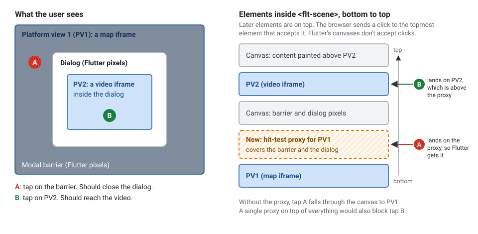
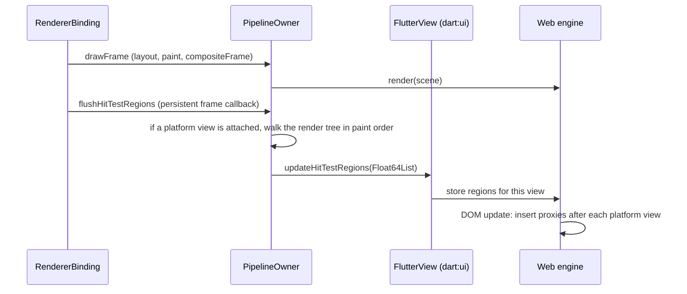

# RFC 420.0000: Automatic PointerInterceptors on the web

## Overview

On Flutter Web, a platform view (`HtmlElementView`, used for iframes, maps and
video) is a real HTML element. It sits between the `<canvas>` elements that
Flutter draws into. Flutter content painted on top of a platform view is just
canvas pixels. So the browser sends clicks on that content to the platform view
underneath.

An iframe swallows those clicks completely. A dialog over an iframe can't be
dismissed by tapping its barrier, and taps on the dialog's buttons go to the
iframe.

Today apps work around this by wrapping each overlapping widget in
`PointerInterceptor`. That is easy to forget, and we can't enforce it. It is
hardest for overlays the app doesn't build itself, such as menus, dropdowns and
autocomplete ([#74618](https://github.com/flutter/flutter/issues/74618),
[#175223](https://github.com/flutter/flutter/issues/175223),
[#167593](https://github.com/flutter/flutter/issues/167593)).

This RFC proposes fixing the problem in the framework and the web engine, with
no app changes and no wrapping. While a platform view is on screen, the
framework walks the render tree after each frame. It finds the areas painted
over each platform view where Flutter's own hit test would claim a pointer
event. (The hit test is how Flutter decides which widget receives a tap.)

The framework sends these areas to the web engine with a new
`FlutterView.updateHitTestRegions` call. The engine places invisible proxy
elements over those areas, directly above the platform view they cover. The
proxies catch clicks before they reach the platform view and pass them to
Flutter.

## Goals

1. Match Flutter's own hit test. A click must go wherever Flutter would send
   it, including to non-interactive surfaces such as a `Card` or `Text` over a
   map. Developers already reason in terms of Flutter's hit test, so any other
   rule would surprise them.
2. Need no cooperation from widgets. Third-party widgets must work unchanged,
   or the manual-wrapping problem comes back.
3. Cost nothing without platform views, and stay cheap with them. Most web apps
   never show a platform view.
4. Leave normal rendering untouched. The feature must not change how content
   paints or composites.

### Non-goals

* Native platforms, which route platform-view touches differently.
* Menus that close on an outside tap without a barrier (`MenuAnchor`,
  `TapRegion`). No region exists over the platform view in that case, so it
  needs a separate signal.
* Accessibility. Semantics behavior is unchanged.

## Background

### How clicks reach platform views

Flutter Web draws each frame into one or more canvases inside a `<flt-scene>`
element. Each platform view's HTML element sits between those canvases, in
paint order. In the DOM, later elements are on top.

The browser sends a click
to the topmost element at that point that accepts pointer events, and Flutter's
canvases don't accept them. So a click on Flutter content passes through the
canvas to whatever platform view is below it.

### How `PointerInterceptor` works today

`PointerInterceptor` places an invisible platform view behind the wrapped
widget. Because it is a platform view, it lands in the DOM above earlier
platform views and receives the click instead. The click then bubbles up to the
Flutter view, where Flutter's existing pointer handling processes it. This
proposal uses the same idea, but the engine places plain elements instead of
extra platform views.

### The hard case

Consider platform view 1 (PV1), a full-screen map, under a dialog. The dialog
contains platform view 2 (PV2), a video.

A tap on the barrier must close the
dialog and never reach PV1. A tap on PV2 must still reach PV2. The diagram shows
how one proxy, placed directly above PV1 in the DOM, handles both.



A single proxy over the whole scene would also block PV2. Placing each platform
view's proxy directly after that platform view gets both cases right through DOM
order alone.

## Technical details

### Frame pipeline



### When the pass runs, and why

The pass runs from a persistent frame callback **after** `drawFrame`, so after
compositing. `CompositedTransformFollower` (dropdowns, autocomplete) only learns
its position while the scene is built, so an earlier pass would place those
proxies a frame late. Using a separate callback rather than a step inside
`drawFrame` also covers bindings that override `drawFrame`, such as the test
bindings.

It runs only on the web, only while
`RendererBinding.automaticPointerInterceptorsEnabled` is on, and only for a
`PipelineOwner` with at least one attached `PlatformViewRenderBox`.
`PlatformViewRenderBox` reports attach and detach to its owner, so the check is
synchronous. That is why the feature costs nothing for apps without platform
views. Multi-view apps get one pass, and one payload, per view.

### What claims a region, and why

The walk visits render objects in paint order, tracking each one's global
transform and the ancestor clips. Each `PlatformViewRenderBox` it reaches starts
a new group: the list of regions that the engine will place directly above that
platform view.

After that, a `RenderBox` claims its clipped global rect if
`hitTestSelf` is true at its center. `hitTestSelf` is the method Flutter's hit
test calls to ask a box whether it claims a point. So modal barriers, Material
surfaces, text, images and opaque gesture detectors claim, and translucent ones
don't.

* `IgnorePointer` and `SliverIgnorePointer` subtrees claim nothing, but the
  walk still searches them for platform views, because a platform view inside
  one still needs protection.
* An absorbing `AbsorbPointer` claims its own bounds. Its children claim
  nothing, but the walk still searches them for platform views.
* `Offstage` and `SliverOffstage` subtrees are skipped. So is an unlinked
  `CompositedTransformFollower` with `showWhenUnlinked: false`. None of these
  paint or hit test their children.
* A protected `RenderObject.visitHitTestRegions` override point covers custom
  hit tests (for example `CustomPaint` with a `hitTest` callback). Render
  objects report local rects, and the walk maps and clips them.

Paint order comes from a new `RenderObject.visitChildrenInPaintOrder`, which
defaults to `visitChildren`. Render objects that paint in a different order
override it. These are viewports (slivers paint last-to-first),
`SliverMainAxisGroup`, `IndexedStack`, overlays, keep-alive lists, 2D viewports
and `Flow`. We don't reuse
`visitChildrenForSemantics`, because it skips `ExcludeSemantics`, which is
exactly where `ModalBarrier` hides on some platforms.

### Keeping the walk small

The walk only needs what is painted over platform views:

* nothing painted before the first platform view can cover it;
* once a claim covers every platform view seen so far, later content can't
  matter until another platform view appears;
* a box that claims its whole rect makes its children redundant;
* subtrees whose clip or hit bounds miss every platform view are skipped;
* a subtree that contains no platform views is skipped before the first
  platform view, and pruned like the rest afterwards;
* the payload is only sent, and the DOM only updated, when it changes.

To know which subtrees contain no platform views, each render object keeps a
count of the platform views below it. Without it, the walk must search
everything painted before the last platform view just to find it. A platform
view painted late, for example in an overlay, would make every frame visit the
whole tree.

The count changes in `adoptChild` and `dropChild`, and only when the moved
subtree contains a platform view. It then updates each ancestor, so the cost is
proportional to tree depth. The updates run only on the web. Other platforms
pay one integer field per render object and no work.

We measured the walk on the Material 3 components demo used by the
`bench_material3_components` web benchmark. It is a screen of about 2,500
render objects that shows most Material widgets.

In common layouts the walk visits 18–47 render objects. With a platform view
painted late, it visits 7 instead of about 2,773. Dense UI with gaps over a
platform view remains the worst case, at about 1,100. See
[Appendix C](#appendix-c-walk-size).

### `FlutterView.updateHitTestRegions`

```dart
/// Web only; a no-op on other platforms.
void updateHitTestRegions(Float64List regions);
```

The payload is a paint-ordered list of groups,
`[viewId, n, left, top, right, bottom × n, …]`, in physical pixels. Each group
holds the rects painted after that platform view and before the next one, kept
only if they overlap an earlier platform view. The framework culls, because it
already knows the platform view rects during the walk. A group with `n = 0`
means the platform view is on screen but nothing claims clicks over it, so the
engine places no proxy for it.

It is a per-view `dart:ui` method rather than a platform channel. Channel
messages are handled immediately, while web rendering is asynchronous and can
drop queued frames. A `dart:ui` call keeps the regions with the frame they belong
to.

It lives on `FlutterView` rather than in `dart:ui_web`. That keeps one framework
code path and one test seam, and lets native embedders adopt it later. On native
platforms it is a concrete no-op. The only implementers it breaks are test
doubles that implement `FlutterView` without extending `Fake`.

### Web engine

`PlatformViewEmbedder` stores the latest payload per view. When it updates the
DOM for a frame, it inserts a `CompositionHitTestProxy` right after each
platform view with a non-empty group. `CompositionHitTestProxy` is a new member
of the sealed `CompositionEntity` hierarchy, so proxies move through the same
DOM diff as canvases and platform views.

Each proxy is a `<flt-hit-test-proxy>` element (`pointer-events: none`) whose
children are absolutely positioned `pointer-events: auto` divs, one per rect.
Proxies call `preventDefault` on `mousedown`, as `PointerInterceptor` does, so
text input keeps focus. Proxy elements are pooled, and an unchanged payload
causes no DOM writes.

## Testing

* Framework unit tests run on the VM, because the payload is exposed for
  tests. They cover the dialog scenario, exit animations,
  `IgnorePointer`/`AbsorbPointer`, paint-order special cases, transforms and
  clips, custom hit tests, multi-view, and toggling the flag at runtime. They
  also check that the platform-view count survives reparenting, and that the
  walk's output is the same with and without the count.
* Engine tests run on CanvasKit and Skwasm. They check proxy DOM order and
  positions at different device pixel ratios. They also check that
  `elementFromPoint` hits the proxy or PV2, that pointer events reach the
  framework, and that proxies are pooled and removed.
* End-to-end tests use real WebDriver clicks on iframes, on CanvasKit and
  Skwasm. They cover the dialog scenario, a modal bottom sheet, a popup menu, a
  `DropdownButton`, and `showGeneralDialog`. They also cover a pinned app bar
  and a floating action button over a scrolled list of iframes.
* A new benchmark, `bench_platform_view_under_m3_components`, measures a
  platform view under the Material 3 components demo with the feature on.
  Benchmarks for two worst-case layouts will follow: a late-painted platform
  view, and dense UI over a platform view.
* To compare designs, we also ran a 22-scenario browser suite against both
  ([Appendix F](#appendix-f-scenario-suite)). It found three paint-order gaps
  in the walk. Each fix lands with its own regression test.

## Rollout

The feature ships behind `RendererBinding.automaticPointerInterceptorsEnabled`,
off by default. `PointerInterceptor` keeps working alongside it, since it is
itself a platform view.

We will turn the flag on by default, keeping it as an opt-out, once we have
verified that:

1. the worst-case benchmarks stay within +10% frame time;
2. the fix has landed for drags that start on Flutter content and cross an
   iframe. Proxies make that existing problem more common.

Possible later work:

* record paint order while painting instead of hand-written overrides;
* attach the regions to the frame they were computed for, to make the frame
  pairing atomic;
* add a debug check that runs the real hit test at each region;
* cache regions for unchanged subtrees.

## Alternatives considered

### Inline `PointerInterceptor` into the framework

The framework would wrap the widgets that usually overlap platform views
(barriers, dialogs, menus, sheets) on the web. It reuses proven code and needs
no new API. We rejected it because coverage stays opt-in by widget type: a
`Card`, a button over a map, or any third-party overlay still leaks clicks. That
fails the first two goals.

Each region would also be a platform view, which adds DOM and splits the scene
into more canvases. The engine caps canvases (8 by default).

### Derive regions from the semantics tree

Semantics nodes already describe interactive areas. We prototyped turning
semantics on by default with a "no DOM" engine mode, and rejected it. It cost
**+30–100% frame time** on widget-heavy benchmarks, almost all in the framework
and per render object, so filtering the output can't fix it.

It also misses barriers, because `ModalBarrier` is excluded from semantics on
Linux and Windows. And it breaks `ensureSemantics()`. See
[Appendix A](#appendix-a-semantics).

### Record regions during paint (`Canvas.addHitTestRegion`)

Render objects would record regions into the canvas while painting. Regions
would travel inside pictures, and the engine would resolve them with the real
layer transforms and clips. Paint order and follower positions then come
straight from the frame, and regions stay in sync with it. We built a working
prototype ([Appendix B](#appendix-b-paint-time-recording)).

We rejected it for these reasons:

* Clickability isn't a paint dependency. Some properties change whether a
  widget accepts clicks without changing its pixels, for example
  `IgnorePointer.ignoring`.

  When one changes, the widget must trigger a
  repaint, or its recorded regions go stale. We can do that for framework
  widgets, but we can't enforce it for third-party render objects. That fails
  the second goal.
* It changes normal rendering while a platform view is on screen:
  * invisible layers for invisible but clickable content;
  * repaints on hit-test state changes;
  * a full repaint when the first platform view appears;
  * a CanvasKit recording change.

  That fails the fourth goal.
* It was slower: +5.1% frame time on CanvasKit, and no significant difference
  on Skwasm.
* New abstract `Canvas` methods break every `implements Canvas`, including one
  in the framework.

Its two strengths shaped the follow-up work above: take paint order from paint,
and bind regions to their frame.

Variants raised in review didn't change the outcome:

* One hit-test layer per claiming render object would mean about 5× today's
  layer count on the Material 3 components demo. Real layers also force their
  ancestors to composite ([Appendix E](#appendix-e-claimant-density)).
* Regions as side data on existing layers avoid the `Canvas` API. But a widget
  whose clickability changes without a repaint must still tell the framework to
  update its regions, which brings back the second-goal problem.
* A regions-only repaint pass needs per-child transforms and paint order, so it
  converges on this RFC's walk.

### Smaller alternatives

* An engine → framework "platform view present" signal arrives one frame late.
  A framework-side counter is synchronous.
* Sending every region and culling in the engine sends far more data, and
  repeats geometry work the framework has already done.
* Taking regions only from interactive widgets misses non-interactive surfaces
  that Flutter's hit test claims.

## Appendix A: Semantics

`drawFrameDuration`, semantics on by default vs off (local interleaved A/B,
noise about ±6%):

| Benchmark | CanvasKit | Skwasm |
|---|---|---|
| `bench_material3_components` | +51% | +33–39% |
| `build_material_checkbox` | +73–104% | +63–73% |
| `bench_card_infinite_scroll` | +63–84% | +61–72% |
| `bench_simple_lazy_text_scroll` | +78–113% | +76–79% |
| `bench_wrapbox_scroll` | +101% | +66% |
| `bench_platform_view_infinite_scroll` | +37–61% | +43–49% |

* An engine whose `updateSemantics` returned immediately reproduced about 100%
  of the regression, so the cost is in the framework.
* `flushSemantics` plus `markNeedsSemanticsUpdate` were about 36% of
  `drawFrame`, and about 87% of that is per render object. The Material 3
  components demo has 2,481 render objects but only 121 semantics nodes.
* Only Material `DialogRoute` and bottom sheets add an explicit blocking node,
  so `showGeneralDialog` and `showMenu` produce nothing to block with.

## Appendix B: Paint-time recording

**Prototype.** The prototype added `Canvas.addHitTestRegion` and a pair of
suppression markers. `IgnorePointer` and `AbsorbPointer` record one marker
before painting their child and one after. The engine ignores any regions
recorded between the two markers, including regions in cached child layers.

The CanvasKit and Skwasm canvases record regions into pictures, and the
engine's layer pass maps them in paint order. In the framework, emission happens
once per render object, before `paint()`. `Opacity(0)` and hidden `Visibility`
paint their child into an alpha-0 layer, because Flutter still hit-tests that
child. The prototype passed 15 engine tests on both renderers.

**Benchmark.** Interleaved, 5 rounds, release builds, same Flutter revision.
Values are paint-time recording relative to the render-tree walk, on a
full-screen platform view under the Material 3 components demo:

| Renderer | Feature on | Feature off (control) |
|---|---|---|
| CanvasKit | +5.1% [+3.6, +6.6] | +0.1% [−2.7, +2.9] |
| Skwasm | +1.4% [−2.5, +5.4] | −0.1% [−2.2, +2.1] |

Recording one region cost 3.7–4.0 µs on CanvasKit (mostly reading the canvas
transform through JS interop), about the same as a `drawRect`. On Skwasm it was
≈0.6 µs. This layout is a near-best case for the walk, which stops after 18
render objects.

## Appendix C: Walk size

Render objects visited per frame on the Material 3 components demo (~2,500
render objects), one platform view:

| Platform view | Without the count | With the count |
|---|---:|---:|
| None (pass doesn't run) | 0 | 0 |
| Full-screen, behind the app | 18 | 18 |
| Behind a transparent `Scaffold` | 41 | 34 |
| Near the top of the page | 47 | 40 |
| First, under scrolling UI | 54 | 47 |
| Feed with a platform view every fifth item | 201 | 66 |
| Painted after the page, while scrolling | ~2,773 | 7 |
| First, under dense non-scrolling UI with gaps | 1,110 | 1,103 |

Scroll views claim their whole viewport, which is why scrolling UI over a
platform view stops the walk early. In the prototype, the count produced
identical payloads in every case.

## Appendix D: How often clickability changes without a repaint

Switching `HitTestBehavior` between opaque and translucent is rare, because
app code passes constants.

`IgnorePointer` flips constantly. It flips on every route push and pop, every
iOS back-swipe, and every scroll drag and fling. (`Scrollable` sets
`RenderIgnorePointer.ignoring` directly.) It also flips for
`Visibility`/`IndexedStack`, menus, tooltips and drag feedback.

We instrumented stock Flutter to see which flips also repaint:

* Scroll flips were always repainted in the same frame anyway.
* On route and dialog exits, the content's `IgnorePointer` flipped to `true`.
  It wasn't repainted for the whole exit animation, because the transitions
  only change layer properties.

A paint-based design would therefore keep blocking the platform view slightly
too long during exits, unless `IgnorePointer` forces a repaint.

## Appendix E: Claimant density

On the Material 3 components demo, 595 of 2,517 render objects claim hits:

| Claimant type | Count |
|---|---:|
| Text | 152 |
| Pointer listeners | 131 |
| Mouse regions | 112 |
| Material surfaces | 86 |
| `CustomPaint` | 55 |

The same screen produces 134 layers today.

## Appendix F: Scenario suite

We used this suite to compare the render-tree walk with paint-time recording.
It has 22 scenarios, run in Chrome on CanvasKit and Skwasm. It covers:

* the dialog scenario and its exit animation;
* `IgnorePointer` around cached subtrees and around a platform view;
* `AbsorbPointer`, `Opacity(0)`, and transparent vs translucent tap targets;
* a platform view appearing next to cached content;
* pinned headers over scrolled platform views;
* `IndexedStack`, `Transform`/`ClipRect`, and a barrier with no color;
* `Visibility`, `SliverIgnorePointer`, `SliverMainAxisGroup`, an unlinked
  follower, `ListWheelScrollView`, and changing `HitTestBehavior`.

The render-tree walk passed 19 scenarios on the first run. Its three failures
are paint-order gaps that will be fixed as part of the implementation. The
paint-time recording prototype passed 22 after two extra per-widget fixes.
