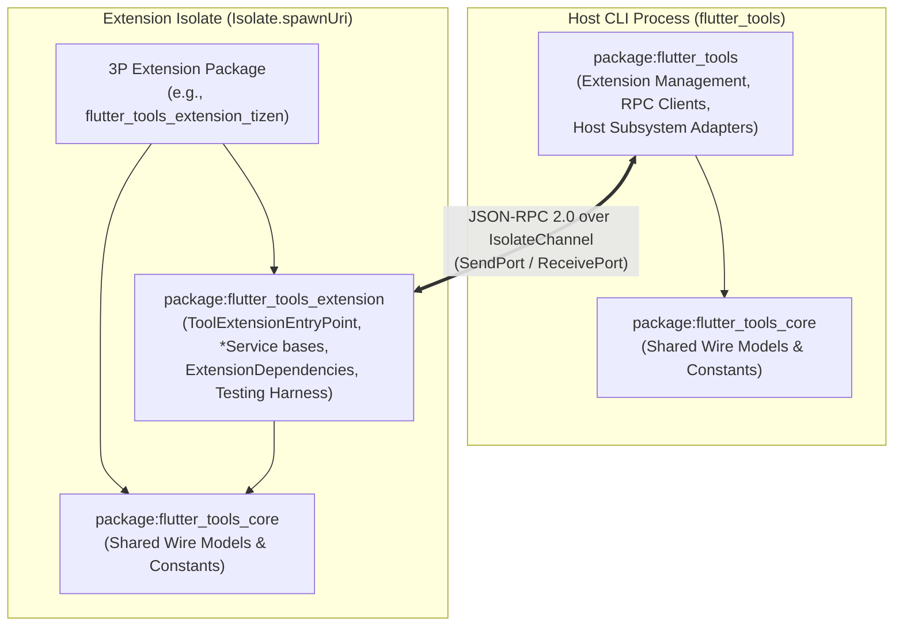
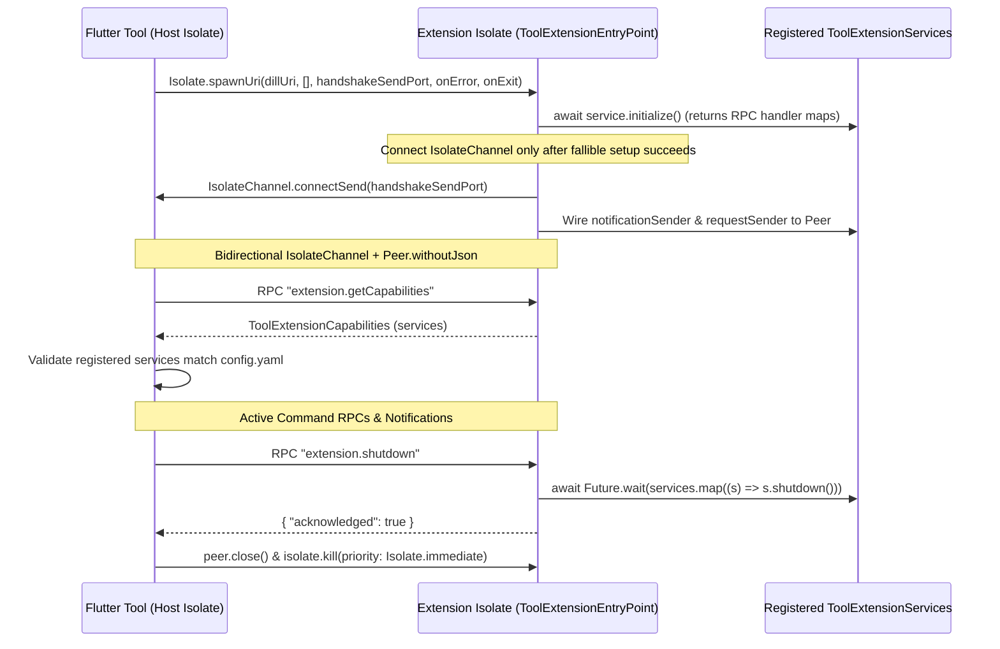

# RFC 510.0000: Targeting Custom Embedders with Flutter Tools

## Summary

This RFC proposes a first-class, isolate-based platform extension architecture for the Flutter CLI (`flutter_tools`). By decoupling target platform tooling from the core Flutter SDK into project-scoped Dart packages (`package:flutter_tools_extension` and `package:flutter_tools_core`) that communicate with the Flutter Tool over a structured JSON-RPC 2.0 protocol, third-party and custom embedder authors can hook their devices, build targets, platform templates, SDK artifacts, and diagnostics directly into standard `flutter` commands (`doctor`, `config`, `create`, `devices`, `emulators`, `run`, `attach`, `install`, `screenshot`, `build`, `assemble`, `precache`, and `clean`) without forking the Flutter repository or maintaining bespoke wrapper CLIs.

## Overview

Custom Flutter embeddings (such as WebOS, Tizen, automotive head units, and industrial displays) currently lack first-class access to the standard functionality of the `flutter` command-line tool. While the C/C++ Embedder API provides a stable boundary for integrating the Flutter runtime on non-standard operating systems, the developer tooling in `flutter_tools` has historically hard-coded assumptions around its six first-party target platforms (Android, iOS, web, Linux, macOS, and Windows).

Consequently, embedder maintainers have been stuck between two difficult choices:

1. **Maintaining a fork of the Flutter SDK or a bespoke wrapper CLI** (`flutter-elinux`, `tizen-flutter`, `flutter-pi` tooling) that duplicates command routing, argument parsing, and asset bundling while constantly drifting behind upstream SDK releases and breaking standard IDE integrations.
2. **Using `flutter custom-devices`**, which substitutes shell commands for basic device discovery, installation, and port forwarding via a static JSON configuration file, but cannot express custom build pipelines (`flutter build`, `flutter assemble`), platform scaffolding (`flutter create`), SDK artifact management (`flutter precache`), environment diagnostics (`flutter doctor`), or native plugin compilation.

To support custom embedders and target platforms without forks, the Flutter Tool needs to be pluggable, providing embedder maintainers a way to hook into existing commands that require knowledge of the target platform. To achieve this, the Flutter Tool will support project-scoped tool extensions (simply referred to as "extensions" throughout the rest of this document) that run in separate Dart isolates and provide platform-specific implementations for key operations performed by the tool.

Once implemented, the Tool Extension API will allow extensions to provide support for:

* Downloading and caching necessary artifacts for the target platform (e.g., custom embeddings of the Flutter engine or cross-compilation toolchains) via `flutter precache`
* Interacting with custom devices (e.g., detection via `flutter devices`, deployment and hot reload via `flutter run` and `flutter attach`, standalone installation via `flutter install`, screenshot capture via `flutter screenshot`, and log streaming)
* Listing and launching device emulators via `flutter emulators`
* Registering high-level `flutter build <target>` subcommands and fine-grained `flutter assemble` build targets to handle compilation and bundling steps specific to the target platform
* Running custom `flutter doctor` checks to verify that the host build environment is set up for the target platform
* Registering custom feature flags and configuration options for use with `flutter config`
* Scaffolding platform runner directories for applications and plugins via `flutter create . --platforms=<platform>`
* Cleaning up extension-specific build outputs during `flutter clean`

### Non-Goals

* **Security Sandboxing**: This design focuses on process stability and isolating the tool from uncaught Dart exceptions in buggy extensions, not on providing an OS-level security sandbox for executing untrusted code (see [Section 3.3](#33-isolate-isolation-boundaries--process-wide-constraints)). Once dependencies are resolved via `flutter pub get`, extensions run with the same permissions as the Flutter Tool, matching the trust model of Dart build hooks (`package:hooks`) and analyzer plugins.
* **Non-Dart Extensions**: This proposal only supports extensions written in Dart to leverage the isolate-based communication model and shared packages.
* **Universal Dart CLI Extensibility**: While the underlying isolate JSON-RPC runner is generic, the scope of this document is limited to the Flutter Tool and does not aim to provide a general plugin system for all Dart CLI tools. (See [Out of Scope & Future Work](#out-of-scope--future-work) for follow-up first-party platform migration and `flutter custom-devices` deprecation plans.)

---

## Usage Examples

### Example 1: Implementing a Custom Embedder Extension

An embedder maintainer creates a Dart package (e.g., `package:flutter_tools_extension_custom_embedder`), declares its static manifest in `extension/flutter_tools/config.yaml`, and implements the relevant services from `package:flutter_tools_extension`.

```yaml
# extension/flutter_tools/config.yaml
name: flutter_tools_extension_custom_embedder
entrypoint: bin/flutter_tools_extension_custom_embedder.dart
host_platforms:
  - linux
  - macos
services:
  - device
  - build
  - template
build_targets:
  - custom-embedder
target_platforms:
  - custom_embedder
```

```dart
// bin/flutter_tools_extension_custom_embedder.dart
import 'package:flutter_tools_extension/flutter_tools_extension.dart';

/// Builds a Flutter application bundle for the custom embedder target.
final class CustomEmbedderBuildTarget extends BuildTarget {
  const CustomEmbedderBuildTarget()
    : super(
        description: 'Build a custom embedder bundle.',
        outputDir:
            '${BuiltInPlaceholders.outputDir}/custom_embedder/${BuiltInPlaceholders.buildMode}',
        targetPlatform: 'custom-arm64',
      );

  /// The subcommand name registered under `flutter build`.
  @override
  String get name => 'custom-embedder';

  /// Compiles and packages the application bundle inside
  /// [ExtensionBuildContext.outputDir].
  @override
  Future<ExtensionBuildResult> build(ExtensionBuildContext context) async {
    final Uri bundleDir = context.outputDir.resolve('bundle/');
    return ExtensionBuildResult(executableUri: bundleDir);
  }
}

/// Exposes custom embedder build targets to the Flutter Tool.
final class CustomEmbedderBuildService extends BuildService {
  /// High-level `flutter build` targets provided by this extension.
  @override
  List<BuildTarget> get buildTargets => const <BuildTarget>[
    CustomEmbedderBuildTarget(),
  ];
}

/// Discovers and manages connected custom embedder hardware.
final class CustomEmbedderDeviceService extends DeviceService {
  /// Queries device tooling or scans the network for target hardware.
  @override
  Future<List<TargetDevice>> getDevices() async {
    return const <TargetDevice>[
      TargetDevice(
        buildTarget: 'custom-embedder',
        category: .mobile,
        ephemeral: true,
        id: 'embedder-01',
        name: 'Custom Embedder Reference Board',
        sdkNameAndVersion: 'CustomOS 2.1',
        supportsInstall: false,
        supportsScreenshot: false,
        supportsScreenRecording: false,
        targetPlatform: 'custom-arm64',
      ),
    ];
  }

  /// Checks whether [project] contains a `custom_embedder/` runner directory.
  @override
  Future<bool> isSupportedForProject({
    required String deviceId,
    required ExtensionFlutterProject project,
  }) async {
    return true;
  }

  /// Installs and launches [executableUri] on [deviceId] and forwards the
  /// VM Service port to the host machine.
  @override
  Future<void> launchApp({
    required ExtensionDebuggingOptions debuggingOptions,
    required String deviceId,
    required Uri executableUri,
  }) async {}

  /// Returns the host-forwarded HTTP VM Service URI for hot reload and
  /// DevTools.
  @override
  Future<Uri?> getVmServiceUri({
    required String deviceId,
    int? deviceVmServicePort,
    int? hostVmServicePort,
  }) async {
    return Uri.parse('http://127.0.0.1:41235/abcd1234efgh=/');
  }

  /// Terminates the running application and tears down port forwarding.
  @override
  Future<void> stopApp({required String deviceId}) async {}
}

/// Adds `--platforms=custom_embedder` support to `flutter create`.
final class CustomEmbedderTemplateService extends TemplateService {
  /// Maps the `custom_embedder` platform identifier to its template directory.
  @override
  Map<String, String> get appPlatformTemplates => const <String, String>{
    'custom_embedder':
        'package:flutter_tools_extension_custom_embedder/templates/custom_embedder',
  };
}

/// Isolate entrypoint spawned by the Flutter Tool via `Isolate.spawnUri`.
Future<void> main(List<String> args, Object? message) async {
  await ToolExtensionEntryPoint.run(
    message,
    <ToolExtensionService>[
      CustomEmbedderBuildService(),
      CustomEmbedderDeviceService(),
      CustomEmbedderTemplateService(),
    ],
  );
}
```

### Example 2: CLI Workflow for App Developers

Once the extension is published to `pub.dev` or available locally in a workspace, application developers use standard `flutter` CLI commands:

```sh
# 1. Enable the experimental tool extensions feature flag.
$ flutter config --enable-tool-extensions

# 2. Create a standard Flutter project and add the embedder extension.
$ flutter create my_embedded_app
$ cd my_embedded_app
$ flutter pub add --dev flutter_tools_extension_custom_embedder

# 3. Scaffold the custom platform runner directory in place.
$ flutter create . --platforms=custom_embedder

# 4. Verify environment readiness and connected target hardware.
$ flutter doctor
$ flutter devices

# 5. Run with hot reload, build a release bundle, and clean build outputs.
$ flutter run -d embedder-01
$ flutter build custom-embedder --release
$ flutter clean
```

---

## Detailed Design

### 1. Package Boundaries & Workspace Layout

The extension framework splits contracts across three packages in the Flutter repository workspace:



1. **`package:flutter_tools_core`** (`packages/flutter_tools/packages/flutter_tools_core/`):
   * Contains pure, immutable data transfer models and wire types for devices and emulators, build and assemble targets, doctor diagnostics, configuration flags, SDK artifacts, and extension manifest metadata.
   * Depends only on `package:collection` and `package:meta` so it can be published to `pub.dev` without pulling internal `flutter_tools` implementation details into third-party packages.
2. **`package:flutter_tools_extension`** (`packages/flutter_tools/packages/flutter_tools_extension/`):
   * Re-exports `package:flutter_tools_core` and provides the base service interfaces, build and assemble execution contexts, isolate entrypoint runner, injectable host-like dependencies (file system, logger, and process manager), and extension testing utilities (`package:flutter_tools_extension/testing.dart`).
3. **`package:flutter_tools`** (`packages/flutter_tools/`):
   * Implements host-side extension discovery, kernel snapshot compilation and caching, isolate lifecycle management, JSON-RPC client wrappers, and adapters bridging extension services into native Flutter Tool subsystems (doctor, config, templates, devices, build system, artifacts, and clean).

Both `package:flutter_tools_core` and `package:flutter_tools_extension` are published to `pub.dev` and resolved via standard semantic versioning rather than being pinned to the exact version shipped inside the user's Flutter SDK. Because extensions run in separate isolates and communicate with the Flutter Tool over a backwards-compatible JSON-RPC 2.0 wire protocol (rather than sharing in-memory Dart class hierarchies with `package:flutter_tools`), an extension compiled against an older minor version of `package:flutter_tools_extension` remains compatible with newer Flutter SDKs even when newer SDKs add methods, fields, or parameters to the service interfaces.

---

### 2. Project-Scoped Discovery & Two-Tier Kernel Compilation

#### 2.1 Discovery via `package:extension_discovery`

Following the precedent established by DevTools extensions, extensions are shipped as standard Dart packages and declared in a project's `pubspec.yaml` (typically under `dev_dependencies`). When the Flutter Tool runs inside a project directory, it uses `package:extension_discovery` to inspect `.dart_tool/package_config.json` and locate packages containing `extension/flutter_tools/config.yaml`. This enables teams to lock extension versions in version control and execute reproducible builds across developer machines and CI environments with a standard `flutter pub get`.

To prevent unvetted transitive dependencies or incompatible host packages from executing code automatically, the tool enforces several safeguards during discovery:

* **Direct Dependency Filtering**: The tool inspects the active project's `pubspec.yaml` (and the Pub workspace root `pubspec.yaml`, if the project participates in a workspace) and activates only extensions listed in direct `dependencies` or `dev_dependencies`.
* **Host Platform Filtering**: Before compiling or spawning an extension isolate, the tool filters out any extension whose `host_platforms` list in `config.yaml` is non-empty and does not match the current host operating system or `HostPlatform.cliName`.
* **Safe Mode Bypass**: To ensure users can recover from broken or misbehaving extensions, passing `--no-extensions` (`--[no-]extensions`) on the command line or setting `FLUTTER_NO_EXTENSIONS=1` (`true` or `yes`) in the environment skips extension discovery and isolate spawning for the invocation.
* **`pub get` Lifecycle Ordering**: Commands that register dynamic CLI flags or subcommands from extensions ensure `.dart_tool/package_config.json` is up to date before querying available extensions, and refresh discovery if `pub get` resolves new packages during command startup.

#### 2.2 Static Manifest (`extension/flutter_tools/config.yaml`)

Every extension package includes an `extension/flutter_tools/config.yaml` manifest at its package root that declares its package name, isolate entrypoint script, supported host platforms, implemented services, and contributed build targets and target platforms. Static declarations of `services`, `build_targets`, and `target_platforms` allow the Flutter Tool to register subcommands and flags and lazily spawn only the extensions required by the active command, rather than booting every installed extension on every CLI invocation. These declarations are verified against runtime service registration during the extension isolate handshake (see [Section 3.1](#31-json-rpc-20-transport-handshake--exit-monitoring)):

| Field | Type | Required | Description |
| :--- | :--- | :--- | :--- |
| `name` | `String` | Yes | The Dart package name of the extension. Validated against `packageName` from `package_config.json`. |
| `entrypoint` | `String` | No | Relative POSIX path within the package to the `.dart` isolate entrypoint script (defaults to `bin/<name>.dart`; must end with `.dart`). |
| `host_platforms` | `List<String>` | No | Lowercase host operating systems (`linux`, `macos`, `windows`) or `HostPlatform.cliName` identifiers (`linux-x64`, `linux-arm64`, `darwin-x64`, `darwin-arm64`, `windows-x64`, `windows-arm64`) supported by the extension. If omitted or empty, all host platforms are considered supported. |
| `services` | `List<String>` | No | Service namespaces implemented by the extension (`diagnostics`, `config`, `template`, `device`, `build`, `artifact`, `clean`). Validated against runtime registration at handshake. |
| `build_targets` | `List<String>` | No | Lowercase kebab-case subcommand target names contributed to `flutter build <target>`. |
| `target_platforms` | `List<String>` | No | Lowercase snake_case custom platform identifiers surfaced in `flutter create --platforms=<platform>`. |

#### 2.3 Two-Tier Kernel (`.dill`) Compilation Cache

Because `Isolate.spawnUri` requires either a Dart source URI with a resolved package config or a precompiled Dart kernel (`.dill`) snapshot, the Flutter Tool compiles extension entrypoints with `dart compile kernel` into a two-tier cache to keep startup fast:

1. **Tier 1: Shared Cache for Hosted (`$PUB_CACHE`) Extensions**:
   * **Location**: Stored under `$DART_DATA_HOME/flutter_tool_extensions/cache` (resolved using `package:dart_data_home` to follow standard per-OS user state directories).
   * **Dependency Graph Cache Keying**: Because `dart compile kernel` embeds the consuming project's resolved transitive dependencies (`flutter_tools_extension`, `flutter_tools_core`, `json_rpc_2`, etc.) into the compiled `.dill`, two projects on the same machine may depend on the same hosted extension version while resolving different transitive package versions in their respective `.dart_tool/package_config.json` files. The tool keys Tier 1 snapshots by `<name>-<version>-<sdkAndDepsHash>.dill`, hashing the Dart SDK version together with the exact resolved versions of all direct and transitive package dependencies of the extension from `.dart_tool/package_graph.json` and `.dart_tool/package_config.json`.
   * **Concurrency**: Protected across concurrent `flutter` invocations using cross-process file locking and atomic temporary-file renames.
2. **Tier 2: Project-Local Cache for Mutable (`path:` / Workspace) Extensions**:
   * **Location**: `<project>/.dart_tool/flutter_tools/extensions/<name>/extension.dill` alongside `extension.dill.d`.
   * **Invalidation**: Before spawning the isolate, the tool inspects the `.dill.d` depfile emitted by `dart compile kernel --depfile` and recompiles automatically if any transitive source file or `.dart_tool/package_config.json` has a newer modification timestamp than `extension.dill`.

---

### 3. Isolate Transport, Lifecycle & Isolation Boundaries

#### 3.1 JSON-RPC 2.0 Transport, Handshake & Exit Monitoring



Because both endpoints execute inside the same Dart VM process, the Flutter Tool and `ToolExtensionEntryPoint` communicate over a `Peer.withoutJson` backed by an `IsolateChannel<Object?>`. Structured `Map<String, Object?>` payloads cross the isolate port directly without intermediate UTF-8 string encoding or decoding while preserving standard JSON-RPC 2.0 request, response, and notification framing.

When an extension isolate boots, `ToolExtensionEntryPoint.run` invokes `await service.initialize()` on every registered service **before** calling `IsolateChannel.connectSend(sendPort)`. Because `connectSend` opens a `ReceivePort` that keeps the isolate alive, deferring channel connection until after all fallible initialization completes ensures that an unhandled exception during `initialize()` allows the isolate to exit immediately. On the host side, the tool attaches listeners to `Isolate.spawnUri`'s `onError` and `onExit` ports so unexpected isolate termination immediately fails any pending handshake or in-flight RPCs.

**Wire Payload Examples**:

1. **Capability Handshake Request**: Sent by the Flutter Tool to the extension isolate immediately after the `IsolateChannel` connects to query which services the extension registers:

   ```json
   {
     "jsonrpc": "2.0",
     "id": 1,
     "method": "extension.getCapabilities"
   }
   ```

2. **Capability Handshake Response**: Returned by the extension isolate listing the active service namespaces:

   ```json
   {
     "jsonrpc": "2.0",
     "id": 1,
     "result": {
       "services": ["build", "device", "template"]
     }
   }
   ```

3. **Structured Log Notification**: Sent asynchronously by the extension isolate to stream log output to the Flutter Tool's logger:

   ```json
   {
     "jsonrpc": "2.0",
     "method": "extension.log",
     "params": {
       "level": "info",
       "message": "Launching /path/to/bundle on embedder-01..."
     }
   }
   ```

#### 3.2 Graceful Shutdown & Subprocess Cleanup

Extensions frequently spawn OS subprocesses (such as `ssh -L` port-forwarding tunnels, device log readers, or emulators) whose lifecycles must not outlive the `flutter` process:

* The tool registers extension teardown with its shutdown hooks on CLI exit.
* When shutting down an active extension, the tool sends an `extension.shutdown` RPC to the isolate and awaits completion with a short bounded grace period before closing the JSON-RPC `Peer` and calling `isolate.kill(priority: Isolate.immediate)`, ensuring a wedged extension cannot hang CLI exit.
* `ToolExtensionEntryPoint` handles `extension.shutdown` by invoking `await Future.wait(services.map((s) => s.shutdown()))`, allowing `DeviceService.shutdown()` and other services to terminate active tunnels and child processes cleanly.
* Because OS child processes belong to the host VM process rather than the child isolate, we also propose introducing `ExtensionProcessManager` as an injectable abstraction (allowing fake implementations to be injected in unit tests via `ExtensionDependencies`; extensions currently invoke `dart:io` `Process` or `package:process` directly) that tracks active background process PIDs and reports them to the host tool, allowing the tool to terminate any remaining child processes via `Process.killPid` if an extension isolate exits unexpectedly.

#### 3.3 Isolate Isolation Boundaries & Process-Wide Constraints

While Dart isolates provide separate heaps and prevent uncaught Dart exceptions in an extension from crashing the main tool isolate's event loop, **isolates share the same OS process** as the Flutter Tool. Extension authors and the host runtime must account for four process-wide boundaries:

1. **`stdout` / `stderr` / `stdin` Stream Integrity**: Commands such as `flutter daemon` and `flutter devices --machine` emit structured JSON protocol frames over `stdout`. Unintercepted writes to `io.stdout` or `print()` calls inside an extension isolate would corrupt the tool's machine output, and reads from `io.stdin` would contend with the host CLI for terminal input.
   * **Mitigation**: `ToolExtensionService.log` and `ExtensionLogger` emit structured `extension.log` JSON-RPC notifications that the host forwards to its logger. In addition, `ToolExtensionEntryPoint.run` executes inside both a custom `ZoneSpecification` (intercepting `print()` calls) and `IOOverrides.runZoned` (overriding `stdout`, `stderr`, and `stdin`). Any direct writes to `io.stdout` or `io.stderr` inside the extension isolate are captured by the overridden `stdout` and `stderr` streams and forwarded as `extension.log` JSON-RPC notifications (`level: .info` and `level: .error`), while `io.stdin` is overridden with an empty stream so extensions cannot block waiting on raw terminal input (interactive CLI prompts are instead mediated by the host tool over the bidirectional JSON-RPC `Peer`; see [Section 4.3](#43-configuration-flutter-config)).
2. **Process Exit & Working Directory**: Calling `io.exit()` inside an extension terminates the entire `flutter` process immediately, and mutating `io.Directory.current` alters the process-wide current working directory for the main isolate and sibling extensions.
   * **Mitigation**: The `IOOverrides.runZoned` environment installed by `ToolExtensionEntryPoint.run` also overrides `exit` (`exit: (int code) => throw UnsupportedError('Tool extensions must not call exit().')`, using the `IOOverrides.exit` hook added in Dart 3.10) and guards `getCurrentDirectory` / `setCurrentDirectory` against working-directory mutations. Instead of calling `exit()` or mutating `Directory.current`, extensions must throw `ToolExtensionException` on failure, pass explicit `workingDirectory` arguments when spawning processes, and resolve paths against project URIs.
3. **Native Crashes (FFI) and Out-of-Memory**: A segmentation fault in native FFI code loaded by an extension or process-level memory exhaustion will terminate the `flutter` process.
4. **Snapshot Format Compatibility (`Isolate.spawnUri`)**: The snapshot format passed to `Isolate.spawnUri` must match the execution mode of the host Dart runtime. Because the Flutter Tool currently executes on the Dart JIT VM, the tool compiles extensions into kernel (`.dill`) snapshots (`dart compile kernel`). If the Flutter Tool is compiled into a standalone AOT executable (`dart compile exe`), `Isolate.spawnUri` cannot load kernel `.dill` files, but it *can* spawn precompiled AOT snapshots (`dart compile aot-snapshot`) compiled with the matching Dart runtime. (See [Alternatives Considered](#alternatives-considered) for `stdio` subprocess trade-offs.)

---

### 4. Base Service Contracts & Host Integration

#### 4.1 Core Service, Entrypoint & Error Abstractions

`package:flutter_tools_extension` provides a set of base classes for the services that can be implemented by an extension. All seven extension services (`DiagnosticsService`, `ConfigService`, `TemplateService`, `DeviceService`, `BuildService`, `ArtifactService`, and `CleanService`), as well as `BuildTarget` and `AssembleTarget`, are declared as `abstract base class`. Restricting `implements` ensures that `package:flutter_tools_extension` can add new defaulted methods in minor releases without breaking existing extensions.

To replace the current ad-hoc error handling (where extensions throw generic exceptions or `RpcException` directly), this RFC proposes a single structured error model in `package:flutter_tools_core`: operational failures throw `ToolExtensionException` (with default error code `-32001`), optional capabilities that are not supported throw `UnsupportedError` (mapped to JSON-RPC error code `-32002`), and unexpected uncaught exceptions map to `json_rpc_2`'s standard `-32000` (`SERVER_ERROR`), allowing the tool to distinguish actionable domain errors from unhandled extension bugs.

```dart
// package:flutter_tools_core/src/exception.dart
/// An exception thrown by a tool extension to report an intentional,
/// user-actionable operational failure over JSON-RPC 2.0.
@immutable
class ToolExtensionException implements Exception {
  /// Creates a domain exception with a user-facing [message], optional JSON-RPC
  /// error [code], and optional structured diagnostic [data].
  const ToolExtensionException(
    this.message, {
    this.code = domainErrorCode,
    this.data,
  });

  /// JSON-RPC error code for intentional, user-actionable domain errors.
  /// Distinct from -32000 (`SERVER_ERROR`), which indicates an unhandled
  /// exception in the extension isolate.
  static const domainErrorCode = -32001;

  /// JSON-RPC error code returned when an optional capability is not supported
  /// by the extension.
  static const unsupportedCapabilityErrorCode = -32002;

  /// The JSON-RPC 2.0 error code reported to the Flutter Tool.
  final int code;

  /// Optional structured error details serialized into the JSON-RPC error data.
  final Map<String, Object?>? data;

  /// Human-readable error message surfaced by the Flutter Tool.
  final String message;
}
```

```dart
// package:flutter_tools_extension/src/protocol_base/service.dart
/// Signature for a JSON-RPC 2.0 request handler registered by a
/// [ToolExtensionService].
typedef ExtensionRpcHandler = FutureOr<Object?> Function(
  Map<String, Object?> params,
);

/// Callback that dispatches a fire-and-forget JSON-RPC 2.0 notification from a
/// [ToolExtensionService] to the host tool.
typedef ExtensionNotificationSender = void Function(
  String method,
  Map<String, Object?> params,
);

/// Callback that dispatches a JSON-RPC 2.0 request from a
/// [ToolExtensionService] to the host tool over the bidirectional peer.
typedef ExtensionRequestSender = Future<Object?> Function(
  String method,
  Map<String, Object?> params,
);

/// Base class for all services exposed by a Flutter Tool extension isolate.
abstract base class ToolExtensionService {
  /// JSON-RPC notification method used to stream structured log messages to the
  /// host tool.
  static const logNotificationMethod = 'extension.log';

  /// JSON-RPC notification method used to report progress for long-running
  /// operations.
  static const progressNotificationMethod = 'extension.progress';

  /// JSON-RPC request method used to prompt the user to select an option from
  /// an interactive terminal menu on the host tool.
  static const promptForOptionRequestMethod = 'terminal.promptForOption';

  /// Callback wired by [ToolExtensionEntryPoint.run] when the JSON-RPC peer
  /// channel connects.
  @internal
  ExtensionNotificationSender? notificationSender;

  /// Callback wired by [ToolExtensionEntryPoint.run] when the JSON-RPC peer
  /// channel connects to send requests to the host tool.
  @internal
  ExtensionRequestSender? requestSender;

  /// The JSON-RPC method namespace prefix owned by this service (for example,
  /// `'device'` or `'build'`).
  String get namespace;

  /// Initializes state needed by the service and returns a map of RPC method
  /// handlers (without the [namespace] prefix).
  Future<Map<String, ExtensionRpcHandler>> initialize();

  /// Sends a fire-and-forget JSON-RPC 2.0 notification to the host tool.
  /// Throws a [StateError] if called before the peer channel is connected.
  void sendNotification(String method, Map<String, Object?> params) {
    final ExtensionNotificationSender? sender = notificationSender;
    if (sender == null) {
      throw StateError(
        'Cannot send notification "$method": service "$namespace" is not '
        'attached to an active peer.',
      );
    }
    sender(method, params);
  }

  /// Sends a structured `extension.log` notification to the host tool.
  void log(
    String message, {
    ExtensionLogLevel level = .info,
    DateTime? timestamp,
  }) {
    sendNotification(logNotificationMethod, <String, Object?>{
      'level': level.name,
      'message': message,
      'timestamp': (timestamp ?? DateTime.now()).toUtc().toIso8601String(),
    });
  }

  /// Emits an `extension.progress` notification to report progress for
  /// long-running operations to the host tool.
  void reportProgress(String message) {
    sendNotification(progressNotificationMethod, <String, Object?>{
      'message': message,
    });
  }

  /// Prompts the user to select an option from [options] via the host tool's
  /// interactive terminal over the bidirectional JSON-RPC peer.
  ///
  /// Returns the selected 0-based index in [options], or `null` if the user
  /// cancels the prompt. Throws a [ToolExtensionException] if the host tool is
  /// running without an interactive terminal or with `--machine`.
  Future<int?> promptForOption({
    required String message,
    required List<String> options,
    int? defaultChoiceIndex,
  }) async {
    final ExtensionRequestSender? sender = requestSender;
    if (sender == null) {
      throw StateError(
        'Cannot send request "$promptForOptionRequestMethod": service '
        '"$namespace" is not attached to an active peer.',
      );
    }
    final Object? response = await sender(
      promptForOptionRequestMethod,
      <String, Object?>{
        'message': message,
        'options': options,
        'defaultChoiceIndex': ?defaultChoiceIndex,
      },
    );
    if (response case {'selectedIndex': final int? selectedIndex}) {
      return selectedIndex;
    }
    return null;
  }

  /// Cleans up resources held by the service when the extension is shut down.
  Future<void> shutdown() async {}
}

/// Bootstraps a tool extension isolate and binds registered
/// [ToolExtensionService]s to a JSON-RPC 2.0 peer over an `IsolateChannel`.
abstract final class ToolExtensionEntryPoint {
  /// Initializes [services], connects the isolate handshake port from
  /// [message], and listens for JSON-RPC 2.0 requests inside an `IOOverrides`
  /// and print-capturing `Zone`.
  static Future<void> run(
    Object? message,
    List<ToolExtensionService> services,
  ) async {
    // Validates that `message` is a SendPort, initializes all services,
    // connects the IsolateChannel, and listens inside IOOverrides.runZoned
    // and a print-capturing Zone.
  }
}
```

#### 4.2 Diagnostics (`flutter doctor`)

To provide environment diagnostics via `flutter doctor`, extensions can register a `DiagnosticsService` that runs one or more validation checks for the target platform's SDK and host toolchain. Each extension providing a `DiagnosticsService` appears as a category in `flutter doctor`, and when `runDiagnostics()` returns multiple `ValidationResult` entries, the tool merges them by severity (`crash > missing > partial > notAvailable > success`).

```dart
/// The service responsible for executing custom diagnostic checks that
/// can be reported via `flutter doctor`.
abstract base class DiagnosticsService extends ToolExtensionService {
  /// The JSON-RPC namespace for diagnostics RPCs (`'diagnostics'`).
  static const String serviceNamespace = 'diagnostics';

  /// The JSON-RPC method namespace owned by this service.
  @override
  String get namespace => serviceNamespace;

  /// This is displayed in the CLI as the header for the check (for example,
  /// `'Tizen toolchain'`).
  String get title;

  /// An RPC handler the main tool invokes to retrieve and run all custom
  /// diagnostic checks provided by this extension.
  Future<List<ValidationResult>> runDiagnostics();
}
```

When `flutter doctor` runs in a project with custom embedder extensions installed, each extension's diagnostic result (including passing `[✓]`, partial `[!]`, or failing `[✗]` status and any `ValidationMessage` error or hint lines) is displayed alongside the built-in categories:

```text
$ flutter doctor
Doctor summary (to see all details, run flutter doctor -v):
[✓] Flutter (Channel main, 3.43.0-1.0.pre, on Linux, locale en_US.UTF-8)
[✓] Android toolchain - develop for Android devices (Android SDK version 35.0.0)
[✓] Chrome - develop for the web
[✓] Linux toolchain - develop for Linux desktop
[✗] Tizen toolchain - develop for Tizen devices
    ✗ Tizen Studio is not installed; download from https://developer.tizen.org/development/tizen-studio/download
    ! Set the Tizen Studio installation path with "flutter config --tizen-sdk=<path>"
[!] Embedded Linux toolchain - develop for eLinux devices (eLinux SDK 1.4.0)
    ! clang++ cross-compiler for aarch64-linux-gnu not found on PATH
[✓] Connected device (2 available)
[✓] Network resources
```

#### 4.3 Configuration (`flutter config`)

To support custom configuration options, extensions can provide an implementation of `ConfigService`, which allows extensions to add boolean feature flags (`--[no-]enable-<flag>`), key-value configuration options (`--<option>=<value>`), and action flags (`--<action>`) to `flutter config`. For declarative flags and key-value options, the Flutter Tool dynamically registers them on the `flutter config` argument parser, groups them under the extension's `title` in `flutter config --help`, and persists values in the user's global Flutter settings file.

In addition to declarative flags and key-value options, platforms such as iOS and macOS require action-based and interactive configuration workflows in `flutter config` (for example, `flutter config --select-ios-signing-settings`, which walks the user through selecting a code-signing certificate or provisioning profile via interactive terminal prompts, and `flutter config --clear-ios-signing-settings`, which clears multiple saved settings without taking a CLI value). `ConfigService` supports these workflows without giving extension isolates direct access to `io.stdin`:

* **Action Registration (`getConfigActions`)**: Extensions declare `ConfigAction` entries (with `name`, `help`, optional `aliases`, and `settingsKeys`), which the Flutter Tool registers as non-negatable boolean action flags on `flutter config`. `ConfigAction.settingsKeys` declares the configuration keys managed by the action so the tool can display their saved values under the extension's section in `flutter config --list` without exposing them as standalone `--<key>=<value>` CLI flags.
* **Action Execution & Persistence (`runConfigAction`)**: When the user invokes `flutter config --<action>`, the tool calls `runConfigAction(name, currentSettings: ...)` (scoping `currentSettings` to the extension's declared `ConfigOption` names and `ConfigAction.settingsKeys`), validates that all keys in the returned `Map<String, String?>` belong to those declared keys, and applies the updates to Flutter's configuration store (persisting non-null string values and removing keys mapped to `null`).
* **Host-Mediated Interactive Prompts (`terminal.promptForOption`)**: When an action needs interactive user input, the extension calls `promptForOption(...)` on `ToolExtensionService`, which sends a `terminal.promptForOption` JSON-RPC request over the bidirectional `Peer` back to the host tool. The host tool verifies `terminal.stdinHasTerminal` (failing fast with a `ToolExtensionException` if invoked non-interactively or with `--machine`), renders the numbered choices and prompt via `terminal.promptForCharInput`, and returns the selected 0-based index (or `null` if the user quits with `'q'`).

```dart
/// Describes an interactive or multi-setting configuration action registered on
/// `flutter config` (for example, `--select-ios-signing-settings` or
/// `--clear-ios-signing-settings`).
@immutable
class ConfigAction {
  /// Creates a configuration action definition for `flutter config`.
  const ConfigAction({
    required this.help,
    required this.name,
    this.aliases = const <String>[],
    this.settingsKeys = const <String>[],
  });

  /// Alternative flag names accepted for this action on the command line.
  final List<String> aliases;

  /// Description shown in `flutter config --help`.
  final String help;

  /// Flag name exposed on `flutter config` as `--<name>` (non-negatable).
  final String name;

  /// Configuration store keys read, updated, or cleared by this action (for
  /// example, `const <String>['ios-signing-cert', 'ios-signing-profile']`).
  ///
  /// Used by the Flutter Tool to scope the `currentSettings` passed to
  /// [ConfigService.runConfigAction], validate the returned updates, and
  /// display saved values under the extension's section in
  /// `flutter config --list` without exposing them as standalone CLI flags.
  final List<String> settingsKeys;
}

/// The service responsible for managing custom configuration options and
/// interactive configuration actions for an extension.
abstract base class ConfigService extends ToolExtensionService {
  /// The JSON-RPC namespace for configuration RPCs (`'config'`).
  static const String serviceNamespace = 'config';

  /// The JSON-RPC method namespace owned by this service.
  @override
  String get namespace => serviceNamespace;

  /// Section header displayed for this extension's settings in
  /// `flutter config` output.
  String get title;

  /// Returns boolean feature flags exposed as `--[no-]enable-<name>` flags in
  /// `flutter config`.
  Future<List<FeatureFlag>> getFeatureFlags() async => const <FeatureFlag>[];

  /// Returns key-value configuration options (such as custom SDK paths) exposed
  /// in `flutter config`.
  Future<List<ConfigOption>> getConfigurations() async => const <ConfigOption>[];

  /// Returns action flags (such as `--select-<platform>-signing-settings` or
  /// `--clear-<platform>-signing-settings`) exposed as non-negatable flags in
  /// `flutter config`.
  Future<List<ConfigAction>> getConfigActions() async => const <ConfigAction>[];

  /// Executes the configuration action named [name] with the current persisted
  /// settings map [currentSettings] and returns the updated key-value entries
  /// to persist (where keys mapped to `null` are removed from Flutter's
  /// configuration store).
  Future<Map<String, String?>> runConfigAction(
    String name, {
    required Map<String, String?> currentSettings,
  }) async {
    throw UnsupportedError('Unknown config action: $name');
  }
}
```

#### 4.4 Platform Templates & Scaffolding (`flutter create`)

To integrate with `flutter create`, extensions can implement `TemplateService`. This service allows embedder maintainers to supply platform-specific runner templates that augment standard application and plugin projects. When a developer adds an extension to their project (`flutter pub add --dev <ext>`) and runs `flutter create . --platforms=<custom_platform>` (or `flutter create . -t plugin --platforms=<custom_platform>`), the tool resolves the `package:` URI mapped by `appPlatformTemplates` or `pluginPlatformTemplates` against `.dart_tool/package_config.json` and renders the Mustache templates into the project directory using the standard template variables augmented by `generatePlatformTemplateParameters`.

```dart
/// The service responsible for adding custom platform support to
/// `flutter create` for `app` and `plugin` projects.
abstract base class TemplateService extends ToolExtensionService {
  /// The JSON-RPC namespace for template RPCs (`'template'`).
  static const String serviceNamespace = 'template';

  /// The JSON-RPC method namespace owned by this service.
  @override
  String get namespace => serviceNamespace;

  /// Map of custom platform identifiers to `package:` URIs pointing to
  /// application platform runner template directories rendered when
  /// `flutter create . --platforms=<platform>` is invoked.
  Map<String, String> get appPlatformTemplates => const <String, String>{};

  /// Map of custom platform identifiers to `package:` URIs pointing to
  /// plugin platform template directories rendered for plugin projects
  /// (`flutter create . -t plugin --platforms=<platform>`).
  Map<String, String> get pluginPlatformTemplates => const <String, String>{};

  /// Generates or augments the map of parameters to values used to populate
  /// Mustache template variables when rendering [platform] during
  /// `flutter create . --platforms=<platform>`.
  ///
  /// Defaults to returning [toolParameters] unchanged.
  Future<Map<String, Object?>> generatePlatformTemplateParameters({
    required String platform,
    required Map<String, Object?> toolParameters,
  }) async => toolParameters;
}
```

> [!NOTE]
> **Why standalone project templates (`flutter create -t <template>`) are not supported at this time**:
> * Under project-scoped `dev_dependencies` discovery, an application or plugin project already exists before the extension is discovered in `.dart_tool/package_config.json`, making a full-project creation template (`-t <custom>`) redundant or destructive (`--overwrite`).
> * In `flutter create`, `-t` (`--template`) selects the project *archetype* (`app`, `module`, `package`, `plugin`, `plugin_ffi`), whereas `--platforms` selects target platforms (`android`, `ios`, `linux`, etc.); a custom embedder is a target platform rather than a new project archetype.
> * Both built-in Mustache variables and custom extension-computed Mustache variables (via `generatePlatformTemplateParameters`) are supported directly when rendering `--platforms=<custom_platform>`.
> * Because `TemplateService` is an `abstract base class`, support for standalone project templates can be added in a future release as a defaulted getter without breaking existing extensions if a workspace-level scaffolding use case arises.

#### 4.5 Build and Compilation (`flutter build` & `flutter assemble`)

Extensions interested in integrating with the tool's build system provide an implementation of `BuildService`, which can expose both high-level `BuildTarget`s (registered as `flutter build <name>` subcommands for packaging bundles such as `.tpk` or `.ipk`) and fine-grained `AssembleTarget`s (nodes in the `flutter assemble` dependency graph):

```dart
// package:flutter_tools_extension/src/build.dart
/// Describes a custom boolean CLI flag registered by a [BuildTarget] on
/// `flutter build <name>`.
@immutable
class BuildFlag {
  /// Creates a boolean CLI flag definition for a [BuildTarget] subcommand.
  const BuildFlag({
    required this.help,
    required this.name,
    this.abbr,
    this.defaultsTo = false,
    this.negatable = true,
  });

  /// Optional single-character short flag alias (for example, `'s'`).
  final String? abbr;

  /// Default boolean value when the flag is not passed on the command line.
  final bool defaultsTo;

  /// Description shown in `flutter build <name> --help`.
  final String help;

  /// Long CLI flag name (for example, `'sign'` for `--[no-]sign`).
  final String name;

  /// Whether the flag supports a `--no-<name>` prefix.
  final bool negatable;
}

/// Describes a custom single-value CLI option registered by a [BuildTarget] on
/// `flutter build <name>`.
@immutable
class BuildOption {
  /// Creates a single-value CLI option definition for a [BuildTarget]
  /// subcommand.
  const BuildOption({
    required this.help,
    required this.name,
    this.abbr,
    this.allowed,
    this.allowedHelp,
    this.defaultsTo,
    this.mandatory = false,
    this.valueHelp,
  });

  /// Optional single-character short option alias.
  final String? abbr;

  /// Optional allowlist of valid string values for this option.
  final List<String>? allowed;

  /// Optional per-value descriptions for each entry in [allowed].
  final Map<String, String>? allowedHelp;

  /// Default value used when the option is omitted on the command line.
  final String? defaultsTo;

  /// Description shown in `flutter build <name> --help`.
  final String help;

  /// Whether the user must provide this option when invoking
  /// `flutter build <name>`.
  final bool mandatory;

  /// Long CLI option name (for example, `'security-profile'` for
  /// `--security-profile=<name>`).
  final String name;

  /// Placeholder label for the option value in `--help` output (for example,
  /// `'profile-name'`).
  final String? valueHelp;
}

/// The output produced by executing a [BuildTarget] or [AssembleTarget].
@immutable
class ExtensionBuildResult {
  /// Creates a build result with an optional [executableUri] pointing to the
  /// built bundle or binary and optional [extraDefines] propagated to
  /// downstream `flutter assemble` targets.
  const ExtensionBuildResult({
    this.executableUri,
    this.extraDefines = const <String, String>{},
  });

  /// File or directory URI of the built application bundle or executable
  /// passed to [DeviceService.launchApp].
  final Uri? executableUri;

  /// Custom defines passed back to the tool for subsequent `flutter assemble`
  /// targets.
  ///
  /// Keys must be non-empty identifiers matching `^[a-zA-Z_][a-zA-Z0-9_-]*$`
  /// and must not collide with reserved built-in `flutter assemble`
  /// environment keys.
  final Map<String, String> extraDefines;
}

/// Environment state and build configuration provided by the tool when invoking
/// [BuildTarget.build].
@immutable
class ExtensionBuildContext {
  /// Creates a build execution context for a single `flutter build` or
  /// `flutter run` invocation.
  const ExtensionBuildContext({
    required this.buildMode,
    required this.flutterRoot,
    required this.mainPath,
    required this.outputDir,
    required this.projectRoot,
    required this.resolvedArtifacts,
    this.buildFlags = const <String, bool>{},
    this.buildName,
    this.buildNumber,
    this.buildOptions = const <String, String>{},
    this.dartDefines = const <String, String>{},
    this.flavor,
    this.plugins = const <ExtensionPlugin>[],
    this.targetPlatform,
  });

  /// Parsed custom boolean CLI flag values registered by [BuildTarget.flags].
  final Map<String, bool> buildFlags;

  /// Target compilation mode (`debug`, `profile`, `release`, or `jitRelease`).
  final BuildMode buildMode;

  /// User-facing version name (`--build-name`, or the version from
  /// `pubspec.yaml`).
  final String? buildName;

  /// Version code or build number (`--build-number`, or the `+` suffix from
  /// `pubspec.yaml`).
  final String? buildNumber;

  /// Parsed custom single-value CLI option values registered by
  /// [BuildTarget.options].
  final Map<String, String> buildOptions;

  /// Compile-time environment constants passed via `--dart-define` and
  /// `--dart-define-from-file`.
  final Map<String, String> dartDefines;

  /// Optional application flavor specified via `--flavor`.
  final String? flavor;

  /// The path to the root directory of the active Flutter SDK.
  final Uri flutterRoot;

  /// Relative path to the application's Dart entrypoint (for example,
  /// `'lib/main.dart'`).
  final String mainPath;

  /// The path to the resolved build output directory.
  final Uri outputDir;

  /// Resolved custom platform plugins matching [BuildTarget.pluginPlatformKey].
  final List<ExtensionPlugin> plugins;

  /// The path to the root directory of the project.
  final Uri projectRoot;

  /// Map of artifact identifiers to local file system paths resolved prior to
  /// the build.
  final Map<String, String> resolvedArtifacts;

  /// Selected target platform architecture or identifier (from
  /// `--target-platform` or [BuildTarget.targetPlatform]).
  final String? targetPlatform;
}

/// Environment state provided by the tool when invoking [AssembleTarget.build]
/// within the `flutter assemble` graph.
@immutable
class ExtensionAssembleContext extends ExtensionBuildContext {
  /// Creates an assemble execution context including the intermediate
  /// [buildDir] and [extraDefines] from the `flutter assemble` environment.
  const ExtensionAssembleContext({
    required this.buildDir,
    required super.buildMode,
    required super.flutterRoot,
    required super.mainPath,
    required super.outputDir,
    required super.projectRoot,
    required super.resolvedArtifacts,
    super.buildFlags,
    super.buildName,
    super.buildNumber,
    super.buildOptions,
    super.dartDefines,
    this.extraDefines = const <String, String>{},
    super.flavor,
    super.plugins,
    super.targetPlatform,
  });

  /// Intermediate `.dart_tool/flutter_build/<hash>/` directory URI for this
  /// assemble invocation.
  final Uri buildDir;

  /// Non-standard `-dKey=Value` defines passed to `flutter assemble` (excluding
  /// reserved built-in `flutter assemble` keys, which are surfaced as typed
  /// fields on [ExtensionBuildContext]).
  final Map<String, String> extraDefines;
}

/// Defines a high-level `flutter build <name>` subcommand target.
@immutable
abstract base class BuildTarget {
  /// Configures a high-level build target with its CLI help [description],
  /// [outputDir] template, and optional [targetPlatform] identifier.
  const BuildTarget({
    required this.description,
    required this.outputDir,
    this.targetPlatform,
  });

  /// Subcommand name registered under `flutter build <name>`.
  String get name;

  /// Human-readable description shown in `flutter build --help`.
  final String description;

  /// Output directory template (supporting [BuiltInPlaceholders]) where build
  /// outputs are written.
  final String outputDir;

  /// Default target platform identifier associated with this build target.
  final String? targetPlatform;

  /// Optional set of supported target platform identifiers exposed via
  /// `--target-platform` on `flutter build <name>`.
  Set<String> get targetPlatforms => const <String>{};

  /// Custom boolean CLI flags registered on `flutter build <name>` and
  /// passed via [ExtensionBuildContext.buildFlags].
  List<BuildFlag> get flags => const <BuildFlag>[];

  /// Custom single-value CLI options registered on `flutter build <name>` and
  /// passed via [ExtensionBuildContext.buildOptions].
  List<BuildOption> get options => const <BuildOption>[];

  /// Custom extension artifacts required before running [build].
  Set<ExtensionArtifact> get artifacts => const <ExtensionArtifact>{};

  /// Built-in Flutter engine host artifacts required before running [build].
  Set<ExtensionHostArtifact> get hostArtifacts => const <ExtensionHostArtifact>{};

  /// Optional `flutter.plugin.platforms.<key>` identifier used to resolve
  /// custom platform plugins for this target.
  String? get pluginPlatformKey => null;

  /// Optional cross-compilation configuration passed to Dart Build Hooks
  /// (`package:code_assets`).
  ExtensionNativeAssetsConfig? get nativeAssetsConfig => null;

  /// Executes the build target, returning an [ExtensionBuildResult] on success
  /// or throwing a [ToolExtensionException] on failure.
  Future<ExtensionBuildResult> build(ExtensionBuildContext context);
}

/// Defines a specific build, bundle, or signing step in the `flutter assemble`
/// dependency graph.
@immutable
abstract base class AssembleTarget {
  /// Configures a `flutter assemble` target node with its [description] and
  /// optional [targetPlatform].
  const AssembleTarget({
    required this.description,
    this.targetPlatform,
  });

  /// Unique target identifier registered in the `flutter assemble` build graph.
  String get name;

  /// Human-readable description of this assemble step.
  final String description;

  /// Optional target platform identifier associated with this assemble target.
  final String? targetPlatform;

  /// The list of dependencies. Can contain custom extension target names or
  /// references from the stable [BuiltInTargets] catalog.
  List<String> get dependencies => const <String>[];

  /// References to `.d` files in [ExtensionAssembleContext.buildDir] for
  /// tracking implicit dependencies.
  List<String> get depfiles => const <String>[];

  /// Inputs required for this target.
  List<ExtensionSource> get inputs => const <ExtensionSource>[];

  /// Outputs generated by this target.
  List<ExtensionSource> get outputs => const <ExtensionSource>[];

  /// Executes target operations, returning an [ExtensionBuildResult] on
  /// success or throwing a [ToolExtensionException] on failure.
  Future<ExtensionBuildResult> build(ExtensionAssembleContext context);
}

/// The primary coordinator between the tool and extension compilation logic.
abstract base class BuildService extends ToolExtensionService {
  /// The JSON-RPC namespace for build RPCs (`'build'`).
  static const String serviceNamespace = 'build';

  /// The JSON-RPC method namespace owned by this service.
  @override
  String get namespace => serviceNamespace;

  /// High-level `flutter build <target>` subcommands provided by this
  /// extension.
  List<BuildTarget> get buildTargets => const <BuildTarget>[];

  /// Fine-grained `flutter assemble` graph nodes provided by this extension.
  List<AssembleTarget> get assembleTargets => const <AssembleTarget>[];
}
```

Each `BuildTarget` returned by `BuildService.buildTargets` is registered as a dynamic `flutter build <name>` subcommand, appearing in `flutter build --help` and exposing standard Flutter build flags alongside its `targetPlatforms`, custom `flags`, and custom `options` in `flutter build <name> --help`:

```text
$ flutter build --help
Build an executable app or install bundle.
...
Available subcommands:
  aar         Build a repository containing an AAR and a POM file.
  apk         Build an Android APK file from your app.
  appbundle   Build an Android App Bundle file from your app.
  bundle      Build the Flutter assets directory from your app.
  linux       Build a Linux desktop application.
  tpk         Build a Tizen TPK package from your app.
  web         Build a web application bundle.

$ flutter build tpk --help
Build a Tizen TPK package from your app.

Usage: flutter build tpk [arguments]
-h, --help                         Print this usage information.
    --debug                        Build a debug version of your app.
    --profile                      Build a version of your app specialized for performance profiling.
    --release                      Build a release version of your app (default mode).
-t, --target=<path>                The main entry-point file of the application, as run on the device.
                                   (defaults to "lib/main.dart")
    --flavor                       Build a custom app flavor as defined by platform-specific build setup.
    --build-name=<x.y.z>           A "x.y.z" string used as the version number shown to users.
    --build-number=<number>        An identifier used as an internal version number.
    --dart-define=<foo=bar>        Additional key-value pairs that will be available as constants.
    --target-platform              The target platform for which the app is compiled.
                                   [tizen-arm (default), tizen-arm64, tizen-x86]
    --security-profile=<name>      The Tizen security profile name used to sign the TPK package.
    --[no-]sign                    Whether to sign the TPK package after bundling.
                                   (defaults to on)
```

At build time, the tool requests the targets provided by the extension and integrates `AssembleTarget`s into its build dependency graph alongside built-in targets (`BuiltInTargets.kernelSnapshot`, `BuiltInTargets.copyAssets`, and `InstallCodeAssets`). To keep target implementations simple, the tool handles dependency ordering, input and output validation (`ExtensionPatternSource`, `ExtensionArtifactSource`, `ExtensionHostArtifactSource`), and `.d` depfile tracking for incremental builds.

When passing `ExtensionAssembleContext.extraDefines` into `AssembleTarget.build` or merging `ExtensionBuildResult.extraDefines` back into the `flutter assemble` environment for downstream targets, the tool validates `extraDefines` keys:

* Keys must be non-empty strings matching `^[a-zA-Z_][a-zA-Z0-9_-]*$` (in particular, they must not contain `'='` or whitespace, since `flutter assemble` parses `--define=key=value` on the first `'='`).
* Keys must not collide with reserved built-in `flutter assemble` environment keys (`BuildMode`, `TargetPlatform`, `TargetFile`, `DartDefines`, `BuildName`, `BuildNumber`, `Flavor`, `TreeShakeIcons`, `DartObfuscation`, `SplitDebugInfo`, `TrackWidgetCreation`, `CodeSizeDirectory`, `ExtraFrontEndOptions`, `ExtraGenSnapshotOptions`, `DeferredComponents`), which are already represented as typed fields on `ExtensionBuildContext`.
* When constructing `ExtensionAssembleContext.extraDefines`, the tool filters out built-in environment keys so `extraDefines` contains only custom user or extension defines; when deserializing `ExtensionBuildResult.extraDefines`, the tool validates keys and fails the build target with a `FormatException` if an extension returns an invalid or reserved key.

Before starting a build, the tool verifies that all required artifacts are available (downloading missing custom artifacts via `ArtifactService` if needed) and populates `ExtensionBuildContext.resolvedArtifacts`. Artifact resolution is scoped to the **owning extension** rather than merging all installed extensions' artifacts into a single flat map, and built-in engine artifacts (`BuiltInArtifacts`) always take precedence over custom extension artifacts on key collision, both when resolving `ExtensionArtifactSource` inputs and when populating `resolvedArtifacts`. For target-specific built-in engine artifacts (such as `genSnapshot`), if `artifact.platform` and `AssembleTarget.targetPlatform` are omitted or hold a custom platform identifier, the tool requires an explicit built-in `platform` rather than silently defaulting to `android-arm`, and fails fast if a single target declares conflicting `(platform, mode)` requests that resolve to different paths for the same artifact name.

#### 4.6 Custom Platform Plugins & Dart Hooks (`package:hooks`)

Custom embedders integrate with third-party packages through two mechanisms, each with distinct support boundaries for arbitrary target platforms:

1. **Custom Platform Flutter Plugins (`ExtensionPlugin`)**:
   * When a plugin's `pubspec.yaml` declares an embedder platform entry under `flutter.plugin.platforms.<platformKey>` (with `pluginClass` and/or `dartPluginClass`), the Flutter Tool parses non-built-in keys and filters the project's plugins against `BuildTarget.pluginPlatformKey`:
     * **Dart-only plugin implementations (`dartPluginClass`)**: Universally supported across arbitrary platforms. The tool registers the implementation in `.dart_tool/flutter_build/dart_plugin_registrant.dart` guarded by the compile-time environment define `const String.fromEnvironment('FLUTTER_CUSTOM_PLATFORM') == '<platformKey>'` (rather than checking `Platform.operatingSystem` at runtime, which would misidentify a custom Linux-based embedder as desktop Linux or fail on an unknown OS).
     * **Native C/C++ plugin implementations (`pluginClass`)**: The tool resolves and passes the raw `List<ExtensionPlugin>` metadata (package name, plugin path, `pluginClass`, and `dartPluginClass`) to the extension via `ExtensionBuildContext.plugins`. Because the tool does not assume a specific native build system for custom targets, the extension is responsible for whatever native binding, build integration, or registration code generation its target build system requires (for example, generating CMake, GN, Meson, or Make inputs and a C/C++ plugin registrant for its native runner).
2. **Dart Hooks (`package:hooks` / `package:code_assets`) for FFI Native Assets**:
   * `BuildTarget` exposes `ExtensionNativeAssetsConfig? get nativeAssetsConfig`, specifying `targetOs`, `targetArchitecture`, and optional C toolchain paths (`cc`, `ar`, `ld`, `envScript`). When an `AssembleTarget` depends on `install_code_assets` (`InstallCodeAssets`), the tool passes the extension's `ExtensionNativeAssetsConfig` into the hooks runner, compiling and bundling `CodeAsset`s into `native_assets/<targetOs>/`.
   * **Arbitrary OS Caveat**: Dart's `package:code_assets` (`OS` in `package:code_assets/code_assets.dart`) currently requires target OS identifiers from a fixed set of known operating systems (`android`, `fuchsia`, `iOS`, `linux`, `macOS`, `windows`). Consequently, Dart Hooks work out of the box for custom embedders that target one of these underlying OS kernels (such as embedded Linux distributions using `targetOs: 'linux'` with a custom cross-compiler toolchain), whereas arbitrary custom operating systems (such as an RTOS or a proprietary embedded OS) cannot use `package:code_assets` hooks without upstream Dart SDK / `package:code_assets` support or OS mapping.

#### 4.7 Devices and Emulators (`flutter devices`, `flutter emulators`, `flutter run`, `flutter attach`, `flutter install`, `flutter screenshot`)

Extensions targeting custom platforms provide an implementation of `DeviceService`, which allows the tool to discover connected hardware, launch emulator instances, stream device logs, and install, launch, and attach to running applications. Capabilities such as standalone installation (`flutter install`) and screen capture (`flutter screenshot`) are gated by explicit capability flags on `TargetDevice` (`supportsInstall`, `supportsScreenshot`, and `supportsScreenRecording`).

```dart
/// The service responsible for managing custom hardware and emulators.
abstract base class DeviceService extends ToolExtensionService {
  /// The JSON-RPC namespace for device RPCs (`'device'`).
  static const String serviceNamespace = 'device';

  /// JSON-RPC notification method used to stream device log lines to the host.
  static const String logEntryNotificationMethod = '$serviceNamespace.logEntry';

  /// The JSON-RPC method namespace owned by this service.
  @override
  String get namespace => serviceNamespace;

  /// Queries and returns a list of available custom devices (for
  /// `flutter devices`, VS Code, IntelliJ, and DevTools).
  Future<List<TargetDevice>> getDevices();

  /// Returns `true` if the device identified by [deviceId] is supported for
  /// running [project].
  Future<bool> isSupportedForProject({
    required String deviceId,
    required ExtensionFlutterProject project,
  });

  /// Starts streaming device logs for [deviceId] via [emitLogLine].
  Future<void> startLogStream({required String deviceId}) async {}

  /// Stops streaming device logs for [deviceId].
  Future<void> stopLogStream({required String deviceId}) async {}

  /// Streams a single standard output/error log [line] from [deviceId] back to
  /// the host terminal.
  void emitLogLine({required String deviceId, required String line}) {
    sendNotification(logEntryNotificationMethod, <String, Object?>{
      'deviceId': deviceId,
      'line': line,
    });
  }

  /// Installs and launches the compiled [executableUri] on [deviceId] using the
  /// specified [debuggingOptions] (for `flutter run`).
  Future<void> launchApp({
    required ExtensionDebuggingOptions debuggingOptions,
    required String deviceId,
    required Uri executableUri,
  });

  /// Retrieves the host-accessible HTTP Dart VM Service URI (including any auth
  /// token path) for [deviceId] to attach debuggers and enable hot reload.
  Future<Uri?> getVmServiceUri({
    required String deviceId,
    int? deviceVmServicePort,
    int? hostVmServicePort,
  });

  /// Stops the running application and tears down any associated port
  /// forwarding for [deviceId].
  Future<void> stopApp({required String deviceId});

  /// Returns all available emulators or simulators managed by this extension.
  Future<List<TargetEmulator>> getEmulators() async => const <TargetEmulator>[];

  /// Launches a specific device emulator for the custom platform (for
  /// `flutter emulators`), optionally performing a [coldBoot].
  Future<void> launchEmulator({
    required String emulatorId,
    bool coldBoot = false,
  }) async {
    throw UnsupportedError('Launching emulator $emulatorId is not supported.');
  }

  /// Installs the compiled application bundle at [bundleUri] to [deviceId]
  /// without launching it (for `flutter install`).
  Future<void> installApp({
    required Uri bundleUri,
    required String deviceId,
  }) async {
    throw UnsupportedError('App installation is not supported on $deviceId.');
  }

  /// Uninstalls the application identified by [appId] from [deviceId].
  Future<void> uninstallApp({
    required String appId,
    required String deviceId,
  }) async {
    throw UnsupportedError('App uninstallation is not supported on $deviceId.');
  }

  /// Returns `true` if the application identified by [appId] is currently
  /// installed on [deviceId].
  Future<bool> isAppInstalled({
    required String appId,
    required String deviceId,
  }) async {
    throw UnsupportedError(
      'Checking app installation status is not supported on $deviceId.',
    );
  }

  /// Captures a screenshot from [deviceId] and writes it to [outputFileUri]
  /// (for `flutter screenshot`).
  Future<void> takeScreenshot({
    required String deviceId,
    required Uri outputFileUri,
  }) async {
    throw UnsupportedError('Screenshots are not supported on $deviceId.');
  }

  /// Starts recording the screen on [deviceId] into [outputFileUri] for an
  /// optional maximum [duration].
  Future<void> startScreenRecording({
    required String deviceId,
    required Uri outputFileUri,
    Duration? duration,
  }) async {
    throw UnsupportedError('Screen recording is not supported on $deviceId.');
  }

  /// Stops an active screen recording on [deviceId] and returns the output file
  /// [Uri].
  Future<Uri> stopScreenRecording({required String deviceId}) async {
    throw UnsupportedError('Screen recording is not supported on $deviceId.');
  }
}
```

Rather than exposing a separate, chatty port-forwarding interface across the isolate boundary, port forwarding is encapsulated directly inside `DeviceService`:

* **Launching & Attaching**: During `flutter run`, the tool invokes the extension's `BuildTarget` to produce `executableUri` (or skips building and passes the prebuilt file URI directly when `--use-application-binary=<path>` is provided), then calls `launchApp` with `ExtensionDebuggingOptions`. For remote targets (such as embedded Linux boards over SSH or SDB), the extension starts the application on the device, discovers the VM Service URI, establishes the host-to-device tunnel, and returns the local HTTP VM Service URI (`http://127.0.0.1:<hostPort>/<authToken>=/`) from `getVmServiceUri`. During `flutter attach`, the tool invokes `getVmServiceUri` directly with `deviceVmServicePort` and `hostVmServicePort` so the extension can establish the tunnel on demand. The tool's resident runner and Dart Development Service (DDS) connect directly to that local URI for hot reload, hot restart, and DevTools inspection.
* **Teardown**: When the user quits (`q`), `stopApp` terminates the remote process and closes the tunnel; when the user detaches (`d`) or exits the CLI, `DeviceService.shutdown()` tears down any active tunnels and log reader subprocesses.

#### 4.8 Artifacts (`flutter precache`)

Extensions requiring custom artifacts (i.e., custom engine binaries, sysroots, or cross-compilation toolchains for different host and target architectures) provide an implementation of `ArtifactService`, which declares the `ArtifactDependency` items required for a given Flutter engine version and `HostPlatform`.

```dart
// package:flutter_tools_core/src/host_platform.dart
/// Describes the host operating system and CPU architecture running the
/// Flutter Tool.
@immutable
class HostPlatform {
  /// Creates a host platform descriptor for [osName] (`'linux'`, `'darwin'`, or
  /// `'windows'`) and [cpuArch] (`'x64'` or `'arm64'`).
  ///
  /// Neither [osName] nor [cpuArch] may contain `'-'`, because [cliName]
  /// serializes the pair as `'<osName>-<cpuArch>'` (for example, `'linux-x64'`
  /// or `'darwin-arm64'`) and `HostPlatform.fromName` splits on `'-'` to parse
  /// it back.
  HostPlatform({
    required this.cpuArch,
    required this.osName,
  }) : assert(!osName.contains('-'), 'osName must not contain "-"'),
       assert(!cpuArch.contains('-'), 'cpuArch must not contain "-"');

  /// Host CPU architecture identifier (`'x64'` or `'arm64'`).
  final String cpuArch;

  /// Host operating system identifier (`'linux'`, `'darwin'`, or `'windows'`).
  final String osName;

  /// Combined CLI identifier (`'<osName>-<cpuArch>'`, for example
  /// `'linux-x64'` or `'darwin-arm64'`).
  String get cliName => '$osName-$cpuArch';
}

/// The service responsible for acquiring the necessary files to develop
/// and deploy Flutter applications for a custom target platform.
abstract base class ArtifactService extends ToolExtensionService {
  /// The JSON-RPC namespace for artifact RPCs (`'artifact'`).
  static const String serviceNamespace = 'artifact';

  /// The JSON-RPC method namespace owned by this service.
  @override
  String get namespace => serviceNamespace;

  /// Returns the list of [ArtifactDependency] items required for the given
  /// [engineVersion], [hostPlatform], and optional [targetPlatforms] filter.
  Future<List<ArtifactDependency>> downloadArtifacts({
    required String engineVersion,
    required HostPlatform hostPlatform,
    Set<String>? targetPlatforms,
  });
}
```

Every `ArtifactDependency` requires a 64-character lowercase hex `sha256` digest alongside its `name`, `url`, and `isZipArchive` flag for cryptographic integrity verification. The Flutter Tool downloads and extracts these artifacts into a content-addressed cache under `$DART_DATA_HOME/flutter_tool_extensions/artifacts/<extensionName>/<sha256>/<artifactName>`, using cross-process file locking and atomic directory renames. Keying the cache by SHA-256 ensures that unchanged cross-compilers or sysroots are not re-downloaded when the Flutter engine revision advances, and prevents two projects using different versions of an extension from overwriting each other's cached binaries. Running `flutter precache --force` re-verifies and refreshes cached extension artifacts.

#### 4.9 Project Cleanup (`flutter clean`)

Because custom build systems may write intermediate outputs outside the standard `build/` directory, extensions can implement `CleanService` to clean up project-local state when `flutter clean` is invoked. The Flutter Tool runs each extension's `CleanService.clean` **before** deleting `.dart_tool/` (so `.dart_tool/package_config.json` is still available to discover extensions) and never purges the shared machine-wide artifact cache during `flutter clean`.

```dart
/// The service responsible for cleaning up extension-specific build outputs
/// during `flutter clean`.
abstract base class CleanService extends ToolExtensionService {
  /// The JSON-RPC namespace for project cleanup RPCs (`'clean'`).
  static const String serviceNamespace = 'clean';

  /// The JSON-RPC method namespace owned by this service.
  @override
  String get namespace => serviceNamespace;

  /// Removes extension-specific intermediate files or build outputs inside
  /// [environment].
  Future<void> clean(CleanEnvironment environment);
}
```

---

## Testing Plan

`package:flutter_tools_extension/testing.dart` provides a three-tier testing harness for extension authors, complemented by integration tests within `flutter_tools`:

1. **Tier 1: Hermetic In-Memory Unit Tests (`createTestDependencies`)**:
   * Extension authors construct hermetic `ExtensionDependencies` via `createTestDependencies` (backed by `MemoryExtensionFileSystem`, `BufferExtensionLogger`, and `FakeExtensionProcessManager`) and invoke service or target methods (`runDiagnostics()`, `getDevices()`, `build()`, `clean()`) directly in a single isolate without JSON-RPC overhead.
2. **Tier 2: End-to-End JSON-RPC Isolate Harness (`ExtensionTestHarness`)**:
   * `ExtensionTestHarness.spawn` and `ExtensionTestHarness.spawnUri` launch the extension entrypoint in a child isolate over a real `IsolateChannel` and JSON-RPC 2.0 `Peer`, automatically registering `addTearDown(harness.dispose)` with `package:test` by default (via `bool autoDispose = true`), exposing typed clients (`diagnosticsClient`, `configClient`, `templateClient`, `deviceClient`, `buildClient`, `artifactClient`, `cleanClient`), and capturing `extension.log` notifications in `harness.logs`.
3. **Tier 3: Package Manifest & Entrypoint Conformance (`verifyExtensionPackage`)**:
   * Parses `extension/flutter_tools/config.yaml`, spawns the configured `entrypoint` via `ExtensionTestHarness.spawnUri`, and asserts that the runtime handshake capabilities, `build.getBuildTargets`, and `template.getAppTemplates` / `template.getPluginTemplates` match the static manifest (`services`, `build_targets`, and `target_platforms`).

```dart
// test/custom_embedder_extension_test.dart
import 'dart:isolate' show SendPort;

import 'package:flutter_tools_extension/flutter_tools_extension.dart';
import 'package:flutter_tools_extension/testing.dart';
import 'package:test/test.dart';

import '../bin/flutter_tools_extension_custom_embedder.dart';

Future<void> _testEntryPoint(SendPort sendPort) {
  return ToolExtensionEntryPoint.run(
    sendPort,
    <ToolExtensionService>[
      CustomEmbedderBuildService(),
      CustomEmbedderDeviceService(),
      CustomEmbedderTemplateService(),
    ],
  );
}

void main() {
  test('Tier 1: hermetic in-memory build target unit test', () async {
    const target = CustomEmbedderBuildTarget();
    final Uri projectRoot = Uri.parse('file:///workspace/app/');
    final Uri outputDir = projectRoot.resolve('build/custom_embedder/release/');

    final ExtensionBuildResult result = await target.build(
      ExtensionBuildContext(
        buildMode: .release,
        flutterRoot: Uri.parse('file:///sdk/flutter/'),
        mainPath: 'lib/main.dart',
        outputDir: outputDir,
        projectRoot: projectRoot,
        resolvedArtifacts: const <String, String>{},
      ),
    );

    expect(result.executableUri, outputDir.resolve('bundle/'));
  });

  test('Tier 2: discovers devices over JSON-RPC isolate harness', () async {
    final ExtensionTestHarness harness = await ExtensionTestHarness.spawn(
      _testEntryPoint,
    );

    final List<TargetDevice> devices = await harness.deviceClient.getDevices();
    expect(devices, hasLength(1));
    expect(devices.single.id, 'embedder-01');
  });
}
```

---

## Documentation Plan

To support third-party embedder maintainers adopting this architecture, we will publish:

1. **Extension Authoring Guide**: Step-by-step documentation covering package layout, the `extension/flutter_tools/config.yaml` schema, implementing each of the seven services, integrating custom platform plugins and Dart Hooks (`ExtensionNativeAssetsConfig`), and testing with `createTestDependencies`, `ExtensionTestHarness`, and `verifyExtensionPackage`.
2. **API Reference Documentation**: Dartdoc comments and examples on all public classes in `package:flutter_tools_core` and `package:flutter_tools_extension` hosted on `pub.dev`.
3. **Migration Guide from `flutter custom-devices`**: Instructions mapping existing `custom_devices.json` shell command hooks (`pingCommand`, `installCommand`, `uninstallCommand`, `runDebugCommand`, `forwardPortCommand`, and `screenshotCommand`) to `DeviceService` methods.

---

## Alternatives Considered

### 1. Forking `flutter_tools` or Maintaining Wrapper CLIs

* **Description**: Embedder teams maintain separate CLI wrappers (such as `flutter-elinux` or `tizen-flutter`) that invoke `flutter assemble` internally or fork `packages/flutter_tools`.
* **Why Rejected**: Wrapper CLIs break standard IDE integrations (VS Code and IntelliJ/Android Studio invoke `flutter daemon` and `flutter run`), duplicate command-line flag parsing, and require constant rebasing as internal `flutter_tools` classes evolve.

### 2. Extending `flutter custom-devices` JSON Configuration

* **Description**: Expand the declarative JSON schema in `custom_devices.json` with additional shell command hooks for builds and templates.
* **Why Rejected**: Complex build graphs (`AssembleTarget`), incremental depfiles, Dart Hooks (`package:code_assets`) cross-compilation, structured `flutter doctor` validation, and multi-step device protocols cannot be expressed reliably or portably as flat shell command strings in a static JSON file.

### 3. Global Machine-Wide Extension Registry (`flutter extensions` CLI)

* **Description**: An early iteration of this design proposed a global registry (`extension_registry.json`) managed via `flutter extensions install/uninstall` commands, or recompiling `flutter_tools.snapshot` with extension packages baked in.
* **Why Rejected**: Global installation breaks project reproducibility across developer machines and CI environments, and baking third-party extensions into `flutter_tools.snapshot` risks breaking the entire Flutter SDK installation if an extension fails to compile. Project-scoped `dev_dependencies` in `pubspec.yaml` ensure that `git clone` followed by `flutter pub get` reproduces the exact target tooling required by the workspace.

### 4. Separate Package Resolution (Dart 3.10+ Analyzer Plugin Model) vs. `dev_dependencies`

* **Description**: Dart 3.10+ analyzer plugins moved out of `dev_dependencies` into an `analysis_options.yaml` `plugins:` section with a dedicated background `pub` solve so analyzer plugin dependencies never constrain the application's own package solve.
* **Trade-offs**: Discovering tool extensions via `dev_dependencies` and `package:extension_discovery` (the DevTools extension model) avoids a second `.dart_tool/` solve during `flutter pub get`, keeps `package:flutter_tools_extension` dependencies minimal (`flutter_tools_core`, `json_rpc_2`, `stream_channel`, `meta`, `collection`), and integrates directly with existing pub workspaces.

### 5. Out-of-Process `stdio` Subprocesses vs. Dart Isolates (`Isolate.spawnUri`)

* **Description**: Spawn each extension as a separate OS process (`dart run <entrypoint>.dill`) communicating with the Flutter Tool over `stdin`/`stdout` JSON-RPC 2.0 pipes instead of `Isolate.spawnUri`.
* **Trade-offs**: A separate OS process provides full OS-level isolation (`stdout`, `exit()`, `Directory.current`, and FFI crashes cannot affect the Flutter Tool) and decouples the extension's execution mode from the host runtime. Conversely, `Isolate.spawnUri` shares the already-running Dart VM (spawning `.dill` kernel snapshots when the tool runs in JIT mode, or `.aot` snapshots if the tool is compiled with `dart compile exe`), avoiding separate VM startup latency and UTF-8 JSON serialization overhead (`Peer.withoutJson` passes Dart maps directly across `SendPort`). Because the wire protocol is already standard JSON-RPC 2.0 over a `StreamChannel`, the transport layer can add or switch to a `stdio` `StreamChannel` with zero changes to the seven service contracts if process-level sandboxing is required in the future.

---

## Out of Scope & Future Work

To keep this RFC focused on the core extension mechanism (`510-tool`), custom embedder support (`450-embedded`), and custom platform plugin interop (`440-plugins`), the following items are explicitly **out of scope for this RFC** and will be proposed in dedicated follow-up RFCs:

1. **Migrating Built-In First-Party Platforms to Extensions**: Any future proposal to extract built-in platform implementations (Android, iOS, web, Linux, macOS, Windows) into bundled extensions affects `410-mobile`, `420-web`, and `430-desktop` and requires a dedicated bundled-extension loading model (independent of project `dev_dependencies`) and separate RFC review.
2. **Deprecating `flutter custom-devices`**: Deprecating the experimental `flutter custom-devices` feature and shipping a compatibility extension package (`flutter_tools_extension_custom_devices` reading existing `custom_devices.json` files) will be proposed in a separate follow-up RFC once the extension ecosystem stabilizes.

---

## Open Questions

1. **Extension Namespace & Identifier Collisions**:
   * How should the Flutter Tool handle collisions when two installed extensions declare the same `build_targets` name, `target_platforms` identifier, or `TargetDevice.id`, or when a third-party extension declares a target name that collides with a built-in platform (such as `linux` or `apk`)?
   * *Proposed Resolution*: Built-in platform names, build subcommands, and artifacts always take precedence over third-party extensions; collisions with built-in identifiers or between two active extensions emit an actionable warning and skip the conflicting registration.
2. **Crash Reporting & Analytics Attribution**:
   * When an extension isolate throws an unhandled exception or returns an `RpcException`, how should the Flutter Tool attribute the failure in telemetry and crash reporting so defects in third-party extension packages do not pollute first-party crash buckets or leak third-party local file paths?
   * *Proposed Resolution*: Catch and wrap extension RPC and isolate-exit failures in a distinct host-side exception (using JSON-RPC error code `-32001` for intentional `ToolExtensionException` domain errors and `-32000` for unhandled extension crashes) that is excluded from first-party `flutter_tools` crash reporting.
3. **Protocol Versioning, Backwards Compatibility & Breaking Changes**:
   * Because extension packages are published independently to `pub.dev` while `flutter_tools` ships with the user's Flutter SDK, how should the JSON-RPC wire protocol evolve over time without breaking existing extensions or older Flutter SDKs, and what governance process should apply to breaking changes?
   * *Design Exploration*:
     * **Protocol Capability Negotiation & Graceful Degradation**: Include an explicit `protocolVersion` (and optional per-service feature capabilities) in the `extension.getCapabilities` handshake response. When the tool encounters an extension speaking an older minor protocol version, it can gracefully skip newer optional RPCs or fall back to default behavior; when an extension requires a minimum protocol version newer than the host tool, the tool can surface a clear diagnostic instructing the user to upgrade Flutter or pin a compatible extension version.
     * **Additive Evolution of RPCs, Parameters & Wire Models**: Because all service classes are `abstract base class`, new service methods can be added with safe default implementations (for example, returning an empty collection or throwing `UnsupportedError` mapped to `-32002`). On the wire, data models in `package:flutter_tools_core` ignore unknown JSON map keys during deserialization and provide sensible defaults for newly introduced optional fields:
       * *Incoming RPCs with new parameters will not break older extensions*: Because JSON-RPC 2.0 `params` is a named `Map<String, Object?>` and extensions are compiled against their own `pub.dev`-resolved version of `package:flutter_tools_extension`, when a newer Flutter Tool sends additional RPC parameters on the wire, an extension compiled against an older version of `package:flutter_tools_extension` simply ignores the unknown parameter keys during deserialization and invokes its existing service method without breaking.
       * *Dart API evolution via semantic versioning*: At the Dart API level, adding a new parameter directly to an abstract or overridden service method signature (or changing existing parameter types) is a standard semantic-versioning breaking change in `package:flutter_tools_extension` (requiring a major version bump on `pub.dev`), whereas adding new defaulted fields to existing context/parameter classes (`ExtensionBuildContext`, `ExtensionAssembleContext`, `ExtensionDebuggingOptions`, `ExtensionFlutterProject`, `CleanEnvironment`) or new defaulted methods on `abstract base class` services is non-breaking. Because the wire protocol remains backwards-compatible, bumping the major version of `package:flutter_tools_extension` does not break already-published extensions on newer Flutter SDKs; extension authors only encounter the Dart signature change when they opt into upgrading their `package:flutter_tools_extension` constraint.
     * **Deprecation Windows & Breaking Change Policy**: Establish a formal deprecation policy for wire protocol changes between `flutter_tools` and `pub.dev`-published extensions: deprecate superseded RPC methods or fields in `package:flutter_tools_extension` while maintaining host-side support across a defined number of stable Flutter releases (matching Flutter's breaking change policy), accompanied by migration guides and conformance checks in `verifyExtensionPackage`.
4. **Shared Kernel & Artifact Cache Eviction**:
   * How should stale `.dill` snapshots and content-addressed `<sha256>` artifact directories in `$DART_DATA_HOME/flutter_tool_extensions/` be garbage-collected over time (for example, via LRU timestamp pruning during `flutter precache` or an explicit `flutter clean --extensions-cache` flag)?
