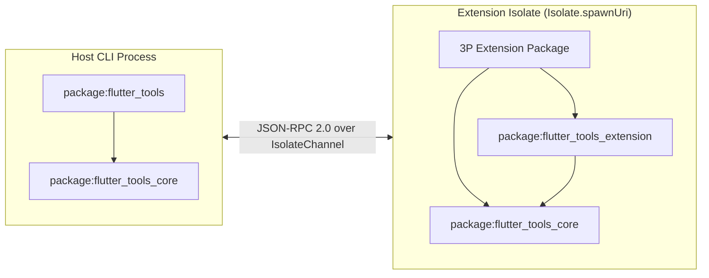
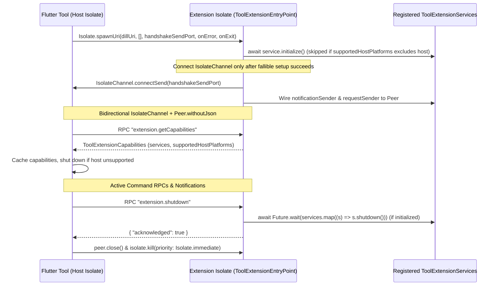

# RFC 510.0000: Targeting Custom Embedders with Flutter Tools

## Summary

This RFC proposes a first-class, isolate-based platform extension architecture for the Flutter CLI (`flutter_tools`). By decoupling target platform tooling from the core Flutter SDK into project-scoped Dart packages (`package:flutter_tools_extension` and `package:flutter_tools_core`) that communicate with the Flutter Tool over a structured JSON-RPC 2.0 protocol, third-party and custom embedder authors can hook their devices, build targets, platform templates, SDK artifacts, and diagnostics directly into standard `flutter` commands (`doctor`, `config`, `create`, `devices`, `emulators`, `run`, `attach`, `logs`, `install`, `screenshot`, `drive`, `test`, `build`, `assemble`, `precache`, and `clean`) without forking the Flutter repository or maintaining bespoke wrapper CLIs.

## Overview

Custom Flutter embeddings (such as WebOS, Tizen, automotive head units, and industrial displays) currently lack first-class access to the standard functionality of the `flutter` command-line tool. While the C/C++ Embedder API provides a stable boundary for integrating the Flutter runtime on non-standard operating systems, the developer tooling in `flutter_tools` has historically hard-coded assumptions around its six first-party target platforms (Android, iOS, web, Linux, macOS, and Windows).

Consequently, embedder maintainers have been stuck between two difficult choices:

1. **Maintaining a fork of the Flutter SDK or a bespoke wrapper CLI** (`flutter-elinux`, `flutter-tizen`, `flutter-pi` tooling) that duplicates command routing, argument parsing, and asset bundling while constantly drifting behind upstream SDK releases and breaking standard IDE integrations.
2. **Using `flutter custom-devices`**, which substitutes shell commands for basic device discovery, installation, and port forwarding via a static JSON configuration file, but cannot express custom build pipelines (`flutter build`, `flutter assemble`), platform scaffolding (`flutter create`), SDK artifact management (`flutter precache`), environment diagnostics (`flutter doctor`), or native plugin compilation.

To support custom embedders and target platforms without forks, the Flutter Tool needs to be pluggable, providing embedder maintainers a way to hook into existing commands that require knowledge of the target platform. To achieve this, the Flutter Tool will support project-scoped tool extensions (simply referred to as "extensions" throughout the rest of this document) that run in separate Dart isolates and provide platform-specific implementations for key operations performed by the tool.

Once implemented, the Tool Extension API will allow extensions to provide support for:

* Downloading and caching necessary artifacts for the target platform (e.g., custom embeddings of the Flutter engine or cross-compilation toolchains) via `flutter precache`
* Interacting with custom devices (e.g., detection via `flutter devices`, deployment and hot reload via `flutter run` and `flutter attach`, log streaming via `flutter logs`, standalone installation via `flutter install`, screenshot capture via `flutter screenshot`, and end-to-end testing via `flutter drive` and `flutter test integration_test -d <device>`)
* Selecting out-of-tree target devices and launching, hot reloading, and debugging applications directly from IDEs (VS Code and IntelliJ/Android Studio) via `flutter daemon` without custom IDE plugins
* Listing, launching, and creating device emulators (`--create`) via `flutter emulators`
* Registering high-level `flutter build <target>` subcommands and fine-grained `flutter assemble` build targets to handle compilation and bundling steps specific to the target platform
* Running custom `flutter doctor` checks to verify that the host build environment is set up for the target platform
* Registering custom feature flags and configuration options for use with `flutter config`
* Scaffolding platform runner directories for applications and plugins via `flutter create . --platforms=<platform>`
* Cleaning up extension-specific build outputs during `flutter clean`

### Non-Goals

* **Security Sandboxing**: This design focuses on process stability and isolating the tool from uncaught Dart exceptions in buggy extensions, not on providing an OS-level security sandbox for executing untrusted code (see [Section 3.3](#33-isolate-isolation-boundaries--process-wide-constraints)). Once dependencies are resolved via `flutter pub get`, extensions run with the same permissions as the Flutter Tool, matching the trust model of Dart build hooks (`package:hooks`) and analyzer plugins.
* **Non-Dart Extensions**: This proposal only supports extensions written in Dart to leverage the isolate-based communication model and shared packages.
* **Universal Dart CLI Extensibility**: While the underlying isolate JSON-RPC runner is generic, the scope of this document is limited to the Flutter Tool and does not aim to provide a general plugin system for all Dart CLI tools. (See [Out of Scope & Future Work](#out-of-scope--future-work) for follow-up first-party platform migration and `flutter custom-devices` deprecation plans.)

---

## Usage Examples

### Example 1: Implementing a Custom Embedder Extension

An embedder maintainer creates a Dart package (e.g., `package:flutter_tools_extension_custom_embedder`), implements the relevant services from `package:flutter_tools_extension`, and exposes the conventional `extension/flutter_tools/extension.dart` isolate entrypoint.

```dart
// extension/flutter_tools/extension.dart
import 'package:flutter_tools_extension/flutter_tools_extension.dart';

/// Builds a Flutter application bundle for the custom embedder target.
final class CustomEmbedderBuildTarget extends BuildTarget {
  const CustomEmbedderBuildTarget()
    : super(
        description: 'Build a custom embedder bundle.',
        outputDir:
            '${BuiltInPlaceholders.outputDir}/custom_embedder/${BuiltInPlaceholders.buildMode}',
        targetOs: 'linux',
        targetPlatform: 'custom-arm64',
      );

  /// The subcommand name registered under `flutter build`.
  @override
  String get name => 'custom-embedder';

  /// Compiles and packages the application bundle inside
  /// [ExtensionBuildContext.outputDir].
  @override
  Future<ExtensionBuildResult> build(ExtensionBuildContext context) async {
    final Uri bundleDir = context.outputDir.resolve('bundle/');
    return ExtensionBuildResult(executableUri: bundleDir);
  }
}

/// Exposes custom embedder build targets to the Flutter Tool.
final class CustomEmbedderBuildService extends BuildService {
  /// High-level `flutter build` targets provided by this extension.
  @override
  List<BuildTarget> get buildTargets => const <BuildTarget>[
    CustomEmbedderBuildTarget(),
  ];
}

/// Discovers and manages connected custom embedder hardware.
final class CustomEmbedderDeviceService extends DeviceService {
  /// Queries device tooling or scans the network for target hardware.
  @override
  Future<List<TargetDevice>> getDevices() async {
    return const <TargetDevice>[
      TargetDevice(
        buildTarget: 'custom-embedder',
        category: .mobile,
        ephemeral: true,
        id: 'embedder-01',
        name: 'Custom Embedder Reference Board',
        sdkNameAndVersion: 'CustomOS 2.1',
        supportsInstall: false,
        supportsScreenshot: false,
        supportsScreenRecording: false,
        targetPlatform: 'custom-arm64',
      ),
    ];
  }

  /// Checks whether [project] contains a `custom_embedder/` runner directory.
  @override
  Future<bool> isSupportedForProject({
    required String deviceId,
    required ExtensionFlutterProject project,
  }) async {
    return true;
  }

  /// Installs and launches [executableUri] on [deviceId] and forwards the
  /// VM Service port to the host machine.
  @override
  Future<void> launchApp({
    required String appId,
    required ExtensionDebuggingOptions debuggingOptions,
    required String deviceId,
    required Uri executableUri,
    bool prebuiltApplication = false,
  }) async {}

  /// Returns the host-forwarded HTTP VM Service URI for hot reload and
  /// DevTools.
  @override
  Future<Uri?> getVmServiceUri({
    required String deviceId,
    String? appId,
    int? deviceVmServicePort,
    int? hostVmServicePort,
  }) async {
    return Uri.parse('http://127.0.0.1:41235/abcd1234efgh=/');
  }

  /// Terminates the running application and tears down port forwarding.
  @override
  Future<void> stopApp({required String deviceId, String? appId}) async {}
}

/// Adds `--platforms=custom_embedder` support to `flutter create`.
final class CustomEmbedderTemplateService extends TemplateService {
  /// Maps the `custom_embedder` platform identifier to its template directory.
  @override
  Map<String, String> get appPlatformTemplates => const <String, String>{
    'custom_embedder':
        'package:flutter_tools_extension_custom_embedder/templates/custom_embedder',
  };
}

/// Isolate entrypoint spawned by the Flutter Tool via `Isolate.spawnUri`.
Future<void> main(List<String> args, Object? message) async {
  await ToolExtensionEntryPoint.run(
    message,
    <ToolExtensionService>[
      CustomEmbedderBuildService(),
      CustomEmbedderDeviceService(),
      CustomEmbedderTemplateService(),
    ],
    supportedHostPlatforms: <HostPlatform>{
      .darwin_arm64,
      .darwin_x64,
      .linux_arm64,
      .linux_x64,
    },
  );
}
```

### Example 2: CLI Workflow for App Developers

Once the extension is published to `pub.dev` or available locally in a workspace, application developers use standard `flutter` CLI commands:

```sh
# 1. Enable the experimental tool extensions feature flag.
$ flutter config --enable-tool-extensions

# 2. Create a Flutter project without default platform runners and add the
#    embedder extension.
$ flutter create --no-platforms my_embedded_app
$ cd my_embedded_app
$ flutter pub add --dev flutter_tools_extension_custom_embedder

# 3. Scaffold the custom platform runner directory in place.
$ flutter create . --platforms=custom_embedder

# 4. Verify environment readiness and connected target hardware.
$ flutter doctor
$ flutter devices

# 5. Run with hot reload, build a release bundle, and clean build outputs.
$ flutter run -d embedder-01
$ flutter build custom-embedder --release
$ flutter clean
```

---

## Detailed Design

### 1. Package Boundaries & Workspace Layout

The extension framework splits contracts across three packages in the Flutter repository workspace:



1. **`package:flutter_tools_core`** (`packages/flutter_tools/packages/flutter_tools_core/`):
   * **Shared by both the Flutter Tool and extensions**: Contains pure, immutable wire models and enums for devices and emulators, build and assemble targets, doctor diagnostics, configuration flags, SDK artifacts, and capability handshake metadata, imported directly by built-in `package:flutter_tools` subsystems (doctor, device, build, and project models) as well as third-party extensions.
   * Depends only on `package:collection` and `package:meta` (with zero `dart:io` or `dart:ffi` imports) so it can be published to `pub.dev` without pulling internal `flutter_tools` implementation details into third-party packages.
2. **`package:flutter_tools_extension`** (`packages/flutter_tools/packages/flutter_tools_extension/`):
   * **For extensions only (not imported by `package:flutter_tools`)**: Re-exports `package:flutter_tools_core` and provides the extension-author SDK, including the `abstract base class` service interfaces, build and assemble execution contexts, `ToolExtensionEntryPoint` isolate runner, injectable host-like dependencies (file system, logger, and process manager), and extension testing utilities (`package:flutter_tools_extension/testing.dart`).
3. **`package:flutter_tools`** (`packages/flutter_tools/`):
   * **For the host CLI only**: Implements host-side extension discovery, kernel snapshot compilation and caching, isolate lifecycle management, JSON-RPC client wrappers, and adapters bridging extension services into native Flutter Tool subsystems (doctor, config, templates, devices, build system, artifacts, and clean).

Splitting `package:flutter_tools_core` from `package:flutter_tools_extension` allows `package:flutter_tools` to share canonical data models (`ValidationResult`, `HostPlatform`, `BuildMode`, `Category`, etc.) with extensions without taking a dependency on extension-side runtime machinery (`ToolExtensionEntryPoint`, `*Service` base classes, or `testing.dart`), while keeping extensions insulated from internal `package:flutter_tools` APIs. Both `package:flutter_tools_core` and `package:flutter_tools_extension` are published to `pub.dev` and resolved via standard semantic versioning rather than being pinned to the exact version shipped inside the user's Flutter SDK. Because extensions run in separate isolates and communicate with the Flutter Tool over a backwards-compatible JSON-RPC 2.0 wire protocol (rather than sharing in-memory Dart class hierarchies with `package:flutter_tools`), an extension compiled against an older minor version of `package:flutter_tools_extension` remains compatible with newer Flutter SDKs even when newer SDKs add methods, fields, or parameters to the service interfaces.

---

### 2. Project-Scoped Discovery & Two-Tier Kernel Compilation

#### 2.1 Project-Scoped Discovery via `pubspec.yaml`

Following the precedent established by DevTools extensions, extensions are shipped as standard Dart packages and declared in a project's `pubspec.yaml` (typically under `dev_dependencies`). When the Flutter Tool runs inside a project directory, it reads direct `dependencies` and `dev_dependencies` from the active project's `pubspec.yaml` (and the Pub workspace root `pubspec.yaml`, if the project participates in a workspace), resolves only those direct dependencies' package roots in `.dart_tool/package_config.json` (`package:package_config`), and discovers any direct dependency containing `extension/flutter_tools/extension.dart` (verifying after symlink resolution that the entrypoint resides within the package root). This enables teams to lock extension versions in version control and execute reproducible builds across developer machines and CI environments with a standard `flutter pub get`.

To prevent unvetted transitive dependencies from executing code automatically and avoid running host-specific service initialization on unsupported hosts, the tool enforces several safeguards during discovery:

* **Direct Dependency Filtering**: The tool inspects the active project's `pubspec.yaml` (and the Pub workspace root `pubspec.yaml`, if the project participates in a workspace) and activates only extensions listed in direct `dependencies` or `dev_dependencies`.
* **Host Platform & Service Capability Filtering**: Because `dart compile kernel` is platform-independent Dart front-end compilation, the tool compiles an extension snapshot once per cache key and caches its handshake `ToolExtensionCapabilities` (`services` and optional `supportedHostPlatforms`). Extension `main()` entrypoints and `*Service` constructors must be side-effect-free, deferring any host-specific work to service RPC handlers (`getDevices`, `runDiagnostics`, `build`, etc.). When `supportedHostPlatforms` is non-null and excludes the current `HostPlatform`, `ToolExtensionEntryPoint.run` skips `service.initialize()`, completes the `extension.getCapabilities` handshake so the host records the cached capabilities, and shuts down cleanly (logging at trace level only). On subsequent CLI invocations, the tool skips spawning isolates whose cached `services` do not apply to the active command or whose cached `supportedHostPlatforms` excludes the current host.
* **Safe Mode Bypass**: To ensure users can recover from broken or misbehaving extensions, passing `--no-extensions` (`--[no-]extensions`) on the command line or setting `FLUTTER_NO_EXTENSIONS=1` (`true` or `yes`) in the environment skips extension discovery and isolate spawning for the invocation.
* **`pub get` Lifecycle Ordering**: Commands that register dynamic CLI flags or subcommands from extensions ensure `.dart_tool/package_config.json` is up to date before querying available extensions, and refresh discovery if `pub get` resolves new packages during command startup.
* **Long-Lived Session & Multi-Project Invalidation (`flutter daemon`)**: In long-lived sessions such as `flutter daemon`, where the initial working directory may be a multi-root workspace parent and dependencies can change mid-session (`flutter pub add --dev`), the daemon discovers extensions from the initial working directory plus any `projectDirectory` roots registered via `app.start` (or workspace roots), refreshes discovery whenever `.dart_tool/package_config.json` changes in any tracked root, and deduplicates discovered extensions across tracked roots by extension package name (if two tracked workspace roots resolve different versions of the same extension package, the first registered root wins for global `device.enable` polling and the tool logs a warning). Launching an application via `app.start` for a `projectDirectory` that does not declare that extension in its own `pubspec.yaml` remains gated by project dependency membership and `isSupportedForProject`.

#### 2.2 Entrypoint Convention & Capability Registration (`extension/flutter_tools/extension.dart`)

Every extension package exposes `extension/flutter_tools/extension.dart` at its package root with the isolate entrypoint signature `Future<void> main(List<String> args, Object? message)`. Placing the entrypoint under `extension/flutter_tools/extension.dart` scopes the extension to `flutter_tools` (matching the `extension/<target_package>/` directory layout used by DevTools extensions) without requiring a separate YAML manifest file, while keeping `bin/` reserved for actual CLI executables (preventing broken `dart run` invocations on `SendPort` scripts and preventing `pub.dev` / `pana` from falsely tagging tool extensions as `has:executable`).

Service and host-platform registration happen in one place only in typed Dart with dartdoc: the `List<ToolExtensionService>` and optional `Set<HostPlatform>? supportedHostPlatforms` passed to `ToolExtensionEntryPoint.run` (see [Section 4.1](#41-core-service-entrypoint--error-abstractions)), while build subcommand names, custom template platforms, and custom CLI flags and options are declared once in Dart on `BuildTarget`, `TemplateService`, and `ConfigService`. `supportedHostPlatforms` defaults to `null` (meaning all host platforms are supported), and passing a non-null empty set (`{}`) throws an `ArgumentError` (and fails `verifyExtensionPackage`) so an extension cannot accidentally disable itself on all hosts. Both `services` and `supportedHostPlatforms` must depend **only on the extension package snapshot** (never branching on environment variables, `PATH` or installed host toolchains, current working directory, or project contents; host environment and project checks belong in `DiagnosticsService`, `DeviceService.getDevices`, and `isSupportedForProject`). After an extension's first handshake (`extension.getCapabilities`; see [Section 3.1](#31-json-rpc-20-transport-handshake--exit-monitoring)), the tool caches its `ToolExtensionCapabilities` (`services` and `supportedHostPlatforms`) alongside the compiled `.dill` snapshot (see [Section 2.3](#23-two-tier-kernel-dill-compilation-cache)) so subsequent CLI invocations skip spawning isolates whose cached `services` do not apply to the active command or whose cached `supportedHostPlatforms` excludes the current host.

#### 2.3 Two-Tier Kernel (`.dill`) Compilation Cache

Because `Isolate.spawnUri` requires either a Dart source URI with a resolved package config or a precompiled Dart kernel (`.dill`) snapshot, the Flutter Tool compiles extension entrypoints with `dart compile kernel` into a two-tier cache to keep startup fast:

1. **Tier 1: Shared Cache for Immutable (`hosted` / `git`) Extensions**:
   * **Eligibility**: An extension is eligible for Tier 1 only when both the extension package and its entire transitive dependency closure resolve from immutable sources in `pubspec.lock` (`hosted` or `git`, with no `path:` dependencies or mutable `dependency_overrides`); otherwise it falls back to Tier 2 so edits to a transitive `path:` dependency never leave a stale shared `.dill`.
   * **Location & Cached Capabilities**: Stored under `$DART_DATA_HOME/flutter_tool_extensions/cache` (resolved using `package:dart_data_home` to follow standard per-OS user state directories) as `<package_name>-<version>-<sdkAndDepsHash>.dill`, alongside `<package_name>-<version>-<sdkAndDepsHash>.capabilities.json` written after the first handshake (`services` and `supportedHostPlatforms`).
   * **Dart SDK & Dependency Graph Cache Keying**: Compiled kernel `.dill` snapshots are tied to the exact Dart VM binary format and embed the consuming project's resolved transitive dependencies (`flutter_tools_extension`, `flutter_tools_core`, `json_rpc_2`, etc.). Two projects on the same machine may depend on the same extension version while resolving different transitive package versions, different `git` commits sharing a `pubspec.yaml` version, or different Flutter SDK versions (for example, via `fvm`). Keying Tier 1 artifacts by `<package_name>-<version>-<sdkAndDepsHash>`, hashing the exact Dart SDK version and revision (`Platform.version` / `bin/cache/dart-sdk/revision`) together with the resolved package versions and resolved `git` commit SHAs / `.dart_tool/package_config.json` `rootUri` locations of all direct and transitive dependencies in the extension's closure from `.dart_tool/package_graph.json` and `.dart_tool/package_config.json`, allows `fvm` and multi-SDK workflows to coexist in `$DART_DATA_HOME/flutter_tool_extensions/cache` without wiping cached `.dill` snapshots.
   * **Concurrency**: Protected across concurrent `flutter` invocations using cross-process file locking and atomic temporary-file renames.
2. **Tier 2: Project-Local Cache for Mutable (`path:` / Workspace) Extensions**:
   * **Location**: `<project>/.dart_tool/flutter_tools/extensions/<package_name>/extension.dill` alongside `extension.dill.d` and `extension.dill.stamp`.
   * **Invalidation & Capability Freshness Ordering**: Alongside `extension.dill`, the tool writes an `extension.dill.stamp` file recording the exact Dart SDK version and revision hash, the resolved dependency closure hash, and (after handshake) the extension's cached `ToolExtensionCapabilities` (`services` and `supportedHostPlatforms`). During discovery, the host runs the Tier 2 freshness check (`extension.dill.stamp` SDK/dependency hash plus `.dill.d` source and `.dart_tool/package_config.json` modification timestamps) **before** applying the cached-capability filter, treating stale Tier 2 snapshots as having unknown capabilities. Adding a new `*Service` to a mutable local extension is therefore picked up immediately on the next `flutter doctor` or `flutter build` invocation, and switching to an older SDK via `fvm` (whose SDK files have older modification timestamps than `extension.dill`) deterministically invalidates and recompiles `extension.dill`.

---

### 3. Isolate Transport, Lifecycle & Isolation Boundaries

#### 3.1 JSON-RPC 2.0 Transport, Handshake & Exit Monitoring



Because both endpoints execute inside the same Dart VM process, the Flutter Tool and `ToolExtensionEntryPoint` communicate over a `Peer.withoutJson` backed by an `IsolateChannel<Object?>`. Structured `Map<String, Object?>` payloads cross the isolate port directly without intermediate UTF-8 string encoding or decoding while preserving standard JSON-RPC 2.0 request, response, and notification framing.

When an extension isolate boots on a supported host platform, `ToolExtensionEntryPoint.run` invokes `await service.initialize()` on every registered service **before** calling `IsolateChannel.connectSend(sendPort)`. Because `connectSend` opens a `ReceivePort` that keeps the isolate alive, deferring channel connection until after all fallible initialization completes ensures that an unhandled exception during `initialize()` allows the isolate to exit immediately. When `supportedHostPlatforms` is non-null and excludes the current host platform, `ToolExtensionEntryPoint.run` skips `service.initialize()`, connects the `IsolateChannel` to serve `extension.getCapabilities` so the host records the cached capabilities, and awaits clean shutdown. On the host side, the tool attaches listeners to `Isolate.spawnUri`'s `onError` and `onExit` ports so unexpected isolate termination immediately fails any pending handshake or in-flight RPCs.

**Wire Payload Examples**:

1. **Capability Handshake Request**: Sent by the Flutter Tool to the extension isolate immediately after the `IsolateChannel` connects to query which services and host platforms the extension declares:

   ```json
   {
     "jsonrpc": "2.0",
     "id": 1,
     "method": "extension.getCapabilities"
   }
   ```

2. **Capability Handshake Response**: Returned by the extension isolate listing the active service namespaces and optional `supportedHostPlatforms` (serialized as a `List<String>` of `HostPlatform.cliName` values such as `linux-x64`, `linux-arm64`, `linux-riscv64`, `darwin-x64`, `darwin-arm64`, `windows-x64`, or `windows-arm64`, and omitted when unrestricted/`null`):

   ```json
   {
     "jsonrpc": "2.0",
     "id": 1,
     "result": {
       "services": ["build", "device", "template"],
       "supportedHostPlatforms": [
         "darwin-arm64",
         "darwin-x64",
         "linux-arm64",
         "linux-x64"
       ]
     }
   }
   ```

3. **Structured Log Notification**: Sent asynchronously by the extension isolate to stream log output to the Flutter Tool's logger:

   ```json
   {
     "jsonrpc": "2.0",
     "method": "extension.log",
     "params": {
       "level": "info",
       "message": "Launching /path/to/bundle on embedder-01..."
     }
   }
   ```

#### 3.2 Graceful Shutdown & Subprocess Cleanup

Extensions frequently spawn OS subprocesses (such as `ssh -L` port-forwarding tunnels, device log readers, or emulators) whose lifecycles must not outlive the `flutter` process:

* The tool registers extension teardown with its shutdown hooks on CLI exit.
* When shutting down an active extension, the tool sends an `extension.shutdown` RPC to the isolate and awaits completion with a short bounded grace period before closing the JSON-RPC `Peer` and calling `isolate.kill(priority: Isolate.immediate)`, ensuring a wedged extension cannot hang CLI exit.
* `ToolExtensionEntryPoint` handles `extension.shutdown` by invoking `await Future.wait(initializedServices.map((s) => s.shutdown()))` on every initialized service (skipping `shutdown()` when `service.initialize()` was skipped on an excluded host), allowing `DeviceService.shutdown()` and other services to terminate active tunnels and child processes cleanly.
* Because OS child processes belong to the host VM process rather than the child isolate, we also propose introducing `ExtensionProcessManager` as an injectable abstraction (allowing fake implementations to be injected in unit tests via `ExtensionDependencies`; extensions currently invoke `dart:io` `Process` or `package:process` directly) that tracks active background process PIDs and reports them to the host tool, allowing the tool to terminate any remaining child processes via `Process.killPid` if an extension isolate exits unexpectedly.

#### 3.3 Isolate Isolation Boundaries & Process-Wide Constraints

While Dart isolates provide separate heaps and prevent uncaught Dart exceptions in an extension from crashing the main tool isolate's event loop, **isolates share the same OS process** as the Flutter Tool. Extension authors and the host runtime must account for four process-wide boundaries:

1. **`stdout` / `stderr` / `stdin` Stream Integrity**: Commands such as `flutter daemon` and `flutter devices --machine` emit structured JSON protocol frames over `stdout`. Unintercepted writes to `io.stdout` or `print()` calls inside an extension isolate would corrupt the tool's machine output, and reads from `io.stdin` would contend with the host CLI for terminal input.
   * **Mitigation**: `ToolExtensionService.log` and `ExtensionLogger` emit structured `extension.log` JSON-RPC notifications that the host forwards to its logger. In addition, `ToolExtensionEntryPoint.run` executes inside both a custom `ZoneSpecification` (intercepting `print()` calls) and `IOOverrides.runZoned` (overriding `stdout`, `stderr`, and `stdin`). Any direct writes to `io.stdout` or `io.stderr` inside the extension isolate are captured by the overridden `stdout` and `stderr` streams and forwarded as `extension.log` JSON-RPC notifications (`level: .info` and `level: .error`), while `io.stdin` is overridden with an empty stream so extensions cannot block waiting on raw terminal input (interactive CLI prompts are instead mediated by the host tool over the bidirectional JSON-RPC `Peer`; see [Section 4.3](#43-configuration-flutter-config)).
2. **Process Exit & Working Directory**: Calling `io.exit()` inside an extension terminates the entire `flutter` process immediately, and mutating `io.Directory.current` alters the process-wide current working directory for the main isolate and sibling extensions.
   * **Mitigation**: The `IOOverrides.runZoned` environment installed by `ToolExtensionEntryPoint.run` also overrides `exit` (`exit: (int code) => throw UnsupportedError('Tool extensions must not call exit().')`, using the `IOOverrides.exit` hook added in Dart 3.10) and guards `getCurrentDirectory` / `setCurrentDirectory` against working-directory mutations. Instead of calling `exit()` or mutating `Directory.current`, extensions must throw `ToolExtensionException` on failure, pass explicit `workingDirectory` arguments when spawning processes, and resolve paths against project URIs.
3. **Native Crashes (FFI) and Out-of-Memory**: A segmentation fault in native FFI code loaded by an extension or process-level memory exhaustion will terminate the `flutter` process.
4. **Snapshot Format Compatibility (`Isolate.spawnUri`)**: The snapshot format passed to `Isolate.spawnUri` must match the execution mode of the host Dart runtime. Because the Flutter Tool currently executes on the Dart JIT VM, the tool compiles extensions into kernel (`.dill`) snapshots (`dart compile kernel`). If the Flutter Tool is compiled into a standalone AOT executable (`dart compile exe`), `Isolate.spawnUri` cannot load kernel `.dill` files, but it *can* spawn precompiled AOT snapshots (`dart compile aot-snapshot`) compiled with the matching Dart runtime. (See [Alternatives Considered](#alternatives-considered) for `stdio` subprocess trade-offs.)

---

### 4. Base Service Contracts & Host Integration

#### 4.1 Core Service, Entrypoint & Error Abstractions

`package:flutter_tools_extension` provides a set of base classes for the services that can be implemented by an extension. All seven extension services (`DiagnosticsService`, `ConfigService`, `TemplateService`, `DeviceService`, `BuildService`, `ArtifactService`, and `CleanService`), as well as `BuildTarget` and `AssembleTarget`, are declared as `abstract base class`. Restricting `implements` ensures that `package:flutter_tools_extension` can add new defaulted methods in minor releases without breaking existing extensions.

To replace the current ad-hoc error handling (where extensions throw generic exceptions or `RpcException` directly), this RFC proposes a single structured error model in `package:flutter_tools_core`: operational failures throw `ToolExtensionException` (with default error code `-32001`), optional capabilities that are not supported throw `UnsupportedError` (mapped to JSON-RPC error code `-32002`), and unexpected uncaught exceptions map to `json_rpc_2`'s standard `-32000` (`SERVER_ERROR`), allowing the tool to distinguish actionable domain errors from unhandled extension bugs.

```dart
// package:flutter_tools_core/src/exception.dart
/// An exception thrown by a tool extension to report an intentional,
/// user-actionable operational failure over JSON-RPC 2.0.
@immutable
class ToolExtensionException implements Exception {
  /// Creates a domain exception with a user-facing [message], optional JSON-RPC
  /// error [code], and optional structured diagnostic [data].
  const ToolExtensionException(
    this.message, {
    this.code = domainErrorCode,
    this.data,
  });

  /// JSON-RPC error code for intentional, user-actionable domain errors.
  /// Distinct from -32000 (`SERVER_ERROR`), which indicates an unhandled
  /// exception in the extension isolate.
  static const domainErrorCode = -32001;

  /// JSON-RPC error code returned when an optional capability is not supported
  /// by the extension.
  static const unsupportedCapabilityErrorCode = -32002;

  /// The JSON-RPC 2.0 error code reported to the Flutter Tool.
  final int code;

  /// Optional structured error details serialized into the JSON-RPC error data.
  final Map<String, Object?>? data;

  /// Human-readable error message surfaced by the Flutter Tool.
  final String message;
}
```

```dart
// package:flutter_tools_extension/src/protocol_base/service.dart
/// Signature for a JSON-RPC 2.0 request handler registered by a
/// [ToolExtensionService].
typedef ExtensionRpcHandler = FutureOr<Object?> Function(
  Map<String, Object?> params,
);

/// Callback that dispatches a fire-and-forget JSON-RPC 2.0 notification from a
/// [ToolExtensionService] to the host tool.
typedef ExtensionNotificationSender = void Function(
  String method,
  Map<String, Object?> params,
);

/// Callback that dispatches a JSON-RPC 2.0 request from a
/// [ToolExtensionService] to the host tool over the bidirectional peer.
typedef ExtensionRequestSender = Future<Object?> Function(
  String method,
  Map<String, Object?> params,
);

/// Base class for all services exposed by a Flutter Tool extension isolate.
abstract base class ToolExtensionService {
  /// JSON-RPC request method used to query the persisted `flutter config`
  /// values owned by this extension from the host tool.
  static const getConfigurationValuesRequestMethod =
      'extension.getConfigurationValues';

  /// JSON-RPC notification method used to stream structured log messages to the
  /// host tool.
  static const logNotificationMethod = 'extension.log';

  /// JSON-RPC notification method used to report progress for long-running
  /// operations.
  static const progressNotificationMethod = 'extension.progress';

  /// JSON-RPC request method used to prompt the user to enter a line of text or
  /// a passphrase via the host tool's interactive terminal.
  static const promptForInputRequestMethod = 'terminal.promptForInput';

  /// JSON-RPC request method used to prompt the user to select an option from
  /// an interactive terminal menu on the host tool.
  static const promptForOptionRequestMethod = 'terminal.promptForOption';

  /// Callback wired by [ToolExtensionEntryPoint.run] when the JSON-RPC peer
  /// channel connects.
  @internal
  ExtensionNotificationSender? notificationSender;

  /// Callback wired by [ToolExtensionEntryPoint.run] when the JSON-RPC peer
  /// channel connects to send requests to the host tool.
  @internal
  ExtensionRequestSender? requestSender;

  /// The JSON-RPC method namespace prefix owned by this service (for example,
  /// `'device'` or `'build'`).
  String get namespace;

  /// Initializes state needed by the service and returns a map of RPC method
  /// handlers (without the [namespace] prefix).
  Future<Map<String, ExtensionRpcHandler>> initialize();

  /// Sends a fire-and-forget JSON-RPC 2.0 notification to the host tool.
  /// Throws a [StateError] if called before the peer channel is connected.
  void sendNotification(String method, Map<String, Object?> params) {
    final ExtensionNotificationSender? sender = notificationSender;
    if (sender == null) {
      throw StateError(
        'Cannot send notification "$method": service "$namespace" is not '
        'attached to an active peer.',
      );
    }
    sender(method, params);
  }

  /// Sends a structured `extension.log` notification to the host tool.
  void log(
    String message, {
    ExtensionLogLevel level = .info,
    DateTime? timestamp,
  }) {
    sendNotification(logNotificationMethod, <String, Object?>{
      'level': level.name,
      'message': message,
      'timestamp': (timestamp ?? DateTime.now()).toUtc().toIso8601String(),
    });
  }

  /// Emits an `extension.progress` notification to report progress for
  /// long-running operations to the host tool.
  void reportProgress(String message) {
    sendNotification(progressNotificationMethod, <String, Object?>{
      'message': message,
    });
  }

  Future<Object?> _sendRequest(String method, Map<String, Object?> params) {
    final ExtensionRequestSender? sender = requestSender;
    if (sender == null) {
      throw StateError(
        'Cannot send request "$method": service "$namespace" is not '
        'attached to an active peer.',
      );
    }
    return sender(method, params);
  }

  /// Queries the host tool over the bidirectional JSON-RPC `Peer` for the
  /// persisted `flutter config` values owned by this extension (`bool` for
  /// declared `FeatureFlag.settingName` keys, `String` for declared
  /// `ConfigOption.name` and `ConfigAction.settingsKeys`), omitting unset
  /// keys.
  Future<Map<String, Object?>> getConfigurationValues() async {
    final Object? response = await _sendRequest(
      getConfigurationValuesRequestMethod,
      const <String, Object?>{},
    );
    if (response case final Map<String, Object?> map) {
      return map;
    }
    throw FormatException(
      'Expected Map<String, Object?> from '
      '"$getConfigurationValuesRequestMethod", got ${response.runtimeType}.',
      response,
    );
  }

  /// Prompts the user to enter a line of text via the host tool's interactive
  /// terminal over the bidirectional JSON-RPC peer.
  ///
  /// When [echo] is `false`, the host disables terminal character echoing
  /// while reading the line (for pairing passphrases or PINs). Returns the
  /// entered text (including `''` or [defaultValue]), or `null` if the user
  /// cancels input (EOF). Throws a [ToolExtensionException] if the host tool
  /// is running without an interactive terminal or with `--machine`.
  Future<String?> promptForInput({
    required String message,
    String? defaultValue,
    bool echo = true,
  }) async {
    final Object? response = await _sendRequest(
      promptForInputRequestMethod,
      <String, Object?>{
        'message': message,
        'defaultValue': ?defaultValue,
        'echo': echo,
      },
    );
    if (response case {'value': final String? value}) {
      return value;
    }
    throw FormatException(
      'Expected {"value": String?} from "$promptForInputRequestMethod", got '
      '${response.runtimeType}.',
      response,
    );
  }

  /// Prompts the user to select an option from [options] via the host tool's
  /// interactive terminal over the bidirectional JSON-RPC peer.
  ///
  /// Returns the selected 0-based index in [options], or `null` if the user
  /// cancels the prompt. Throws a [ToolExtensionException] if the host tool is
  /// running without an interactive terminal or with `--machine`.
  Future<int?> promptForOption({
    required String message,
    required List<String> options,
    int? defaultChoiceIndex,
  }) async {
    final Object? response = await _sendRequest(
      promptForOptionRequestMethod,
      <String, Object?>{
        'message': message,
        'options': options,
        'defaultChoiceIndex': ?defaultChoiceIndex,
      },
    );
    if (response case {'selectedIndex': final int? selectedIndex}) {
      return selectedIndex;
    }
    throw FormatException(
      'Expected {"selectedIndex": int?} from "$promptForOptionRequestMethod", '
      'got ${response.runtimeType}.',
      response,
    );
  }

  /// Cleans up resources held by the service when the extension is shut down.
  Future<void> shutdown() async {}
}

/// Bootstraps a tool extension isolate and binds registered
/// [ToolExtensionService]s to a JSON-RPC 2.0 peer over an `IsolateChannel`.
abstract final class ToolExtensionEntryPoint {
  /// Initializes [services], connects the isolate handshake port from
  /// [message], reports `ToolExtensionCapabilities` (`services` and optional
  /// [supportedHostPlatforms]), and listens for JSON-RPC 2.0 requests inside
  /// an `IOOverrides` and print-capturing `Zone`.
  ///
  /// [supportedHostPlatforms] defaults to `null` (all host platforms
  /// supported); passing a non-null empty set throws an [ArgumentError]. When
  /// [supportedHostPlatforms] excludes the current host platform, `run` skips
  /// `service.initialize()` while still serving `extension.getCapabilities` so
  /// the host tool can cache capabilities and shut down cleanly.
  ///
  /// Both [services] and [supportedHostPlatforms] must depend only on the
  /// extension package snapshot (never branching on environment variables,
  /// `PATH` or installed host toolchains, working directory, or project
  /// contents) so cached handshake capabilities remain valid across invocations
  /// and projects, and the extension's `main()` entrypoint and `*Service`
  /// constructors must be side-effect-free, deferring any host-specific work to
  /// service RPC handlers (`getDevices`, `runDiagnostics`, `build`, etc.).
  static Future<void> run(
    Object? message,
    List<ToolExtensionService> services, {
    Set<HostPlatform>? supportedHostPlatforms,
  }) async {
    // Validates that `message` is a SendPort and `supportedHostPlatforms` is
    // null or non-empty, initializes services when the current host is
    // supported, connects the IsolateChannel, and listens inside
    // IOOverrides.runZoned and a print-capturing Zone.
  }
}
```

#### 4.2 Diagnostics (`flutter doctor`)

To provide environment diagnostics via `flutter doctor`, extensions can register a `DiagnosticsService` that runs one or more validation checks for the target platform's SDK and host toolchain. Each extension providing a `DiagnosticsService` appears as a category in `flutter doctor`, and when `runDiagnostics()` returns multiple `ValidationResult` entries, the tool merges them by severity (`crash > missing > partial > notAvailable > success`).

```dart
/// The service responsible for executing custom diagnostic checks that
/// can be reported via `flutter doctor`.
abstract base class DiagnosticsService extends ToolExtensionService {
  /// The JSON-RPC namespace for diagnostics RPCs (`'diagnostics'`).
  static const String serviceNamespace = 'diagnostics';

  /// The JSON-RPC method namespace owned by this service.
  @override
  String get namespace => serviceNamespace;

  /// This is displayed in the CLI as the header for the check (for example,
  /// `'Tizen toolchain'`).
  String get title;

  /// An RPC handler the main tool invokes to retrieve and run all custom
  /// diagnostic checks provided by this extension.
  Future<List<ValidationResult>> runDiagnostics();
}
```

When `flutter doctor` runs in a project with custom embedder extensions installed, each extension's diagnostic result (including passing `[✓]`, partial `[!]`, or failing `[✗]` status and any `ValidationMessage` error or hint lines) is displayed alongside the built-in categories:

```text
$ flutter doctor
Doctor summary (to see all details, run flutter doctor -v):
[✓] Flutter (Channel main, 3.43.0-1.0.pre, on Linux, locale en_US.UTF-8)
[✓] Android toolchain - develop for Android devices (Android SDK version 35.0.0)
[✓] Chrome - develop for the web
[✓] Linux toolchain - develop for Linux desktop
[✗] Tizen toolchain - develop for Tizen devices
    ✗ Tizen Studio is not installed; download from https://developer.tizen.org/development/tizen-studio/download
    ! Set the Tizen Studio installation path with "flutter config --tizen-sdk=<path>"
[!] Embedded Linux toolchain - develop for eLinux devices (eLinux SDK 1.4.0)
    ! clang++ cross-compiler for aarch64-linux-gnu not found on PATH
[✓] Connected device (2 available)
[✓] Network resources
```

#### 4.3 Configuration (`flutter config`)

To support custom configuration options, extensions can provide an implementation of `ConfigService`, which allows extensions to add boolean feature flags (`--[no-]enable-<flag>`), key-value configuration options (`--<option>=<value>`), and action flags (`--<action>`) to `flutter config`. For declarative flags and key-value options, the Flutter Tool dynamically registers them on the `flutter config` argument parser, groups them under the extension's `title` in `flutter config --help`, and persists values in the user's global Flutter settings file.

In addition to declarative flags and key-value options, platforms such as iOS and macOS require action-based and interactive configuration workflows in `flutter config` (for example, `flutter config --select-ios-signing-settings`, which walks the user through selecting a code-signing certificate or provisioning profile via interactive terminal prompts, and `flutter config --clear-ios-signing-settings`, which clears multiple saved settings without taking a CLI value). `ConfigService` supports these workflows without giving extension isolates direct access to `io.stdin`:

* **Action Registration (`getConfigActions`)**: Extensions declare `ConfigAction` entries (with `name`, `help`, optional `aliases`, and `settingsKeys`), which the Flutter Tool registers as non-negatable boolean action flags on `flutter config`. `ConfigAction.settingsKeys` declares the configuration keys managed by the action so the tool can display their saved values under the extension's section in `flutter config --list` without exposing them as standalone `--<key>=<value>` CLI flags.
* **Action Execution & Persistence (`runConfigAction`)**: When the user invokes `flutter config --<action>`, the tool calls `runConfigAction(name, currentSettings: ...)` (scoping `currentSettings` to the extension's declared `ConfigOption` names and `ConfigAction.settingsKeys`), validates that all keys in the returned `Map<String, String?>` belong to those declared keys, and applies the updates to Flutter's configuration store (persisting non-null string values and removing keys mapped to `null`).
* **Host-Mediated Interactive Prompts (`terminal.promptForOption` & `terminal.promptForInput`)**: When an action needs interactive user input, the extension calls `promptForOption(...)` (for numbered menu selections) or `promptForInput(...)` (for free-form text or `echo: false` passphrase entry) on `ToolExtensionService` over the bidirectional `Peer`. In both cases, the host tool verifies `terminal.stdinHasTerminal` (failing fast with a `ToolExtensionException` if invoked non-interactively or with `--machine`) and returns the user's selection or text (or `null` if the user cancels the prompt). This allows interactive hardware setup and device pairing workflows (such as prompting for a device address and an ephemeral on-screen pairing passphrase via `promptForInput(..., echo: false)` to exchange SSH keys) to run directly inside `flutter config` without requiring users to invoke a separate vendor CLI tool. Extensions managing multi-device or structured connection inventories should persist those records in an extension-managed configuration file (under `$DART_DATA_HOME/<extension>/` or at a path configured via `ConfigOption`) so interactive `ConfigAction` flows can update it while CI and headless environments can configure devices declaratively. Such extension-managed device inventory files are runtime `DeviceService` state and must not be read as untracked inputs inside `BuildTarget.build` or `AssembleTarget.build` (any file read during `flutter assemble` must be declared via `ExtensionPatternSource`).

At runtime, `ToolExtensionService` subclasses (`DiagnosticsService`, `ArtifactService`, `DeviceService`, and `TemplateService`) read persisted configuration values by calling `getConfigurationValues()` (`extension.getConfigurationValues`) over the bidirectional JSON-RPC `Peer`. By contrast, because `BuildTarget` and `AssembleTarget` are not `ToolExtensionService` subclasses and `AssembleTarget.build` must not read untracked inputs over ad-hoc RPCs (which would bypass `flutter assemble` incremental cache invalidation), build and assemble targets receive the extension's persisted settings directly via `ExtensionBuildContext.configuration`, which the host hashes into the `flutter assemble` environment inputs so configuration changes automatically invalidate cached build outputs. To enforce per-extension scoping and avoid key collisions across extensions, persisted values are namespaced per extension package in host settings storage, the host filters `getConfigurationValues()` and `ExtensionBuildContext.configuration` strictly to keys declared by that extension's `ConfigService` (`FeatureFlag.settingName` mapped to `bool`, and `ConfigOption.name` and `ConfigAction.settingsKeys` mapped to `String`, omitting unset keys), and colliding CLI flag names across active extensions fail registration with a clear diagnostic, consistent with `BuildTarget` subcommand collision handling. When first-party platforms migrate existing top-level `flutter config` settings (such as `ios-signing-cert`), `ConfigOption.aliases` (or legacy top-level fallback) preserves backward-compatible reads while new extension keys remain isolated per extension package.

```dart
/// Describes an interactive or multi-setting configuration action registered on
/// `flutter config` (for example, `--select-ios-signing-settings` or
/// `--clear-ios-signing-settings`).
@immutable
class ConfigAction {
  /// Creates a configuration action definition for `flutter config`.
  const ConfigAction({
    required this.help,
    required this.name,
    this.aliases = const <String>[],
    this.settingsKeys = const <String>[],
  });

  /// Alternative flag names accepted for this action on the command line.
  final List<String> aliases;

  /// Description shown in `flutter config --help`.
  final String help;

  /// Flag name exposed on `flutter config` as `--<name>` (non-negatable).
  final String name;

  /// Configuration store keys read, updated, or cleared by this action (for
  /// example, `const <String>['ios-signing-cert', 'ios-signing-profile']`).
  ///
  /// Used by the Flutter Tool to scope the `currentSettings` passed to
  /// [ConfigService.runConfigAction], validate the returned updates, and
  /// display saved values under the extension's section in
  /// `flutter config --list` without exposing them as standalone CLI flags.
  final List<String> settingsKeys;
}

/// The service responsible for managing custom configuration options and
/// interactive configuration actions for an extension.
abstract base class ConfigService extends ToolExtensionService {
  /// The JSON-RPC namespace for configuration RPCs (`'config'`).
  static const String serviceNamespace = 'config';

  /// The JSON-RPC method namespace owned by this service.
  @override
  String get namespace => serviceNamespace;

  /// Section header displayed for this extension's settings in
  /// `flutter config` output.
  String get title;

  /// Returns boolean feature flags exposed as `--[no-]enable-<name>` flags in
  /// `flutter config`.
  Future<List<FeatureFlag>> getFeatureFlags() async => const <FeatureFlag>[];

  /// Returns key-value configuration options (such as custom SDK paths) exposed
  /// in `flutter config`.
  Future<List<ConfigOption>> getConfigurations() async => const <ConfigOption>[];

  /// Returns action flags (such as `--select-<platform>-signing-settings` or
  /// `--clear-<platform>-signing-settings`) exposed as non-negatable flags in
  /// `flutter config`.
  Future<List<ConfigAction>> getConfigActions() async => const <ConfigAction>[];

  /// Executes the configuration action named [name] with the current persisted
  /// settings map [currentSettings] and returns the updated key-value entries
  /// to persist (where keys mapped to `null` are removed from Flutter's
  /// configuration store).
  Future<Map<String, String?>> runConfigAction(
    String name, {
    required Map<String, String?> currentSettings,
  }) async {
    throw UnsupportedError('Unknown config action: $name');
  }
}
```

#### 4.4 Platform Templates & Scaffolding (`flutter create`)

To integrate with `flutter create`, extensions can implement `TemplateService`. This service allows embedder maintainers to supply platform-specific runner templates that augment standard application and plugin projects. This RFC proposes adding a dedicated non-negatable boolean flag `--no-platforms` (`addFlag('no-platforms', negatable: false)`, mutually exclusive with `--platforms`) on `flutter create` (`flutter create --no-platforms <dir>`) that scaffolds only the shared Dart project skeleton (`pubspec.yaml`, `lib/`, `test/`) so developers targeting only a custom embedder can perform clean two-step scaffolding (`flutter create --no-platforms <dir>`, `flutter pub add --dev <ext>`, and `flutter create . --platforms=<custom_platform>`) without generating unused built-in platform directories.

```dart
// package:flutter_tools_core/src/templates.dart
/// Project template archetype being scaffolded by `flutter create`.
enum ExtensionTemplateType {
  /// A standard Flutter application (`flutter create -t app`).
  app,

  /// A Flutter FFI plugin (`flutter create -t plugin_ffi`).
  ffiPlugin,

  /// A Flutter platform channel plugin (`flutter create -t plugin`).
  plugin,
}

/// Describes a custom boolean CLI flag registered by a [TemplateService] on
/// `flutter create`.
@immutable
class TemplateFlag {
  /// Creates a boolean CLI flag definition for `flutter create`.
  const TemplateFlag({
    required this.help,
    required this.name,
    this.abbr,
    this.defaultsTo = false,
    this.negatable = true,
  });

  /// Optional single-character short flag alias.
  final String? abbr;

  /// Default boolean value when the flag is not passed on the command line.
  final bool defaultsTo;

  /// Description shown in `flutter create --help`.
  final String help;

  /// Long CLI flag name (for example, `'tizen-wearable'`).
  final String name;

  /// Whether the flag supports a `--no-<name>` prefix.
  final bool negatable;
}

/// Describes a custom single-value CLI option registered by a
/// [TemplateService] on `flutter create`.
@immutable
class TemplateOption {
  /// Creates a single-value CLI option definition for `flutter create`.
  const TemplateOption({
    required this.help,
    required this.name,
    this.abbr,
    this.allowed,
    this.allowedHelp,
    this.defaultsTo,
    this.valueHelp,
  });

  /// Optional single-character short option alias.
  final String? abbr;

  /// Optional allowlist of valid string values for this option.
  final List<String>? allowed;

  /// Optional per-value descriptions for each entry in [allowed].
  final Map<String, String>? allowedHelp;

  /// Default value used when the option is omitted on the command line.
  final String? defaultsTo;

  /// Description shown in `flutter create --help`.
  final String help;

  /// Long CLI option name (for example, `'tizen-language'` or `'app-type'`).
  final String name;

  /// Placeholder label for the option value in `--help` output.
  final String? valueHelp;
}

/// Descriptor for a resolved platform template variant returned by
/// [TemplateService.resolvePlatformTemplate].
@immutable
class ExtensionPlatformTemplate {
  /// Creates a platform template descriptor with its [templateUri] and
  /// optional [dependencies] and [overwritePaths].
  const ExtensionPlatformTemplate({
    required this.templateUri,
    this.dependencies = const <String, String>{},
    this.overwritePaths = const <String>{},
  });

  /// Additional pub package dependencies (`packageName -> versionConstraint`)
  /// inserted under `dependencies:` in `pubspec.yaml` if not already present
  /// (unless `--overwrite` is passed) when rendering this template variant.
  final Map<String, String> dependencies;

  /// Relative in-project POSIX file paths (such as `'lib/main.dart'`) that
  /// this template variant may replace during additive
  /// `flutter create . --platforms=<platform>` scaffolding when the existing
  /// file still matches the unmodified default `flutter create` skeleton (or
  /// when `--overwrite` is passed).
  ///
  /// Entries must stay strictly within the project root (rejecting absolute
  /// paths, `..` traversal segments, `.dart_tool/**`, and `pubspec.yaml`).
  final Set<String> overwritePaths;

  /// `package:` URI pointing to the Mustache template directory to render.
  final Uri templateUri;
}

// package:flutter_tools_extension/src/templates.dart
/// The service responsible for adding custom platform support to
/// `flutter create` for `app`, `plugin`, and `plugin_ffi` projects.
abstract base class TemplateService extends ToolExtensionService {
  /// The JSON-RPC namespace for template RPCs (`'template'`).
  static const String serviceNamespace = 'template';

  /// The JSON-RPC method namespace owned by this service.
  @override
  String get namespace => serviceNamespace;

  /// Custom boolean CLI flags registered on `flutter create` and passed in
  /// `toolParameters['templateFlags']`.
  List<TemplateFlag> get flags => const <TemplateFlag>[];

  /// Custom single-value CLI options registered on `flutter create` and passed
  /// in `toolParameters['templateOptions']` (for example,
  /// `--tizen-language=cpp|csharp` or `--app-type=ui|service|multi`).
  List<TemplateOption> get options => const <TemplateOption>[];

  /// Map of custom platform identifiers to `package:` URIs pointing to
  /// application platform runner template directories rendered when
  /// `flutter create . --platforms=<platform>` is invoked.
  Map<String, String> get appPlatformTemplates => const <String, String>{};

  /// Map of custom platform identifiers to `package:` URIs pointing to
  /// plugin platform template directories rendered for plugin projects
  /// (`flutter create . -t plugin --platforms=<platform>`).
  Map<String, String> get pluginPlatformTemplates => const <String, String>{};

  /// Map of custom platform identifiers to `package:` URIs pointing to FFI
  /// plugin platform template directories rendered for FFI plugin projects
  /// (`flutter create . -t plugin_ffi --platforms=<platform>`).
  Map<String, String> get ffiPluginPlatformTemplates =>
      const <String, String>{};

  /// Custom platform identifiers supported for `-t app` projects, surfaced in
  /// `flutter create --help`, `--platforms` validation, and
  /// `verifyExtensionPackage`.
  ///
  /// Defaults to the keys of [appPlatformTemplates]; extensions overriding
  /// [resolvePlatformTemplate] for dynamic multi-variant templates without
  /// populating [appPlatformTemplates] override this getter directly.
  Set<String> get appPlatforms => appPlatformTemplates.keys.toSet();

  /// Custom platform identifiers supported for `-t plugin` projects, surfaced
  /// in `flutter create --help`, `--platforms` validation, and
  /// `verifyExtensionPackage`.
  ///
  /// Defaults to the keys of [pluginPlatformTemplates]; extensions overriding
  /// [resolvePlatformTemplate] without populating [pluginPlatformTemplates]
  /// override this getter directly.
  Set<String> get pluginPlatforms => pluginPlatformTemplates.keys.toSet();

  /// Custom platform identifiers supported for `-t plugin_ffi` projects,
  /// surfaced in `flutter create --help`, `--platforms` validation, and
  /// `verifyExtensionPackage`.
  ///
  /// Defaults to the keys of [ffiPluginPlatformTemplates]; extensions
  /// overriding [resolvePlatformTemplate] without populating
  /// [ffiPluginPlatformTemplates] override this getter directly.
  Set<String> get ffiPluginPlatforms =>
      ffiPluginPlatformTemplates.keys.toSet();

  /// Resolves the platform template descriptor for [platform] and
  /// [templateType] using the parsed [toolParameters].
  ///
  /// Defaults to looking up [platform] in [appPlatformTemplates],
  /// [pluginPlatformTemplates], or [ffiPluginPlatformTemplates]. Extensions
  /// with multiple template variants (such as C++ vs. C# or UI vs. background
  /// service app templates) can override this method to validate platform
  /// options, select a template directory, specify shared project files in
  /// [ExtensionPlatformTemplate.overwritePaths] (such as `'lib/main.dart'`),
  /// or declare additional pub dependencies in
  /// [ExtensionPlatformTemplate.dependencies].
  Future<ExtensionPlatformTemplate?> resolvePlatformTemplate({
    required String platform,
    required ExtensionTemplateType templateType,
    required Map<String, Object?> toolParameters,
  }) async {
    final String? rawUri = switch (templateType) {
      .app => appPlatformTemplates[platform],
      .ffiPlugin => ffiPluginPlatformTemplates[platform],
      .plugin => pluginPlatformTemplates[platform],
    };
    if (rawUri == null) {
      return null;
    }
    return ExtensionPlatformTemplate(templateUri: Uri.parse(rawUri));
  }

  /// Generates or augments the map of parameters to values used to populate
  /// Mustache template variables when rendering [platform] during
  /// `flutter create . --platforms=<platform>`.
  ///
  /// Defaults to returning [toolParameters] unchanged.
  Future<Map<String, Object?>> generatePlatformTemplateParameters({
    required String platform,
    required Map<String, Object?> toolParameters,
  }) async => toolParameters;

  /// Returns the platform configuration map (for example, `pluginClass`,
  /// `dartPluginClass`, or `ffiPlugin`) to merge under
  /// `flutter.plugin.platforms.<platform>` in `pubspec.yaml` when scaffolding
  /// a plugin via `flutter create . -t plugin --platforms=<platform>` or
  /// `flutter create . -t plugin_ffi --platforms=<platform>`, or `null` if no
  /// `pubspec.yaml` update is needed.
  Future<Map<String, Object?>?> generatePluginPlatformConfig({
    required String platform,
    required ExtensionTemplateType templateType,
    required Map<String, Object?> toolParameters,
  }) async => null;
}
```

Host integration with `TemplateService` during `flutter create` follows these steps:

* **Platform Discovery (`appPlatforms`, `pluginPlatforms`, `ffiPluginPlatforms`)**: `flutter create` queries active `TemplateService` extensions for `appPlatforms`, `pluginPlatforms`, and `ffiPluginPlatforms` (defaulting to the keys of `appPlatformTemplates`, `pluginPlatformTemplates`, and `ffiPluginPlatformTemplates`) so extensions overriding `resolvePlatformTemplate` for multi-variant templates can advertise their supported platform identifiers to `flutter create --help` and `--platforms` validation without supplying placeholder URIs.
* **Custom `flutter create` CLI Flags & Options (`flags` & `options`)**: Before parsing arguments, `flutter create` queries active `TemplateService` extensions for their `flags` (`TemplateFlag`) and `options` (`TemplateOption`), registers them on the `flutter create` `ArgParser`, and includes the parsed maps under `toolParameters['templateFlags']` (`Map<String, bool>`) and `toolParameters['templateOptions']` (`Map<String, String>`) alongside standard template parameters (`projectName`, `description`, `organization`, `androidLanguage`, `iosLanguage`, etc.). `flutter create` rejects both long-name (`name`) and short-alias (`abbr`) collisions against built-in `CreateCommand` options, global `FlutterCommandRunner` flags (`-d`, `-v`, `-h`, etc.), and other active extensions. Because `CreateCommand` shares a single `ArgParser` across all target platforms, `TemplateOption` intentionally omits `mandatory` (which would otherwise break unrelated commands such as `flutter create . --platforms=linux` whenever the extension is active); extensions validate any platform-required options inside `resolvePlatformTemplate` when their platform is requested.
* **Dynamic Multi-Variant Template Resolution, Selective Overwrite, & Extra Dependencies (`resolvePlatformTemplate`)**: When `flutter create . --platforms=<platform>` (for `-t app`, `-t plugin`, or `-t plugin_ffi`) runs, the tool calls `resolvePlatformTemplate(platform: platform, templateType: ..., toolParameters: ...)` (defaulting to `appPlatformTemplates[platform]`, `pluginPlatformTemplates[platform]`, or `ffiPluginPlatformTemplates[platform]`). The tool resolves `ExtensionPlatformTemplate.templateUri` against `.dart_tool/package_config.json` and renders its Mustache templates into the project directory using the parameters returned by `generatePlatformTemplateParameters`:
  * Relative POSIX paths in `ExtensionPlatformTemplate.overwritePaths` must stay strictly within the project root (the host rejects absolute paths, `..` traversal segments, `.dart_tool/**`, and `pubspec.yaml`). Without `--overwrite`, an existing file listed in `overwritePaths` (for example, `'lib/main.dart'` when scaffolding a headless background service or multi-entrypoint application template after `flutter create --no-platforms`) is overwritten only if its contents match the unmodified default `flutter create` skeleton; if the user has modified the file, the host preserves it and logs a status hint to pass `--overwrite`.
  * Package entries declared in `ExtensionPlatformTemplate.dependencies` (`packageName -> versionConstraint`) are merged under `dependencies:` in `pubspec.yaml` using insert-if-missing semantics (`!dependencies.containsKey(pkg) || overwrite`) prior to running `flutter pub get`.
* **Plugin Platform Stanza Generation (`generatePluginPlatformConfig`)**: When scaffolding a plugin platform (`flutter create . -t plugin --platforms=<platform>` or `flutter create . -t plugin_ffi --platforms=<platform>`), `generatePluginPlatformConfig` receives `platform`, `templateType`, and `toolParameters` (including `templateFlags` and `templateOptions` so multi-language extensions such as Tizen C++ vs. C# plugins can emit the language-appropriate schema). If it returns a non-null map (for example, `{'pluginClass': '...', 'fileName': '...'}` or `{'ffiPlugin': true}`), the Flutter Tool merges that stanza under `flutter.plugin.platforms.<platform>` in the plugin's `pubspec.yaml`, inserting missing keys without overwriting existing user-edited keys unless `--overwrite` is passed to `flutter create`.
* **Add-to-App Module Targets (`flutter build <target>-module`)**: Following the Android (`.android/`) and iOS (`.ios/`) module pattern, `flutter create --template=module` remains platform-agnostic and does not require a separate module template hook on `TemplateService`. Instead, an extension's module `BuildTarget` (for example, `flutter build tizen-module`) lazily scaffolds or refreshes its ephemeral host runner directory (such as `.tizen/`) during `BuildTarget.build` by rendering its module templates directly.

> [!NOTE]
> **Why standalone project templates (`flutter create -t <template>`) are not supported at this time**:
>
> * Under project-scoped `dev_dependencies` discovery, an application or plugin project already exists before the extension is discovered in `.dart_tool/package_config.json`, making a full-project creation template (`-t <custom>`) redundant or destructive (`--overwrite`).
> * In `flutter create`, `-t` (`--template`) selects the project *archetype* (`app`, `module`, `package`, `plugin`, `plugin_ffi`), whereas `--platforms` selects target platforms (`android`, `ios`, `linux`, etc.); a custom embedder is a target platform rather than a new project archetype.
> * Both built-in Mustache variables and custom extension-computed Mustache variables (via `generatePlatformTemplateParameters`) are supported directly when rendering `--platforms=<custom_platform>`.
> * Because `TemplateService` is an `abstract base class`, support for standalone project templates can be added in a future release as a defaulted getter without breaking existing extensions if a workspace-level scaffolding use case arises.

#### 4.5 Build and Compilation (`flutter build` & `flutter assemble`)

Extensions interested in integrating with the tool's build system provide an implementation of `BuildService`, which can expose both high-level `BuildTarget`s (registered as `flutter build <name>` subcommands for packaging bundles such as `.tpk` or `.ipk`) and fine-grained `AssembleTarget`s (nodes in the `flutter assemble` dependency graph):

```dart
// package:flutter_tools_core/src/build.dart
/// Shader compilation targets supported by the Flutter tool's `impellerc`
/// shader compiler.
enum ExtensionShaderTarget {
  /// Skia Shading Language (SkSL) runtime stage bundle.
  sksl,

  /// OpenGL ES 2.0 Impeller shader target.
  gles,

  /// OpenGL ES 3.0 Impeller shader target.
  gles3,

  /// Vulkan Impeller shader target.
  vulkan,

  /// Apple Metal Impeller shader target.
  metal,
}

// package:flutter_tools_extension/src/build.dart
/// Describes a custom boolean CLI flag registered by a [BuildTarget] on
/// `flutter build <name>`.
@immutable
class BuildFlag {
  /// Creates a boolean CLI flag definition for a [BuildTarget] subcommand.
  const BuildFlag({
    required this.help,
    required this.name,
    this.abbr,
    this.defaultsTo = false,
    this.negatable = true,
  });

  /// Optional single-character short flag alias (for example, `'s'`).
  final String? abbr;

  /// Default boolean value when the flag is not passed on the command line.
  final bool defaultsTo;

  /// Description shown in `flutter build <name> --help`.
  final String help;

  /// Long CLI flag name (for example, `'sign'` for `--[no-]sign`).
  final String name;

  /// Whether the flag supports a `--no-<name>` prefix.
  final bool negatable;
}

/// Describes a custom single-value CLI option registered by a [BuildTarget] on
/// `flutter build <name>`.
@immutable
class BuildOption {
  /// Creates a single-value CLI option definition for a [BuildTarget]
  /// subcommand.
  const BuildOption({
    required this.help,
    required this.name,
    this.abbr,
    this.allowed,
    this.allowedHelp,
    this.defaultsTo,
    this.mandatory = false,
    this.valueHelp,
  });

  /// Optional single-character short option alias.
  final String? abbr;

  /// Optional allowlist of valid string values for this option.
  final List<String>? allowed;

  /// Optional per-value descriptions for each entry in [allowed].
  final Map<String, String>? allowedHelp;

  /// Default value used when the option is omitted on the command line.
  final String? defaultsTo;

  /// Description shown in `flutter build <name> --help`.
  final String help;

  /// Whether the user must provide this option when invoking
  /// `flutter build <name>`.
  final bool mandatory;

  /// Long CLI option name (for example, `'security-profile'` for
  /// `--security-profile=<name>`).
  final String name;

  /// Placeholder label for the option value in `--help` output (for example,
  /// `'profile-name'`).
  final String? valueHelp;
}

/// The output produced by executing a [BuildTarget] or [AssembleTarget].
@immutable
class ExtensionBuildResult {
  /// Creates a build result with an optional [executableUri] pointing to the
  /// built bundle or binary, an optional [bundleDirectoryUri] and
  /// [aotSnapshotFileName] for `--analyze-size`, and optional [extraDefines]
  /// propagated to downstream `flutter assemble` targets.
  const ExtensionBuildResult({
    this.aotSnapshotFileName = 'libapp.so',
    this.bundleDirectoryUri,
    this.executableUri,
    this.extraDefines = const <String, String>{},
  });

  /// File name of the compiled AOT snapshot inside [bundleDirectoryUri]
  /// inspected by the host `SizeAnalyzer` during `--analyze-size` builds
  /// (defaults to `'libapp.so'`).
  final String aotSnapshotFileName;

  /// Optional directory URI of the unpacked application bundle (containing
  /// [aotSnapshotFileName], native libraries, and bundled assets) inspected by
  /// the host `SizeAnalyzer` when `--analyze-size` is passed to
  /// `flutter build <name>`.
  final Uri? bundleDirectoryUri;

  /// File or directory URI of the built application bundle or executable
  /// passed to [DeviceService.launchApp].
  final Uri? executableUri;

  /// Custom defines passed back to the tool for subsequent `flutter assemble`
  /// targets.
  ///
  /// Keys must be non-empty identifiers matching `^[a-zA-Z_][a-zA-Z0-9_-]*$`
  /// and must not collide with reserved built-in `flutter assemble`
  /// environment keys.
  final Map<String, String> extraDefines;
}

/// Environment state and build configuration provided by the tool when invoking
/// [BuildTarget.build].
@immutable
class ExtensionBuildContext {
  /// Creates a build execution context for a single `flutter build` or
  /// `flutter run` invocation.
  const ExtensionBuildContext({
    required this.buildMode,
    required this.flutterRoot,
    required this.mainPath,
    required this.outputDir,
    required this.projectRoot,
    required this.resolvedArtifacts,
    required this.trackWidgetCreation,
    required this.treeShakeIcons,
    this.buildFlags = const <String, bool>{},
    this.buildName,
    this.buildNumber,
    this.buildOptions = const <String, String>{},
    this.codeSizeDirectory,
    this.configuration = const <String, Object?>{},
    this.dartDefines = const <String, String>{},
    this.dartObfuscation = false,
    this.extraFrontEndOptions = const <String>[],
    this.extraGenSnapshotOptions = const <String>[],
    this.flavor,
    this.plugins = const <ExtensionPlugin>[],
    this.splitDebugInfo,
    this.targetDeviceId,
    this.targetPlatform,
  });

  /// Parsed custom boolean CLI flag values registered by [BuildTarget.flags].
  final Map<String, bool> buildFlags;

  /// Target compilation mode (`debug`, `profile`, `release`, or `jitRelease`).
  final BuildMode buildMode;

  /// User-facing version name (`--build-name`, or the version from
  /// `pubspec.yaml`).
  final String? buildName;

  /// Version code or build number (`--build-number`, or the `+` suffix from
  /// `pubspec.yaml`).
  final String? buildNumber;

  /// Parsed custom single-value CLI option values registered by
  /// [BuildTarget.options].
  final Map<String, String> buildOptions;

  /// Optional output directory URI where custom AOT targets invoking
  /// `gen_snapshot` emit V8 snapshot profile and instruction-size JSON files
  /// when `--analyze-size` (or `--code-size-directory`) is passed.
  final Uri? codeSizeDirectory;

  /// Persisted `flutter config` values declared by this extension's
  /// [ConfigService] and hashed into `flutter assemble` environment inputs.
  final Map<String, Object?> configuration;

  /// Compile-time environment constants passed via `--dart-define` and
  /// `--dart-define-from-file`.
  final Map<String, String> dartDefines;

  /// Whether Dart source code obfuscation is enabled (`--obfuscate`).
  final bool dartObfuscation;

  /// Additional command-line options forwarded to the Dart front-end compiler
  /// (`--extra-front-end-options`).
  final List<String> extraFrontEndOptions;

  /// Additional command-line options forwarded to `gen_snapshot`
  /// (`--extra-gen-snapshot-options`).
  final List<String> extraGenSnapshotOptions;

  /// Optional application flavor specified via `--flavor`.
  final String? flavor;

  /// The path to the root directory of the active Flutter SDK.
  final Uri flutterRoot;

  /// Absolute file system path to the Dart entrypoint being compiled (for
  /// example, `'/workspace/app/lib/main.dart'`, or an ephemeral generated
  /// entrypoint in a system temporary directory outside [projectRoot] during
  /// `flutter test integration_test -d <device>`).
  ///
  /// Extensions must use [mainPath] directly rather than resolving it relative
  /// to [projectRoot], and must not cache the file across invocations.
  final String mainPath;

  /// The path to the resolved build output directory.
  final Uri outputDir;

  /// Resolved custom platform plugins matching [BuildTarget.pluginPlatformKey].
  final List<ExtensionPlugin> plugins;

  /// The path to the root directory of the project.
  final Uri projectRoot;

  /// Map of artifact identifiers to local file system paths resolved prior to
  /// the build.
  final Map<String, String> resolvedArtifacts;

  /// Optional directory URI where separated debug symbols are written in
  /// release builds (`--split-debug-info`).
  final Uri? splitDebugInfo;

  /// Identifier of the target device when building for a specific device
  /// (for example, `flutter run -d <id>`) so targets that require per-device
  /// provisioning, signing certificates, or capability queries can identify
  /// the target hardware, or `null` for standalone `flutter build`.
  final String? targetDeviceId;

  /// Selected target platform architecture or identifier (from
  /// `--target-platform` or [BuildTarget.targetPlatform]).
  final String? targetPlatform;

  /// Whether widget creation locations are tracked by the Dart compiler
  /// (`--[no-]track-widget-creation`; resolved by the host from [buildMode],
  /// defaulting to `true` in debug and `false` otherwise).
  final bool trackWidgetCreation;

  /// Whether icon fonts are tree-shaken to retain only referenced glyphs
  /// (`--[no-]tree-shake-icons`; resolved by the host from [buildMode],
  /// defaulting to `true` in profile/release and `false` in debug).
  final bool treeShakeIcons;
}

/// Environment state provided by the tool when invoking [AssembleTarget.build]
/// within the `flutter assemble` graph.
@immutable
class ExtensionAssembleContext extends ExtensionBuildContext {
  /// Creates an assemble execution context including the intermediate
  /// [buildDir] and [extraDefines] from the `flutter assemble` environment.
  const ExtensionAssembleContext({
    required this.buildDir,
    required super.buildMode,
    required super.flutterRoot,
    required super.mainPath,
    required super.outputDir,
    required super.projectRoot,
    required super.resolvedArtifacts,
    required super.trackWidgetCreation,
    required super.treeShakeIcons,
    super.buildFlags,
    super.buildName,
    super.buildNumber,
    super.buildOptions,
    super.codeSizeDirectory,
    super.configuration,
    super.dartDefines,
    super.dartObfuscation,
    this.extraDefines = const <String, String>{},
    super.extraFrontEndOptions,
    super.extraGenSnapshotOptions,
    super.flavor,
    super.plugins,
    super.splitDebugInfo,
    super.targetDeviceId,
    super.targetPlatform,
  });

  /// Intermediate `.dart_tool/flutter_build/<hash>/` directory URI for this
  /// assemble invocation.
  final Uri buildDir;

  /// Non-standard `-dKey=Value` defines passed to `flutter assemble` (excluding
  /// reserved built-in `flutter assemble` keys, which are surfaced as typed
  /// fields on [ExtensionBuildContext]).
  final Map<String, String> extraDefines;
}

/// Defines a high-level `flutter build <name>` subcommand target.
@immutable
abstract base class BuildTarget {
  /// Configures a high-level build target with its CLI help [description],
  /// [outputDir] template, and optional [shaderTargets], [targetOs], and
  /// [targetPlatform].
  const BuildTarget({
    required this.description,
    required this.outputDir,
    this.shaderTargets,
    this.targetOs,
    this.targetPlatform,
  });

  /// Subcommand name registered under `flutter build <name>`.
  String get name;

  /// Human-readable description shown in `flutter build --help`.
  final String description;

  /// Output directory template (supporting [BuiltInPlaceholders]) where build
  /// outputs are written.
  final String outputDir;

  /// Explicit set of shader targets to compile for this target during asset
  /// bundling, or `null` to derive defaults from [targetOs].
  final Set<ExtensionShaderTarget>? shaderTargets;

  /// Underlying operating system identifier for this target (such as `'linux'`
  /// for Linux-based custom embedders, or a custom OS identifier).
  final String? targetOs;

  /// Default target platform identifier associated with this build target.
  final String? targetPlatform;

  /// Optional set of supported target platform identifiers exposed via
  /// `--target-platform` on `flutter build <name>`.
  Set<String> get targetPlatforms => const <String>{};

  /// Custom boolean CLI flags registered on `flutter build <name>` and
  /// passed via [ExtensionBuildContext.buildFlags].
  List<BuildFlag> get flags => const <BuildFlag>[];

  /// Custom single-value CLI options registered on `flutter build <name>` and
  /// passed via [ExtensionBuildContext.buildOptions].
  List<BuildOption> get options => const <BuildOption>[];

  /// Custom extension artifacts required before running [build].
  Set<ExtensionArtifact> get artifacts => const <ExtensionArtifact>{};

  /// Built-in Flutter engine host artifacts required before running [build].
  Set<ExtensionHostArtifact> get hostArtifacts => const <ExtensionHostArtifact>{};

  /// Optional `flutter.plugin.platforms.<key>` identifier used to resolve
  /// custom platform plugins for this target.
  String? get pluginPlatformKey => null;

  /// Resolves the cross-compilation configuration passed to Dart Build Hooks
  /// (`package:code_assets`) for the current build [context], or returns
  /// `null` if native asset hooks are not configured by this target.
  Future<ExtensionNativeAssetsConfig?> resolveNativeAssetsConfig(
    ExtensionBuildContext context,
  ) async => null;

  /// Executes the build target, returning an [ExtensionBuildResult] on success
  /// or throwing a [ToolExtensionException] on failure.
  Future<ExtensionBuildResult> build(ExtensionBuildContext context);
}

/// Defines a specific build, bundle, or signing step in the `flutter assemble`
/// dependency graph.
@immutable
abstract base class AssembleTarget {
  /// Configures a `flutter assemble` target node with its [description] and
  /// optional [targetPlatform].
  const AssembleTarget({
    required this.description,
    this.targetPlatform,
  });

  /// Unique target identifier registered in the `flutter assemble` build graph.
  String get name;

  /// Human-readable description of this assemble step.
  final String description;

  /// Optional target platform identifier associated with this assemble target.
  final String? targetPlatform;

  /// The list of dependencies. Can contain custom extension target names or
  /// references from the stable [BuiltInTargets] catalog.
  List<String> get dependencies => const <String>[];

  /// References to `.d` files in [ExtensionAssembleContext.buildDir] for
  /// tracking implicit dependencies.
  List<String> get depfiles => const <String>[];

  /// Inputs required for this target.
  List<ExtensionSource> get inputs => const <ExtensionSource>[];

  /// Outputs generated by this target.
  List<ExtensionSource> get outputs => const <ExtensionSource>[];

  /// Executes target operations, returning an [ExtensionBuildResult] on
  /// success or throwing a [ToolExtensionException] on failure.
  Future<ExtensionBuildResult> build(ExtensionAssembleContext context);
}

/// The primary coordinator between the tool and extension compilation logic.
abstract base class BuildService extends ToolExtensionService {
  /// The JSON-RPC namespace for build RPCs (`'build'`).
  static const String serviceNamespace = 'build';

  /// The JSON-RPC method namespace owned by this service.
  @override
  String get namespace => serviceNamespace;

  /// High-level `flutter build <target>` subcommands provided by this
  /// extension.
  List<BuildTarget> get buildTargets => const <BuildTarget>[];

  /// Fine-grained `flutter assemble` graph nodes provided by this extension.
  List<AssembleTarget> get assembleTargets => const <AssembleTarget>[];
}
```

Each `BuildTarget` returned by `BuildService.buildTargets` is registered as a dynamic `flutter build <name>` subcommand, appearing in `flutter build --help` and exposing standard Flutter build flags alongside its `targetPlatforms`, custom `flags`, and custom `options` in `flutter build <name> --help`:

```text
$ flutter build --help
Build an executable app or install bundle.
...
Available subcommands:
  aar         Build a repository containing an AAR and a POM file.
  apk         Build an Android APK file from your app.
  appbundle   Build an Android App Bundle file from your app.
  bundle      Build the Flutter assets directory from your app.
  linux       Build a Linux desktop application.
  tpk         Build a Tizen TPK package from your app.
  web         Build a web application bundle.

$ flutter build tpk --help
Build a Tizen TPK package from your app.

Usage: flutter build tpk [arguments]
-h, --help                         Print this usage information.
    --debug                        Build a debug version of your app.
    --profile                      Build a version of your app specialized for performance profiling.
    --release                      Build a release version of your app (default mode).
-t, --target=<path>                The main entry-point file of the application, as run on the device.
                                   (defaults to "lib/main.dart")
    --flavor                       Build a custom app flavor as defined by platform-specific build setup.
    --build-name=<x.y.z>           A "x.y.z" string used as the version number shown to users.
    --build-number=<number>        An identifier used as an internal version number.
    --dart-define=<foo=bar>        Additional key-value pairs that will be available as constants.
    --split-debug-info=<v1.2.3/>   In a release build, this flag reduces application size by storing
                                   Dart program symbols in a separate file on the host rather than in the
                                   application.
    --obfuscate                    In a release build, this flag removes identifiers and replaces them
                                   with randomized values for the purposes of source code obfuscation.
    --[no-]tree-shake-icons        Tree shake icon fonts so that only glyphs used by the application remain.
                                   (defaults to on)
    --analyze-size                 Produce additional profile information for artifact size analysis.
    --code-size-directory=<path>   The location to write code size analysis files.
    --target-platform              The target platform for which the app is compiled.
                                   [tizen-arm (default), tizen-arm64, tizen-x86]
    --security-profile=<name>      The Tizen security profile name used to sign the TPK package.
    --[no-]sign                    Whether to sign the TPK package after bundling.
                                   (defaults to on)
```

At build time, the tool requests the targets provided by the extension and integrates `AssembleTarget`s into its build dependency graph alongside built-in targets (`BuiltInTargets.kernelSnapshot`, `BuiltInTargets.copyAssets`, and `InstallCodeAssets`). `BuildTarget` serves as the single source of truth for `targetOs` and `shaderTargets`: when `BuildTarget` invokes `flutter assemble`, the host injects `targetOs` and `shaderTargets` into the `flutter assemble` environment defines (tracked in the build cache key) consumed by built-in targets (and standalone `flutter assemble` invocations can pass those defines explicitly). To keep target implementations simple, the tool handles dependency ordering, input and output validation (`ExtensionPatternSource`, `ExtensionArtifactSource`, `ExtensionHostArtifactSource`), and `.d` depfile tracking for incremental builds:

* **`BuiltInTargets.kernelSnapshot` (`targetOs`)**: When `BuildTarget.targetOs` matches one of the six Dart VM operating systems (`android`, `fuchsia`, `ios`, `linux`, `macos`, `windows`), the tool passes `--target-os <targetOs>` to `frontend_server` so AOT tree-shaking folds `Platform.isLinux` (and sibling OS getters) accurately; when `BuildTarget.targetOs` is `null` or a custom/RTOS identifier (such as `'freertos'`), the tool omits `--target-os` so `Platform.operatingSystem` evaluates at runtime while still linking the platform kernel.
* **`BuiltInTargets.copyAssets` (`ShaderCompiler` & `shaderTargets`)**: Compiles shaders for each target in `BuildTarget.shaderTargets`, deriving defaults from `BuildTarget.targetOs` when `shaderTargets` is `null` (`'linux'`, `'android'`, and `'windows'` default to `{.sksl, .gles, .gles3, .vulkan}`; `'macos'` defaults to `{.sksl, .metal}`; `'ios'` defaults to `{.metal}`; `'fuchsia'` defaults to `{.sksl, .vulkan}`; and when `BuildTarget.targetOs` is `null` or an unrecognized/custom identifier, `shaderTargets` defaults to `{.sksl}`, matching `ShaderCompiler`'s existing fallback, while custom C/C++ embedders using OpenGL ES or Vulkan either set `targetOs: 'linux'` or declare `shaderTargets` explicitly, such as `const <ExtensionShaderTarget>{.sksl, .gles, .vulkan}`).
* **Code Size Analysis (`--analyze-size`, `bundleDirectoryUri`, & `aotSnapshotFileName`)**: When `--analyze-size` (or `--code-size-directory`) is passed to `flutter build <name>`, the host populates `ExtensionBuildContext.codeSizeDirectory` (and forwards `CodeSizeDirectory` into `flutter assemble`) so the extension's `gen_snapshot` invocation writes `snapshot.<targetPlatform>.json` and `trace.<targetPlatform>.json` into `codeSizeDirectory`. Host `SizeAnalyzer.analyzeAotSnapshot` execution is gated strictly on `codeSizeDirectory != null && result.bundleDirectoryUri != null`: when both are non-null, `ExtensionBuildSubCommand` verifies that `snapshot.<targetPlatform>.json` and `trace.<targetPlatform>.json` exist in `codeSizeDirectory` (exiting with an actionable error if `bundleDirectoryUri` is returned under `--analyze-size` without those V8 snapshot profile and trace JSON files), locates `result.aotSnapshotFileName` (defaulting to `'libapp.so'`) inside `result.bundleDirectoryUri`, writes `~/.flutter-devtools/<targetPlatform>-code-size-analysis_*.json`, and prints the size breakdown summary.

When passing `ExtensionAssembleContext.extraDefines` into `AssembleTarget.build` or merging `ExtensionBuildResult.extraDefines` back into the `flutter assemble` environment for downstream targets, the tool validates `extraDefines` keys:

* Keys must be non-empty strings matching `^[a-zA-Z_][a-zA-Z0-9_-]*$` (in particular, they must not contain `'='` or whitespace, since `flutter assemble` parses `--define=key=value` on the first `'='`).
* Keys must not collide with reserved built-in `flutter assemble` environment keys (`BuildMode`, `TargetPlatform`, `TargetFile`, `DartDefines`, `BuildName`, `BuildNumber`, `Flavor`, `TreeShakeIcons`, `DartObfuscation`, `SplitDebugInfo`, `TrackWidgetCreation`, `CodeSizeDirectory`, `ExtraFrontEndOptions`, `ExtraGenSnapshotOptions`, `DeferredComponents`), which are already represented as typed fields on `ExtensionBuildContext`.
* When constructing `ExtensionAssembleContext.extraDefines`, the tool filters out built-in environment keys so `extraDefines` contains only custom user or extension defines; when deserializing `ExtensionBuildResult.extraDefines`, the tool validates keys and fails the build target with a `FormatException` if an extension returns an invalid or reserved key.

Before starting a build, the tool verifies that all required artifacts are available (downloading missing custom artifacts via `ArtifactService` if needed) and populates `ExtensionBuildContext.resolvedArtifacts`. Artifact resolution is scoped to the **owning extension** rather than merging all installed extensions' artifacts into a single flat map, and built-in engine artifacts (`BuiltInArtifacts`) always take precedence over custom extension artifacts on key collision, both when resolving `ExtensionArtifactSource` inputs and when populating `resolvedArtifacts`. For target-specific built-in engine artifacts (such as `genSnapshot`), if `artifact.platform` and `AssembleTarget.targetPlatform` are omitted or hold a custom platform identifier, the tool requires an explicit built-in `platform` rather than silently defaulting to `android-arm`, and fails fast if a single target declares conflicting `(platform, mode)` requests that resolve to different paths for the same artifact name.

#### 4.6 Custom Platform Plugins & Dart Hooks (`package:hooks`)

Custom embedders integrate with third-party packages through two mechanisms, each with distinct support boundaries for arbitrary target platforms:

```dart
// package:flutter_tools_core/src/build.dart
/// Representation of a Flutter plugin resolved for an extension target
/// platform.
@immutable
class ExtensionPlugin {
  /// Creates a resolved custom platform plugin descriptor.
  const ExtensionPlugin({
    required this.name,
    required this.path,
    this.configuration = const <String, Object?>{},
  });

  /// Parsed `flutter.plugin.platforms.<platformKey>` YAML map from
  /// `pubspec.yaml` (including `pluginClass`, `dartPluginClass`, `ffiPlugin`,
  /// and any custom per-plugin manifest keys such as required system
  /// permissions or entitlements).
  final Map<String, Object?> configuration;

  /// The package name of the plugin.
  final String name;

  /// Absolute directory URI of the plugin root on disk.
  final Uri path;
}

// package:flutter_tools_core/src/build_system/native_assets.dart
/// C compiler toolchain configuration for running Dart build and link hooks
/// (`package:code_assets`) on an extension build target.
@immutable
class ExtensionCCompilerConfig {
  /// Creates a cross-compiler toolchain configuration for Dart build hooks.
  const ExtensionCCompilerConfig({
    required this.ar,
    required this.cc,
    required this.ld,
    this.envScript,
    this.envScriptArgs = const <String>[],
  });

  /// Absolute URI to the archiver (`ar`) executable.
  final Uri ar;

  /// Absolute URI to the C compiler (`cc`) executable.
  final Uri cc;

  /// Optional Windows developer command prompt environment setup script URI.
  final Uri? envScript;

  /// Optional arguments passed to [envScript] on Windows.
  final List<String> envScriptArgs;

  /// Absolute URI to the linker (`ld`) executable.
  final Uri ld;
}

/// Configuration for running Dart build and link hooks (`package:code_assets`)
/// for an extension build target.
@immutable
class ExtensionNativeAssetsConfig {
  /// Creates a native assets hook configuration for [targetArchitecture],
  /// [targetOs], and optional [cCompilerConfig].
  const ExtensionNativeAssetsConfig({
    required this.targetArchitecture,
    required this.targetOs,
    this.cCompilerConfig,
  });

  /// Optional C compiler toolchain configuration for `CodeAsset` hooks.
  final ExtensionCCompilerConfig? cCompilerConfig;

  /// Target CPU architecture for `CodeAsset` hooks (for example, `'x64'`,
  /// `'arm64'`, `'arm'`, `'ia32'`, or `'riscv64'`).
  final String targetArchitecture;

  /// Target operating system for `CodeAsset` hooks (for example, `'linux'`,
  /// `'macos'`, `'windows'`, `'android'`, `'ios'`, or a custom OS identifier).
  final String targetOs;
}
```

1. **Custom Platform Flutter Plugins (`ExtensionPlugin`)**:
   * When a plugin's `pubspec.yaml` declares an embedder platform entry under `flutter.plugin.platforms.<platformKey>` (with `pluginClass`, `dartPluginClass`, `ffiPlugin`, or custom platform keys), the Flutter Tool parses non-built-in keys and filters the project's plugins against `BuildTarget.pluginPlatformKey`:
     * **Dart-only plugin implementations (`dartPluginClass`)**: Universally supported across arbitrary platforms. The tool registers the implementation in `.dart_tool/flutter_build/dart_plugin_registrant.dart` guarded by the compile-time environment define `const String.fromEnvironment('FLUTTER_CUSTOM_PLATFORM') == '<platformKey>'` (rather than checking `Platform.operatingSystem` at runtime, which would misidentify a custom Linux-based embedder as desktop Linux or fail on an unknown OS).
     * **Native C/C++ plugin implementations (`configuration`)**: The tool resolves and passes the `List<ExtensionPlugin>` metadata (`name`, `path`, and the parsed `configuration` map from `flutter.plugin.platforms.<platformKey>`) to the extension via `ExtensionBuildContext.plugins`. Providing the parsed `configuration` map (including `pluginClass`, `dartPluginClass`, `ffiPlugin`, and custom per-plugin manifest keys such as required system permissions or entitlements) avoids duplicating map keys as separate fields while exposing all platform stanza metadata. Because the tool does not assume a specific native build system for custom targets, the extension is responsible for whatever native binding, build integration, or registration code generation its target build system requires (for example, generating CMake, GN, Meson, or Make inputs and a C/C++ plugin registrant for its native runner).
2. **Dart Hooks (`package:hooks` / `package:code_assets`) for FFI Native Assets**:
   * `BuildTarget` exposes `Future<ExtensionNativeAssetsConfig?> resolveNativeAssetsConfig(ExtensionBuildContext context)`, which receives the active `ExtensionBuildContext` so multi-architecture targets (`targetPlatforms`) and targets with custom toolchain `BuildOption`s or `configuration` can compute `targetArchitecture`, `targetOs`, and compiler paths per build invocation using `context.targetPlatform`, `context.buildOptions`, `context.configuration`, and `context.resolvedArtifacts`. Note that `ExtensionNativeAssetsConfig.targetOs` may intentionally differ from `BuildTarget.targetOs` because `package:code_assets` requires one of its six known OS values whereas `BuildTarget.targetOs` may be a custom OS identifier or `null`. When an `AssembleTarget` depends on `install_code_assets` (`InstallCodeAssets`), the tool passes the resolved `ExtensionNativeAssetsConfig` into the hooks runner, compiling and bundling `CodeAsset`s into `native_assets/<targetOs>/`.
   * **POSIX Toolchain Constraint (`CCompilerConfig`)**: Because `package:code_assets`'s `CCompilerConfig` on POSIX hosts currently accepts only bare executable `Uri`s (`ar`, `cc`, `ld`) without per-invocation flag arrays, cross-toolchains that require `--sysroot` or target ABI flags must supply wrapper executables at those `Uri`s until upstream `package:code_assets` (`dart-lang/native`) adds native sysroot and compiler flag fields.
   * **Arbitrary OS Caveat**: Dart's `package:code_assets` (`OS` in `package:code_assets/code_assets.dart`) currently requires target OS identifiers from a fixed set of known operating systems (`android`, `fuchsia`, `iOS`, `linux`, `macOS`, `windows`). Consequently, Dart Hooks work out of the box for custom embedders that target one of these underlying OS kernels (such as embedded Linux distributions using `targetOs: 'linux'` with a custom cross-compiler toolchain), whereas arbitrary custom operating systems (such as an RTOS or a proprietary embedded OS) cannot use `package:code_assets` hooks without upstream Dart SDK / `package:code_assets` support or OS mapping.
   * **Why Wire & Diagnostic Models Live in `package:flutter_tools_core` Rather Than Re-Exporting `package:code_assets` / `package:hooks`**:
     * **Dependency Footprint & Application `pub` Solve Isolation**: Because extensions are declared in the consuming application's `pubspec.yaml`, every dependency of `package:flutter_tools_core` and `package:flutter_tools_extension` participates in the application's `pub` version solve. Keeping `package:flutter_tools_core` pure Dart (`package:collection` and `package:meta` only, with zero `dart:io` or `dart:ffi` imports) avoids pulling `hooks`, `code_assets`, `record_use`, `yaml`, `crypto`, `logging`, and `pub_semver` into application solves and decouples `package:flutter_tools_core`'s semantic versioning from `hooks` and `code_assets` major version bumps.
     * **Host-Mediated Hook Execution & Wire Serialization**: Extension isolates do not invoke `hooks_runner` directly; instead, host `flutter_tools` translates `ExtensionNativeAssetsConfig` through `flutter assemble` defines into the Flutter SDK's bundled `hooks_runner` (and `CCompilerConfig` in `package:code_assets` lacks a `const` constructor and public JSON wire serialization). Adding new toolchain fields in `package:code_assets` therefore requires coordinated host plumbing in `flutter_tools` regardless of whether `CCompilerConfig` were re-exported.
     * **Diagnostic Model Alignment (`ValidationResult` vs. `hook/doctor.dart`)**: Host `package:flutter_tools` already depends on `package:hooks` and can map hook diagnostic results into `ValidationResult` and `ValidationMessage` (see [Section 4.2](#42-diagnostics-flutter-doctor)) on the host side without adding dependencies to `package:flutter_tools_core`. If `dart doctor`, `package:hooks`, and `flutter doctor` unify on a shared diagnostic model in the future, those pure-Dart classes (`ValidationResult`, `ValidationMessage`, `ValidationType`, and `ValidationMessageType`) can live in a zero-dependency leaf package re-exported by both `package:hooks` and `package:flutter_tools_core`.

#### 4.7 Devices and Emulators (`flutter devices`, `flutter emulators`, `flutter run`, `flutter attach`, `flutter logs`, `flutter install`, `flutter screenshot`, `flutter drive`, `flutter test integration_test -d <device>`)

Extensions targeting custom platforms provide an implementation of `DeviceService`, which allows the tool to discover connected hardware, launch emulator instances, stream device logs, and install, launch, and attach to running applications. Capabilities such as standalone installation (`flutter install`) and screen capture (`flutter screenshot`) are gated by explicit capability flags on `TargetDevice` (`supportsInstall`, `supportsScreenshot`, and `supportsScreenRecording`).

```dart
// package:flutter_tools_core/src/device.dart
/// Representation of a target device provided by a tool extension.
@immutable
class TargetDevice {
  /// Creates a [TargetDevice] definition.
  const TargetDevice({
    required this.category,
    required this.id,
    required this.name,
    required this.targetPlatform,
    this.buildTarget,
    this.ephemeral = true,
    this.isSupported = true,
    this.sdkNameAndVersion,
    this.supportsInstall = false,
    this.supportsScreenRecording = false,
    this.supportsScreenshot = false,
  });

  /// Optional [BuildTarget.name] used to build an application for this device
  /// during `flutter run`, `flutter drive`, and
  /// `flutter test integration_test -d <device>`.
  final String? buildTarget;

  /// Device workflow category (`web`, `desktop`, `mobile`, or `other`).
  final Category category;

  /// Whether the device dynamically connects and disconnects and is prioritized
  /// for automatic target selection.
  final bool ephemeral;

  /// Unique identifier of the device.
  final String id;

  /// Whether the device is supported by Flutter tooling on the host platform.
  final bool isSupported;

  /// Display name of the device.
  final String name;

  /// Operating system SDK name and version string (for example,
  /// `'CustomOS 2.1'`).
  final String? sdkNameAndVersion;

  /// Whether the device supports application installation management via
  /// [DeviceService.installApp], [DeviceService.uninstallApp], and
  /// [DeviceService.isAppInstalled].
  final bool supportsInstall;

  /// Whether the device supports screen recording via
  /// [DeviceService.startScreenRecording] and
  /// [DeviceService.stopScreenRecording].
  final bool supportsScreenRecording;

  /// Whether the device supports `flutter screenshot` via
  /// [DeviceService.takeScreenshot].
  final bool supportsScreenshot;

  /// Target platform identifier string (for example, `'custom-arm64'`).
  final String targetPlatform;
}

/// Debugging, port-binding, and engine launch configuration passed when
/// launching an application on a target device.
@immutable
class ExtensionDebuggingOptions {
  /// Creates launch and debugging configuration for [DeviceService.launchApp].
  const ExtensionDebuggingOptions({
    required this.buildMode,
    required this.debuggingEnabled,
    this.dartEntrypointArgs = const <String>[],
    this.deviceVmServicePort,
    this.engineSwitches = const <String>[],
    this.hostVmServicePort,
    this.route,
    this.uninstallFirst = false,
  });

  /// The compilation mode for the application launch.
  final BuildMode buildMode;

  /// Command-line arguments forwarded to the Dart `main(List<String> args)`
  /// entrypoint (`--dart-entrypoint-args`).
  final List<String> dartEntrypointArgs;

  /// Whether debugging and VM Service discovery are enabled for this launch.
  final bool debuggingEnabled;

  /// Optional preferred port to bind the Dart VM Service on the target device
  /// (`--device-vmservice-port`).
  final int? deviceVmServicePort;

  /// Embedder-agnostic `key=value` engine switches pre-computed by the host
  /// tool from `DebuggingOptions` (matching `DesktopDevice`'s
  /// `FLUTTER_ENGINE_SWITCH_*` format, such as `enable-dart-profiling=true`,
  /// `start-paused=true`, `disable-service-auth-codes=true`,
  /// `enable-checked-mode=true`, `verify-entry-points=true`,
  /// `vm-service-port=<port>`, `dart-flags=...`, `route=...`,
  /// `trace-startup=true`, `enable-impeller=true`,
  /// `enable-software-rendering=true`, `trace-skia=true`,
  /// `purge-persistent-cache=true`, and `verbose-logging=true`).
  final List<String> engineSwitches;

  /// Optional preferred local port to bind on the host machine when forwarding
  /// the Dart VM Service (`--host-vmservice-port`).
  final int? hostVmServicePort;

  /// Optional initial navigation route (`--route`) when a platform launcher
  /// also accepts a native route intent or parameter.
  final String? route;

  /// Whether the existing installed application should be uninstalled before
  /// installing the new bundle (`--uninstall-first`).
  final bool uninstallFirst;
}

/// Context passed to [DeviceService.resolveApplication] when resolving the
/// platform application identity and expected bundle output path for a device.
@immutable
class ExtensionApplicationResolutionContext {
  /// Creates an application resolution context for [deviceId] and [project].
  const ExtensionApplicationResolutionContext({
    required this.buildMode,
    required this.deviceId,
    required this.project,
    this.applicationBinaryUri,
    this.flavor,
  });

  /// User-supplied prebuilt application binary or archive URI passed via
  /// `--use-application-binary`, or `null` when resolving from [project].
  final Uri? applicationBinaryUri;

  /// Target compilation mode (`debug`, `profile`, `release`, or `jitRelease`).
  final BuildMode buildMode;

  /// Target device identifier for which the application package is being
  /// resolved.
  final String deviceId;

  /// Optional application flavor specified via `--flavor`.
  final String? flavor;

  /// The Flutter project being resolved.
  final ExtensionFlutterProject project;
}

/// Resolved platform application identity and expected bundle location for a
/// custom target device.
@immutable
class ExtensionApplicationPackage {
  /// Creates a resolved application descriptor with its platform [appId] and
  /// optional [bundleUri].
  const ExtensionApplicationPackage({
    required this.appId,
    this.bundleUri,
  });

  /// Platform-specific application or bundle identifier (for example,
  /// `'com.example.my_app'` from a platform manifest or prebuilt archive).
  final String appId;

  /// Expected application bundle or package URI for the requested
  /// [ExtensionApplicationResolutionContext.buildMode] and
  /// [ExtensionApplicationResolutionContext.flavor] (or
  /// [ExtensionApplicationResolutionContext.applicationBinaryUri] when
  /// supplied), or `null` only when the bundle location cannot be determined
  /// without building.
  final Uri? bundleUri;
}

// package:flutter_tools_extension/src/device_service.dart
/// The service responsible for managing custom hardware and emulators.
abstract base class DeviceService extends ToolExtensionService {
  /// The JSON-RPC namespace for device RPCs (`'device'`).
  static const String serviceNamespace = 'device';

  /// JSON-RPC notification method used to stream device log lines to the host.
  static const String logEntryNotificationMethod = '$serviceNamespace.logEntry';

  /// Parameter key for an application identifier.
  static const String appIdParam = 'appId';

  /// Parameter and notification payload key for a target device identifier.
  static const String deviceIdParam = 'deviceId';

  /// Notification payload key for a streamed device log line.
  static const String lineKey = 'line';

  /// The JSON-RPC method namespace owned by this service.
  @override
  String get namespace => serviceNamespace;

  /// Queries and returns a list of available custom devices (for
  /// `flutter devices`, VS Code, IntelliJ, and DevTools).
  Future<List<TargetDevice>> getDevices();

  /// Returns `true` if the device identified by [deviceId] is supported for
  /// running [project].
  Future<bool> isSupportedForProject({
    required String deviceId,
    required ExtensionFlutterProject project,
  });

  /// Resolves the platform-specific application identifier and expected bundle
  /// location for [context] to back a host-side `ApplicationPackage`.
  ///
  /// Returns `null` when the extension does not provide custom manifest or
  /// bundle resolution, in which case the host falls back to a synthesized
  /// `ApplicationPackage` using the project's `pubspec.yaml` `name` as `id`
  /// and [ExtensionApplicationResolutionContext.applicationBinaryUri] as
  /// `bundleUri`.
  Future<ExtensionApplicationPackage?> resolveApplication(
    ExtensionApplicationResolutionContext context,
  ) async => null;

  /// Starts streaming device logs for [deviceId] via [emitLogLine], optionally
  /// filtered to [appId] when non-null.
  Future<void> startLogStream({
    required String deviceId,
    String? appId,
  }) async {}

  /// Stops streaming device logs for [deviceId].
  Future<void> stopLogStream({required String deviceId}) async {}

  /// Streams a single standard output/error log [line] from [deviceId] back to
  /// the host terminal.
  void emitLogLine({required String deviceId, required String line}) {
    sendNotification(logEntryNotificationMethod, <String, Object?>{
      deviceIdParam: deviceId,
      lineKey: line,
    });
  }

  /// Installs and launches the compiled [executableUri] for [appId] on
  /// [deviceId] using the specified [debuggingOptions] (for `flutter run`,
  /// `flutter drive`, and `flutter test integration_test -d <device>`).
  ///
  /// When [prebuiltApplication] is `true`
  /// (`--use-application-binary`), [executableUri] points to a user-supplied
  /// prebuilt package file rather than the output of [BuildTarget.build].
  Future<void> launchApp({
    required String appId,
    required ExtensionDebuggingOptions debuggingOptions,
    required String deviceId,
    required Uri executableUri,
    bool prebuiltApplication = false,
  });

  /// Retrieves the host-accessible HTTP Dart VM Service URI (including any auth
  /// token path) for [deviceId] to attach debuggers and enable hot reload.
  ///
  /// When [appId] is non-null (such as during `flutter run` or
  /// `flutter attach --app-id`), discovery is scoped to that application; when
  /// [appId] is `null` (such as standalone `flutter attach` without
  /// `--app-id`), the extension targets the active or most recently launched
  /// Flutter application on [deviceId].
  Future<Uri?> getVmServiceUri({
    required String deviceId,
    String? appId,
    int? deviceVmServicePort,
    int? hostVmServicePort,
  });

  /// Stops the running application and tears down any associated port
  /// forwarding for [deviceId].
  ///
  /// When [appId] is non-null, stops that specific application; when [appId] is
  /// `null`, stops the active or most recently launched Flutter application on
  /// [deviceId].
  Future<void> stopApp({required String deviceId, String? appId});

  /// Returns all available emulators or simulators managed by this extension.
  Future<List<TargetEmulator>> getEmulators() async => const <TargetEmulator>[];

  /// Launches a specific device emulator for the custom platform (for
  /// `flutter emulators`), optionally performing a [coldBoot].
  Future<void> launchEmulator({
    required String emulatorId,
    bool coldBoot = false,
  }) async {
    throw UnsupportedError('Launching emulator $emulatorId is not supported.');
  }

  /// Creates a new device emulator instance and returns its [TargetEmulator]
  /// descriptor (for `flutter emulators --create [--name <name>]
  /// [--platform <platform>]`).
  ///
  /// Throws [UnsupportedError] (`-32002`) when emulator creation is not
  /// supported by this extension, or [ToolExtensionException] (`-32001`) if
  /// creation fails.
  Future<TargetEmulator> createEmulator({String? name}) async {
    throw UnsupportedError('Creating emulators is not supported.');
  }

  /// Installs the compiled application bundle at [bundleUri] to [deviceId]
  /// without launching it (for `flutter install`; required when
  /// [TargetDevice.supportsInstall] is `true`).
  ///
  /// When [prebuiltApplication] is `true`
  /// (`flutter install --use-application-binary`), [bundleUri] points to a
  /// user-supplied prebuilt package file rather than the output of
  /// [BuildTarget.build].
  Future<void> installApp({
    required Uri bundleUri,
    required String deviceId,
    bool prebuiltApplication = false,
  }) async {
    throw UnsupportedError('App installation is not supported on $deviceId.');
  }

  /// Uninstalls the application identified by [appId] from [deviceId] (required
  /// when [TargetDevice.supportsInstall] is `true`).
  Future<void> uninstallApp({
    required String appId,
    required String deviceId,
  }) async {
    throw UnsupportedError('App uninstallation is not supported on $deviceId.');
  }

  /// Returns `true` if the application identified by [appId] is currently
  /// installed on [deviceId] (required when [TargetDevice.supportsInstall] is
  /// `true`).
  Future<bool> isAppInstalled({
    required String appId,
    required String deviceId,
  }) async {
    throw UnsupportedError(
      'Checking app installation status is not supported on $deviceId.',
    );
  }

  /// Captures a screenshot from [deviceId] and writes it to [outputFileUri]
  /// (for `flutter screenshot`).
  Future<void> takeScreenshot({
    required String deviceId,
    required Uri outputFileUri,
  }) async {
    throw UnsupportedError('Screenshots are not supported on $deviceId.');
  }

  /// Starts recording the screen on [deviceId] into [outputFileUri] for an
  /// optional maximum [duration].
  Future<void> startScreenRecording({
    required String deviceId,
    required Uri outputFileUri,
    Duration? duration,
  }) async {
    throw UnsupportedError('Screen recording is not supported on $deviceId.');
  }

  /// Stops an active screen recording on [deviceId] and returns the output file
  /// [Uri].
  Future<Uri> stopScreenRecording({required String deviceId}) async {
    throw UnsupportedError('Screen recording is not supported on $deviceId.');
  }
}
```

Host integration with `DeviceService` follows these contracts:

* **Application Identity & Package Resolution (`resolveApplication`)**:
  * **When invoked**: Before running `flutter run`, `flutter install`, `flutter drive`, or `flutter test integration_test -d <device>` against an extension-backed device, the host resolves a device-scoped `ApplicationPackage` (via `ApplicationPackageFactory.getPackageForDevice`) by invoking `DeviceService.resolveApplication` with `ExtensionApplicationResolutionContext(buildMode: ..., deviceId: device.id, project: project.toExtensionProject(), applicationBinaryUri: ..., flavor: ...)`.
  * **Why `DeviceService`**: `resolveApplication` lives on `DeviceService` rather than `BuildTarget` because `TargetDevice.buildTarget` is optional, resolution is keyed by `deviceId`, and prebuilt archives (`--use-application-binary`) may be resolved or inspected without invoking a build target. Because `DeviceService` and `BuildService` run in the same extension isolate, extensions with a `BuildTarget` can share their bundle output path helper between `BuildTarget.build` and `DeviceService.resolveApplication` so `flutter install` never drifts from `flutter build`.
  * **Return value & fallback**: When `resolveApplication` returns an `ExtensionApplicationPackage`, the host constructs an `ApplicationPackage` with `id` set to `appId` (for example, `'com.example.my_app'` from `webos/appinfo.json`, `tizen-manifest.xml`, or a prebuilt archive) and `bundleUri` set to the returned `bundleUri`. If `resolveApplication` returns `null` or fails with JSON-RPC `-32601` (`METHOD_NOT_FOUND` on an older extension), the host falls back to an `ApplicationPackage` using the project's `pubspec.yaml` `name` as `id` and `applicationBinaryUri` as `bundleUri`. Whenever `applicationBinaryUri` (`--use-application-binary`) is supplied, the resolved host package implements `PrebuiltApplicationPackage`.
* **Launching, Attaching & End-to-End Testing (`flutter run`, `flutter attach`, `flutter drive`, `flutter test integration_test -d <device>`)**:
  * **Build vs. prebuilt launch (`launchApp`)**: `startApp` on extension-backed devices requires a non-null `ApplicationPackage` (throwing a `StateError` if `package` is `null`). When `package` implements `PrebuiltApplicationPackage` (`--use-application-binary`), the host skips `BuildTarget.build` and calls `DeviceService.launchApp` with `appId: package.id`, `executableUri: package.bundleUri`, `prebuiltApplication: true`, and `ExtensionDebuggingOptions`. Otherwise, the host invokes the associated `BuildTarget.build` (passing `targetDeviceId: device.id` and the absolute entrypoint `mainPath`, which may be a temporary generated test runner outside `projectRoot` during `flutter test integration_test -d <device>`) and calls `launchApp` with `appId: package.id`, `executableUri` set to `ExtensionBuildResult.executableUri`, and `prebuiltApplication: false`.
  * **Engine switches & hot reload**: Within `ExtensionDebuggingOptions`, `engineSwitches` is authoritative for the Flutter engine command line, while `route` and `deviceVmServicePort` are provided as typed hints for platform launchers and port forwarders. During `flutter run` and `flutter attach`, the host resolves `targetOs`, `shaderTargets`, and `pluginPlatformKey` from `TargetDevice.buildTarget` to configure shader hot reload and pass `-DFLUTTER_CUSTOM_PLATFORM=<pluginPlatformKey>` to `ResidentCompiler`.
  * **VM Service discovery & port forwarding (`getVmServiceUri`)**: Rather than exposing a separate port-forwarding interface across the isolate boundary, port forwarding is encapsulated inside `DeviceService`. After `launchApp` (during `flutter run`, `flutter drive`, and `flutter test integration_test -d <device>`, passing `appId: package.id`) or directly during `flutter attach` (passing `--app-id` if specified, or `appId: null` to target the active or most recently launched Flutter application on the device), the host calls `getVmServiceUri(deviceId: device.id, appId: ..., deviceVmServicePort: ..., hostVmServicePort: ...)`. For remote targets, the extension discovers the device VM Service, establishes the host-to-device tunnel, and returns the local HTTP VM Service URI (`http://127.0.0.1:<hostPort>/<authToken>=/`) for the resident runner and Dart Development Service (DDS).
* **Installation Lifecycle & Error Handling (`supportsInstall`, `installApp`, `uninstallApp`, `isAppInstalled`)**:
  * **Capability gating (`TargetDevice.supportsInstall`)**: `installApp`, `uninstallApp`, and `isAppInstalled` are gated together by `TargetDevice.supportsInstall`. When `supportsInstall` is `false`, the host makes no installation RPCs and returns no-op results (`isAppInstalled` returns `false`, `uninstallApp` returns `true` so `flutter drive` teardown succeeds quietly, and standalone `flutter install` is rejected). When `supportsInstall` is `true`, the extension must implement all three methods.
  * **Standalone `flutter install`**: Never triggers a build. When `--uninstall-only` is passed, the host checks `isAppInstalled(appId: app.id, deviceId: device.id)` and, if installed, calls `uninstallApp(appId: app.id, deviceId: device.id)`. Otherwise, when `--use-application-binary` is omitted, the host first verifies that `app.bundleUri` is non-null and exists on disk (failing with an actionable error instructing the user to run `flutter build <buildTarget>` first or pass `--use-application-binary` if missing). For both prebuilt (`app is PrebuiltApplicationPackage`) and built-bundle installs, the host then checks `isAppInstalled(appId: app.id, deviceId: device.id)`, calls `uninstallApp(appId: app.id, deviceId: device.id)` if the app is already installed, and calls `installApp(bundleUri: app.bundleUri, deviceId: device.id, prebuiltApplication: app is PrebuiltApplicationPackage)`.
  * **Operational errors**: Any JSON-RPC error from `launchApp`, `stopApp`, `installApp`, `uninstallApp`, or `isAppInstalled` on a device where the operation is invoked (including `-32001` `ToolExtensionException` and `-32002` `UnsupportedError`) is logged via `logger.printError` and treated as an operational failure (`LaunchResult.failed()` or `false`).
* **Emulator Management (`getEmulators`, `launchEmulator`, `createEmulator`)**: `flutter emulators` aggregates emulator descriptors from `DeviceService.getEmulators`, and `flutter emulators --launch <id> [--cold]` delegates to `DeviceService.launchEmulator`. For emulator creation (`flutter emulators --create [--name <name>] [--platform <platform>]`), `flutter emulators` adds an optional `--platform <platform>` option (`android` or an extension platform identifier). When `--platform` is passed, the host routes `--create` directly to that provider; when `--platform` is omitted, the host delegates directly if only one emulator-creation provider (Android `avdmanager` or a single active extension implementing `createEmulator`) is available, prompts the user via `promptForOption` in interactive terminals when multiple providers are available, or fails with an actionable error listing the available `--platform` options in non-interactive environments. Extensions return the created `TargetEmulator` on success, throw `UnsupportedError` (JSON-RPC `-32002`) when emulator creation is unsupported, and throw `ToolExtensionException` (JSON-RPC `-32001`) on operational failure, matching `launchEmulator`.
* **Log Streaming (`startLogStream`, `stopLogStream`, `device.logEntry`)**: Each extension-backed device uses a single host log reader that starts streaming via `DeviceService.startLogStream(deviceId: device.id, appId: app?.id)` (passing the resolved `app.id` during `flutter run` and `flutter drive`, or `appId: null` during device-wide `flutter logs`), receives lines from `device.logEntry` notifications matching `deviceId`, and stops streaming via `stopLogStream(deviceId: device.id)`.
* **Daemon Serialization (`flutter daemon`)**: The `flutter daemon` wire schema is unchanged (requiring no `540-ide` protocol additions): `device.added` populates the existing open-string `platform` field with `TargetDevice.targetPlatform` (matching `flutter custom-devices`, which IDE clients already handle as an open string), and `device.forward` and `device.unforward` return a structured daemon error on extension-backed devices because port forwarding is encapsulated inside `DeviceService`. Daemon `ProxiedDevice` binary transfer (`device.uploadApplicationPackage`, which keys solely on built-in `TargetPlatform` names without a `deviceId`) is not supported for extension-backed devices.
* **Teardown (`stopApp` & `shutdown`)**: When the user quits (`q`) or a test run completes, the host invokes `DeviceService.stopApp(deviceId: device.id, appId: app?.id)` to terminate the specified application (or the active/most recently launched application when `appId` is `null`) and close its tunnel; when the user detaches (`d`) or exits the CLI, `DeviceService.shutdown()` tears down any active tunnels and log reader subprocesses.

#### 4.8 Artifacts (`flutter precache`)

Extensions requiring custom artifacts (i.e., custom engine binaries, sysroots, or cross-compilation toolchains for different host and target architectures) provide an implementation of `ArtifactService`, which declares the `ArtifactDependency` items required for a given Flutter engine version and `HostPlatform`.

```dart
// package:flutter_tools_core/src/host_platform.dart
/// Describes the host operating system and CPU architecture running the
/// Flutter Tool.
@immutable
final class HostPlatform {
  /// Creates a host platform descriptor for [osName] (`'linux'`, `'darwin'`, or
  /// `'windows'`) and [cpuArch] (`'x64'`, `'arm64'`, or `'riscv64'`).
  ///
  /// Neither [osName] nor [cpuArch] may contain `'-'`, because [cliName]
  /// serializes the pair as `'<osName>-<cpuArch>'` (for example, `'linux-x64'`
  /// or `'darwin-arm64'`) and `HostPlatform.fromName` splits on `'-'` to parse
  /// it back.
  HostPlatform({
    required this.cpuArch,
    required this.osName,
  }) : assert(!osName.contains('-'), 'osName must not contain "-"'),
       assert(!cpuArch.contains('-'), 'cpuArch must not contain "-"');

  const HostPlatform._({required this.cpuArch, required this.osName});

  /// macOS (`darwin`) host on 64-bit x86 (`x64`).
  static const darwin_x64 = HostPlatform._(cpuArch: 'x64', osName: 'darwin');

  /// macOS (`darwin`) host on 64-bit ARM (`arm64`).
  static const darwin_arm64 = HostPlatform._(
    cpuArch: 'arm64',
    osName: 'darwin',
  );

  /// Linux host on 64-bit x86 (`x64`).
  static const linux_x64 = HostPlatform._(cpuArch: 'x64', osName: 'linux');

  /// Linux host on 64-bit ARM (`arm64`).
  static const linux_arm64 = HostPlatform._(cpuArch: 'arm64', osName: 'linux');

  /// Linux host on 64-bit RISC-V (`riscv64`).
  static const linux_riscv64 = HostPlatform._(
    cpuArch: 'riscv64',
    osName: 'linux',
  );

  /// Windows host on 64-bit x86 (`x64`).
  static const windows_x64 = HostPlatform._(cpuArch: 'x64', osName: 'windows');

  /// Windows host on 64-bit ARM (`arm64`).
  static const windows_arm64 = HostPlatform._(
    cpuArch: 'arm64',
    osName: 'windows',
  );

  /// Host CPU architecture identifier (`'x64'`, `'arm64'`, or `'riscv64'`).
  final String cpuArch;

  /// Host operating system identifier (`'linux'`, `'darwin'`, or `'windows'`).
  final String osName;

  /// Combined CLI identifier (`'<osName>-<cpuArch>'`, for example
  /// `'linux-x64'` or `'darwin-arm64'`).
  String get cliName => '$osName-$cpuArch';

  @override
  bool operator ==(Object other) =>
      identical(this, other) ||
      (other is HostPlatform &&
          other.osName == osName &&
          other.cpuArch == cpuArch);

  @override
  int get hashCode => Object.hash(osName, cpuArch);
}

// package:flutter_tools_core/src/artifacts.dart
/// Supported archive formats for [RemoteArtifactDependency].
enum ArchiveFormat {
  /// A single file stored verbatim without extraction.
  none('none'),

  /// A `.zip` archive extracted into a directory named
  /// [ArtifactDependency.name].
  zip('zip');

  const ArchiveFormat(this.cliName);

  /// The serialized wire name of the archive format.
  final String cliName;
}

/// Describes an engine or toolchain artifact required by an extension.
@immutable
sealed class ArtifactDependency {
  /// Initializes shared artifact metadata for subclasses.
  const ArtifactDependency({
    required this.name,
    this.hostPlatform,
    this.targetPlatform,
  });

  /// Declares a remote artifact downloaded over HTTP/HTTPS and verified against
  /// a 64-character hexadecimal [sha256] digest.
  factory ArtifactDependency.remote({
    required String name,
    required String sha256,
    required Uri url,
    ArchiveFormat? archiveFormat,
    Set<String> executables,
    HostPlatform? hostPlatform,
    bool isExecutable,
    String? targetPlatform,
  }) = RemoteArtifactDependency;

  /// Declares a local file or directory `file:` [localUri] override used during
  /// local C/C++ engine or embedder development without requiring a static
  /// SHA-256 digest.
  const factory ArtifactDependency.local({
    required Uri localUri,
    required String name,
    HostPlatform? hostPlatform,
    Uri? stampUri,
    String? targetPlatform,
  }) = LocalArtifactDependency;

  /// Optional host platform this artifact is intended for.
  final HostPlatform? hostPlatform;

  /// Unique single-segment identifier for this artifact within the owning
  /// extension.
  final String name;

  /// Optional target platform identifier this artifact is intended for (for
  /// example, `'tizen-arm64'` or `'linux-x64'`).
  final String? targetPlatform;
}

/// A remote [ArtifactDependency] that the host downloads over HTTP/HTTPS,
/// verifies by SHA-256, and stores in the shared content-addressed cache.
@immutable
final class RemoteArtifactDependency extends ArtifactDependency {
  /// Creates a remote artifact dependency with [archiveFormat] inferred from
  /// [url] when omitted (`ArchiveFormat.zip` when [url]'s path ends with
  /// `.zip` case-insensitively, or `ArchiveFormat.none` otherwise).
  RemoteArtifactDependency({
    required super.name,
    required this.sha256,
    required this.url,
    ArchiveFormat? archiveFormat,
    this.executables = const <String>{},
    super.hostPlatform,
    this.isExecutable = false,
    super.targetPlatform,
  }) : archiveFormat =
           archiveFormat ??
           (url.path.toLowerCase().endsWith('.zip') ? .zip : .none);

  /// The archive format of the downloaded artifact.
  final ArchiveFormat archiveFormat;

  /// Relative in-tree POSIX file paths within an extracted archive that must
  /// be marked executable (`chmod +x`) on POSIX hosts after extraction (for
  /// example, `const <String>{'gen_snapshot'}`).
  ///
  /// Entries must stay strictly within the extracted directory (rejecting
  /// `'.'`, `'..'`, absolute paths, and symlinks). For single-file binaries
  /// (`ArchiveFormat.none`), set [isExecutable] instead.
  final Set<String> executables;

  /// Whether a single-file artifact (`ArchiveFormat.none`) must be marked
  /// executable (`chmod +x`) on POSIX hosts after download.
  final bool isExecutable;

  /// The 64-character hexadecimal SHA-256 checksum of the artifact.
  final String sha256;

  /// The HTTP/HTTPS download URL for the artifact.
  final Uri url;

  /// Whether this artifact is a `.zip` archive extracted into a directory.
  bool get isZipArchive => archiveFormat == .zip;
}

/// A local [ArtifactDependency] that resolves directly to [localUri] on the
/// host filesystem without downloading or caching.
@immutable
final class LocalArtifactDependency extends ArtifactDependency {
  /// Creates a local artifact dependency override for [localUri].
  const LocalArtifactDependency({
    required this.localUri,
    required super.name,
    super.hostPlatform,
    this.stampUri,
    super.targetPlatform,
  });

  /// The `file:` URI of the local artifact file or directory on the host.
  final Uri localUri;

  /// Optional `file:` URI of a stamp file used to track staleness for
  /// directory-based local artifacts.
  final Uri? stampUri;
}

// package:flutter_tools_extension/src/artifacts.dart
/// The service responsible for acquiring the necessary files to develop
/// and deploy Flutter applications for a custom target platform.
abstract base class ArtifactService extends ToolExtensionService {
  /// The JSON-RPC namespace for artifact RPCs (`'artifact'`).
  static const String serviceNamespace = 'artifact';

  /// The JSON-RPC method namespace owned by this service.
  @override
  String get namespace => serviceNamespace;

  /// Returns the list of [ArtifactDependency] items required for the given
  /// [engineVersion], [hostPlatform], and optional [targetPlatforms] filter.
  Future<List<ArtifactDependency>> listRequiredArtifacts({
    required String engineVersion,
    required HostPlatform hostPlatform,
    Set<String>? targetPlatforms,
  });
}
```

Each `ArtifactDependency` is either a `RemoteArtifactDependency` (`ArtifactDependency.remote`) or a `LocalArtifactDependency` (`ArtifactDependency.local`):

* **Remote Artifacts (`ArtifactDependency.remote` / `RemoteArtifactDependency`)**: Require an `http` or `https` `url` and a 64-character hex `sha256` digest alongside `name` and optional `archiveFormat` (defaulting to `ArchiveFormat.zip` when `url` ends with `.zip`) for cryptographic integrity verification. The Flutter Tool downloads and extracts these artifacts into a content-addressed cache under `$DART_DATA_HOME/flutter_tool_extensions/artifacts/<extensionName>/<sha256>/<name>`, using cross-process file locking and atomic directory renames. On POSIX hosts, the host `ArtifactService` runner marks downloaded `ArchiveFormat.none` files executable (`chmod +x`) when `RemoteArtifactDependency.isExecutable` is `true`, and for extracted `.zip` archives (`ArchiveFormat.zip`) validates that every entry in `RemoteArtifactDependency.executables` is a relative in-tree POSIX path within the extracted directory (rejecting `'.'`, `'..'`, absolute paths, and symlinks) before setting executable permissions (`chmod +x`) alongside any Unix executable mode bits preserved in archive metadata. Keying the cache by SHA-256 ensures that unchanged cross-compilers or sysroots are not re-downloaded when the Flutter engine revision advances, and prevents two projects using different versions of an extension from overwriting each other's cached binaries. Running `flutter precache --force` re-verifies and refreshes cached extension artifacts.
* **Local Artifact Overrides (`ArtifactDependency.local` / `LocalArtifactDependency`)**: Strictly intended for developer local-engine overrides (returned by `ArtifactService.listRequiredArtifacts` only when an extension's `ConfigOption` or environment variable points to a local build, and never hardcoded in published extensions). `ArtifactDependency.local` resolves a local directory or file `file:` `Uri` without requiring a static `sha256`. When a `LocalArtifactDependency` is referenced via `ExtensionArtifactSource` in `flutter assemble`, the tool tracks `stampUri` for directory overrides (or the file's modification timestamp when `localUri` is a file) rather than hashing an entire local engine `out/` directory tree on every build, ensuring that rebuilding the local engine invalidates downstream assemble targets cleanly.

#### 4.9 Project Cleanup (`flutter clean`)

Because custom build systems may write intermediate outputs outside the standard `build/` directory, extensions can implement `CleanService` to clean up project-local state when `flutter clean` is invoked. The Flutter Tool runs each extension's `CleanService.clean` **before** deleting `.dart_tool/` (so `.dart_tool/package_config.json` is still available to discover extensions) and never purges the shared machine-wide artifact cache during `flutter clean`.

```dart
/// The service responsible for cleaning up extension-specific build outputs
/// during `flutter clean`.
abstract base class CleanService extends ToolExtensionService {
  /// The JSON-RPC namespace for project cleanup RPCs (`'clean'`).
  static const String serviceNamespace = 'clean';

  /// The JSON-RPC method namespace owned by this service.
  @override
  String get namespace => serviceNamespace;

  /// Removes extension-specific intermediate files or build outputs inside
  /// [environment].
  Future<void> clean(CleanEnvironment environment);
}
```

---

## Testing Plan

`package:flutter_tools_extension/testing.dart` provides a three-tier testing harness for extension authors, complemented by integration tests within `flutter_tools`:

1. **Tier 1: Hermetic In-Memory Unit Tests (`createTestDependencies`)**:
   * Extension authors construct hermetic `ExtensionDependencies` via `createTestDependencies` (backed by `MemoryExtensionFileSystem`, `BufferExtensionLogger`, and `FakeExtensionProcessManager`) and invoke service or target methods (`runDiagnostics()`, `getDevices()`, `build()`, `clean()`) directly in a single isolate without JSON-RPC overhead.
2. **Tier 2: End-to-End JSON-RPC Isolate Harness (`ExtensionTestHarness`)**:
   * `ExtensionTestHarness.spawn` and `ExtensionTestHarness.spawnUri` launch the extension entrypoint in a child isolate over a real `IsolateChannel` and JSON-RPC 2.0 `Peer`, automatically registering `addTearDown(harness.dispose)` with `package:test` by default (via `bool autoDispose = true`), exposing typed clients (`diagnosticsClient`, `configClient`, `templateClient`, `deviceClient`, `buildClient`, `artifactClient`, `cleanClient`), and capturing `extension.log` notifications in `harness.logs`.
3. **Tier 3: Package Entrypoint & Capability Conformance (`verifyExtensionPackage`)**:
   * Verifies that `extension/flutter_tools/extension.dart` exists within the package root, spawns it via `ExtensionTestHarness.spawnUri`, and verifies that `ToolExtensionCapabilities.supportedHostPlatforms` (when non-null) is non-empty. When the current host is included in `supportedHostPlatforms` (or `supportedHostPlatforms` is `null`), `verifyExtensionPackage` also validates `BuildTarget.name` identifiers returned by `build.getBuildTargets` (enforcing `^[a-z][a-z0-9_-]*$`, uniqueness within the extension, and non-collision with built-in `flutter build` subcommands) and verifies that every static `package:` URI in `appPlatformTemplates`, `pluginPlatformTemplates`, and `ffiPluginPlatformTemplates` resolves to an existing template directory within the package; when run on a host excluded by `supportedHostPlatforms` (where `service.initialize()` is skipped and service RPCs are not registered), it validates `extension/flutter_tools/extension.dart` startup and handshake capabilities while skipping service-RPC checks.

```dart
// test/custom_embedder_extension_test.dart
import 'dart:isolate' show SendPort;

import 'package:flutter_tools_extension/flutter_tools_extension.dart';
import 'package:flutter_tools_extension/testing.dart';
import 'package:test/test.dart';

import '../extension/flutter_tools/extension.dart';

Future<void> _testEntryPoint(SendPort sendPort) {
  return ToolExtensionEntryPoint.run(
    sendPort,
    <ToolExtensionService>[
      CustomEmbedderBuildService(),
      CustomEmbedderDeviceService(),
      CustomEmbedderTemplateService(),
    ],
  );
}

void main() {
  test('Tier 1: hermetic in-memory build target unit test', () async {
    const target = CustomEmbedderBuildTarget();
    final Uri projectRoot = Uri.parse('file:///workspace/app/');
    final Uri outputDir = projectRoot.resolve('build/custom_embedder/release/');

    final ExtensionBuildResult result = await target.build(
      ExtensionBuildContext(
        buildMode: .release,
        flutterRoot: Uri.parse('file:///sdk/flutter/'),
        mainPath: '/workspace/app/lib/main.dart',
        outputDir: outputDir,
        projectRoot: projectRoot,
        resolvedArtifacts: const <String, String>{},
        trackWidgetCreation: false,
        treeShakeIcons: true,
      ),
    );

    expect(result.executableUri, outputDir.resolve('bundle/'));
  });

  test('Tier 2: discovers devices over JSON-RPC isolate harness', () async {
    final ExtensionTestHarness harness = await ExtensionTestHarness.spawn(
      _testEntryPoint,
    );

    final List<TargetDevice> devices = await harness.deviceClient.getDevices();
    expect(devices, hasLength(1));
    expect(devices.single.id, 'embedder-01');
  });
}
```

On the host side within `packages/flutter_tools/test/`, unit and integration tests verify device-aware `ApplicationPackageFactory` resolution (`DeviceService.resolveApplication` with `ExtensionApplicationResolutionContext`, its `null` / `-32601` fallback to the project's `pubspec.yaml` `name`, and `PrebuiltApplicationPackage` wrapping for `--use-application-binary`), `TargetDevice.supportsInstall` gating for `installApp` / `uninstallApp` / `isAppInstalled`, standalone `flutter install` (prior build output verification, `--use-application-binary`, and `--uninstall-only`), `flutter drive` and `flutter test integration_test -d <device>` (including external temporary `mainPath` entrypoints), and `startLogStream` `appId` filtering.

---

## Documentation Plan

To support third-party embedder maintainers adopting this architecture, we will publish:

1. **Extension Authoring Guide**: Step-by-step documentation covering package layout, the `extension/flutter_tools/extension.dart` entrypoint convention and capability registration, implementing each of the seven services, integrating custom platform plugins and Dart Hooks (`ExtensionNativeAssetsConfig`), and testing with `createTestDependencies`, `ExtensionTestHarness`, and `verifyExtensionPackage`.
2. **API Reference Documentation**: Dartdoc comments and examples on all public classes in `package:flutter_tools_core` and `package:flutter_tools_extension` hosted on `pub.dev`.
3. **Migration Guide from `flutter custom-devices`**: Instructions mapping existing `custom_devices.json` shell command hooks (`pingCommand`, `installCommand`, `uninstallCommand`, `runDebugCommand`, `forwardPortCommand`, and `screenshotCommand`) to `DeviceService` methods.

---

## Alternatives Considered

### 1. Forking `flutter_tools` or Maintaining Wrapper CLIs

* **Description**: Embedder teams maintain separate CLI wrappers (such as `flutter-elinux` or `flutter-tizen`) that invoke `flutter assemble` internally or fork `packages/flutter_tools`.
* **Why Rejected**: Wrapper CLIs break standard IDE integrations (VS Code and IntelliJ/Android Studio invoke `flutter daemon` and `flutter run`), duplicate command-line flag parsing, and require constant rebasing as internal `flutter_tools` classes evolve.

### 2. Extending `flutter custom-devices` JSON Configuration

* **Description**: Expand the declarative JSON schema in `custom_devices.json` with additional shell command hooks for builds and templates.
* **Why Rejected**: Complex build graphs (`AssembleTarget`), incremental depfiles, Dart Hooks (`package:code_assets`) cross-compilation, structured `flutter doctor` validation, and multi-step device protocols cannot be expressed reliably or portably as flat shell command strings in a static JSON file.

### 3. Global Machine-Wide Extension Registry (`flutter extensions` CLI)

* **Description**: An early iteration of this design proposed a global registry (`extension_registry.json`) managed via `flutter extensions install/uninstall` commands, or recompiling `flutter_tools.snapshot` with extension packages baked in.
* **Why Rejected**: Global installation breaks project reproducibility across developer machines and CI environments, and baking third-party extensions into `flutter_tools.snapshot` risks breaking the entire Flutter SDK installation if an extension fails to compile. Project-scoped `dev_dependencies` in `pubspec.yaml` ensure that `git clone` followed by `flutter pub get` reproduces the exact target tooling required by the workspace.

### 4. Separate Package Resolution (Dart 3.10+ Analyzer Plugin Model) vs. `dev_dependencies`

* **Description**: Dart 3.10+ analyzer plugins moved out of `dev_dependencies` into an `analysis_options.yaml` `plugins:` section with a dedicated background `pub` solve so analyzer plugin dependencies never constrain the application's own package solve.
* **Trade-offs**: Discovering tool extensions via `dev_dependencies` and `extension/flutter_tools/extension.dart` (the DevTools `extension/<target_package>/` directory convention) avoids a second `.dart_tool/` solve during `flutter pub get`, keeps `package:flutter_tools_extension`'s dependencies minimal (`flutter_tools_core`, `json_rpc_2`, `stream_channel`, `meta`, `collection`, and `test_api` for `testing.dart`; if `flutter_test`'s exact `0.x` pin on `test_api` creates version-solve friction, `testing.dart` can be split out into a separate dev-only `package:flutter_tools_extension_test` package), and integrates directly with existing pub workspaces.

### 5. Out-of-Process `stdio` Subprocesses vs. Dart Isolates (`Isolate.spawnUri`)

* **Description**: Spawn each extension as a separate OS process (`dart run <entrypoint>.dill`) communicating with the Flutter Tool over `stdin`/`stdout` JSON-RPC 2.0 pipes instead of `Isolate.spawnUri`.
* **Trade-offs**: A separate OS process provides full OS-level isolation (`stdout`, `exit()`, `Directory.current`, and FFI crashes cannot affect the Flutter Tool) and decouples the extension's execution mode from the host runtime. Conversely, `Isolate.spawnUri` shares the already-running Dart VM (spawning `.dill` kernel snapshots when the tool runs in JIT mode, or `.aot` snapshots if the tool is compiled with `dart compile exe`), avoiding separate VM startup latency and UTF-8 JSON serialization overhead (`Peer.withoutJson` passes Dart maps directly across `SendPort`). Because the wire protocol is already standard JSON-RPC 2.0 over a `StreamChannel`, the transport layer can add or switch to a `stdio` `StreamChannel` with zero changes to the seven service contracts if process-level sandboxing is required in the future.

### 6. Static YAML Manifest (`extension/flutter_tools/config.yaml`) or `hook/flutter_tool_extension.dart` vs. `extension/flutter_tools/extension.dart`

* **Description**: Discover extensions either via `package:extension_discovery` and a static `extension/flutter_tools/config.yaml` manifest (with a `bin/<package_name>.dart` entrypoint) or via a `hook/flutter_tool_extension.dart` entrypoint.
* **Trade-offs**:
  1. *Against `extension/flutter_tools/config.yaml` (`package:extension_discovery`) + `bin/<package_name>.dart`*: Duplicating services, host platforms, build targets, and template platforms in YAML creates drift hazards and lacks dartdoc or type checking, and once capability registration lives in typed Dart on `ToolExtensionEntryPoint.run` (cached alongside the platform-independent `.dill` snapshot after the first handshake), `config.yaml` degenerates to `{}` (where a 0-byte file silently parses as `null` in `package:extension_discovery`). Furthermore, `extension_discovery`'s `.dart_tool/extension_discovery/` cache optimizes scanning all transitive packages in `package_config.json` (which `flutter_tools` discards when filtering to direct `pubspec.yaml` dependencies) while hardcoding `dart:io` instead of `package:file`, `pub.dev` (`pana`) does not inspect `extension/<target>/config.yaml` (`dependency:flutter_tools_extension` works out of the box), and placing an isolate `SendPort` script in `bin/` causes `pub.dev` (`pana`) to falsely tag the package `has:executable`.
  2. *Against `hook/flutter_tool_extension.dart`*: In the Dart ecosystem, `hook/*.dart` (`package:hooks_runner`) is the convention for package-scoped lifecycle hooks executed transitively across every package in the dependency graph as short-lived standalone CLI processes (`void main(List<String> args)` reading `--config=<input.json>`). By contrast, Flutter Tool extensions are direct-dependency-only, target `flutter_tools` specifically under `extension/flutter_tools/extension.dart`, and run as long-lived JSON-RPC isolates (`Future<void> main(List<String> args, Object? message)` receiving a `SendPort`).

---

## Out of Scope & Future Work

To keep this RFC focused on the core extension mechanism (`510-tool`), custom embedder support (`450-embedded`), and custom platform plugin interop (`440-plugins`), the following items are explicitly **out of scope for this RFC** and will be proposed in dedicated follow-up RFCs:

1. **Migrating Built-In First-Party Platforms to Extensions**: Any future proposal to extract built-in platform implementations (Android, iOS, web, Linux, macOS, Windows) into bundled extensions affects `410-mobile`, `420-web`, and `430-desktop` and requires a dedicated bundled-extension loading model (independent of project `dev_dependencies`) and separate RFC review.
2. **Deprecating `flutter custom-devices`**: Deprecating the experimental `flutter custom-devices` feature and shipping a compatibility extension package (`flutter_tools_extension_custom_devices` reading existing `custom_devices.json` files) will be proposed in a separate follow-up RFC once the extension ecosystem stabilizes.

---

## Open Questions

1. **Extension Namespace & Identifier Collisions**:
   * How should the Flutter Tool handle collisions when two installed extensions declare the same `BuildTarget.name`, `TemplateService` platform identifier, or `TargetDevice.id`, or when a third-party extension declares a target name that collides with a built-in platform (such as `linux` or `apk`)?
   * *Proposed Resolution*: Built-in platform names, build subcommands, and artifacts always take precedence over third-party extensions; collisions with built-in identifiers or between two active extensions emit an actionable warning and skip the conflicting registration.
2. **Crash Reporting & Analytics Attribution**:
   * When an extension isolate throws an unhandled exception or returns an `RpcException`, how should the Flutter Tool attribute the failure in telemetry and crash reporting so defects in third-party extension packages do not pollute first-party crash buckets or leak third-party local file paths?
   * *Proposed Resolution*: Catch and wrap extension RPC and isolate-exit failures in a distinct host-side exception (using JSON-RPC error code `-32001` for intentional `ToolExtensionException` domain errors and `-32000` for unhandled extension crashes) that is excluded from first-party `flutter_tools` crash reporting.
3. **Protocol Versioning, Backwards Compatibility & Breaking Changes**:
   * Because extension packages are published independently to `pub.dev` while `flutter_tools` ships with the user's Flutter SDK, how should the JSON-RPC wire protocol evolve over time without breaking existing extensions or older Flutter SDKs, and what governance process should apply to breaking changes?
   * *Design Exploration*:
     * **Protocol Capability Negotiation & Graceful Degradation**: Include an explicit `protocolVersion` (and optional per-service feature capabilities) in the `extension.getCapabilities` handshake response. When the tool encounters an extension speaking an older minor protocol version, it can gracefully skip newer optional RPCs or fall back to default behavior; when an extension requires a minimum protocol version newer than the host tool, the tool can surface a clear diagnostic instructing the user to upgrade Flutter or pin a compatible extension version.
     * **Additive Evolution of RPCs, Parameters & Wire Models**: Because all service classes are `abstract base class`, new service methods can be added with safe default implementations (for example, returning an empty collection or throwing `UnsupportedError` mapped to `-32002`). On the wire, data models in `package:flutter_tools_core` ignore unknown JSON map keys during deserialization and provide sensible defaults for newly introduced optional fields:
       * *Incoming RPCs with new parameters will not break older extensions*: Because JSON-RPC 2.0 `params` is a named `Map<String, Object?>` and extensions are compiled against their own `pub.dev`-resolved version of `package:flutter_tools_extension`, when a newer Flutter Tool sends additional RPC parameters on the wire, an extension compiled against an older version of `package:flutter_tools_extension` simply ignores the unknown parameter keys during deserialization and invokes its existing service method without breaking.
       * *Dart API evolution via semantic versioning*: At the Dart API level, adding a new parameter directly to an abstract or overridden service method signature (or changing existing parameter types) is a standard semantic-versioning breaking change in `package:flutter_tools_extension` (requiring a major version bump on `pub.dev`), whereas adding new defaulted fields to existing context/parameter classes (`ExtensionBuildContext`, `ExtensionAssembleContext`, `ExtensionDebuggingOptions`, `ExtensionApplicationResolutionContext`, `ExtensionFlutterProject`, `CleanEnvironment`) or new defaulted methods on `abstract base class` services is non-breaking. Direct abstract-method signature changes are therefore landed during pre-1.0 (`0.x`) stabilization; once `package:flutter_tools_extension` reaches `1.0.0`, abstract method signatures are frozen within each major version and new inputs are added via context objects or defaulted methods. Because the wire protocol remains backwards-compatible, bumping the major version of `package:flutter_tools_extension` does not break already-published extensions on newer Flutter SDKs; extension authors only encounter the Dart signature change when they opt into upgrading their `package:flutter_tools_extension` constraint.
     * **Deprecation Windows & Breaking Change Policy**: Establish a formal deprecation policy for wire protocol changes between `flutter_tools` and `pub.dev`-published extensions: deprecate superseded RPC methods or fields in `package:flutter_tools_extension` while maintaining host-side support across a defined number of stable Flutter releases (matching Flutter's breaking change policy), accompanied by migration guides and conformance checks in `verifyExtensionPackage`.
4. **Shared Kernel & Artifact Cache Eviction**:
   * How should stale `.dill` snapshots and content-addressed `<sha256>` artifact directories in `$DART_DATA_HOME/flutter_tool_extensions/` be garbage-collected over time (for example, via LRU timestamp pruning during `flutter precache` or an explicit `flutter clean --extensions-cache` flag)?
