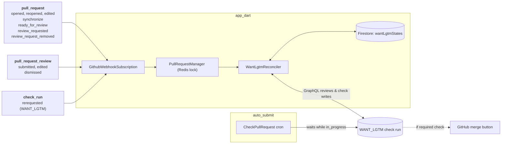

# RFC 610.0000: WANT_LGTM

## 1. Objective

Pull request (PR) authors and Flutter maintainers can name who must approve a PR before it lands by adding one line to the PR description:

```text
WANT_LGTM=@alice,@bob
```

### Critical user journeys

* ***As a PR author changing code that other teams own***, I can add `WANT_LGTM=@alice,@bob` and trust that the PR will not land until both of them approve.
* ***As a reviewer who wants a domain expert to weigh in***, I edit the PR description to add `WANT_LGTM=@expert`.
* ***As a PR author who asked several people for review***, I add `WANT_LGTM=all`. The check keeps running until every reviewer I requested has approved.
* ***As a PR author who added reviewers only to keep them in the loop***, I add `WANT_LGTM=any`, so they know one approval is enough.
* ***As a named reviewer who requests changes***, I expect the PR to stay blocked until I approve or a maintainer dismisses my review.
* ***As a PR author who never uses the directive***, I see no changes and my workflow is not impeded.

### 1.1 Goals

* Block a PR from landing until every required reviewer submits an approving review.
* Support three modes: explicit user logins, `all` requested reviewers, and `any` single reviewer.
* Report status via a standard GitHub check run named `WANT_LGTM`, requiring zero code changes in `auto_submit`.
* Show missing reviewers directly in the check run title.
* Avoid unnecessary GitHub API calls by storing active directives in Firestore and querying GraphQL only when needed.

### 1.2 Non-goals

* Access control beyond PR description edit permissions (author, triage, or write access), matching the trust model of [RFC 010.0001](010.0001-test-exemption-process.md).
* Changes to `auto_submit`, which already waits on any `in_progress` check run.
* Automatically adding reviewers or sending review requests.
* Merge queue evaluation (`WANT_LGTM` evaluates pull requests only; see [Section 3.4](#34-check-run-lifecycle) for required-check handling).
* Replacing existing repository ruleset or `auto_submit` approval counts.
* Team handles (`@flutter/engine`) in v1, comment-based directives, or custom stale-approval rules.

---

## 2. Background

### 2.1 The gap in GitHub reviews

Sending a GitHub review request to multiple individuals does not block merging on all reviewers. `auto_submit` does not take into account all reviewers. `CODEOWNERS` maps files to a single owner but does not extend to requiring reviewers outside of touched files.

Without `WANT_LGTM`, PRs can land prematurely when:

1. An author requests `@alice` and `@bob` and adds the `autosubmit` label. `@alice` approves, and the bot merges before `@bob` opens the PR.
2. A reviewer approves with a note asking to wait for `@bob`, and someone later adds `autosubmit` without reading the thread.

### 2.2 How Cocoon fits in

Cocoon runs `app_dart` for PR subscriptions and CI runs, and `auto_submit`, which polls PRs for the `autosubmit` label, validating all check runs are complete and some approvals are available.

---

## 3. Detailed design

### 3.1 Architecture and reconciliation



Enabling `WANT_LGTM` requires adding `pull_request_review` events to the `flutter-dashboard` GitHub App webhook settings.

Firestore gates API requests to GitHub. On PR creation, push, or edit, `WantLgtmReconciler` parses the PR body for a `WANT_LGTM` directive. If no directive exists and none is stored in Firestore, it exits immediately (unless required checks are active; see [Section 3.4](#34-check-run-lifecycle)). Otherwise, it records the directive in Firestore and reconciles the `WANT_LGTM` check run against live GraphQL review data.

On review events (`pull_request_review`, `review_requested`, `review_request_removed`, or check run `rerequested`), `WantLgtmReconciler` checks Firestore first and returns immediately if no active directive exists. Otherwise, it queries GitHub GraphQL for the PR's reviews and review requests and evaluates them against the stored directive.

### 3.2 Directive syntax

The directive is read only from the PR description:

```text
WANT_LGTM=<token>[,<token>...]
```

| Token | Meaning |
| :--- | :--- |
| `@login` (recommended) or `login` | Named GitHub user must approve. |
| `all` | Every requested reviewer must approve. |
| `any` | One non-author approval is sufficient. |

Parser rules:

* Strip HTML comments (`<!-- ... -->`) and fenced code blocks first so PR templates never activate the directive.
* Match lines starting with `^\s*WANT_LGTM\s*=\s*(.*)$` (case-insensitive key).
* Split tokens on commas and whitespace, merge multiple directive lines, and deduplicate logins case-insensitively.
* Remove the PR author's login from explicit tokens, because GitHub prevents self-approval.
* Validate logins syntactically (`^@?[a-zA-Z0-9](?:[a-zA-Z0-9]|-(?=[a-zA-Z0-9])){0,38}$`) without calling GitHub.

A directive evaluates to `invalid` if any token contains `/` (team handle), ends with `[bot]`, fails login syntax, mixes `any` with other tokens, or leaves an empty set. Combining `all` with logins (`WANT_LGTM=all,@carol`) is valid and requires the union of both sets.

> [!CAUTION]
> **Typos leave the PR waiting.** Syntax checks do not verify that a GitHub user exists. A typo like `WANT_LGTM=@alcie` blocks the check until someone edits the description. Typing `@` in GitHub's editor opens user autocomplete and avoids most typos.

### 3.3 Reviewer state and modes

For each user, the evaluator derives one state from the GraphQL query results (`reviews`, open `reviewRequests`, and review-request `timelineItems`):

1. An open review request marks the user **waiting**, even after an earlier approval ("Re-request review" asks for a fresh look).
2. Otherwise, check the user's latest non-comment review (`APPROVED`, `CHANGES_REQUESTED`, or `DISMISSED`), ignoring `COMMENTED` and draft `PENDING` reviews.
3. `APPROVED` marks the user **approved**; `CHANGES_REQUESTED`, `DISMISSED`, or no review marks them **waiting**.

Cocoon does not compare review commit SHAs against `head_sha`. Repositories that want pushes to invalidate prior approvals can enable stale-approval dismissal in their GitHub ruleset.

#### Modes

* **Explicit users (`@alice,@bob`)**: Satisfied when every named user is approved, including uninvited drive-by approvals.
* **`all`**: Satisfied when every reviewer requested via the Reviewers sidebar is approved. GitHub drops a user from `requested_reviewers` as soon as they submit *any* review, even comments. The GraphQL query therefore combines `reviewRequests` with review-request `timelineItems` to include every requested user who has not been removed. Authors, bots, and uninvited drive-by reviewers are excluded, and an empty set evaluates to `pending` ("No reviewers requested").
* **`any`**: Satisfied once at least one non-author user approves, telling courtesy reviewers that one approval is enough.

| Directive | Reviews & requests | Verdict |
| :--- | :--- | :--- |
| `@alice,@bob` | alice `APPROVED` | `pending` (Waiting on @bob) |
| `@alice` | alice `APPROVED`, then `CHANGES_REQUESTED` | `pending` (@alice requested changes) |
| `@alice` | alice `APPROVED`, then `COMMENTED` | `satisfied` |
| `@alice` | alice `APPROVED`, then dismissed or re-requested | `pending` (Waiting on @alice) |
| `@alice` | alice never requested, drive-by `APPROVED` | `satisfied` |
| `all` | alice & bob requested; alice `APPROVED`; bob `COMMENTED` | `pending` (Waiting on @bob) |
| `all` | alice requested then removed; bob requested & `APPROVED` | `satisfied` |
| `all` | no reviewers requested | `pending` (No reviewers requested) |
| `@flutter/engine` or `any,@alice` | anything | `invalid` |

### 3.4 Check run lifecycle

Evaluator verdicts map directly to GitHub check run states and titles:

* `satisfied` completes the run with `success` (for example, `Approved by @alice, @bob`).
* `pending` keeps the run `in_progress` and lists missing or blocking logins in the title (for example, `Waiting on @bob` or `@alice requested changes`).
* `invalid` completes the run with `failure` naming the bad token so `auto_submit` drops `autosubmit` and alerts the author.

Because GitHub check runs cannot transition from `completed` back to `in_progress`, reconciling against the standing run follows five cases:

| Event / standing run | Desired state | Action |
| :--- | :--- | :--- |
| Directive added, changed, or new `head_sha` | `in_progress` / `success` / `failure` | Create a **new** `WANT_LGTM` check run on `head_sha` and save its ID. |
| Directive removed (or required check on non-directive PR / `merge_group`) | `neutral` | Complete standing check run (or create completed run) with `neutral`. |
| `in_progress` | `in_progress` | Update run output if title/summary changed; otherwise skip write. |
| `in_progress` | `success` / `failure` | Complete standing check run with `success` or `failure`. |
| `completed` (`success` or `failure`) | `in_progress` | Create a **new** `WANT_LGTM` check run on `head_sha` and save the new ID. |

If a repository configures `WANT_LGTM` as a required ruleset check (to block GitHub's manual "Merge when ready" button in addition to `auto_submit`), GitHub waits for a `WANT_LGTM` check run on every PR and optional `merge_group` commit. Under that configuration, `app_dart` immediately posts a completed `neutral` check run whenever a PR has no directive or belongs to a merge queue (`merge_group`).

### 3.5 Storage

`WantLgtmState` uses a dedicated `wantLgtmStates` Firestore collection (one document per PR, created only when a PR uses `WANT_LGTM`):

| Field | Contents |
| :--- | :--- |
| `slug` | Repository slug (`flutter/flutter`) |
| `pr` | PR number |
| `directive` | Latest parsed `WANT_LGTM` directive (tokens / mode), or empty after removal |
| `head_sha` | Head commit SHA |
| `check_run_id` | GitHub check run ID |
| `check_run_status` | `in_progress` or `completed` (queried during rollback sweeps) |

Firestore stores only the active directive and standing check run, keeping non-directive PRs free of GraphQL calls. Reading reviews live from GraphQL (paginating via `pageInfo.hasNextPage` past 100 items) avoids webhook ordering drift.

### 3.6 Testing and code touchpoints

Implementation touches `app_dart` only: webhook routing in `GithubWebhookSubscription` and `PullRequestManager`, parser and evaluator in `WantLgtmReconciler`, LUCI exclusion in `Scheduler.kCheckRunsToIgnore`, and the `WantLgtmState` Firestore model.

Unit tests reuse Cocoon's `FakeFirestoreService` and fake GitHub GraphQL/Checks services to cover parser edge cases, `COMMENTED` after `APPROVED`, re-requested reviews, check run recreation from `completed` back to `in_progress`, `neutral` completions, and >100-item GraphQL pagination.

---

## 4. Alternatives considered

Only an `app_dart` check run blocks `auto_submit` without code changes, works safely on fork PRs, and optionally gates manual merges via repository rulesets:

| Option | Names approvers | Blocks `autosubmit` | Blocks merge button | Replay-safe | Spoof-resistant | Build cost |
| :--- | :--- | :--- | :--- | :--- | :--- | :--- |
| **Proposed: `app_dart` check run** | 🟢 Yes | 🟢 Yes (zero changes) | 🟡 If required check | 🟢 Live GraphQL state | 🟢 Needs triage; App-pinned | 🟢 Low |
| Status quo (comments + requests) | 🔴 No | 🔴 No | 🔴 No | 🟢 N/A | 🔴 N/A | 🟢 None |
| `CODEOWNERS` ruleset | 🟡 Per-file, any owner | 🟡 Via ruleset | 🟢 Yes | 🟢 Yes | 🟢 Yes | 🟢 Low |
| Validation inside `auto_submit` | 🟢 Yes | 🟢 Yes | 🔴 Cannot without check run | 🟢 Yes | 🟡 Manual merge bypasses | 🟡 Duplicates logic |
| GitHub Actions workflow check | 🟢 Yes | 🟢 Yes | 🟡 If required check | 🟡 Full rerun per event | 🔴 Fork PRs require `pull_request_target` | 🟡 Medium |

---

## 5. Rollout plan and open questions

### 5.1 Rollout

Gate rollout behind global and per-repo flags in `app_dart/config.yaml`, enabling `flutter/cocoon` first and then `flutter/flutter`.

Cloud Logging tracks verdict counts, GraphQL queries and check writes per event, rate-limit errors, and approval-to-green latency. To roll back, disable the config flag and sweep `wantLgtmStates` (`check_run_status == 'in_progress'`) to complete open runs as `neutral` (or push an empty commit). Remove the flag after 30 rollback-free days on `flutter/flutter`.

### 5.2 Open questions

1. Should we block the GitHub merge button by making `WANT_LGTM` a required check (posting `neutral` runs on non-directive PRs and `merge_group` commits)?
2. Should directives inside HTML comments (`<!-- WANT_LGTM=@alice -->`) stay ignored so PR templates cannot trigger checks accidentally?
