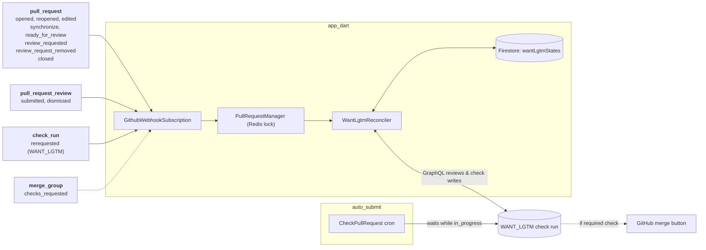
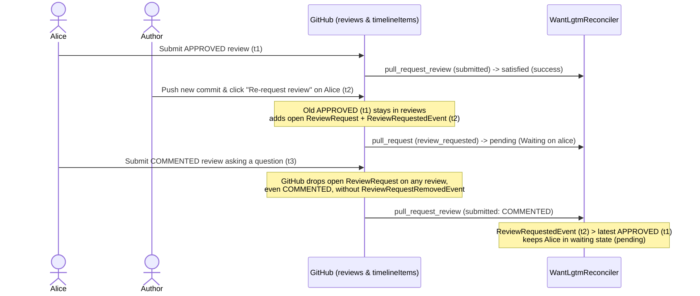

# RFC 610.0001: WANT_LGTM

## 1. Objective

Pull request (PR) authors and Flutter maintainers can name who must approve a PR before it lands by adding one line to the PR description:

```text
WANT_LGTM=alice,bob
```

### Critical user journeys

* ***As a PR author changing code that other teams own***, I can add `WANT_LGTM=alice,bob` and trust that the PR will not land until both of them approve.
* ***As a reviewer who wants a domain expert to weigh in***, I edit the PR description to add `WANT_LGTM=expert`.
* ***As a PR author who asked several people for review***, I add `WANT_LGTM=all`. The check keeps running until every reviewer I requested has approved.
* ***As a named reviewer who requests changes***, I expect the PR to stay blocked until I approve or a maintainer removes me from `WANT_LGTM` and dismisses my review.
* ***As a PR author who never uses the directive***, I see no changes and my workflow is not impeded.

### 1.1 Goals

* Block a PR from landing until every required reviewer submits an approving review.
* Support two modes: explicit user logins and `all` requested reviewers.
* Report status via a standard GitHub check run named `WANT_LGTM`, requiring zero code changes in `auto_submit`.
* Show missing reviewers directly in the check run title.
* Avoid unnecessary GitHub API calls by storing active directives in Firestore and querying GraphQL only when needed.

### 1.2 Non-goals

* Access control beyond PR description edit permissions (author, triage, or write access), matching the trust model of [RFC 010.0001](010.0001-test-exemption-process.md).
* Changes to `auto_submit`, which already waits on any `in_progress` check run.
* Automatically adding reviewers or sending review requests.
* Merge queue evaluation (`WANT_LGTM` evaluates pull requests only and resolves `neutral` on `merge_group`).
* Replacing existing repository ruleset or `auto_submit` approval counts.
* Team handles (`@flutter/engine`) in v1, comment-based directives, or custom stale-approval rules.

---

## 2. Background

### 2.1 The gap in GitHub reviews

Sending a GitHub review request to multiple individuals does not block merging on all reviewers. `auto_submit` does not take into account all reviewers. `CODEOWNERS` maps files to a single owner but does not extend to requiring reviewers outside of touched files.

Without `WANT_LGTM`, PRs can land prematurely when:

1. An author requests `alice` and `bob` and adds the `autosubmit` label. `alice` approves, and the bot merges before `bob` opens the PR.
2. A reviewer approves with a note asking to wait for `bob`, and someone later adds `autosubmit` without reading the thread.

### 2.2 How Cocoon fits in

Cocoon runs `app_dart` for PR subscriptions and CI runs, and `auto_submit`, which polls PRs for the `autosubmit` label, validating all check runs are complete and some approvals are available.

---

## 3. Detailed design

### 3.1 Architecture and reconciliation



Enabling `WANT_LGTM` requires adding `pull_request_review` events to the `flutter-dashboard` GitHub App webhook settings.

Cocoon tries to limit API requests to GitHub due to our large traffic. On `pull_request` events, the want-lgtm reconciler parses the pull request body looking for the directive. It returns early if neither the PR nor Firestore has the directive - except to post neutral status. Otherwise, Cocoon updates Firestore and reconciles the `WANT_LGTM` check run against live GraphQL review data.

When the PR is closed, it updates any stored `wantLgtmStates` as `completed` and completes in-progress check runs. On review events, the reconciler parses the event body first and short circuits if it is missing the directive.

### 3.2 Directive syntax

The directive is read only from the PR description:

```text
WANT_LGTM=<token>[,<token>...]
```

| Token | Meaning |
| :--- | :--- |
| `login` | Named GitHub user must approve. *Discouraged*: Using `@login` causes cascading emails. Use the `@` to look up a username, but then remove the symbol. |
| `all` | Every requested reviewer must approve. |

Parser rules:

* Strip HTML comments (`<!-- ... -->`) and fenced code blocks first so PR templates never activate the directive.
* Match lines starting with `^\s*WANT_LGTM\s*=\s*(.*)$` (case-insensitive key).
* Split tokens on commas and whitespace, merge multiple directive lines, and deduplicate logins case-insensitively.
* Remove the PR author's login from explicit tokens (GitHub prevents self-approval), and ignore a blank or self-only `WANT_LGTM=` line as no directive.
* Validate logins syntactically (`^@?[a-zA-Z0-9](?:[a-zA-Z0-9]|-(?=[a-zA-Z0-9])){0,38}$`) without calling GitHub.

A directive evaluates to `invalid` if any token contains `/` (team handle) or fails login syntax. Combining `all` with logins (`WANT_LGTM=all,carol`) is valid and requires the union of both sets.

> [!CAUTION]
> **Typos leave the PR waiting.** Syntax checks do not verify that a GitHub user exists. A typo like `WANT_LGTM=alcie` blocks the check until someone edits the description. Type `@` in GitHub's editor to autocomplete the username, then delete the `@` symbol so fork syncs do not email the reviewer.

### 3.3 Reviewer state and modes

For each user, the evaluator derives one state from the GraphQL query results (`reviews(states: [APPROVED, CHANGES_REQUESTED, DISMISSED])`, open `reviewRequests`, and review-request `timelineItems`):

1. An open review request marks the user **waiting**, as does a `ReviewRequestedEvent` newer than their latest `APPROVED` review (when not followed by `ReviewRequestRemovedEvent`).
2. Otherwise, check the user's latest non-comment review (`APPROVED`, `CHANGES_REQUESTED`, or `DISMISSED`), ignoring `COMMENTED` and draft `PENDING` reviews.
3. `APPROVED` marks the user **approved**; `CHANGES_REQUESTED`, `DISMISSED`, or no review marks them **waiting**.



Cocoon does not compare review commit SHAs against `head_sha`. Repositories that want pushes to invalidate prior approvals can enable stale-approval dismissal in their GitHub ruleset.

#### Modes

* **Explicit users (`alice,bob`)**: Satisfied when every named user is approved, including uninvited drive-by approvals.
* **`all`**: Satisfied when every reviewer requested via the Reviewers sidebar is approved. Because GitHub drops a user from open `reviewRequests` as soon as they submit *any* review (even `COMMENTED`), the evaluator combines open `reviewRequests` with `timelineItems` (`ReviewRequestedEvent` more recent than `ReviewRequestRemovedEvent`). Only `User` nodes are included (`Team`, `Mannequin`, `Bot`, the PR author, `config.rollerAccounts`, and uninvited drive-by reviewers are excluded). An empty reviewer set with no explicit logins evaluates to `pending` ("No reviewers requested").

If a requested reviewer leaves a `COMMENTED` review and later becomes unavailable (when GitHub's sidebar only offers "Re-request review"), edit `WANT_LGTM=all` to list the remaining logins explicitly.

| Directive | Reviews & requests | Verdict |
| :--- | :--- | :--- |
| `alice,bob` | alice `APPROVED` | `pending` (Waiting on bob) |
| `alice` | alice `APPROVED`, then `CHANGES_REQUESTED` | `pending` (alice requested changes) |
| `alice` | alice `APPROVED`, then `COMMENTED` | `satisfied` |
| `alice` | alice `APPROVED`, then dismissed or re-requested (even if followed by `COMMENTED`) | `pending` (Waiting on alice) |
| `alice` | alice never requested, drive-by `APPROVED` | `satisfied` |
| `all` | alice & bob requested; alice `APPROVED`; bob `COMMENTED` | `pending` (Waiting on bob) |
| `all` | alice requested then removed; bob requested & `APPROVED` | `satisfied` |
| `all` | no reviewers requested | `pending` (No reviewers requested) |
| `all,carol` | no sidebar reviewers requested; carol `APPROVED` | `satisfied` |
| `@flutter/engine` | anything | `invalid` |

### 3.4 Check run lifecycle

Evaluator verdicts map directly to GitHub check run states and titles:

* `satisfied` completes the run with `success` (for example, `Approved by alice, bob`).
* `pending` keeps the run `in_progress` (so `auto_submit` waits without dropping the `autosubmit` label) and lists missing or blocking logins in the title (for example, `Waiting on bob` or `alice requested changes`).
* `invalid` completes the run with `failure` naming the bad token so `auto_submit` drops `autosubmit` and alerts the author.

The reconciler updates the standing check run on the head SHA in place whenever its status or output changes, and completes it as neutral if the directive is removed. Because GitHub check runs cannot transition from completed back to in-progress, Cocoon creates a new check run (and saves its ID) only on a first directive, a new head SHA, or when a completed run must reopen as in-progress.

Configuring `WANT_LGTM` as a required ruleset check blocks accidental clicks of GitHub's manual "Merge when ready" button in addition to `auto_submit`, requiring a maintainer to explicitly edit `WANT_LGTM=` in the PR description (which GitHub records in the PR edit history). Under that configuration, `app_dart` posts a completed `neutral` check run on new non-directive PR commits (`opened`, `synchronize`) and when found in a merge group (`merge_group`).

### 3.5 Storage

`WantLgtmState` uses a dedicated `wantLgtmStates` Firestore collection (one document per PR, created only when a PR uses `WANT_LGTM`):

| Field | Contents |
| :--- | :--- |
| `slug` | Repository slug (`flutter/flutter`) |
| `pr` | PR number |
| `directive` | Latest parsed `WANT_LGTM` directive (tokens / mode), or empty after removal |
| `head_sha` | Head commit SHA |
| `check_run_id` | GitHub check run ID |
| `check_run_status` | `in_progress` or `completed` (queried during rollback sweeps) |

Firestore stores only the active directive and standing check run, keeping non-directive PRs free of GraphQL calls. Filtering `reviews` by state server-side and paginating via `pageInfo.hasNextPage` past 100 items avoids webhook ordering drift.

### 3.6 Testing and code touchpoints

Implementation touches `app_dart` only. Unit tests reuse Cocoon's `FakeFirestoreService` and fake GitHub GraphQL/Checks services to cover parser and review status edge cases.

---

## 4. Rollout plan

Gate rollout behind global and per-repo flags in `app_dart/config.yaml`, enabling `flutter/cocoon` first and then `flutter/flutter`.

Cloud Logging tracks verdict counts, GraphQL queries and check writes per event, rate-limit errors, and approval-to-green latency. To roll back, remove `WANT_LGTM` from the repository's required status checks ruleset (if enabled), disable the `app_dart/config.yaml` flag, and sweep `wantLgtmStates` (`check_run_status == 'in_progress'`) to complete open runs as `neutral`. Remove the flag after 30 rollback-free days on `flutter/flutter`.

---

## Appendix: Alternatives considered

Only an `app_dart` check run keeps `WANT_LGTM` `in_progress` across days so `auto_submit` waits without stripping the `autosubmit` label (whereas a GitHub Actions job must complete, causing `auto_submit` to treat a waiting PR as a failed build). If `auto_submit` later moves to GitHub Actions, `WANT_LGTM` can move to a GitHub Actions workflow as well.

| Option | Names approvers | Blocks `autosubmit` | Blocks merge button | Replay-safe | Spoof-resistant | Build cost |
| :--- | :--- | :--- | :--- | :--- | :--- | :--- |
| **Proposed: `app_dart` check run** | 🟢 Yes | 🟢 Yes (`in_progress` waits) | 🟡 If required check | 🟢 Live GraphQL state | 🟢 Needs triage; App-pinned | 🟢 Low |
| Status quo (comments + requests) | 🔴 No | 🔴 No | 🔴 No | 🟢 N/A | 🔴 N/A | 🟢 None |
| `CODEOWNERS` ruleset | 🟡 Per-file, any owner | 🟡 Via ruleset | 🟢 Yes | 🟢 Yes | 🟢 Yes | 🟢 Low |
| Validation inside `auto_submit` | 🟢 Yes | 🟢 Yes | 🔴 Cannot without check run | 🟢 Yes | 🟡 Manual merge bypasses | 🟡 No check UI before `autosubmit` |
| GitHub Actions workflow check | 🟢 Yes | 🔴 Failure strips `autosubmit` | 🟡 If required check | 🟡 Full rerun per event | 🔴 Fork PRs require `pull_request_target` | 🟡 Medium |
