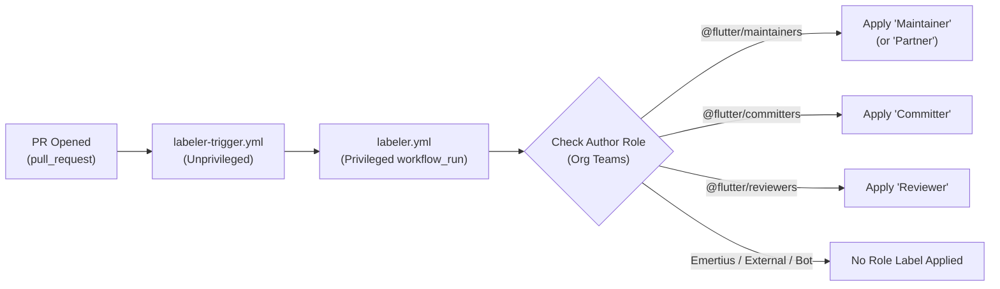

# RFC 740.0000: Contributor Ladder Role Labeling on Pull Requests

## Overview

This RFC proposes an automated GitHub workflow across Flutter repositories that tags incoming PRs with the author's role on the [Flutter Contributor Ladder](740.0001-flutter-contributor-ladder.md): `Maintainer`, **`Committer`, or `Reviewer`. Role labels allow reviewers to quickly identify known contributors and partners among the noise, address review bottlenecks, and execute our new [role-based PR approval workflow](https://github.com/flutter/contributors/blob/main/docs/CODE_REVIEW_WORKFLOW.md).

## Goals

- Surface PRs authored by active Contributor Ladder members (`Maintainer`, `Committer`, `Reviewer`) across Flutter repositories.
- Give reviewers immediate visibility into the author's ladder role and privileges so they can tell at a glance whether a PR requires 1 approval (`Maintainer`, `Committer`) or 2 approvals (`Reviewer`, external `Contributor`) and whether the author has merge permissions.

### Non-goals

- Labels tracking review progress (such as `needs: first-pass review` or `needs: committer sign-off`) are out of scope.
  - In practice, with review dismissals from subsequent changes, these could be unwieldy.
- Labels for First-time and external contributors to avoid label clutter and any "newcomer" or lower-tier stigma.
- Modifying the contributor ladder - tier definitions, quarterly audit mechanics, and approval requirements remain governed by [RFC 740.0001: Flutter Contributor Ladder](740.0001-flutter-contributor-ladder.md) and [`flutter/contributors`](https://github.com/flutter/contributors).

## Background

### Org membership transformation & the new approval workflow

Historically, `org:flutter` had a flat membership where nearly everyone held write access.

When the 30-day [Q4 2026 Contributor Ladder audit](https://github.com/flutter/contributors/pull/9) concludes on December 4, 2026, org membership will shift to tiered membership ([`ROSTER.md`](https://github.com/flutter/contributors/blob/main/ROSTER.md)), and PR approvals will follow our new [Code Review Workflow](https://github.com/flutter/contributors/blob/main/docs/CODE_REVIEW_WORKFLOW.md#approval-requirements):

| Ladder Tier | Permissions | Approval Rule |
| :---- | :---- | :---- | :---- |
| Maintainer | Write + Moderation | 1 approval (from `Reviewer`+) |
| Committer | Write, [Audit #10](https://github.com/flutter/contributors/issues/10) | 1 approval (from `Reviewer`+) |
| Reviewer | Triage, [Audit `#10`](https://github.com/flutter/contributors/issues/10)) | 2 approvals (1 `Reviewer`+ & 1 `Committer`+) |

Previously, a GitHub `Member` badge meant the author had write access. After December 4, `Reviewers` (2-approval rule), along with `Committers` and `Maintainers` (1-approval rule) will all be org members displaying the same generic `Member` badge.

### Complementary Efforts to Reduce PR Noise

Role labeling can also help contribute to reducing the increasing noise of generated contributions. In the last year, Pr submissions to the Flutter project have tripled, making it difficult to prioritize work. To further help with this, there are two bottom-of-funnel guardrails to keep unready PRs out of team review queues in progress:

- Updating the labeler so PRs without a signed [Google CLA](https://cla.developers.google.com/) are converted to Draft and are not routed to sub-teams for review until the CLA is signed.
  - We should never review PRs that do not have the CLA signed to begin with.
  - https://github.com/flutter/flutter/pull/196341
- And testing over in fluttr/packages, converting non-org member PRs in [`flutter/packages`](https://github.com/flutter/packages) to Draft when the author has stripped or ignored the [PR template and pre-review checklist](https://github.com/flutter/packages/blob/main/.github/PULL_REQUEST_TEMPLATE.md).
  - This is a common tell for a PR not ready for review that we check for manually, but still evaluating if it is too brittle.
  - https://github.com/flutter/packages/pull/13618

While CLA and template gating filter out _unready noise_ fpr the team, Contributor Ladder role labeling highlights _trusted signal_.

## Technical details

### Workflow Integration (`labeler-trigger.yml` / `labeler.yml`)

Following the two-stage `pull_request` + `workflow_run` labeler pattern recently adopted across Flutter repositories ([`flutter/flutter#195536`](https://github.com/flutter/flutter/pull/195536), [`flutter/packages#13581`](https://github.com/flutter/packages/pull/13581), [`flutter/core-packages#46`](https://github.com/flutter/core-packages/pull/46)):

1. When a pull request is opened, `labeler-trigger.yml` runs unprivileged and triggers the privileged `labeler.yml` `workflow_run` workflow on the default branch.
2. The privileged `labeler.yml` workflow resolves the PR author's active tier from the corresponding `@flutter/maintainers`, `@flutter/partners`, `@flutter/committers`, and `@flutter/reviewers` GitHub teams.
   - Fetching `data/contributors.yaml` from `flutter/contributors` instead (which is publicly readable and validated in CI) avoids requiring a token with `read:org` scope across every repository's GitHub Actions runner while remaining synchronized with quarterly audits - to consider.
3. If the author matches an active ladder tier (and is not a bot account), `labeler.yml` applies the corresponding role label via the GitHub Issues/Labels API using the repository's `GITHUB_TOKEN`.

## Open Questions

- Should we have an Emeritus label as an additional trust signal, given they are past trusted contributors?
- Should we avoid `read:org` scope in the workflow and instead refer to `data/contributors.yaml` from `flutter/contributors`?

## Rollout

1.December 4, 2026 - Wait for the initial 30-day Q4 Contributor Ladder review window ([`flutter/contributors#9`](https://github.com/flutter/contributors/pull/9), [`#10`](https://github.com/flutter/contributors/issues/10), [`#11`](https://github.com/flutter/contributors/issues/11)) to conclude and for GitHub teams (`@flutter/maintainers`, `@flutter/committers`, `@flutter/reviewers`) to be finalized as tracked in [`flutter/flutter#186415`](https://github.com/flutter/flutter/issues/186415).
2. Create the role labels and deploy the `labeler.yml` update in [`flutter/flutter`](https://github.com/flutter/flutter) (747 open PRs) and [`flutter/packages`](https://github.com/flutter/packages) (283 open PRs), which together account for 83.6% of all open PRs in the organization.
3. Roll out the workflow step to remaining active repositories (`flutter/devtools`, `flutter/website`, `flutter/cocoon`, `flutter/core-packages`, etc.).

## References & Supporting Resources

- [RFC 740.0001: Flutter Contributor Ladder](740.0001-flutter-contributor-ladder.md)
- [Flutter Contributor Ladder Repository (`flutter/contributors`)](https://github.com/flutter/contributors)
- [Code Review Workflow & Approval Requirements (`docs/CODE_REVIEW_WORKFLOW.md`)](https://github.com/flutter/contributors/blob/main/docs/CODE_REVIEW_WORKFLOW.md)
- [Contributor Ladder Tiers & Criteria (`docs/LADDER.md`)](https://github.com/flutter/contributors/blob/main/docs/LADDER.md)
- [Project Governance & Team Hierarchy (`docs/GOVERNANCE.md`)](https://github.com/flutter/contributors/blob/main/docs/GOVERNANCE.md)
- [Quarterly Review Process (`docs/QUARTERLY_REVIEW.md`)](https://github.com/flutter/contributors/blob/main/docs/QUARTERLY_REVIEW.md)
- [Active Contributor Roster (`ROSTER.md`)](https://github.com/flutter/contributors/blob/main/ROSTER.md) & [Dasher Emeritus Directory (`EMERITUS.md`)](https://github.com/flutter/contributors/blob/main/EMERITUS.md)
- [Contribution Model Rollout Tracking Issue (`flutter/flutter#186415`)](https://github.com/flutter/flutter/issues/186415) & [Docs Update (`flutter/flutter#196011`)](https://github.com/flutter/flutter/pull/196011)
- [Q4 2026 Quarterly Review PR (`flutter/contributors#9`)](https://github.com/flutter/contributors/pull/9), [Community Audit (`#10`)](https://github.com/flutter/contributors/issues/10), & [Partner Audit (`#11`)](https://github.com/flutter/contributors/issues/11)
- [`flutter/flutter` Labeler Workflow (`labeler.yml`)](https://github.com/flutter/flutter/blob/master/.github/workflows/labeler.yml) & [`flutter/packages` Labeler Workflow (`labeler.yml`)](https://github.com/flutter/packages/blob/main/.github/workflows/labeler.yml)
- [`flutter/packages` Pull Request Template (`PULL_REQUEST_TEMPLATE.md`)](https://github.com/flutter/packages/blob/main/.github/PULL_REQUEST_TEMPLATE.md)
- [Flutter Tree Hygiene — Getting a Code Review (`docs/contributing/Tree-hygiene.md`)](https://github.com/flutter/flutter/blob/master/docs/contributing/Tree-hygiene.md#getting-a-code-review)
