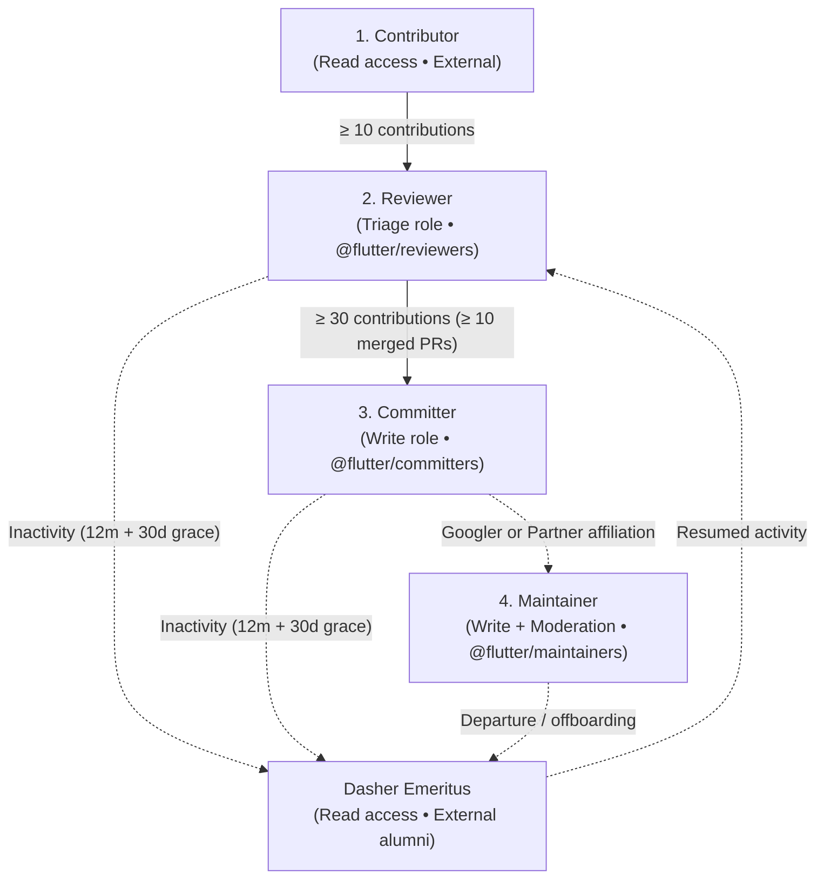
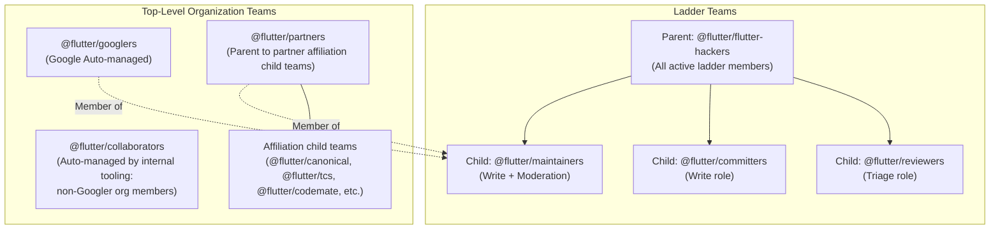
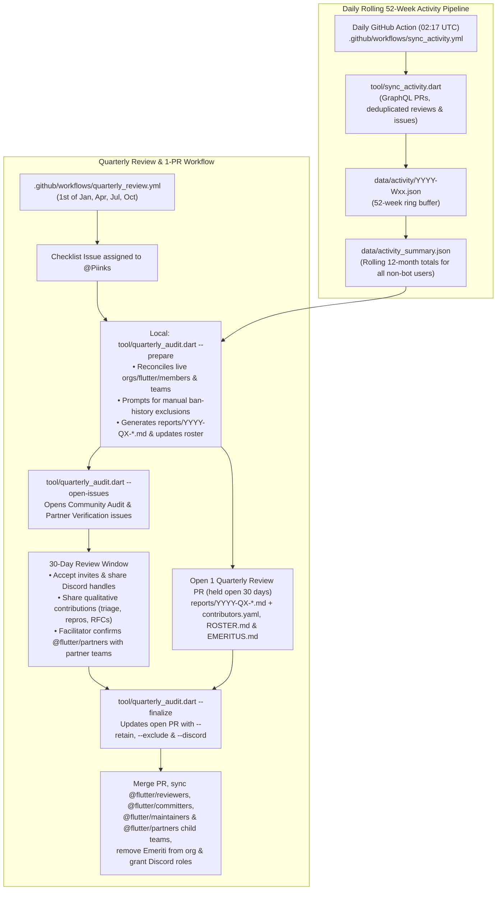

# RFC 740.0000: Flutter Contributor Ladder

## Overview

Associated GitHub issue: [flutter/flutter#186415](https://github.com/flutter/flutter/issues/186415)

This RFC replaces the [original Flutter Contributor Ladder design document](https://docs.google.com/document/d/1ITkAaE96R1kWgttDFVQYYKvdyHlcOz_Rs1QyiS8JMEY/edit?usp=sharing) (`flutter.dev/go/contributor-ladder`). Key updates from that original document include:

* Promotions, new joiner invitations, and returning Dasher Emeriti are identified automatically during quarterly audits using a rolling 52-week activity pipeline in [`flutter/contributors`](https://github.com/flutter/contributors), rather than requiring contributors to manually open self-nomination application issues with two sponsors. Creating new issues and pull requests in `flutter/contributors` is restricted to organization members (`@flutter/collaborators`), who can sponsor out-of-band nominations or off-cycle Emeritus reinstatements, while commenting on public quarterly review issues remains open to all GitHub users.
* Nominated candidates are checked locally against the internal Code of Conduct and ban history list during quarterly preparation (`tool/quarterly_audit.dart --prepare`) before any report, pull request, or tracking issue is published so ineligible users are excluded without being singled out.
* `@flutter/flutter-hackers` serves as parent team to `@flutter/reviewers`, `@flutter/committers`, and `@flutter/maintainers` (preserving existing `flutter/cocoon` approval checks during the transition). All Maintainers belong to `@flutter/maintainers` and come from `@flutter/googlers` and `@flutter/partners` (verified quarterly with partner organizations), `@flutter/collaborators` is automatically managed by internal tooling for non-Googler org members, and every quarterly audit reconciles live `flutter` GitHub organization membership (`orgs/flutter/members`) so no one slips through.
* Dasher Emeriti are removed from the `flutter` GitHub organization for repository security and honored in a dedicated `EMERITUS.md` file (separate from `ROSTER.md`), while retaining access to Discord contributor channels (`#hidden-chat`) and the broadcast-only `flutter-contributors` Google Group so they can stay in touch and easily ramp back up if they return. Temporary leave pauses are not tracked; instead, the 30-day review window captures qualitative contributions and returning Emeriti are automatically identified when they resume contributing.
* Test exemptions have since been formalized separately in [RFC 010.0001: Test Exemption Process](010.0001-test-exemption-process.md), the Flutter RFC process is now live in [`flutter/rfc`](https://github.com/flutter/rfc), and Special Interest Groups (SIGs) have been removed from scope for now.

Brian A. "Drew" Chalker wrote:

> *People come into your life for a reason, a season or a lifetime.*
> *When you figure out which it is, you know exactly what to do.*

This philosophy applies directly to our community: some contributors come to address a specific bug, dedicate a season to a feature, or commit to a lifetime of project stewardship. The challenge for us is in distinguishing, rewarding, and empowering this final, vital group. To address our current scalability limits and secure the long-term health of the Flutter project, this RFC establishes a transparent, data-driven contributor ladder managed in the [`flutter/contributors`](https://github.com/flutter/contributors) repository.

---

## The Need for a Formal Ladder

The Flutter project has fostered a large and vibrant community of contributors. However, our community management model, which evolved organically, has reached its scalability limits. Introducing a formal, data-driven contributor ladder empowers our community, creates a scalable membership structure, and ensures the long-term health of the project by recognizing and celebrating contributors who help build Flutter's future.

### The Historical State of Contribution

Historically, Flutter's contribution model was characterized by two distinct systems:

1. **A "Horizontal" Onboarding Model:** Our [official contribution guide](https://github.com/flutter/flutter/blob/main/docs/contributing/README.md) is effective for onboarding, presenting a menu of paths such as contributing code, writing documentation, triaging issues, and supporting the community.
2. **An Informal Advancement Path:** The only advancement path was admission to the `flutter-hackers` group. This process lacked automation, was informal and trust-based, and focused almost exclusively on code contributions. Existing members of `flutter-hackers` were expected to notice and sponsor contributors under a loose definition of having contributed enough to the project, as documented in [Contributor access](https://github.com/flutter/flutter/blob/main/docs/contributing/Contributor-access.md).

### Key Challenges and Scalability Issues

This ad-hoc model created a significant scalability bottleneck. The `flutter-hackers` group conflated the roles of code reviewer and committer, and because the risk of granting merge access is high, the bar for entry was also high (for example, requiring contributors who needed "no tutoring"). That created a wide mid-ladder gap between new contributors and project leadership, preventing us from cultivating the next generation of reviewers and contributing to slow pull request review times. Because we could only admit contributors who arrived "fully formed," the project lacked clear milestones for contributors working toward meaningful roles.

Focusing primarily on code contributions also created a glass ceiling for contributors specializing in issue triage, bug reproduction, documentation, or community support, undermining our message that all contributions are valued. At the same time, critical workflow responsibilities—such as granting [test exemptions](https://github.com/flutter/flutter/blob/main/docs/contributing/Tree-hygiene.md#test-exemptions), addressed in [RFC 010.0001: Test Exemption Process](010.0001-test-exemption-process.md)—historically relied on a very small number of people. Finally, as a large corporate-backed project, an informal promotion process into `flutter-hackers` could appear opaque to the community and feed the perception of a "walled garden," while fragmented membership documentation and stale `AUTHORS` files made it difficult for contributors to see how to grow within the project.

---

## The Contributor Ladder

To address these challenges, we establish a four-tier Contributor Ladder (plus an honored **Dasher Emeritus** alumni status) inspired by open-source governance models such as [Kubernetes Community Membership](https://github.com/kubernetes/community/blob/master/community-membership.md).

### Tiers, Criteria, and Permissions

Each tier maps to specific [GitHub organization and repository roles](https://docs.github.com/en/organizations/managing-user-access-to-your-organizations-repositories/managing-repository-roles/repository-roles-for-an-organization#permissions-for-each-role) over a rolling 12-month evaluation window:

| Tier | GitHub Role & Team | 12-Month Rolling Criteria | Permissions & Responsibilities |
| :--- | :--- | :--- | :--- |
| **Contributor** | `Read` (External) | Any material contribution (code, docs, issue triage, bug reproduction). | Entry point for community contributors using the fork-and-PR workflow. |
| **Reviewer** | `Triage` (`@flutter/reviewers`) | $\ge 10$ qualifying contributions over 12 months (merged PRs, valid issues filed, reviews on merged PRs, or qualitative triage/repros). | First-pass PR reviews, issue triage and labeling, closing/reopening issues, and non-blocking PR approvals. |
| **Committer** | `Write` (`@flutter/committers`) | $\ge 30$ qualifying contributions over 12 months, including $\ge 10$ merged PRs. | Repository write access, binding code review approvals, merge queue authority, and mentoring. |
| **Maintainer** | `Write` + Org Mod (`@flutter/googlers`, `@flutter/partners`, `@flutter/maintainers`) | All members of `@flutter/googlers` and `@flutter/partners`. | Domain stewardship, architectural oversight, and GitHub organization moderation permissions. |
| **Dasher Emeritus** | `Read` (External alumni) | Former ladder members with $< 10$ contributions over 12 months after the 30-day grace period. | Removed from the GitHub org and honored in `EMERITUS.md`; retains Discord and Google Group access to stay in touch and easily ramp back up if they return. |

#### Baseline Data Analysis

To calibrate the 12-month thresholds, we analyzed contributor activity across the `flutter` GitHub organization over a 12-month baseline period. During that year, **525** unique human community contributors (excluding bots) contributed code, reviews, and issues across the organization:

* **84** community contributors authored merged pull requests
* **22** community contributors provided code reviews on merged pull requests
* **477** community contributors filed issues

At the time of analysis, **131** community members were enrolled in the historical `flutter-hackers` group. Evaluating 3-month and 6-month windows showed that shorter windows produced excessive role churn; a 12-month rolling window evaluated quarterly balances role stability with timely recognition.

#### Are We Raising the Bar?

While explicit numeric thresholds may appear stricter than the historical policy—which informally referenced a "long history of participating productively" or "recently submitted several PRs"—in practice the old model varied widely depending on who in `flutter-hackers` noticed a contributor and chose to sponsor them. Defining transparent, data-driven criteria allows us to proactively identify and elevate active contributors across the organization who might otherwise go unnoticed.

---

## GitHub Team Hierarchy and Organization Membership

### Preserving `@flutter/flutter-hackers`

To preserve the historical moniker—and ensure backwards compatibility with existing automation during the transition—`@flutter/flutter-hackers` is the parent team for the three active ladder role teams: `@flutter/reviewers`, `@flutter/committers`, and `@flutter/maintainers`. Every active member on the contributor ladder belongs to `@flutter/flutter-hackers`, while repository permissions are granted by its child teams. Because all three ladder role teams are children of `@flutter/flutter-hackers`, the current code approval flow in [`flutter/cocoon`](https://github.com/flutter/cocoon) continues to work without disruption during the transition before `flutter/cocoon` is updated to distinguish between tiers.

### Maintainers (`@flutter/maintainers`) and `@flutter/collaborators`

All Maintainers are either Flutter team engineers at Google (`@flutter/googlers`, managed via automated Google tooling) or partner team engineers (`@flutter/partners`, which organizes partner engineers into child teams per affiliation such as `@flutter/canonical`, `@flutter/tcs`, and `@flutter/codemate` and therefore remains top-level due to GitHub team nesting depth limits), and every Maintainer belongs to `@flutter/maintainers` (child team of `@flutter/flutter-hackers`). All organization members who are not Googlers are listed in `@flutter/collaborators`, which is automatically managed by internal tooling and is never manually modified as part of the contributor ladder process. Neither Contributors nor Dasher Emeriti hold `flutter` GitHub organization membership.

### Retiring Static `AUTHORS` Files

Because all contributions to Flutter are covered by the Google Contributor License Agreement (CLA), static `AUTHORS` files carry no legal weight and had become stale across repositories (`flutter/flutter`, `flutter/packages`, `flutter/website`, `flutter/devtools`). Historical `AUTHORS` files will be archived in `flutter/contributors` under `legacy_authors/` to preserve historical recognition, while `ROSTER.md` and `EMERITUS.md` (generated from `data/contributors.yaml`) serve as the single living source of truth.

---

## Code Review and Moderation Policies

### Code Review Approval Matrix

Approval requirements depend on the pull request author's ladder tier (see [Tree hygiene](https://github.com/flutter/flutter/blob/main/docs/contributing/Tree-hygiene.md#getting-a-code-review)):

| Author Tier | Approvals Required | Eligibility Rules | Landing Authority |
| :--- | :--- | :--- | :--- |
| **Contributor** | **2 approvals** | At least 1 approval from a Committer (or Maintainer); 2nd approval may be from a Reviewer (or higher). | Committer or Maintainer |
| **Reviewer** | **2 approvals** | At least 1 approval from a Committer (or Maintainer); 2nd approval may be from a Reviewer (or higher). | Committer or Maintainer |
| **Dasher Emeritus** | **2 approvals** | At least 1 approval from a Committer (or Maintainer); 2nd approval may be from a Reviewer (or higher). | Committer or Maintainer |
| **Committer** | **1 approval** | 1 approval from a Reviewer (or higher). | Committer or Maintainer |
| **Maintainer** | **1 approval** | 1 approval from a Reviewer (or higher). | Committer or Maintainer |

Positioning Reviewers as the primary first-pass reviewers on community pull requests creates a structured learning pathway for newer reviewers while reducing review load on Committers and Maintainers. For large or architectural changes, authors are encouraged to seek early conceptual feedback via a draft PR or an RFC in [`flutter/rfc`](https://github.com/flutter/rfc).

### Organization Moderation and Code of Conduct Standing

Rather than granting GitHub organization moderation privileges (such as blocking accounts or locking threads) across all organization members, GitHub moderation permissions are scoped to the **Maintainer** tier (`@flutter/googlers`, `@flutter/partners`, `@flutter/maintainers`). Code of Conduct concerns can be reported to `conduct@flutter.dev` or an active Maintainer.

Because ladder membership grants GitHub organization membership and repository permissions, good Code of Conduct standing is required. Contributors who have previously received a temporary Code of Conduct ban remain welcome to contribute as external Contributors once a temporary ban expires, but are not eligible for invitation or promotion onto the contributor ladder.

---

## Communication Channels and Dasher Emeritus

### Communication Channels

For asynchronous announcements and event invitations, the broadcast-only `flutter-contributors` Google Group (configured without member posting so discussions are not fragmented across multiple forums) delivers official announcements and calendar invites—including the recurring Flutter Contributor Roundtable and the Dash Forum, where contributors present and get feedback on their [`flutter/rfc`](https://github.com/flutter/rfc) proposals—to active ladder members and Dasher Emeriti. Onboarding to the group is managed via a Google Form pinned in the `#hidden-chat` channel on Discord.

Real-time collaboration takes place on the [Flutter Discord](https://discord.gg/flutter), which provides public channels for all contributors and private role-gated channels (`#hidden-chat`, `#reviewers`, `#committers`, `#maintainers`) for active ladder members and Dasher Emeriti. When invited or promoted on the ladder, contributors share their Discord username so their Discord role can be provisioned alongside their GitHub team role.

### Dasher Emeritus and Returning to Active Status

Former Reviewers, Committers, Maintainers, and historical `flutter-hackers` who have $< 10$ contributions over the preceding 12 months (following the 30-day review window) transition to **Dasher Emeritus**. To maintain repository security, Dasher Emeriti are removed from the `flutter` GitHub organization and honored in `EMERITUS.md`. Crucially, Dasher Emeriti retain access to Discord contributor channels (including `#hidden-chat`) and the `flutter-contributors` Google Group so they can stay in touch with the project and more easily ramp back up if and when they choose to return.

Returning Emeriti who resume contributing and reach $\ge 10$ contributions are automatically identified for reinstatement during quarterly reviews. For off-cycle reinstatement, because creating new issues and pull requests in `flutter/contributors` is restricted to organization members (`@flutter/collaborators`), a returning Emeritus can reach out in `#hidden-chat` on Discord (or to an active organization member) to have an active org member sponsor and open an Emeritus Reinstatement issue on their behalf.

### Initial Transition Carve-Out for Recent Joiners

As a one-time transition policy for the first year after launch, community members who joined `flutter-hackers` within the 12 months preceding ladder adoption and do not yet meet the 10-contribution threshold retain the `Reviewer` role for a 12-month transition period (`grace_until` in `data/contributors.yaml`).

---

## System Architecture and Quarterly Review Workflow (`flutter/contributors`)

The contributor ladder is operated through automated tooling and workflows in the [`flutter/contributors`](https://github.com/flutter/contributors) repository:

### Continuous 52-Week Activity Pipeline (`tool/sync_activity.dart`)

Every night at `02:17 UTC`, `.github/workflows/sync_activity.yml` runs `tool/sync_activity.dart` across `org:flutter is:public` to record merged pull requests, deduplicated pull request reviews on merged PRs (at most 1 review credit per reviewer per merged PR), and opened issues into `data/activity/YYYY-Wxx.json`. Weekly snapshot files older than 52 weeks (`ageInWeeks >= 52`, computed from ISO 8601 week filenames) are pruned automatically, and `data/activity_summary.json` is recomputed as the exact sum of the 52 active weekly files. Accounts in `@flutter/robots`, `@flutter/bots`, and `knownBots` (`tool/bots.dart`), along with `ghost`, are excluded, while activity is recorded for all human contributors and organization members (including Maintainers) so that 12-month contribution history is always available if a Maintainer transitions to the community ladder.

### Live GitHub Organization Reconciliation (`tool/quarterly_audit.dart`)

To ensure no organization member ever slips through an audit—such as someone added to the `flutter` GitHub organization outside of process without being placed in a managed team, or a `dash_emeritus` entry whose organization removal has not yet been processed—`tool/quarterly_audit.dart` queries live `flutter` GitHub organization membership (`GET /orgs/flutter/members`) and team rosters (`@flutter/googlers` plus `.agents/skills/quarterly-ladder-analysis/references/known_maintainers.txt` for Googlers affected by internal sync issues, `@flutter/partners` and its child teams, `@flutter/collaborators`, `@flutter/committers`, `@flutter/reviewers`, `@flutter/robots`, and `@flutter/bots`) on every run. Every non-Maintainer, non-bot member currently in the `flutter` GitHub organization is evaluated against the 12-month activity thresholds: unassigned or inactive organization members with $< 10$ contributions are placed in the 30-day grace period section of the Community Audit for notification and transition to Dasher Emeritus / org removal after 30 days, while active unenrolled org members ($\ge 10$ or $\ge 30$ contributions) are surfaced in the promotions and new joiners section to be enrolled into `@flutter/reviewers` or `@flutter/committers`.

### Quarterly Review Lifecycle (Single-PR Flow)

At the start of each calendar quarter (January, April, July, October), the review follows a four-step workflow:

1. **Automated checklist issue (Day 1):** `.github/workflows/quarterly_review.yml` files a Quarterly Review Checklist Issue in `flutter/contributors` assigned to `@Piinks`.
2. **Local preparation and pre-publication ban check (Day 1):** The facilitator runs `dart run tool/quarterly_audit.dart --prepare` locally on a quarterly branch. The tool prints all candidates qualifying for promotion, reinstatement, or invitation and prompts for any usernames to exclude after checking the internal Code of Conduct and ban history list—ensuring ineligible users are omitted before any files or public issues are created so no one is singled out. In the same run, the tool writes `reports/YYYY-QX-community-ladder-audit.md` and `reports/YYYY-QX-partner-verification-audit.md` and updates `data/contributors.yaml`, `ROSTER.md`, and `EMERITUS.md` for a single Quarterly Review PR held open during the 30-day review window.
3. **Public tracking issues and 30-day review window (Days 1–30):** Running `dart run tool/quarterly_audit.dart --open-issues --pr <PR_URL>` opens two tracking issues for the 30-day review period: the Community Contributor Ladder Audit (listing recommended promotions and new joiners, active role retentions, members entering the 30-day grace period, and a callout inviting links to qualitative contributions such as issue triage, reproductions, RFCs, design docs, or mentoring) and the Partner Team Verification Audit (listing `@flutter/partners` members grouped by child team so the facilitator can confirm active status with each partner organization).
4. **Finalization and team provisioning (Day 30+):** Once the daily `grace_period_check` job (`tool/check_grace_period.dart`) marks the 30-day window concluded, the facilitator runs `dart run tool/quarterly_audit.dart --finalize` (passing `--retain`, `--exclude`, and `--discord user=handle` for 30-day adjustments) on the open PR branch, merges the PR, updates `@flutter/reviewers`, `@flutter/committers`, `@flutter/maintainers`, and `@flutter/partners` child teams to match `ROSTER.md`, removes newly transitioned Dasher Emeriti from the `flutter` GitHub organization, and grants Discord role.

---

## Follow-Up Work

Beyond the governance documentation, roster, and automation landing in [`flutter/contributors`](https://github.com/flutter/contributors), several follow-up steps across the organization will complete the rollout:

* Because `@flutter/reviewers`, `@flutter/committers`, and `@flutter/maintainers` are all child teams of `@flutter/flutter-hackers`, the existing `flutter-hackers` code approval check in [`flutter/cocoon`](https://github.com/flutter/cocoon) will continue working without disruption during the transition; as a follow-up, the approval check in `flutter/cocoon` will be updated to enforce the tiered approval matrix (1 approval from a Reviewer or higher for Committer/Maintainer authors, and 2 approvals—including at least 1 from a Committer or Maintainer—for Contributor, Reviewer, or Dasher Emeritus authors).
* The broadcast-only `flutter-contributors` Google Group onboarding flow will be finalized with the registration Google Form pinned in `#hidden-chat` on Discord.
* Remaining legacy `AUTHORS` files across other Flutter repositories will be archived into `legacy_authors/` in `flutter/contributors` and replaced with `CONTRIBUTORS` pointer files.
* External contributor and code review documentation outside of `flutter/contributors`—including [`Contributor-access.md`](https://github.com/flutter/flutter/blob/main/docs/contributing/Contributor-access.md), [`Tree-hygiene.md`](https://github.com/flutter/flutter/blob/main/docs/contributing/Tree-hygiene.md), and [`flutter/.github/CONTRIBUTING.md`](https://github.com/flutter/.github/blob/main/CONTRIBUTING.md)—will be updated to reference `flutter/contributors` and the new ladder tiers.
* The launch of the Flutter Contributor Ladder and the initial Q4 audit / 30-day community review window will be announced to the contributor community across Discord, GitHub, and the `flutter-contributors` Google Group.
